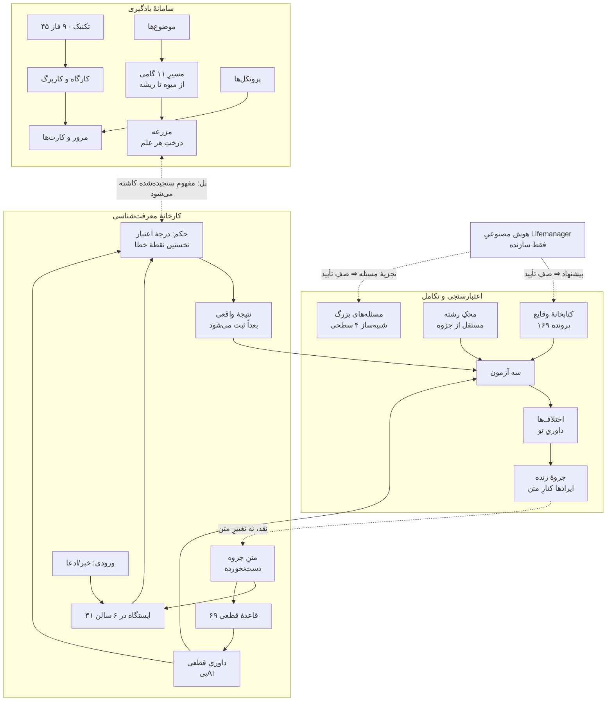
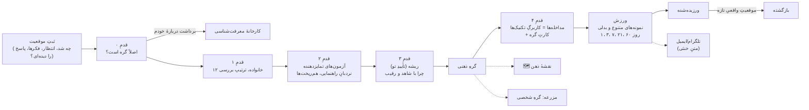
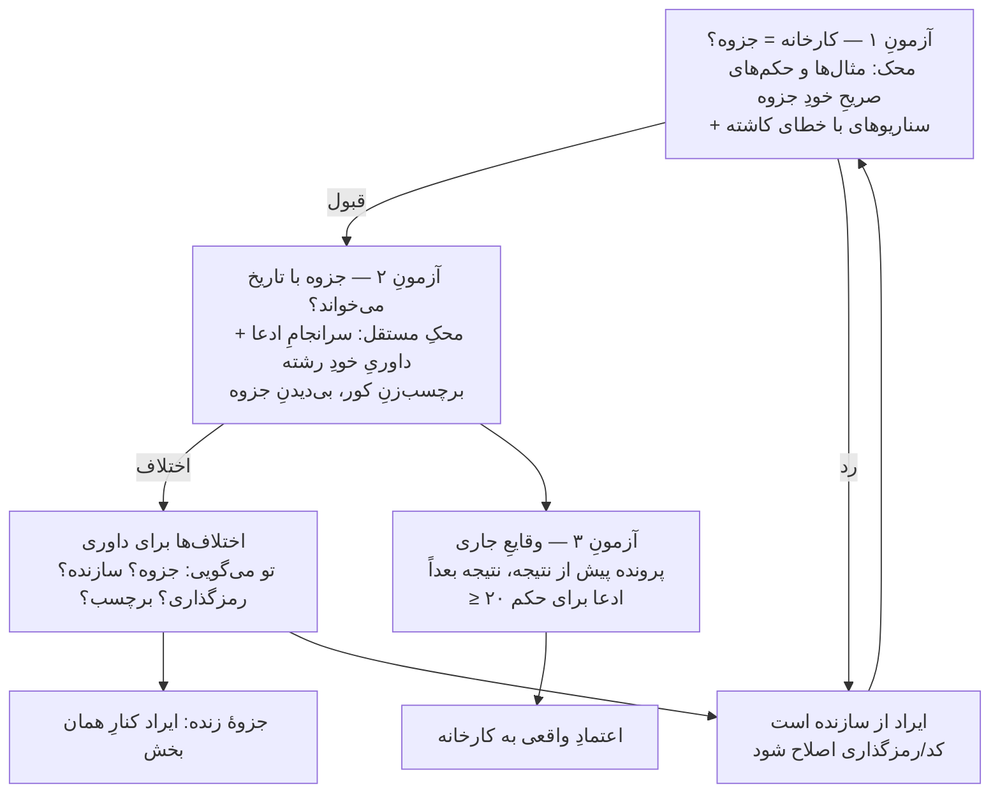
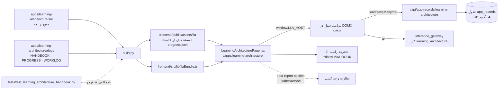
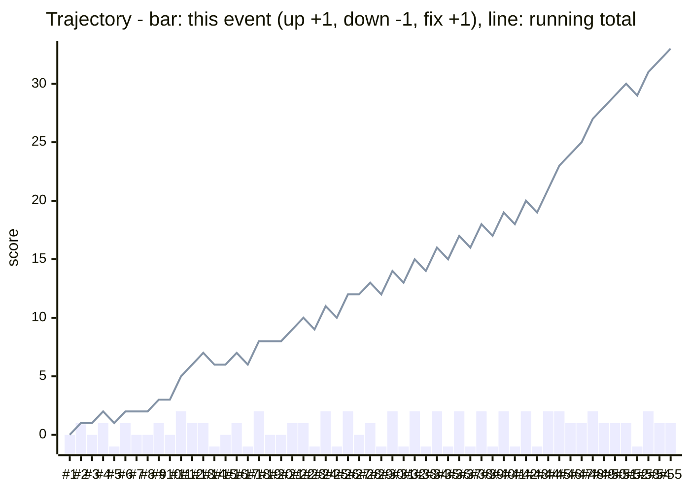
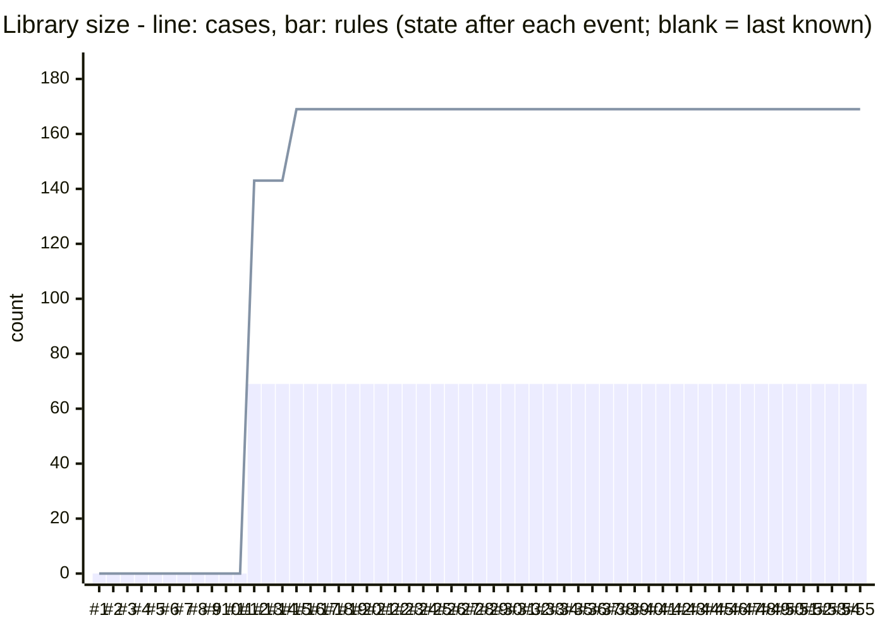

# 📘 دفترچهٔ راهنمای «معماری یادگیری عمیق و کارخانهٔ معرفت‌شناسی»

به‌روزرسانی: 2026-10-13 · با هر تغییر در این صفحه به‌روز می‌شود · همین متن هم در GitHub
(`apps/learning-architecture/docs/HANDBOOK.md`) و هم داخلِ خودِ صفحه (دکمهٔ «📘 دفترچهٔ راهنما») دیده می‌شود.

> **قاعدهٔ نگه‌داری (برای Claude، هر هوش مصنوعیِ دیگر، ناظرِ خودکار و انسان):** پس از هر کار روی این صفحه
> (۱) یک بخش به انتهای [دفترِ کار](WORKLOG.md) با امضا، (۲) اگر صفحه جلو یا عقب رفت یک سطر در [دفترِ پیشرفت](PROGRESS.md)،
> (۳) بخشِ مربوطِ همین دفترچه به‌روز، (۴) `python apps/learning-architecture/build.py`. فهرست و نمودارِ روند **ساخته می‌شوند**؛
> دستی ویرایششان نکن. هیچ سطرِ قدیمی پاک نمی‌شود؛ اصلاح = سطرِ تازه با ↩. روالِ کامل: [§۱۳](#۱۳--روالِ-کار-برای-هر-نشست-ایجنت-و-برگهٔ-نظارت-و-سرکشی).

## فهرست

<!-- TOC:BEGIN (generated by apps/learning-architecture/build.py from the ## headings) -->
- [۰ — واژه‌نامه](#۰--واژهنامه)
- [۱ — این صفحه چیست و چرا ساخته شد](#۱--این-صفحه-چیست-و-چرا-ساخته-شد)
- [۲ — از کجا شروع کنم؛ راهنمای استفادهٔ عملی](#۲--از-کجا-شروع-کنم-راهنمای-استفادهٔ-عملی)
- [۳ — نقشهٔ اجزا و ارتباطشان](#۳--نقشهٔ-اجزا-و-ارتباطشان)
- [۴ — سامانهٔ یادگیری](#۴--سامانهٔ-یادگیری)
- [۵ — کارخانهٔ معرفت‌شناسی](#۵--کارخانهٔ-معرفتشناسی)
- [۶ — اعتبارسنجی؛ سه آزمون](#۶--اعتبارسنجی-سه-آزمون)
- [۷ — شبیه‌سازِ مسئله‌های بزرگ](#۷--شبیهسازِ-مسئلههای-بزرگ)
- [۸ — استفادهٔ علمی؛ چطور با این صفحه پژوهش کنیم](#۸--استفادهٔ-علمی-چطور-با-این-صفحه-پژوهش-کنیم)
- [۹ — جای این صفحه در Lifemanager؛ معماریِ فنی](#۹--جای-این-صفحه-در-lifemanager-معماریِ-فنی)
- [۱۰ — تصمیم‌های کلیدی](#۱۰--تصمیمهای-کلیدی)
- [۱۱ — نمودارِ روند؛ کجاییم، کجا جلو رفتیم، کجا عقب](#۱۱--نمودارِ-روند-کجاییم-کجا-جلو-رفتیم-کجا-عقب)
- [۱۲ — کارهای باز و گامِ بعد](#۱۲--کارهای-باز-و-گامِ-بعد)
- [۱۳ — روالِ کار برای هر نشست، ایجنت و برگهٔ نظارت و سرکشی](#۱۳--روالِ-کار-برای-هر-نشست-ایجنت-و-برگهٔ-نظارت-و-سرکشی)
<!-- TOC:END -->

## ۰ — واژه‌نامه

هر اصطلاح فقط یک‌بار و فقط این‌جا تعریف می‌شود. ستونِ سوم می‌گوید **چرا** وجود دارد.

| اصطلاح | یعنی چه | فلسفه/هدف |
|---|---|---|
| **دورهٔ گام‌به‌گام** | مسیرِ خطیِ ۵۶ درس (۴۵ تکنیک + ۱۱ پروتکل) در ۸ منزل (ترتیبِ برنامهٔ ۸ هفته‌ای)، روی یک «موضوعِ دوره» ِ واقعی؛ نقشه‌اش می‌گوید کجایی | «اقیانوس» را به یک رودخانه با جهت تبدیل می‌کند: هر بار فقط یک قدمِ روشن |
| **درس** | یک تکنیک با پنج قدمِ ثابت: ۰ گرم‌کردن، ۱ ببین و بفهم، ۲ امتحان کن، ۳ انجام بده، ۴ بسنج و ببند | الگوی ثابت یعنی هرگز نمی‌پرسی «حالا چه کنم؟» |
| **ردِ پا / ↩ برگرد** | فهرستِ جاهایی که از آن‌ها آمدی؛ دکمهٔ «برگرد» دقیقاً به همان صفحه و همان اسکرول می‌برد؛ منوی کناری آن را پاک می‌کند | گم‌نشدن: همیشه می‌دانی کجایی و از کجا آمدی |
| **سامانهٔ یادگیری** | نیمهٔ اولِ صفحه: ۴۵ تکنیکِ یادگیری، ۹ فاز، موضوع‌ها، مزرعه، پروتکل‌ها، مرور | چیزی را **عمیق بفهمی** و فراموش نکنی، نه فقط بخوانی |
| **کارخانهٔ معرفت‌شناسی** | نیمهٔ دوم: هر ادعا/خبر/برداشت از ایستگاه‌هایی برگرفته از جزوهٔ مصباح می‌گذرد | بفهمی یک ادعا **چقدر معتبر است** و خطا دقیقاً کجاست |
| **جزوه** | جزوهٔ «معرفت‌شناسی» ِ مجتبی مصباح؛ متنِ کامل و دست‌نخورده در «متن جزوه» | مرجعِ همهٔ ملاک‌های کارخانه؛ کارخانه حق ندارد چیزی به آن ببندد |
| **تصدیق** | جمله‌ای که چیزی را ادعا می‌کند و می‌تواند درست یا نادرست باشد | واحدِ سنجش؛ «دلار» تصدیق نیست، «دلار فردا بالا می‌رود» هست |
| **پرونده** | یک ورودی (خبر، برداشت، استدلال) که از ایستگاه‌ها رد می‌شود و حکم می‌گیرد | هر سنجش ردپا دارد و بعداً با نتیجهٔ واقعی مقایسه می‌شود |
| **ایستگاه / سالن** | یک گامِ سنجش برگرفته از یک بحثِ جزوه / گروهی از ایستگاه‌ها (۳۱ ایستگاه در ۶ سالن) | ترتیبِ ایستگاه‌ها همان ترتیبی است که خطا رخ می‌دهد: اول تفکیک، بعد راه، بعد داوری |
| **راهِ معرفت** | منبعِ یک تصدیق: حس، عقل، نقل، تخصصِ دیگران، استقراء، تجربه، یادآوری، شهود | هر راه شرطِ اعتبار و منشأ خطای خودش را دارد |
| **قاعده** | یک ملاکِ جزوه که به کد درآمده (۶۹ قاعده): «سقف» یا «پرچم» | داوریِ تکرارپذیر و بی‌هوش‌مصنوعی |
| **سقف** | قاعده‌ای که می‌گوید اطمینانِ مجاز به این ادعا حداکثر چقدر است (مثلاً استقراءِ ناقص ⇒ ۸۰) | اطمینانِ بیش از سقف = «اطمینانِ بی‌پشتوانه» |
| **پرچم** | قاعده‌ای که یک خطای روش را علامت می‌زند (مثلاً راوی نامعتبر) | جای دقیقِ خطا را نشان می‌دهد، نه فقط بد بودنِ نتیجه را |
| **داوریِ قطعی** | اجرای همهٔ قاعده‌ها روی پرونده (موتورِ `epi_engine.js`) | همان حکمی که جزوه می‌دهد، بی‌سلیقه و بی‌AI |
| **رمزگذاری** | ثبتِ ویژگی‌های هر ادعا (از چه راهی، با چه اطمینانی…) تا قاعده‌ها اجرا شوند | قاعده روی ویژگی کار می‌کند، نه روی متن |
| **رمزگذاریِ کور** | همان پرونده‌ها را کسی رمزگذاری کرده که حکم و برچسب را ندیده | می‌سنجد عددها از «دانستنِ جواب» باد نکرده باشند |
| **محکِ رشته** | داوریِ خودِ آن رشته (پزشکی، مهندسی، مالی…) دربارهٔ درستیِ روشِ کنشگر، مستقل از جزوه | بدونِ آن، سنجیدنِ جزوه با جزوه دورِ باطل است |
| **سه آزمون** | ۱: کارخانه = جزوه؟ ۲: جزوه با تاریخ می‌خواند؟ ۳: در وقایعِ جاری درست درمی‌آید؟ | به ترتیب: اول ابزار، بعد استاد، بعد خودِ واقعیت |
| **اختلاف** | جایی که کارخانه با محک نخواند | پرسشی که **تو** داوری می‌کنی: ایراد از جزوه است یا از سازنده؟ |
| **جزوهٔ زنده** | فهرستِ ۶۹ قاعده با نتیجهٔ هر کدام در آزمون‌ها و ایرادهای ثبت‌شده | نقدِ جزوه کنارِ متن می‌ماند؛ متن دست نمی‌خورد |
| **دفترِ پیش‌نگر** | پرونده‌هایی که **پیش از** معلوم‌شدنِ نتیجه ثبت شده‌اند | تنها محکی که دانستنِ سرانجام در آن دخالت ندارد |
| **مزرعه** | درختِ هر علم؛ هر مفهومِ فهمیده‌شده از میوه تا ریشه در آن کاشته می‌شود | فهم‌ها پراکنده و گم نشوند |
| **پروتکل** | روال‌های زمان‌دار (پس از هر جلسه، روزانه، هفتگی، ماهانه) | یادگیری عادت شود، نه رویداد |
| **صفِ تأیید** | پرونده/مسئله‌ای که هوش مصنوعی پیشنهاد داده تا تو تأیید نکنی وارد نمی‌شود | AI فقط سازنده است؛ برچسبِ غلطش داوری را آلوده نکند |
| **نمونهٔ آمادهٔ سازنده** | هر مسئله، شبیه‌ساز یا سازندهٔ تمرینی که سازنده از پیش نوشته (۱۳ مسئلهٔ بزرگ، ۶ شبیه‌سازِ نمایشیِ گره، ۶ سازندهٔ کد)؛ پیش‌فرض پنهان، با «تنظیمات › نمونه‌های آمادهٔ سازنده» | مسئله‌ها را مالک می‌دهد؛ سیستم نباید فرض کند مسئله‌های او چیست (WORKLOG (21)) |
| **وارسیِ پاسخ‌ها / سه حلِ مستقل** | هر پاسخی که هوش مصنوعی می‌سازد (گزینهٔ درستِ گام‌ها و تمرین‌ها، مسئله‌های هم‌ساختار، نمونه‌های ورزشِ گره) سه بار جداگانه و بی دیدنِ پاسخ حل می‌شود؛ ناهمخوانی ⇒ پرچم یا «وارسی‌نشده» | با جوابِ غلط تمرین نکنی |
| **دفترِ کار / دفترِ پیشرفت** | [WORKLOG.md](WORKLOG.md) / [PROGRESS.md](PROGRESS.md) | هر تغییر ردپا دارد؛ هر نقطهٔ نمودار سند دارد |

## ۱ — این صفحه چیست و چرا ساخته شد

**یک جمله:** این صفحه دو ابزار است با یک حافظهٔ مشترک — یکی برای **عمیق فهمیدن** (سامانهٔ یادگیری) و یکی برای **سنجیدنِ اعتبارِ
هر ادعا** (کارخانهٔ معرفت‌شناسی) — و یک آزمایشگاه که خودِ کارخانه و جزوه را با واقعیت محک می‌زند.

**چرا دو ابزار در یک جا؟** فهمیدن و سنجیدن «عموم و خصوصِ من وجه»اند: هر فهمی سنجش لازم دارد (آیا درست فهمیدم؟) و هر سنجشی
فهم (اصلاً ادعا چه می‌گوید؟)، ولی هیچ‌کدام زیرمجموعهٔ دیگری نیست. پس دو کارخانه در یک شهرکِ صنعتی ساخته شد: حافظه، مزرعه و
ابزارها مشترک‌اند؛ منو و منطقِ هر کدام جدا (WORKLOG (5)).

**سه اصلِ ثابت** (هر تغییری که یکی از این‌ها را بشکند، اشتباه است):
1. **متنِ جزوه مقدس است، نه مصون.** کارخانه حق ندارد چیزی به جزوه ببندد یا حکمش را بی‌صدا ضعیف کند؛ ولی هر جا جزوه با
   واقعیت نخواند، ایراد ثبت و کنارِ متن نگه داشته می‌شود («جزوهٔ زنده»).
2. **هوش مصنوعی فقط سازنده است.** پیشنهادِ پرونده و تجزیهٔ مسئله؛ در داوری هیچ نقشی ندارد (خواستهٔ صریحِ مالک، WORKLOG (7)).
3. **هر عدد، محکِ مستقل.** برچسبی که از خودِ جزوه آمده نمی‌تواند جزوه را تأیید کند (درسِ تلخِ WORKLOG (8)).

## ۲ — از کجا شروع کنم؛ راهنمای استفادهٔ عملی

**اگر گم شدی: «🧭 نقشهٔ کل»** (بالای منو؛ اولین ورود هم همین‌جا باز می‌شود). سه چیزی که مالک داد — **ایده‌ها و دغدغه‌ها**،
**جزوهٔ معرفت‌شناسیِ مصباح**، **آموزش‌های یادگیری** — این‌جا سه «کار» شده‌اند و هر روز فقط یکی را لازم داری:

| کار | کی؟ | صفحه‌ها | حاصل |
|---|---|---|---|
| 🌱 فهمیدنِ عمیق | چیزی را واقعاً بفهمی و یادت بماند | موضوع‌ها ⇒ سفرِ ۱۱ گامی ⇒ تکنیک‌ها ⇒ مزرعه ⇒ مرور / امروز | کاربرگ، کارتِ مرور، نهال در مزرعه |
| ⚖️ سنجیدنِ ادعا و تصمیم | بدانی خبر/ادعا/تصمیمی چقدر معتبر است | میزِ کار ⇒ پرونده (ایستگاه‌ها) ⇒ حکم و تاریخِ بازبینی ⇒ ثبتِ نتیجه از «امروز» | حکم، نخستین نقطهٔ خطا، راهِ درست |
| 🪢 گره‌گشایی و حلِ مسئله | جایی گیر کرده‌ای | گره‌گشا ⇒ موقعیت (نردبان تا ریشه) ⇒ گرهِ ذهنی ⇒ ورزش ⇒ نقشهٔ ذهن؛ مسئله‌های بزرگ ⇒ حرکت‌ها | ریشه، گره، ورزشِ فاصله‌دار |

بقیه **کارگاهِ سازنده و مرجع**‌اند (اعتبارسنجی/بک‌تست، کتابخانه، اختلاف‌ها، جزوهٔ زنده، متنِ جزوه، دغدغه‌ها، اطلس، مبانی) — برای
ساختن و آزمودنِ خودِ سامانه؛ کارِ روزانه نیستند. بالای **هر** صفحه نوارِ «این‌جا» می‌گوید این صفحه کدام کار است، به چه کار می‌آید و
قدمِ بعد چیست (جمع‌کردنی). هر کار یک «مسیرِ کاری»ِ قدم‌به‌قدم دارد («قدم‌به‌قدم شروع کن» در نقشهٔ کل) که از صفحه‌های واقعی
می‌گذرد و جای تو را نگه می‌دارد. واژه‌نامهٔ «یک نام برای هر معنا» هم در نقشهٔ کل است (گرهِ ذهنی ≠ گرهِ درخت؛ چهار «نقشه»…).

**اگر نمی‌دانی از کجا شروع کنی: «🧭 دورهٔ گام‌به‌گام»** (اولین مورد در منو و اولین «در» در صفحهٔ شروع). یک موضوعِ واقعی انتخاب می‌کنی و
دوره ۵۶ درس (۴۵ تکنیک + ۱۱ پروتکل) را یکی‌یکی جلو می‌برد. زمانِ هر درس از حجمِ خودش برآورد و بالای درس نوشته می‌شود (حدودِ ۱۵ تا ۸۰ دقیقه؛ هر درس را
می‌شود در چند نشست تمام کرد — جای تو نگه داشته می‌شود). هر درس همیشه همان پنج قدم را دارد:

| قدم | چه می‌کنی | چرا |
|---|---|---|
| ۰ گرم‌کردن | ۱–۲ پرسشِ **کاربردی** از درس‌های قبل («کجا به کارش می‌بری؟»، «چرا کار می‌کند؟»، «اشتباهِ رایجش چیست؟» — نه «تعریفش چیست»)، از حافظه؛ پاسخت با تاریخ ذخیره می‌شود، بعد پاسخِ مرجع را می‌بینی و می‌گویی چقدر یادت بود. دکمهٔ «ادامه» اول همین را می‌آورد؛ ردکردن فقط با دکمهٔ صریحِ «فعلاً رد کن» | خودِ دوره بازیابیِ فعال (۴۱) و فاصلهٔ فزاینده (۴۲) را روی تو اجرا می‌کند؛ فاصله‌ها ۱، ۳، ۷، ۲۱، ۶۰ روز |
| ۱ ببین و بفهم | تعریف در یک جمله، تصویر (برای بعضی تکنیک‌ها ویژه)، جای تکنیک در چرخهٔ ۹ فازی، گام‌ها به‌شکلِ مسیر | فهمِ پیش از اجرا |
| ۲ امتحان کن | شبیه‌ساز (برای ۱۴ تکنیک: ۳۷، ۳۲، ۴۱، ۴۲، ۴۰، ۱۲، ۳۶، ۲۸، ۴۵، ۲، ۴، ۱، ۳، ۵) + «ترتیب را بساز» + «درست یا اشتباهِ رایج؟» که از گام‌ها و اشتباه‌های خودِ تکنیک ساخته می‌شوند | تمرینِ تعاملی به‌جای خواندن |
| ۳ انجام بده | کاربرگِ همان تکنیک روی موضوعِ دوره؛ بی‌پرکردنِ فیلدهای لازم جلو نمی‌روی | اجرای واقعی |
| ۴ بسنج و ببند | روبریک، نوشتن از حافظه (ذخیره می‌شود) و یک کارتِ مرورِ کاربردی، «از فردا» | تثبیت و ادامه |

«🗺️ نقشهٔ دوره» همیشه نشان می‌دهد در کدام منزل و کدام درسی (📍)، چند درس تمام شده و قدمِ بعدی چیست. ارجاع به تکنیکِ دیگر در دوره
در یک کشوی کوچک باز می‌شود؛ تو از درس بیرون پرت نمی‌شوی. تکنیکی که **بیرون از دوره** (در صفحهٔ خودِ تکنیک) کامل کرده‌ای، در دوره
«انجام‌شده» حساب می‌شود و مجبور به تکرارش نیستی (مرورش آزاد است). اگر موضوعِ دوره را جای دیگری پاک کنی، دوره پیشرفتت را نگه می‌دارد و
فقط می‌خواهد موضوعِ تازه‌ای انتخاب کنی. فقط **دیدنِ** یک قدم چیزی ذخیره نمی‌کند؛ ذخیره با اولین نوشتهٔ تو شروع می‌شود.

**کارخانهٔ معرفت‌شناسی هم دوره دارد:** «🧭 دورهٔ گام‌به‌گام» بالای منوی کارخانه (و درِ اصلیِ کارخانه در صفحهٔ شروع):
یک درسِ مقدمه (مفاهیمِ پایه از خودِ داده‌های جزوه) و ۳۰ ایستگاه به ترتیبِ مسیرِ کارخانه، «حکمِ نهایی» آخر — ۳۲ درس در ۸ منزل، با همان
پنج قدم. در شروع یک ادعا/خبر/باورِ واقعیِ خودت را می‌نویسی و هر درس همان ایستگاهِ **همان پرونده** را پر می‌کند؛ تمرین‌ها با کلیدِ پاسخِ
خودِ کارخانه بازخورد می‌دهند؛ سه تصویرِ آموزشی (سقفِ اعتبار و «ضعیف‌ترین حلقه»، «راهِ معرفت ⇐ کدام ایستگاه»، «ساختِ مسیرِ پرونده») همان
موتورِ داوریِ واقعی را صدا می‌زنند و هیچ قاعده‌ای را عوض نمی‌کنند.

**دورهٔ سامانهٔ یادگیری** حالا ۵۶ درس است: ۴۵ تکنیک + ۱۱ درسِ پروتکل (آخرِ هر منزل، برای پروتکل‌های همان هفته؛ همان پنج قدم،
اجرای واقعیِ پروتکل روی موضوعِ دوره و زمان‌بندیِ دفعهٔ بعد). ۱۴ تکنیک شبیه‌سازِ ویژه دارند.

**سفرِ گام‌به‌گام روی یک موضوع:** در صفحهٔ هر موضوع دکمهٔ «🧭 سفرِ گام‌به‌گام روی این موضوع» مسیرِ ۱۱ گامی را یکی‌یکی می‌برد
(📍 کجایی، یک کارِ مشخص، کاربرگِ همان گام، بی‌کاملِ فیلدهای لازم جلو نمی‌روی، از همان‌جا ادامه). صفحهٔ کاملِ موضوع دست‌نخورده می‌ماند.

**📎 پیوست‌ها:** پایینِ صفحهٔ هر پرونده، هر موضوع، هر موقعیتِ گره‌گشا و هر **مسئلهٔ خودت** (مسئله‌های بزرگ)؛ و در فرمِ «افزودنِ مسئلهٔ تو» پیش از تجزیه — عکس/PDF ِ صورت یا حل را پیوست کن تا هوش مصنوعی از خودِ تصویر بخواند (تا ۴ فایل، هر کدام ≤ ۸ مگابایت، با تیکِ «فرستاده شود»؛ تایپِ صورت و پاسخ آن‌گاه لازم نیست). فایل مستقیم به فولدرِ همان مورد در درایو می‌رود (حداکثر ۲۵ مگابایت) و سرور فقط پیوندش را نگه می‌دارد. **عمداً بی‌پیوست:** گره (الگوی انتزاعی؛ شواهدش در موقعیت‌هاست)، درس‌های دوره (محتوای سامانه؛ کارِ تو در «موضوع» است)، حرکت‌ها، ورزش‌ها و مسئله‌های هم‌ساختار (ساختهٔ سامانه)، و نمونه‌های آمادهٔ سازنده (WORKLOG (29)).

**گم‌نشدن در بقیهٔ صفحه:** بالای هر صفحه نوارِ «📍» می‌گوید کجایی (سامانه › گروه › صفحه). اگر از جای دیگری با پیوند آمده باشی،
دکمهٔ «↩ برگرد به …» (و یک دکمهٔ شناور پایینِ صفحه) دقیقاً به همان صفحه و همان نقطهٔ اسکرول برت می‌گرداند و می‌گوید از کدام بخش آمدی.
زدنِ منوی کناری یعنی «شروعِ تازه». داخلِ Lifemanager «↩ برگرد» و دکمهٔ Back ِ مرورگر یک کار می‌کنند (هر قدمِ ردِ پا یک خانهٔ
تاریخچه است؛ عوض‌کردنِ زبانه‌های داخلِ یک صفحه تاریخچه را پر نمی‌کند).

صفحهٔ «**از اینجا شروع کن**» (همیشه بالای منو) چند «در» دارد — اولی همین دوره است؛ بقیه (جدولِ زیر، به‌اضافهٔ درهای کارخانه، گره‌گشا و حلِ مسئله) برای وقتی است که راه را بلدی:

| می‌خواهم… | برو به | چه می‌کنی | چه می‌گیری |
|---|---|---|---|
| یک موضوع را عمیق بفهمم | سامانهٔ یادگیری › **موضوع‌ها** | عنوان را بنویس؛ مسیرِ ۱۱ گامی را گام‌به‌گام جلو برو | فهمی که در «مزرعه» کاشته شده و کارت‌های مرور |
| روش‌های یادگیری را تمرین کنم | **نقشه و گراف** › برنامهٔ ۸ هفته‌ای | هر هفته چند تکنیک؛ هر تکنیک: چرا، چطور، کارگاه، ارتباطات | عادتِ یادگیریِ عمیق |
| هر روز بدانم چه کنم | **امروز** و **مرور** | کارهای سررسیده و کارت‌های امروز | پیوستگی |
| اعتبارِ یک خبر/ادعا/برداشت را بسنجم | کارخانه › **میز کار** | ورودی را همان‌طور که هست بنویس، «مسیر سریع»، ایستگاه‌ها را پر کن | درجهٔ اعتبار، نخستین نقطهٔ خطا، تصمیم و تاریخِ بازبینی |
| خودِ جزوه را یاد بگیرم | **ایستگاه‌ها**، **مفاهیم**، **متن جزوه** | هر ایستگاه: چرایی، روش، متنِ جزوه، مثال، تمرین با پاسخ‌نامه | تسلط بر ملاک‌ها |
| حل‌کنندهٔ یک مسئلهٔ سختِ حل‌شده و مشابه‌هایش بشوم | **مسئله‌های بزرگ** ⇒ «افزودنِ مسئلهٔ تو» | صورت و پاسخِ نهایی را بنویس؛ پس از وارسی و تأیید، از سخت به آسان تمرین کن و «مسئله‌های هم‌ساختار» بساز | شمِ حلِ همان مسئله و انتقال به مشابه‌ها |

**یک روالِ عملیِ پیشنهادی** (پیشنهاد است، نه قاعده):
- **هر روز (۱۰–۲۰ دقیقه):** «امروز» ⇒ کارت‌های «مرور» ⇒ اگر خبری ذهنت را مشغول کرد، یک پرونده در «میز کار» با «مسیر سریع».
- **هر هفته:** یک جلسهٔ «برگهٔ سفید» برای موضوعِ هفته (پروتکل‌ها) + سرزدن به «اعتبارسنجی» ⇒ زبانهٔ «اختلاف‌ها برای داوری».
- **وقتی نتیجهٔ یک پرونده معلوم شد:** همان پرونده ⇒ ایستگاهِ «حکم نهایی» ⇒ «نتیجه واقعی» را ثبت کن («میز کار» پرونده‌های سررسیده را یادآوری می‌کند). این همان چیزی است که آزمونِ ۳ را تغذیه می‌کند.

## ۳ — نقشهٔ اجزا و ارتباطشان

**چه چیزی به چه چیزی وصل است، به زبانِ ساده:**
- **جزوه ⇒ ایستگاه‌ها و قاعده‌ها:** هر ایستگاه یک بحثِ جزوه است و زیرِ هر ایستگاه متنِ خودِ جزوه آمده. هر قاعده به بندِ جزوه‌اش ارجاع دارد.
- **پرونده ⇒ داوریِ قطعی ⇒ حکم:** کاربرگِ ایستگاه‌ها را تو پر می‌کنی؛ موتور سقف‌ها و پرچم‌ها را حساب می‌کند و می‌گوید اطمینانت بیش از
  مجاز است یا نه و خطا اولین بار کجا رخ داده.
- **حکم ⇒ نتیجه ⇒ آزمونِ ۳:** هر پرونده‌ای که نتیجه‌اش بعداً ثبت شود، محکِ واقعیِ کارخانه است.
- **کتابخانه + محکِ رشته ⇒ آزمون‌های ۱ و ۲ ⇒ اختلاف‌ها ⇒ جزوهٔ زنده:** این همان چرخهٔ «کارخانه را معتبر کن، جزوه را نقد کن» است (§۶).
- **حکم ⇄ مزرعه:** مفهومی که در کارخانه سنجیدی، می‌تواند در درختِ علمِ خودش در مزرعه کاشته شود.

## ۴ — سامانهٔ یادگیری

| بخش در منو | چیست | منبع در کد |
|---|---|---|
| 🧭 دورهٔ گام‌به‌گام | نقشهٔ سفر (۸ منزل، ۵۶ درس: ۴۵ تکنیک + ۱۱ پروتکل) و درس‌های پنج‌قدمی؛ شبیه‌سازها و تمرین‌های تعاملی | `src/app/a11_course.js`، `a14_sims.js` |
| 🪢 گره‌گشا | جایی گیر کردم / کاری کردم که نمی‌فهمم چرا ⇒ گرهِ ذهنی را پیدا کن، باز کن، ورزیده شو؛ نقشهٔ ذهن (بخشِ پایین) | `src/app/a16_knots.js`، `a17_kpractice.js`، `a18_kmap.js`، طرح: `docs/specs/KNOTS.md` |
| امروز | کارتِ «ادامهٔ دوره»، کارهای موعدار، پیشرفت | `src/app/a3_views.js` |
| نقشه و گراف | ۹ فاز (پیش‌تنظیمِ ذهنی ⇒ … ⇒ تثبیت و بازیابیِ فعال)، گرافِ روابطِ تکنیک‌ها، برنامهٔ ۸ هفته‌ای | `src/app/core*.js`، `a3_views.js` |
| ۴۵ تکنیک | هر تکنیک: چرا کار می‌کند، دقیقاً چطور، کارگاهِ تمرین، ارتباطات، متنِ عینیِ منبع و «اصلاحیه» | `src/tech/t_*.js`، `src_*.js` |
| موضوع‌ها | مسیرِ ۱۱ گامی برای یک موضوع: گرفتنِ میوه ⇒ … ⇒ جاری کردن در زندگی | `src/app/core2.js`، `a5_farm.js` |
| مزرعه | درختِ هر علم (اصلی و پیوندی)، ریشه تا میوه، گره، جوانه، کمپوست، نهالستان | `src/app/a5_farm.js` |
| پروتکل‌ها | ۱۱ روال (از «قانونِ ۵ خطِ دلتا» تا «ممیزیِ دوحلقه‌ایِ ماهانه» و «بیانِ دیگر») و صفِ منابع | `src/app/core*.js` |
| نوارِ «📍» و «↩ برگرد» (همهٔ صفحه‌ها) | جای تو، ردِ پا، برگشت به همان نقطه | `src/app/a10_nav.js` |
| مرور | مرورِ فاصله‌دار و سنجشِ اطمینان (آیا به اندازه‌ای که مطمئنی، درست می‌گویی؟) | `src/app/a4_views2.js` |
| دغدغه‌ها، اطلس، مبانی و اصلاحیه‌ها | ۲۴ دغدغهٔ مالک و راهِ حلِ هر کدام؛ الگوهای مشترکِ علوم؛ پشتوانهٔ علمی و اصلاحیه‌های اسناد | `src/app/core*.js` |

### گره‌گشا — کشف، بازکردن و ورزیدگیِ گره‌های ذهنی، رفتاری و روانی

**چرا (مالک، ۲۰۲۶-۱۰-۱۲):** «اگر در یک آزمونِ هوش یا مسئله گیر کردم، یا کاری کردم که نمی‌فهمم چرا (کفِ دست/ناخن)، یا نتیجه‌ای اجتماعی گرفتم
(از فلانی بیشتر می‌فهمم ولی مدیرها حرفِ او را قبول دارند)، با در نظر گرفتنِ **همهٔ سناریوها** ریشهٔ گره را پیدا کنم، بازش کنم، و با نمونه‌های
متنوع و انتزاعی ورزیده شوم — نه حفظِ راه‌حل.» طرحِ کامل و منابع: [`docs/specs/KNOTS.md`](specs/KNOTS.md) (بازبینی‌شده توسطِ یک بازبینِ مستقل، پیش از ساخت).

- **۱۲ خانواده** (همه همیشه دیده می‌شوند): دانش و مفهوم · بازنماییِ مسئله · راهبرد و گیرکردن · پایش و فراشناخت · ظرفیت و حالتِ ذهنی ·
  عادت و خودکاری · هیجان و انگیزه · اجتماعی و ارتباطی · باور دربارهٔ خود · موقعیت و ساختار (بیرون از ذهن) · برداشت و نتیجه‌گیری · تصمیم و خودتنظیمی.
  رتبه از قواعدِ ثابت روی ورودی و شاهدها (مقایسهٔ عملکرد ±۳، واقعیت ±۱، پیش‌بینیِ خلافِ واقع ±۰٫۵) — «ترتیبِ بررسی، نه احتمال».
- **ریشه را تو تأیید می‌کنی؛** هوش مصنوعی فقط پیشنهاد می‌دهد (فرضیهٔ فرعی، پله‌های نردبان، هم‌ریخت، نمونهٔ ورزش)، هر بار پس از اعلامِ
  «این متن به ارائه‌دهندهٔ بیرونی می‌رود» با پیش‌نمایش و حذفِ نام‌ها؛ هیچ فرضیه‌ای دربارهٔ حالِ درونیِ شخصِ سوم پذیرفته نمی‌شود.
- **ورزش — از مسئلهٔ خودت (۲۰۲۶-۱۰-۱۳):** هوش مصنوعی نمونه‌های تازه را از روی **موقعیت‌های خودت** که به گره پیوند خورده‌اند می‌سازد (صورت، پاسخِ درست، کجا گیر کردی، فکرهایت؛
  برای گره‌های هیجانی/باورِ خود فقط صورت و پاسخ) — همان ساختار و تله، ظاهرِ تازه؛ نمونه‌ای که تقریباً خودِ مسئلهٔ اصلی است کنار می‌رود. هر نمونه فقط با **سه حلِ مستقلِ هم‌نظر** و
  بی‌نشتِ پاسخ پذیرفته می‌شود؛ یا خودت نمونه می‌سازی. شش سازندهٔ برنامه‌وار (کوزه‌های آب، ۲-۴-۶، واسون، نرخِ پایه، حافظهٔ کاری، قیدِ پنهان) مسئله‌های
  کتابی‌اند، نه مسئلهٔ تو ⇒ «نمونهٔ آمادهٔ سازنده»، پیش‌فرض پنهان (تنظیمات).
- **🧪 شبیه‌سازِ همین مسئله:** در موقعیتِ «مسئله» (پس از دیدنِ پاسخ یا پایانِ نردبان) راهِ حلِ مسئلهٔ خودت به گام‌های تصمیم با گزینه شکسته می‌شود (گزینه‌های غلط =
  اشتباه‌های رایج، به‌ویژه همان‌جا که گیر کردی)، سه حل‌کنندهٔ مستقل گزینه‌ها را وارسی می‌کنند و پس از تأییدت در «مسئله‌های بزرگ» با همان شبیه‌سازِ چهارسطحی و «مسئله‌های هم‌ساختار» تمرین می‌شود.
- **شش شبیه‌سازِ نمایشی** (کوزه‌های آب، ۲-۴-۶، نفرینِ دانش، حافظهٔ کاری، وضعیتِ پایانی، نردبان) نمایشِ پدیده‌های کتاب‌اند، نه مسئلهٔ تو ⇒ از منو بیرون و پیش‌فرض پنهان (WORKLOG (21)). «ورزیده‌شده» = دست‌کم ۳ درستِ پیاپی روی ۳ شکل در ۲
  نوبت با فاصلهٔ ≥۳ روز + ۲ بدلیِ درست با اطمینانِ ≥۷۰٪؛ گره‌های اجتماعی/رفتاری فقط با **۳ آزمایشِ واقعیِ کامل در ≥۲ هفته**.
- **صداقت:** هیچ‌جا نمی‌گوید «این گره دیگر برنمی‌گردد» یا «ضریبِ هوشت بالا می‌رود»؛ تمرینِ سؤال‌های شبیهِ هوش آشنایی با همان نوع را بالا می‌برد.
- **ایمنی:** بررسیِ کلیدواژه‌های آسیب به خود پیش از ثبت و پیش از هر درخواستِ هوش مصنوعی (با شماره‌های کمک)؛ بی‌تشخیصِ بالینی؛ ارجاع به متخصص با سه موقعیتِ پیاپیِ شدید.
- **درایو:** برای هر موقعیت و هر گره یک فولدر و شیت **به‌طورِ پیش‌فرض** (خاموش‌کردنی)؛ عکسِ سؤال در «پیوست‌ها»ی همان فولدر؛ احساس‌ها و یادداشت‌های هیجانی/باورِ خود فقط با انتخابِ جدا.
- **عکسِ سؤال:** در ثبتِ «مسئلهٔ حل‌نشده» عکس را بگذار؛ با تأییدِ تو همراهِ متن به هوش مصنوعی می‌رود (پیشنهادِ فرضیه، پله‌های راهنما، هم‌ریخت، ساختِ نمونهٔ ورزش).
- **یادآورها:** در «تنظیمات › اعلان‌ها» ردیفِ «ورزشِ گره‌گشا» دارند (روشن/خاموش، کانال‌های تلگرام و ایمیلِ همان‌جا) و یک نسخه در زنگوله؛ متنِ پیش‌فرض خنثی.
- **پیوندها (هر کدام با «چرا»):** کارخانه — سنجشِ برداشت‌های دربارهٔ خود، و ایستگاه‌های مرتبطِ هر خانواده (برداشت از یک اتفاق ⇐ «استقراء»، «تجربه»، «درجهٔ اعتبار»؛ مدیرها و همکار ⇐ «استناد به تخصصِ دیگران»، «فهمِ متن و گوینده»؛ بدخوانیِ صورت ⇐ «واقع، فهم، زبان»؛ باور دربارهٔ خود ⇐ «پیش‌زمینه‌ها»، «مسئولیتِ معرفتی»؛ مفهوم ⇐ «تصور یا تصدیق»)؛ کاربرگِ ۴۵ تکنیک و درسِ دورهٔ همان تکنیک؛ «مسئله‌های بزرگ» برای گیرکردن روی راه؛ مزرعه («گرهِ شخصی»)؛ کارت‌های مرور؛ «امروز»؛ P9؛ دغدغه‌های ۱۰ و ۷ ِ خودت.

**فلسفه:** اسنادِ اولیه چند ادعای نادرست داشتند (مثلاً «۸۰/۲۰ قانون است»). سامانه آن‌ها را **پنهان نکرد**؛ کنارِ هر تکنیک «اصلاحیه» گذاشت.
مثال‌هایی که سامانه خودش ساخته برچسبِ «تولیدی» دارند و می‌شود پنهانشان کرد (WORKLOG (2)). همین قاعده برای **مسئله‌ها**: مسئله‌ها را مالک می‌دهد؛
هر مسئله، شبیه‌ساز یا سازنده‌ای که سازنده از پیش نوشته «نمونهٔ آمادهٔ سازنده» است و پیش‌فرض پنهان (تنظیمات › نمونه‌های آمادهٔ سازنده؛ WORKLOG (21)).

## ۵ — کارخانهٔ معرفت‌شناسی

**شش سالن، به ترتیبِ وقوعِ خطا:**

| سالن | کار | چرا این‌جا |
|---|---|---|
| ۰ پذیرش | ورودی دقیق ثبت می‌شود: چه هست، از کجا آمده، چه تصمیمی به آن بسته است، خطا چقدر گران است | سنجشِ چیزِ مبهم بی‌معناست |
| ۱ تفکیک | ساحتِ واقع/فهم/زبان، تصور از تصدیق، حضوری از حصولی، کلی از جزئی، صدقِ معرفتی از اخلاقی | بیشترِ خطاها پیش از استدلال، در خلطِ مفاهیم رخ می‌دهند |
| ۲ راه‌ها | هر تصدیق بدیهی است یا نظری؛ اگر نظری، از کدام راه؛ ایستگاهِ همان راه با ملاکِ خودش می‌سنجد | هر راه منشأ خطای خودش را دارد |
| ۳ داوری | درجهٔ اعتبار تا پایه، حلِ تعارض، ممیزیِ پیش‌زمینه‌ها، وظیفهٔ تحقیق؛ «حکمِ نهایی» **همیشه آخر** | اعتبار مراتب دارد و عمل باید بر احتمالِ برتر تکیه کند |
| ۴ آزمایشگاهِ شبهه | اگر استدلال به شک‌گرایی، نسبی‌گرایی، کل‌گرایی یا هرمنوتیکِ فلسفی رسید | این شبهات اگر بی‌پاسخ بمانند کلِ سنجش را بی‌معنا می‌کنند |
| ۵ دین | قواعدِ ویژهٔ معرفتِ دینی (ساختار، منابع، تعارض، قرائت‌ها، کثرت‌گرایی) | شاخه‌ای از معرفت‌شناسیِ خاص که بر عام متوقف است |

**مسیرِ سریع و کامل:** سریع فقط ایستگاه‌ها و پرسش‌های اصلی؛ کامل همه را. مسیر بر اساسِ پاسخ‌هایت باز و بسته می‌شود
(مثلاً سالنِ دین فقط برای پروندهٔ دینی).

**پوشش:** هر ۷۲ بخشِ جزوه در جایی از کارخانه به کار رفته («پوشش و ملاحظاتِ متن» دقیقاً می‌گوید کجا)؛ ۲۳ «ملاحظهٔ متن» دربارهٔ
خودِ جزوه ثبت شده؛ بخش‌های روایی/تاریخی که ایستگاه نشده‌اند در «پرونده‌های پشتوانه» آمده‌اند.

**دیدگاهِ رقیب:** جایی که موضعِ جزوه محلِ نزاع است، دیدگاهِ رقیب با برچسب و جدا از متن آمده و قابلِ پنهان‌کردن است (WORKLOG (5)).

## ۶ — اعتبارسنجی؛ سه آزمون

این بخش همان خواستهٔ اصلیِ مالک است: «بر حسبِ وقایعِ قطعیِ خودِ جزوه، ایراداتِ کارخانه را بگیریم؛ وقتی کارخانه درست شد روی
وقایعِ گذشته بک‌تست بگیریم و وقایعِ فعلی را هم بسنجیم؛ کارخانه کم‌کم معتبر شود، جزوه نقد شود، و وقایعِ گذشته و حال داوری شوند.»

| آزمون | می‌پرسد | محک | اگر نخواند یعنی | وضعِ فعلی (2026-10-11) |
|---|---|---|---|---|
| ۱ | آیا کارخانه همان جزوه است؟ | فقط خودِ جزوه: ۵۱ مثال/حکمِ صریح + ۲۰۰ سناریوی ساختگی با خطای کاشته | سازنده بد فهمیده یا بد پیاده کرده — **نه** جزوه | **قبول:** ۱٫۰۰ روی مثال‌ها؛ ۱٫۰۰ روی خطاهای کاشته |
| ۲ | آیا جزوه با تاریخ می‌خواند؟ | **مستقل از جزوه:** آیا ادعا واقعاً درست درآمد + داوریِ خودِ رشته دربارهٔ روش (برچسب‌زنِ کور) | یا ملاکی از جزوه با واقعیت نمی‌خواند، یا رمزگذاری غلط است، یا برچسبِ رشته محلِ بحث است — داوری با تو | **قبول:** ۱۱۰ واقعه؛ توافق ۰٫۹۸ (کرانِ پایینِ ۹۵٪: ۰٫۹۱)؛ از ۷۹ ادعای پرچم‌خورده ۹۷٪ غلط درآمد، از ۸۳ ادعای بی‌پرچم ۱۴٪؛ Brier ۰٫۲۰ در برابرِ ۰٫۲۵ ِ پایه؛ ۴ اختلاف |
| ۳ | در وقایعِ جاری درست درمی‌آید؟ | نتیجهٔ واقعیِ پرونده‌های خودت که **پیش از** نتیجه ثبت شده‌اند | همان «۲» ولی بی‌آلودگیِ دانستنِ سرانجام | **هنوز دادهٔ کافی نیست** (۰ ادعای پیش‌نگرِ نتیجه‌دار؛ ≥ ۲۰ لازم) |

**چرا ترتیب مهم است:** تا آزمونِ ۱ قبول نشود، ردشدنِ آزمونِ ۲ چیزی دربارهٔ جزوه نمی‌گوید (شاید فقط کارخانه بد ساخته شده).
و آزمونِ ۲ هر قدر خوب باشد، سقفِ خوش‌بینانه است: وقایعِ کتابخانه مشهورند (و مشهورند چون روشن‌اند) و رمزگذاری‌شان با دانستنِ
سرانجام انجام شده؛ رمزگذاریِ کور این را کم می‌کند (۰٫۹۷؛ ۹۴٫۵٪ در برابرِ ۴٪ — در صفحه گرد‌شده ۹۵٪) ولی صفر نمی‌کند. **آزمونِ ۳ محکِ واقعی است.**

**هیچ وزنی خودکار تنظیم نمی‌شود.** زبانهٔ «حساسیتِ قاعده‌ها» فقط **گزارش** می‌دهد که خاموش‌کردنِ هر قاعده نتیجه را چقدر عوض
می‌کند. قاعده‌ای که با تاریخ نخواند، بی‌صدا ضعیف نمی‌شود؛ به‌عنوانِ پرسش از جزوه پیشِ تو می‌آید (WORKLOG (8)).

**سه حالتِ رمزگذاری** در زبانهٔ «سه آزمون» قابلِ انتخاب‌اند: رمزگذاریِ نخست، رمزگذاریِ کورِ مستقل، فقط‌واقعیت‌ها (بدونِ ویژگی‌های
تشخیصی). آزمونِ ۱ همیشه با رمزگذاریِ نخست اجرا می‌شود (چون محکش خودِ جزوه است).

**تکرارِ دوره‌ای (هفتگی، بی‌تنظیمِ وزن):** هر دوره دسته‌ای تازه و بی‌تکرار از سناریوهای با خطای کاشته می‌سازد (آزمونِ ۱ هر بار با دادهٔ
تازه)، سه آزمون را روی همهٔ پرونده‌های تأییدشده دوباره اجرا می‌کند و اگر آزمونِ ۱ رد شد هشدار می‌دهد. در Lifemanager اگر هفت روز از
دورهٔ قبل گذشته باشد با باز کردنِ «میز کار» اجرا می‌شود؛ دستی: زبانهٔ «تکرار دوره‌ای» ⇒ «اجرای یک دوره اکنون». گزارشِ هر دوره در
همان زبانه و «تاریخچه» می‌ماند.

**کنترل‌ها:** کنترلِ مثبت (خطاهای کاشته باید گرفته شوند) و کنترلِ منفی (برچسب‌های به‌هم‌ریخته نباید توافقِ بالا بدهند).

### ♾ بک‌تستِ پیوسته (۲۰۲۶-۱۰-۱۳) — همیشه، دوره‌ای، بی‌تکرار

مالک: «بک‌تست باید همیشه ادامه داشته باشد، مثلِ ترید کوانتومی؛ هم سامانه خودش را بسنجد و اصلاح کند، هم وقایع را معرفت‌شناسی کند؛
هوش مصنوعی فقط سازنده است.» «تکرارِ دوره‌ای» ِ بالا فقط با بازکردنِ صفحه و فقط روی سناریوهای ساخته از خودِ قاعده‌ها اجرا می‌شد،
پس فضایش ته می‌کشید (۱۳۱ ⇒ … ⇒ ~۶ سناریوی تازه) و هرگز واقعهٔ واقعیِ تازه‌ای نمی‌آورد — «تمام‌شده» به نظر می‌رسید. حالا:

| ترید کوانتومی (مفهوم) | این‌جا |
|---|---|
| تونل/باکس: ساختارِ ثابت و نسخه‌دار؛ فقط ضریب‌ها برازش می‌شوند | سالن/ایستگاه و ۶۹ قاعده ثابت؛ سقف = «وزن»؛ تغییر فقط با تصمیمِ مالک |
| داده‌ای که دائم بزرگ می‌شود | **پیکره**: بذر (۱۶۹) + هر دور وقایعِ واقعیِ تازه و سناریوهای انتزاعیِ هم‌ساختارِ آن‌ها (`backtest/corpus/`) |
| داوریِ قطعی، بی هوش مصنوعی | `tools/epi_backtest.js` — همان موتورِ صفحه، در Node |
| تأیید فقط روی دادهٔ برون‌نمونه | یافته فقط وقتی «تأییدشده» است که روی ≥۳ واقعهٔ **افزوده پس از اصلاح** درست درآید |
| کنترلِ منفی/مثبت | هر دور خودکار: برچسبِ جابه‌جا (توافق باید فرو بریزد) و خطای کاشته (باید دیده شود) |
| دفتر و حکمِ هر آزمایش | `backtest/ledger.json` (هر دور یک ردیف)، `findings.json` (هر نقص و سرانجامش)، `results.json` |
| هوش مصنوعی فقط سازنده | روتینِ ناظر گردآوری و **رمزگذاریِ کور** (رمزگذار برچسب را نمی‌بیند) و تشخیصِ علت می‌کند؛ حکم را فقط موتور می‌دهد |

**هر دور** (`docs/supervisor/BACKTEST_PROMPT.md`، روتینِ «بک‌تستِ پیوسته»): وضع و شکاف‌ها ⇒ گردآوریِ ۸–۱۲ مورد (شکست‌های واقعی برای
قاعده‌های نیازموده، **وقایعِ سالمِ کامل** به‌عنوانِ آزمونِ سلامت، و سناریوی انتزاعی از روی یک واقعهٔ واقعی) ⇒ رمزگذاریِ کور ⇒
`add` (ردِ تکراری، منبع‌دار بودن، کلیدهای مجاز) ⇒ `run` ⇒ تشخیصِ هر یافته با یکی از هفت علت و نقل از جزوه ⇒ اصلاحِ خطای سازنده
(رمزگذاری/برچسب) یا **پیشنهادِ تغییرِ قاعده برای مالک** ⇒ `run` ⇒ «جزوهٔ متقن» ⇒ کامیت.

**آزمونِ سلامت:** واقعه‌ای که واقعاً (نه از شانس) سالم به نتیجه رسیده باید بی‌پرچم بگذرد؛ پرچم ⇒ «هشدارِ کاذب» ⇒ نقصِ سامانه تا
خلافش ثابت شود. **آزمونِ تشخیص:** شکست باید دیده شود، در ایستگاهِ درست («کاملاً» = همهٔ ایستگاه‌های موردانتظار)، با راهِ درست.

**در صفحه:** «اعتبارسنجی» ⇒ زبانهٔ پیش‌فرضِ «♾ بک‌تستِ پیوسته»: آخرین دور، روند، هر یافته و سرانجامش، **پیشنهادهای منتظرِ
تصمیمِ تو** (بپذیر/رد کن ⇒ رکوردِ `ebtp_<id>`؛ ناظر با `GET /api/inspection/audit/epi-decisions` ِ فقط‌خواندنی آن را می‌خواند)،
قاعده‌های هنوز نیازموده، و حکمِ هر واقعه — وقایعِ افزوده تحلیلِ معرفتیِ خودشان را درجا دارند (چرا شکست/سالم، راهِ درست، حکمِ
کارخانه، منبع). **«📜 جزوهٔ متقن»** (`docs/VERIFIED_BOOKLET.md`، هر دور خودکار): هر بخشِ جزوه با ✅ آزموده‌ودرست / ⚠ یافتهٔ باز /
🔧 اصلاح‌شده در انتظارِ آزمونِ تازه / ⬜ نیازموده، و علتِ هر یافته زیرِ همان بخش.

**مرزها:** متنِ جزوه هرگز عوض نمی‌شود؛ قاعده/سقف/ایستگاه/معیارِ قبولی فقط با تصمیمِ مالک؛ هر واقعه یک بار؛ سناریوی انتزاعی از روی
یک واقعهٔ واقعی (نه از روی قاعده‌ها). **جزوه‌های دیگر** (مثلاً آئودی): ساختار آماده است (`books` روی قاعده و واقعه؛ هر جزوه اول جدا، بعد
یکپارچه)، ولی متنی جز جزوهٔ مصباح به سامانه داده نشده.

### 🧱 مبنای درجه‌ها (۲۰۲۶-۱۰-۱۳) — هیچ عددی بی مبنا

پرسشِ مالک: «این درصد بر چه مبنایی است؟ … به بدیهیات منتقل کن، طبقِ جزوه». پاسخ (`src/app/epi_found.js`، زبانهٔ «🧱 مبنای درجه‌ها»):
- **بدیهی طبقِ جزوه (s39):** اولیات و وجدانیات، «خطاناپذیر». **تکمیلِ s40:** باقیِ تصدیق‌ها «بر اساسِ حسابِ احتمالات» در بازهٔ ۰..۱. پس هر عدد باید
  **قضیه‌ای از حسابِ احتمالات** باشد که اصولش (امتناعِ تناقض، «کل از جزء بزرگ‌تر»، بازهٔ ۰..۱، ضربِ مستقل‌ها، امتناعِ ترجیحِ بلامرجح) اولی‌اند.
- **چهار گونهٔ سقف:** B (عدد خودش قضیه است — ۲۱)، S (ساختار قضیه، مقدارِ پایه نه — ۱۴)، O (فقط «< یقین» — ۴)، X (ناسازگار با قضیه — ۳).
- **پایه‌ها** (مثلِ وثاقتِ ناقلِ ثقه) را جزوه با «سنجشِ تطابق با واقعیات و اسناد» (s52) احراز می‌کند؛ چون این سنجش استقرایی است، سه مرز دارد:
  فقط نمونهٔ **بی‌گزینش** (`sample: "unselected"`)، دست‌کم ۳۰ گروهِ مستقل با نیم‌پهنای ۹۵٪ ≤ ۱۰ واحد، و هرگز بالاتر از کرانِ قضیه. تا آن وقت «ناکافی».
- **اعمال‌شده با پذیرشِ مالک (WORKLOG 33):** ۱۵ سقف به کرانِ قضیه («حداکثر شک = ۵۰»)؛ هر سقفِ گذشته‌شده ایستگاهش را پرچم می‌زند؛ ویژگیِ
  **«گسترهٔ ادعا»** (`scope`: کلی نامحدود / کلی محدود / مورد بعدی، + `dom_n`) با سه سقفِ **فرمولی** — صفرِ حدی، ۱۰۰(n+1)/(M+1)، ۱۰۰(n+1)/(n+2) —
  که عددشان را قضیه از ویژگی‌های همان تصدیق می‌سازد. دو قاعدهٔ قدیمِ استقراء «گذرا» ماندند (فقط برای تصدیقِ بی‌گستره).
- **حالت‌های آزمایشی** (پیش‌فرض خاموش): `deg` (فقط درجه‌ها) و `derived` (کرانِ قضیه). بک‌تست هر دور اثرشان را روی کلِ پیکره می‌سنجد؛
  پیشنهادهای برآمده (`p_found_*`) در «♾ بک‌تستِ پیوسته» منتظرِ «بپذیر/رد کن» ِ مالک‌اند. هیچ سقفی خودکار عوض نمی‌شود.

## ۷ — شبیه‌سازِ مسئله‌های بزرگ

**مسئله را خودت می‌آوری** (مالک، ۲۰۲۶-۱۰-۱۳: «قرار شد مسئله‌ها را من بدهم»): مسئلهٔ سختی از هر علمی که سال‌ها حل‌نشده ماند — یا مسئله‌ای که خودت در آن گیر کردی (از
«گره‌گشا» ⇒ «🧪 شبیه‌سازِ همین مسئله») — همراهِ پاسخی که سرانجام به دست آمد. هوش مصنوعی مسیرِ حل را به گام‌ها می‌شکند؛ هر گام «لحظه‌ای» است: وضعِ دانش تا آن‌جا، و تو حرکتِ
بعدی را از میانِ گزینه‌ها انتخاب می‌کنی (گزینهٔ درست و گزینه‌های بن‌بست با توضیح). فهرست با مسئله‌های خودت باز می‌شود. ۱۳ مسئلهٔ آماده‌ای که سازنده نوشته (فرما، چهار رنگ، پوانکاره،
درجهٔ پنج، ساخت‌های یونانی، اصلِ توازی، عطارد، جسمِ سیاه، زنون، هانسِ زیرک، زملوایس، هلیکوباکتر، طولِ جغرافیایی) «نمونهٔ آمادهٔ سازنده»اند و پیش‌فرض پنهان؛ پرونده‌های بک‌تستِ کارخانه از آن‌ها همیشه سر جایشان‌اند.

- **چهار سطح:** سطحِ بعد وقتی باز می‌شود که سطحِ فعلی را با دست‌کم ۸۰٪ درست تمام کنی؛ در سطحِ آخر گزینه‌ای نیست و حرکت را خودت می‌نویسی. نمرهٔ بارِ اول هرگز بازنویسی نمی‌شود.
- **ترتیب:** تاریخی، آسان به سخت، یا سخت به آسان.
- **زبانه‌ها:** مسئله و پاسخ (پاسخِ نهایی پنهان)، **دوره و زمانه** (ابزارها و باورهای آن روزگار و چرا حل این‌قدر طول کشید)، مسیرِ حل، شبیه‌ساز، بن‌بست‌ها، تمرین‌های هم‌خانواده، درس‌ها و ایستگاه‌ها، پرونده‌های بک‌تست.
- **حرکت‌ها (🧗):** فقط از گام‌های **مسئله‌های خودت** (تجزیهٔ هوش مصنوعی برای هر گام برچسبِ حرکت می‌دهد؛ نمونه‌های آماده فقط با گزینهٔ تنظیمات). ۱۶ «حرکتِ حل» (ناوردا، بازنمایی، کنارگذاشتنِ فرض، جدی‌گرفتنِ ناهنجاری، تجزیه، محاسبه، سنجشِ دقیق‌تر، …). هر گامِ مسئله با حرکتِ قاطعش برچسب دارد (یا عمداً بی‌برچسب، با دلیل). صفحهٔ هر حرکت همان حرکت را در مسئله‌های رشته‌های مختلف کنارِ هم می‌گذارد، و **تمرینِ درهم‌تنیده** اول می‌پرسد «کدام حرکت این‌جا کار می‌کند؟» و بعد خودِ گام را. انتقال به مسئله‌های «مشابه» همین‌جا ساخته می‌شود: بازشناختنِ حرکت در لباسِ تازه، نه حفظِ پاسخ.
- **پلِ گیرکردن:** «🪢 این‌جا گیر کردم» از هر گام یک موقعیتِ عادیِ «گره‌گشا» می‌سازد؛ فقط زمینهٔ خنثی و پرسش در صورتِ موقعیت می‌آید (جمله‌ای که پاسخ را لو بدهد تا دیدنِ پاسخ نگه داشته می‌شود) و از همان‌جا به همان گام برمی‌گردی.
- **مسئله‌های هم‌ساختار («موارد مشابه»):** زبانهٔ هر مسئله: از صورت، پاسخ و حرکت‌های قاطعش ۴ مسئلهٔ تازه در شکل‌های دیگر + ۱ بدلی (ظاهرِ شبیه، بی‌آن حرکت) ساخته می‌شود؛
  نشتِ پاسخ و «تقریباً همان مسئله» رد؛ هر کدام **سه حلِ مستقل**؛ وارسی‌نشده پنهان؛ تمرینِ یکی‌یکی با اطمینان پیش از پاسخ، فاصله‌های ۱/۳/۷/۲۱/۶۰ روز، موعدها در «امروز».
- **وارسیِ پاسخ‌ها:** هر گام و هر تمرینِ ساختهٔ هوش مصنوعی پیش از تأیید سه بار جداگانه حل می‌شود (حل‌کننده‌ها برچسبِ «درست» را نمی‌بینند و ترتیبِ گزینه‌ها برای هر کدام فرق دارد)؛
  ناهمخوانی یا «دو پاسخِ قابلِ‌دفاع» ⇒ پرچم و تأییدِ بسته تا اصلاح و وارسیِ دوباره یا پذیرشِ آگاهانه؛ تغییرِ متنِ پرسش/گزینه پس از وارسی ⇒ دوباره.
- **مسئلهٔ تازه:** با هوش مصنوعی (تجزیهٔ مسیر؛ منبع اختیاری — بی‌منبع برچسب می‌خورد) یا JSON ِ دستی ⇒ **بازبینِ تاریخی** (یک فراخوانِ جدا که هر قلمِ تجزیه را با منبع و دوره می‌سنجد و پرچم می‌زند؛ قلمی که پس از بازبینی تغییر کند باید دوباره بازبینی یا آگاهانه پذیرفته شود) ⇒ **صفِ تأیید** ⇒ پس از تأییدِ تو وارد می‌شود. ساختار سخت‌گیرانه سنجیده می‌شود (همهٔ ایرادها یک‌جا، به فارسی) و رکوردِ خراب جدا نشان داده می‌شود، نه وارد شبیه‌ساز.
- **تضمین نیست:** این بخش شمِ حل را ورزیده می‌کند؛ «حل‌کنندهٔ مسئله‌های باز» شدن را وعده نمی‌دهد.

## ۸ — استفادهٔ علمی؛ چطور با این صفحه پژوهش کنیم

سه کارِ علمی که این صفحه برایش ساخته شده، و دقیقاً چطور:

**الف) معتبر کردنِ کارخانه (کارِ سازنده، با داوریِ تو)**
1. «اعتبارسنجی کارخانه و جزوه» ⇒ زبانهٔ «سه آزمون». آزمونِ ۱ باید «قبول» باشد. اگر نیست، هر ردیفِ ردشده خطای سازنده است ⇒ برگهٔ
   «نظارت و سرکشی» بزن یا در نشستِ بعد بخواه اصلاح شود.
2. در همان زبانه، «رمزگذاری پرونده‌ها» را روی «رمزگذاری کور مستقل» بگذار: اگر عددها خیلی افت کرد، کارخانه به «دانستنِ جواب» تکیه دارد، نه به ملاک. زبانهٔ «پایداری رمزگذاری» نشان می‌دهد سر کدام ویژگی‌ها دو رمزگذار توافق ندارند.

**ب) نقدِ جزوه (کارِ تو)**
1. «اختلاف‌ها برای داوری»: برای هر اختلاف علت را انتخاب کن — اشتباهِ جزوه، بدفهمیِ سازنده، خطای رمزگذاری، برچسبِ نادرست،
   خلأِ جزوه (ملاکی ندارد)، خلأِ پیاده‌سازی، یا نامعلوم — و یک خط دلیل بنویس.
2. علتِ «اشتباه/خلأِ جزوه» زیرِ همان بخش در «متن جزوه» و در «جزوهٔ زنده» می‌ماند. این **نقدِ مستند** است: هر ایراد با واقعه‌اش.
3. «حساسیتِ قاعده‌ها» نشان می‌دهد کدام قاعده بیشترین بار را می‌کشد؛ قاعده‌ای که خاموش‌کردنش نتیجه را **بهتر** کند، نامزدِ نقد است
   (و فقط نامزد — تصمیم با توست).

**ج) داوریِ وقایعِ گذشته و حال**
- **گذشته:** «کتابخانهٔ وقایع» ⇒ «افزودن پرونده» (یا «گردآوری با هوش مصنوعی» ⇒ «صف تأیید»). برای هر واقعه «داوریِ رشته» را از منبعِ مستقل بنویس، نه از جزوه.
- **حال (مهم‌ترین):** خبر یا تصمیمی که نتیجه‌اش هنوز معلوم نیست ⇒ «میز کار» ⇒ ایستگاه‌ها ⇒ حکم و تاریخِ بازبینی. **پیش از** نتیجه
  ثبت کن و بعد دست نزن. وقتی نتیجه آمد ⇒ در ایستگاهِ «حکم نهایی» کادرِ «نتیجه واقعی (پس از بازبینی)». با ۲۰ ادعای نتیجه‌دار، آزمونِ ۳ حکم می‌دهد.

**خطاهای روشیِ رایج که باید ازشان پرهیز کرد:** ثبتِ پرونده بعد از دانستنِ نتیجه (آزمونِ ۳ را باد می‌کند)؛ نوشتنِ «داوریِ رشته» از
روی جزوه (دورِ باطل)؛ تغییرِ قاعده برای سبز شدنِ یک واقعه (همان «بهینه‌سازیِ» ردشده).

## ۹ — جای این صفحه در Lifemanager؛ معماریِ فنی

| موضوع | چطور | کجا |
|---|---|---|
| منبع | کدِ خامِ برنامه (JS ِ بی‌چارچوب) + متن‌های خامِ اسناد | `apps/learning-architecture/src/`، `sources/` |
| ساخت | یک فرمان: `python apps/learning-architecture/build.py` — بسته، اسناد، فهرست و نمودار؛ خروجی‌های مستقل (artifact، Apps Script) در `dist/` | `build.py`، `tools/handbook.py` |
| بسته در برنامه | `lla.<hash>.js` و `lla.<hash>.css` (CSS محدود به `.lla`) | `frontend/public/assets/lla/` |
| صفحه | بسته را بارگذاری و در `
` سوار می‌کند؛ نشانی `?tab=&a=&s=` جای فعلی را نگه می‌دارد؛ `?doc=` دفترچه را باز می‌کند | `frontend/src/pages/LearningArchitecturePage.jsx` |
| داده | هر رکوردِ برنامه یک سطر در `app_records` (کاربر، برنامه، شناسه، نوع، JSON). **فقط با ورود:** بی‌توکن ⇒ ۴۰۱ و حسابِ گوگلِ تأییدنشده ⇒ ۴۰۳، حتی وقتی `REQUIRE_AUTH` خاموش است (پیش‌تر هر کسی بی‌ورود دادهٔ مالک را می‌خواند). ذخیره رکورد‌به‌رکورد جواب می‌دهد: رکوردِ نامعتبر (شناسهٔ بد، بیش از ۲ میلیون نویسه) با دلیل رد می‌شود و بقیه ذخیره می‌شوند؛ سقف‌ها: ۸ MB برای هر درخواست، ۲۰٬۰۰۰ رکورد برای هر کاربر | `app/models/app_record.py`، `app/routes/app_records.py` |
| ذخیره در صفحه | تا داده‌ها از سرور نیامده‌اند هیچ نمایی ساخته و هیچ چیزی ذخیره نمی‌شود (بارگذاریِ ناموفق ⇒ پیام + «تلاشِ دوباره»، نه برنامهٔ خالی که پیش‌فرض‌ها را روی داده‌های تو بنویسد)؛ ذخیره در دسته‌های کوچک، یکی‌یکی، با تلاشِ دوبارهٔ فزاینده؛ حذف در صف و هرگز با یک ذخیرهٔ جامانده زنده نمی‌شود؛ هنگامِ بستنِ صفحه هرچه مانده فرستاده می‌شود | `src/app/a1_base.js` |
| پیوست‌ها | بایت‌ها **فقط** در درایو: `…/<گروه>/<عنوان · شناسه>/پیوست‌ها/`؛ جدولِ `app_files` فقط نام، نوع، حجم، شناسه و پیوندِ درایو (+ migration ِ `0067`)؛ درایوِ قطع ⇒ ۵۰۳ با پیام، نه ذخیره در سرور؛ حذف ⇒ پنهان + تغییرِ نام در درایو | `app/services/app_mirror_service.py` (`upload_attachment`)، `app/models/app_file.py`، `src/app/a12_mirror.js` |
| گره‌گشا | سه ماژول + طرح؛ رکوردها: `kcase`، `knot`، `kitem`، `kexp`؛ یادآورها نزدِ سرور (`app_reminders` + لاگِ ارسال `app_reminder_sends`، migration `0068`؛ کارِ `app_reminders` هر ۱۵ دقیقه): فقط در بازهٔ [ساعتِ انتخابی، +۱۲ ساعت] به وقتِ محلی، حداکثر ۳ پیام در روز، هر کانال یک بار با نتیجهٔ صادقانه (`sent`/`failed`/`skipped_unconfigured`)، تلاشِ دوباره فقط برای کانالِ شکست‌خورده | `src/app/a16_knots.js`، `a17_kpractice.js`، `a18_kmap.js`، `app/services/app_reminder_service.py`، `app/routes/app_records.py` |
| حجم و هزینه | «تنظیمات › 📁 گوگل درایو › 📦 حجم و هزینه»: رکوردها و رونوشتِ آینه در پایگاه‌داده، پیوست‌ها در درایو، و هوش مصنوعیِ این صفحه در ۳۰ روز (درخواست، توکنِ تقریبی = نویسه÷۴، هزینهٔ تخمینی اگر قیمتِ مدل وارد شده باشد) | `GET /api/app-records/learning-architecture/usage` |
| آینهٔ درایو | هر پرونده، هر موضوع و دوره یک **فولدر** با یک **شیتِ تب‌دار** (راست‌به‌چپ) در `LifeManagerData › learning-architecture › پرونده‌ها | موضوع‌ها | دوره › «عنوان · شناسه»`؛ هر چند دقیقه خودکار (کارِ `app_mirror`) و دکمهٔ «همگام‌سازیِ الان» در تنظیمات؛ پیوندِ «📁 فولدر» و «📊 شیت» در نوارِ بالای همان صفحه. اصلِ داده در پایگاه‌داده؛ حذف در برنامه ⇒ فولدر فقط تغییرِ نام می‌دهد. نوشتن: اول مقدارها، بعد پاک‌کردنِ فقط دُمِ کهنه (شیت هیچ‌وقت نیمه‌خالی نمی‌ماند)؛ تبی که سند دیگر ندارد «(قدیمی)» و آخر می‌رود، پاک نمی‌شود؛ تغییرِ گروه (مثلاً موضوع ⇐ دوره) همان فولدر را جابه‌جا می‌کند؛ خطای گذرای درایو هرگز «پاک‌شده» حساب نمی‌شود (فولدرِ تکراری ساخته نمی‌شود)؛ سقفِ سهمیهٔ گوگل ⇒ توقف تا نوبتِ بعد؛ دو همگام‌سازیِ هم‌زمان ممکن نیست؛ موردهای خطادار ته صف می‌روند تا بقیه گیر نکنند. نوعِ تازه = یک سازنده در `a12_mirror.js` (سرور عوض نمی‌شود) | `src/app/a12_mirror.js`، `app/services/app_mirror_service.py`، `app/models/app_mirror.py` |
| هوش مصنوعی | فقط از مسیرِ مرکزیِ برنامه؛ برای کارِ `learning_architecture` در تنظیماتِ AI مدل بگذار. بی‌مدل ⇒ فقط پیشنهادِ AI غیرفعال است؛ داوری‌ها همه کار می‌کنند | `app/services/ai/catalog.py` |
| AI در عمل (به‌روز ۲۰۲۶-۱۰-۱۳) | فقط با دکمه: منتقدِ کارگاه، جای‌گذاری در مزرعه، «بیان دیگر»، منتقدِ ایستگاه، گردآوریِ وقایع (⇒ صفِ تأیید)، تجزیهٔ مسئله (⇒ بازبینِ تاریخی + وارسیِ پاسخ ⇒ صفِ تأیید)، «شبیه‌سازِ همین مسئله»، مسئله‌های هم‌ساختار؛ در گره‌گشا: فرضیهٔ فرعی، پله‌های نردبان (+ حل‌کنندهٔ نشت)، هم‌ریخت (+ سه حل)، نمونه‌های ورزش (+ سه حل). هر پاسخِ «پاسخ‌دار» با سه حلِ مستقل وارسی می‌شود. هر دکمه فقط متنِ خودش را می‌بیند و پیش از ارسال (در گره‌گشا) دقیقاً همان متن نشان داده می‌شود؛ بودجهٔ پاسخ ≥ ۶۰۰۰ توکن (۸۱۹۲ برای JSON ِ بزرگ). **فقط مالک** (ADMIN_EMAILS) به هوش مصنوعی، درایو، پیوست و یادآورِ این صفحه دسترسی دارد (WORKLOG (23)). دوره و داوری‌ها بی‌AI. **مدل دیگر دستی نوشته نمی‌شود:** کارِ روزانهٔ `ai_model_refresh` فهرستِ زندهٔ ارائه‌دهنده را می‌گیرد، تازه‌ترین مدلِ پایدار را روشن و مدلِ حذف‌شده را خاموش (نگه‌داشته) می‌کند؛ انتخابِ دستیِ مالک (`[owner]`) محترم است. پاسخِ خالی یا مسدود دیگر «موفق» حساب نمی‌شود؛ کلید در سرآیند می‌رود نه در نشانی، و در پیامِ خطا نمی‌آید (WORKLOG (15)) | `app/services/ai/model_discovery.py`، `app/services/ai/inference_gateway.py` |
| نظارت و سرکشی | برنامه در خودِ صفحه سوار است (نه قاب)، هر نما `data-report-section` دارد، هر بخشِ دفترچه هم؛ کادرِ برگه دقیقاً همان‌جا را نشان می‌دهد | `src/app/a3_views.js`، صفحه |
| دفترچه در صفحه | دکمهٔ «📘 دفترچهٔ راهنما» (و «📈 نمودارِ پیشرفت»، «🗒️ دفترِ کار»): همین سه سند، همان فایل‌های GitHub؛ فهرست از عنوان‌ها، نمودارهای mermaid، نمودارِ روندِ بومی از `progress.json`؛ برنامه زیرش سوار می‌ماند | `frontend/src/components/learning-architecture/`، `frontend/src/lib/llaHandbook.js` |
| دروازهٔ همگامی | `build.py --check` + قواعدِ دفترها؛ در pytest اجرا می‌شود، پس ادغامِ ناهمگام ممکن نیست | `tests/test_learning_architecture_handbook.py` |
| نسخهٔ قدیمی | قرنطینه، نه حذف: `?legacy=1` | `docs/overhaul/REMOVAL_CANDIDATES.md` |
| نسخه‌های مستقل | artifact ِ claude.ai و پروژهٔ Google Apps Script از همان منبع | `dist/` (پس از ساخت) |

**امنیت:** بسته هم‌مبدأ با برنامه اجرا می‌شود (به توکن دسترسی دارد). پذیرفتنی است چون فقط از همین ریپو ساخته می‌شود و رندرِ متنش
ورودی را escape می‌کند. **هرگز** بسته‌ای از بیرون (آپلود، پیوستِ برگه) جای آن نگذار؛ تغییر فقط از مسیرِ منبع ⇒ ساخت.

## ۱۰ — تصمیم‌های کلیدی

| تاریخ | تصمیم | دلیل (و گزینه‌های ردشده) | سند |
|---|---|---|---|
| 2026-10-09 | docx سندِ مرجعِ ۴۵ تکنیک؛ AI فقط «منتقد» در کارگاه | تناقضِ اسناد باید یک‌جا حل شود. **ردشده:** هر سه سند هم‌وزن | WORKLOG (1) |
| 2026-10-11 | مثال‌های تولیدی برچسب‌دار و قابلِ پنهان | شفافیت بدونِ ازدست‌دادنِ کاربرد. **ردشده:** حذفِ کامل | WORKLOG (2) |
| 2026-10-11 | دو کارخانه، هستهٔ مشترک؛ متنِ جزوه دست‌نخورده؛ دیدگاهِ رقیب جدا؛ دین داخلِ کارخانه | نسبتِ «عموم و خصوصِ من وجه». **ردشده:** ادغامِ کامل؛ اصلاحِ متن؛ ماژولِ دینِ جدا | WORKLOG (5) |
| 2026-10-11 | «حکمِ نهایی» همیشه آخرین ایستگاه | ممیزی: پیش از سالن‌های ۴ و ۵ حکم صادر می‌شد | WORKLOG (6) |
| 2026-10-11 | شبیه‌ساز همین حالا؛ پیشنهادهای AI ⇒ صفِ تأیید | مالک. **ردشده:** «بعداً»؛ ورودِ خودکار | WORKLOG (7) |
| 2026-10-11 | AI فقط سازنده، هیچ نقشی در داوری | خواستهٔ صریحِ مالک | WORKLOG (7) |
| 2026-10-11 | سه آزمونِ پشت‌سرهم با محکِ مستقل به‌جای «دادگاه» و بهینه‌ساز | دورِ باطل و کپیِ کورکورانه. **ردشده:** بهینه‌سازِ وزن، تقسیمِ دوره، «پاکت» (کد نگه داشته شد، نمایش داده نمی‌شود) | WORKLOG (8) |
| 2026-10-11 | هیچ وزنی خودکار تنظیم نمی‌شود؛ حساسیت فقط گزارش | تنظیمِ خودکار یعنی بی‌صدا ضعیف‌کردنِ حکمِ استاد. **ردشده:** ایدهٔ اولیهٔ «وزن‌دهی و تثبیت با بک‌تست» | WORKLOG (8) |
| 2026-10-11 | صفحهٔ «از اینجا شروع کن» و زبانِ ساده | «گنگ است». **ردشده:** راهنمای بیرونیِ جدا (کسی نمی‌خواند) | WORKLOG (9) |
| 2026-10-11 | سوار شدنِ بومی در Lifemanager، دادهٔ پایگاه‌داده، AI ِ برنامه، قدیمی قرنطینه | «نظارت و سرکشی» باید ببیند. **ردشده:** قابِ ایزوله؛ کلیدِ AI در مرورگر | WORKLOG (10) |
| 2026-10-11 | همه‌چیزِ صفحه در `apps/learning-architecture/`؛ فهرست و نمودار **تولیدی**؛ دروازهٔ همگامی در pytest؛ اسناد در بستهٔ فرانت | منبع فقط روی دیسکِ یک نشست بود؛ نمودارِ دستیِ Detective-1 رانش کرده بود. **ردشده:** نمودارِ دستی؛ فقط گیت‌هاب؛ خواندنِ فایل از ریپو در زمانِ اجرا (`docs/` از Docker بیرون است) | WORKLOG (11) |
| 2026-10-12 | «دورهٔ گام‌به‌گام» ِ خطی (۴۵ درس، ترتیبِ برنامهٔ ۸ هفته‌ای) با پنج قدمِ ثابت، روی یک موضوعِ واقعی؛ اول سامانهٔ یادگیری | مالک: «وارد اقیانوس شدم، از وسطش… سیستم فراری‌دهنده است». مالک انتخاب کرد: یک دوره از صفر تا آخر، اول سامانهٔ یادگیری. **ردشده:** مسیرِ هدف‌محور (فعلاً)؛ هر دو سامانه هم‌زمان؛ حذف یا خلاصه‌کردنِ محتوای مرجع (مالک: «نمی‌گم حذف کنی») | WORKLOG (12) |
| 2026-10-12 | ردِ پا + «↩ برگرد» در همهٔ صفحه‌ها؛ منوی کناری = شروعِ تازه؛ در دوره ارجاع‌ها در کشو | گم‌شدن با هر پیوند. **ردشده:** فقط دکمهٔ Back ِ مرورگر (در نسخهٔ مستقل کار نمی‌کرد و جای اسکرول را نگه نمی‌داشت) | WORKLOG (12) |
| 2026-10-12 | شبیه‌سازها «مدلِ ساده‌شده برای شهود» با برچسبِ صریح؛ تمرین‌های عمومی فقط از دادهٔ خودِ تکنیک (گام‌ها و اشتباه‌ها) | عددِ علمی جعل نشود. **ردشده:** ساختنِ ۴۵ شبیه‌سازِ ویژه در یک نوبت (کیفیت و درستی پایین می‌آمد) | WORKLOG (12) |
| 2026-10-12 | فهرستِ مدل‌های AI خودکار از ارائه‌دهنده (روزانه + همان دکمه)، نه هارد‌کد؛ مدلِ ناپدید خاموش ولی نگه‌داشته؛ پیش‌نمایش‌ها و خانواده‌های ناشناخته خاموش | مالک: «به‌روزرسانیِ مدل‌ها نباید هارد‌کد باشد… خودکار، بدونِ زدنِ دکمه». **ردشده:** روشن‌کردنِ خودکارِ هر مدلِ تازه (پیش‌نمایش‌ها ناپایدارند)؛ حذفِ مدلِ ناپدید (قرنطینه، نه حذف)؛ خاموش‌کردن وقتی فهرست خالی یا خطا برمی‌گردد | WORKLOG (15) |
| 2026-10-12 | `/api/app-records` فقط با ورودِ معتبر و حسابِ تأییدشده، مستقل از `REQUIRE_AUTH` | صفحه همیشه پشتِ ورود است، پس برای مالک تغییری ندارد؛ ولی بی‌آن هر کسی دادهٔ مالک را می‌خواند. **ردشده:** فقط مدیر (ممکن بود مالک را بیرون بگذارد اگر نقشِ مدیر نداشت)؛ منتظرِ روشن‌شدنِ `REQUIRE_AUTH` ماندن | WORKLOG (15) |
| 2026-10-12 | «گره‌گشا»: تشخیص فرضیه است و ریشه را کاربر تأیید می‌کند؛ ۱۲ خانواده همیشه دیده می‌شوند؛ قدمِ ۰ («اصلاً گره است؟») پیش از همه | مالک: «همهٔ سناریوها را در نظر بگیر». **ردشده:** تشخیصِ خودکار با هوش مصنوعی (داوری نمی‌کند)؛ فقط مسئله‌های ریاضی؛ پنهان‌کردنِ خانواده‌های کم‌امتیاز | WORKLOG (18) |
| 2026-10-12 | نمونه‌های ورزش: برنامه‌وار هر جا ممکن است؛ نمونهٔ هوش مصنوعی فقط با سه حلِ مستقلِ هم‌نظر؛ «ورزیده‌شده» نه «حل‌شده» | بازبینیِ مستقل: یک مدل خودش را تأیید نمی‌کند؛ انتقالِ دور تضمین‌پذیر نیست. **ردشده:** یک وارسیِ دوم با همان مدل؛ ادعای «گره دیگر برنمی‌گردد» | WORKLOG (18) |
| 2026-10-12 | قاعدهٔ تکنیک‌های ترکیبی (ممیزی B28): وقتی خودِ ترکیب آزمون نشده و شواهد فقط برای اجزاست، سطح = B فقط اگر سازوکارِ اصلی شواهدِ مستقیم و فراتحلیلی دارد، وگرنه C؛ همیشه با برچسبِ «بر پایهٔ اجزا» | ۲۸ را B و ۳۵/۳۹ را C گذاشته بودیم بی‌قاعدهٔ صریح. نتیجه: ۲۸، ۳۰، ۳۶ = B؛ ۳۵، ۳۹ = C. **ردشده:** پایین‌آوردنِ فقط ۲۸ (ناهماهنگیِ تازه با ۳۰ و ۳۶) | WORKLOG (16) |
| 2026-10-12 | پیوست‌ها فقط در درایو، نه در سرور | مالک: «پایگاه را شلوغ و پرحجم نکند». **ردشده:** ذخیرهٔ موقت در سرور وقتی درایو قطع است (همان پرشدن را برمی‌گرداند) | WORKLOG (16) |
| 2026-10-12 | دورهٔ کارخانه روی **یک پروندهٔ واقعی**؛ تمرین‌ها فقط با کلیدِ پاسخِ موجود؛ بی‌بازیِ ترتیب | جعلِ کلیدِ پاسخ ممنوع؛ ایستگاه‌ها ترتیبِ روشی ندارند | WORKLOG (16) |
| 2026-10-12 | درایو = آینهٔ همیشه‌به‌روز (نه جای اصلی): برای هر پرونده/موضوع/دوره یک فولدر + یک شیت، زیرِ همان `LifeManagerData` که «نظارت و سرکشی» استفاده می‌کند؛ صفحه سند را می‌سازد، سرور فقط می‌نویسد | مالک انتخاب کرد. **ردشده:** درایو به‌عنوانِ منبعِ اصلی (کند، تعارضِ ویرایش)؛ فقط با دکمه؛ فولدرِ قدیمیِ خالیِ «LifeManager» (برنامه از آن استفاده نمی‌کند) | WORKLOG (14) |
| 2026-10-13 | مسئله‌ها را مالک می‌دهد: ۶ شبیه‌سازِ نمایشی، ۶ سازندهٔ کد و ۱۳ مسئلهٔ آماده «نمونهٔ آمادهٔ سازنده» و پیش‌فرض پنهان؛ نمونه‌ها و شبیه‌سازها از مسئلهٔ خودِ مالک؛ حرکت‌ها فقط از مسئله‌های او؛ هر پاسخِ ساختهٔ هوش مصنوعی با سه حلِ مستقل | مالک: «تو نباید مسئله طرح کنی … از کجا می‌دانی مسئله‌های من این است» و «وارسیِ جواب باید بماند، وگرنه با جوابِ غلط تمرین می‌کنم». **ردشده:** حذف (قرنطینه، نه حذف؛ ۸ مسئله پروندهٔ بک‌تست‌اند)؛ نمایانِ برچسب‌دار؛ پنهان‌کردنِ کلِ «حرکت‌ها» (از مسئله‌های مالک زنده است)؛ وارسیِ فقط پاسخِ نهایی | WORKLOG (21) |
| 2026-10-13 | «مسئله‌های بزرگ» جدا ولی وصل می‌ماند؛ واحدِ انتقال = «حرکت» (۱۶ حرکتِ حل) و تمرینِ درهم‌تنیده؛ تجزیهٔ هوش مصنوعی فقط با بازبینِ تاریخیِ جدا و تأییدِ مالک | مالک: «مسائلِ سختِ علوم را با جوابشان تزریق کنم … تا حل‌کنندهٔ آن و موارد مشابهش بشوم … متخصص تویی». این بخش از قبل بود؛ ادغام در «گره‌گشا» دو کار با منطقِ متفاوت (بازسازیِ مسیرِ تاریخی ↔ کشفِ گرهِ شخصی) را قاطی می‌کرد، پس جدا با پلِ دوطرفه. **ردشده:** بخشِ کاملاً تازه کنارِ بخشِ موجود (دوباره‌کاری)؛ ورودِ مستقیمِ خروجیِ هوش مصنوعی؛ «تمرینِ مشابه» با تولیدِ آزادِ مسئله (پاسخِ وارسی‌نشده) | WORKLOG (20) |
| 2026-10-13 | لایهٔ راه‌یابیِ کل (نقشهٔ کل، نوارِ «این‌جا»، سه مسیرِ کاری، واژه‌نامه) — **فقط افزودنی** | مالک: «وسطِ اقیانوسم … چیزی حذف نکن». ممیزیِ اجرایی: ۴۲ نما، دو منوی موازی، پنج «از اینجا شروع کن»، واژه‌های چندمعنایی. **ردشده:** ادغام یا حذفِ منوها (خلافِ خواستِ مالک) | WORKLOG (30) |
| 2026-10-13 | بک‌تستِ پیوسته در git و با روتین؛ اصلاح فقط با آزمونِ تازه؛ قاعده فقط با تصمیمِ مالک | الگوی ترید کوانتومی انتزاع شد: ساختار ثابت، ماده همیشه تازه، داوری قطعی، تأییدِ برون‌نمونه، کنترل‌ها، دفتر. **ردشده:** تنظیمِ خودکارِ سقف‌ها (بی‌تصمیمِ مالک دوری می‌شد)؛ ادامهٔ سناریوی ساخته از خودِ قاعده‌ها به‌عنوانِ تنها ماده (دوری و ته‌کشنده) | WORKLOG (31) |
| 2026-10-13 | عددِ هر درجه یا قضیه از حسابِ احتمالات (اصولِ اولی، طبقِ s39/s40) یا پایهٔ اندازه‌گیری‌شده با نمونهٔ بی‌گزینش و کافی؛ وگرنه صادقانه «ترتیبی/اندازه‌گیری‌نشده»؛ تغییرِ سقف فقط با تصمیمِ مالک | مالک: «هیچ چیز نباید قراردادی باشد … به بدیهیات منتقل کن». **ردشده:** برازشِ عددها روی پیکره (استقرایی و پیکرهٔ گزینش‌شده)؛ رفتن فقط با درجه‌های کیفی (۱۰ شکستِ دیده‌شده از دست می‌رفت)؛ تعویضِ خودکار | WORKLOG (32) |
| 2026-10-13 | سقف‌های B به کرانِ قضیه؛ «گسترهٔ ادعا» و سقفِ فرمولی برای استقراء؛ هر سقفِ گذشته‌شده مقصر | پذیرشِ مالک (p_found_half/vazraf/scope). **ردشده:** تنظیمِ جوجه و فرما برای «قبول‌شدن» — ناسازگاری‌شان با قضیه به‌صورتِ یافته و پیشنهاد ماند | WORKLOG (33) |

## ۱۱ — نمودارِ روند؛ کجاییم، کجا جلو رفتیم، کجا عقب

**قاعدهٔ بخش:** تنها جای دیدنِ یکجای مسیرِ این صفحه. هر نقطه = یک سطرِ [دفترِ پیشرفت](PROGRESS.md)؛ نقطهٔ بی‌سند ممنوع. ستونِ اول
(میله) امتیازِ همان رویداد است (▲ و ↩ = +۱، ▼ = −۱)؛ خط، جمعِ جاری. نمودارِ دوم اندازهٔ کتابخانه است؛ خانهٔ خالیِ دفتر یعنی «این‌بار
اندازه‌گیری نشد» و آخرین مقدارِ معلوم ادامه داده می‌شود (نه صفر). داخلِ صفحه همین نمودار بومی رسم می‌شود: نشانگر را روی هر ستون ببر،
یا با Tab به آن برو و Enter/Space بزن تا جزئیات و پیوندِ دفترِ کارش بیاید.

<!-- PROGRESS-CHART:BEGIN (generated by apps/learning-architecture/build.py — do not edit by hand) -->

> نقطه‌ها = سطرهای [دفتر پیشرفت](PROGRESS.md) (#1 تا #55). جمعِ جاری الان **33** است. این بلوک را دستی ویرایش نکن؛ `python apps/learning-architecture/build.py` آن را از روی دفتر می‌سازد.

<!-- PROGRESS-CHART:END -->

**خوانشِ مسیر تا امروز:**
- **پسرفت‌ها** همه از یک جنس بودند: چیزی ساخته شد که **ظاهرش** درست بود — محتوای پر از ایراد (#۵)، کارخانه‌ای که حکمِ نهایی را
  زود می‌داد (#۱۰)، بک‌تستی که با برچسب‌های دوری «تأیید» گرفت (#۱۳ ⇒ #۱۴ ⇒ #۱۷)، صفحه‌ای بی‌راهنما و بی‌تاریخچه (#۲۳)، رابطی که
  درست کار می‌کرد ولی کسی در آن راه را پیدا نمی‌کرد (#۲۵)، و هوش مصنوعی‌ای که به مدلِ مرده وصل بود (#۲۷). همه را **ممیزِ مستقل** یا **پرسشِ مالک** گرفت، نه آزمون‌های سازنده.
- **ممیزیِ چهارنفرهٔ ۲۰۲۶-۱۰-۱۲** (#۲۹–#۳۰) همین را دوباره نشان داد: دسترسیِ بی‌ورود به داده، ذخیره‌ای که با یک رکوردِ بد برای همیشه گیر می‌کرد،
  بارگذاریِ ناموفقی که می‌توانست تنظیماتِ مالک را بازنویسی کند، و تمرین‌هایی که «ترتیبِ درست»شان واقعاً یکتا نبود — هیچ‌کدام را
  آزمون‌های قبلی نگرفته بودند.
- **درس:** هر ادعای «درست است» باید محکی بیرون از خودش داشته باشد. همین درس سه آزمون، رمزگذاریِ کور و این دفترچه را ساخت.
- **کجاییم:** ابزار کامل است (آزمون‌های ۱ و ۲ قبول)، ولی آزمونِ ۳ — تنها محکِ بی‌آلودگی — هنوز دادهٔ کافی ندارد. گامِ بعدیِ واقعی
  **استفاده** است، نه ساختنِ بیشتر.

## ۱۲ — کارهای باز و گامِ بعد

| # | کار | چرا | وضعیت |
|---|---|---|---|
| 1 | جمع‌کردنِ ≥ ۲۰ ادعای پیش‌نگرِ نتیجه‌دار برای آزمونِ ۳ | تنها محکِ بی‌آلودگی | باز — با استفادهٔ روزمرهٔ مالک |
| 2 | داوریِ ۴ اختلافِ فعلیِ آزمونِ ۲ (لاووازیه و اسیدها، پوانکاره ۱۹۰۰، لایحهٔ π ایندیانا، آزمون‌های دریاییِ H4) | علتِ هر اختلاف = نقدِ جزوه یا اصلاحِ سازنده | **تشخیص داده شد** (بک‌تستِ پیوسته، دورِ ۱ — WORKLOG (31)): هر چهار خطای رمزگذاریِ سازنده بود، نه جزوه؛ اصلاح شد و «در انتظارِ آزمون روی وقایعِ تازه» است |
| 3 | پرسش‌های بازِ متنی: قواعدِ تعارض §۸۰ (تقسیمِ سه‌گانهٔ نثر یا چهارگانهٔ نمودار؟)، تعریفِ «مقصر» و «معاند»، منبعِ ۳۷ در §۸۱–۸۳ | پاسخِ مالک لازم است | باز |
| 4 | سقفِ ۹۵ برای «حسِ کنترل‌شده»؛ دقیق‌کردنِ ویژگی‌های ناپایدار (توافقِ دو رمزگذار روی ویژگی‌ها فقط ۰٫۴۵ بود) | پایداریِ رمزگذاری | باز |
| 5 | سه اصلاحِ اجرانشدهٔ ممیزیِ سامانهٔ یادگیری (سقفِ تایمرِ ۱۵ دقیقه، اعتبارسنجیِ «منابعِ متمایز»، B28) | WORKLOG (3) | **انجام شد** — WORKLOG (16): تایمرِ «سقف» (`max`) که در ۱۵ دقیقه می‌ایستد؛ کاربرگِ ۲۵ بی دو منبعِ متفاوت و دست‌کم یک انسان کامل نمی‌شود؛ قاعدهٔ صریحِ تکنیک‌های ترکیبی (§۱۰) با برچسبِ «بر پایهٔ اجزا» روی ۲۸، ۳۰، ۳۵، ۳۶، ۳۹ |
| 6 | اتصالِ این صفحه به بخش‌های دیگرِ Lifemanager | مالک: «بعداً خودم» | منتظرِ مالک — تا آن موقع چیزی از بقیهٔ برنامه این‌جا نمی‌آید |
| 7 | آزمون‌های مرورگرِ سازنده (`tests/*.js`) هنوز روی نسخهٔ مستقل اجرا می‌شوند، نه داخلِ Lifemanager | پوششِ میزبان | **بخشی** — `tests/host/run_host_e2e.py` برنامهٔ واقعی را با پایگاه‌دادهٔ موقت بالا می‌آورد و آزمون‌های میزبان را اجرا می‌کند (WORKLOG (16))؛ در روالِ §۱۳ اجباری است، ولی در pytest نیست چون Chromium و Node می‌خواهد |
| 8 | شبیه‌سازِ ویژه برای ۱۴ تکنیک (۳۷، ۳۲، ۴۱، ۴۲، ۴۰، ۱۲ + منزل‌های ۲ و ۳: ۳۶، ۲۸، ۴۵، ۲، ۴، ۱، ۳، ۵)؛ ۳۱ تکنیکِ دیگر تمرین‌های عمومی دارند | ملموس‌تر شدنِ درس‌ها، منزل‌به‌منزل | **بخشی** — منزل‌های ۴ تا ۸ در نوبت (عمداً منزل‌به‌منزل، §۱۰) |
| 9 | دوره برای کارخانهٔ معرفت‌شناسی (ایستگاه‌به‌ایستگاه، همان الگو) | مالک | **انجام شد** — WORKLOG (16): ۳۲ درس در ۸ منزل روی یک پروندهٔ واقعیِ خودت |
| 10 | پروتکل‌های هر منزل هنوز درسِ جدا ندارند | پیوستگیِ «روال» با «تکنیک» | **انجام شد** — ۱۱ درسِ پروتکل (دوره ۵۶ درس شد)؛ «مزرعه» پروتکل نیست و پیوند ماند |
| 11 | اولین نوشتنِ واقعی در درایو را در production ببین (فولدر و شیتِ یک پرونده)؛ از محیطِ سازنده به گوگل دسترسی نبود — فقط با شبیه‌سازِ API آزموده شد | آینهٔ درایو | باز |
| 12 | پیوست‌ها (فایل/صوت/تصویر) | آینهٔ درایو | **انجام شد** — مستقیم در `…/<عنوان · شناسه>/پیوست‌ها/` ِ درایو؛ سرور فقط اشاره‌گر نگه می‌دارد؛ بی‌درایو رد می‌شود (نه ذخیره در سرور). نوشتنِ واقعی در production دیده نشده (مثلِ ۱۱) |
| 13 | ~~روشن‌کردنِ `REQUIRE_AUTH=true` روی Render~~ | — | **نادرست بود:** از قبل روشن بوده (مالک، ۲۰۲۶-۱۰-۱۲). `/api/ai/overview` عمداً عمومی است (فقط خواندنی، بی‌کلید) |
| 14 | ثبتِ هزینهٔ هر درخواستِ AI | — | **انجام شد (تخمینی)** — دفترِ مصرف از قبل وجود داشت (تعداد و نویسه)؛ حالا «تنظیمات › 📁 گوگل درایو › 📦 حجم و هزینه» درخواست‌ها، توکنِ تقریبی و هزینهٔ تخمینی را نشان می‌دهد، به شرطِ واردکردنِ قیمتِ مدل در «تنظیماتِ AI › 💲 قیمت» (ارائه‌دهنده قیمت را از API نمی‌دهد) |
| 15 | اولین اجرای کارِ `ai_model_refresh` در production | — | **انجام شد و دیده شد** (WORKLOG (17)): ۶۲ مدلِ زندهٔ Gemini خوانده شد، ۱۱ تازه، `gemini-3.8-flash` روشن، دو مدلِ بازنشسته خاموش؛ بذر هم سالم بود (یافتهٔ «شکستِ بذر» در (16) نادرست بود) |
| 16 | دکمهٔ «بیرون از دوره انجام شده» برای پرونده‌های کارخانه؛ بازیِ ترتیب برای ایستگاه‌ها | ایستگاه‌ها کلیدِ ترتیبی ندارند، پس بازیِ ترتیب ساخته نشد (جعلِ کلید ممنوع) | باز — نیازمندِ داده |
| 17 | اولین ارسالِ واقعیِ یادآورِ گره‌گشا با تلگرام/ایمیل در production را ببین (وضعیتِ هر کانال در «تنظیمات › یادآورِ ورزشِ گره‌ها» دیده می‌شود) | از این محیط به تلگرام و جیمیل دسترسی نبود | باز |
| 18 | گرهِ دانشی (F1) سازندهٔ برنامه‌وار ندارد؛ به نمونهٔ هوش مصنوعیِ وارسی‌شده یا ساختهٔ خودت نیاز دارد (صفحه همین را می‌گوید) | محتوای F1 به موضوعِ خودِ کاربر بسته است | **بسته شد** (WORKLOG (21)): برای همهٔ خانواده‌ها نمونه‌ها از مسئلهٔ خودِ مالک ساخته و با سه حل وارسی می‌شوند؛ سازنده‌های کد نمونهٔ آماده‌اند |
| 19 | ~~مسئله‌های بزرگِ بیشتر از رشته‌های دیگر~~ | — | **[CORRECTION] نادرست بود** (WORKLOG (21)): سازنده مسئله نمی‌نویسد؛ مسئله‌ها را مالک می‌آورد («افزودنِ مسئلهٔ تو» یا «شبیه‌سازِ همین مسئله») |
| 20 | اجرای واقعیِ «وارسیِ پاسخ‌ها» و «مسئله‌های هم‌ساختار» با مدلِ production | WORKLOG (21) | **انجام شد** (WORKLOG (22)): سه خرابیِ واقعی پیدا و رفع شد (سقفِ ۲۵۰۰ توکن، پاسخِ بدشکلِ حل‌کننده، JSON ِ گاه‌به‌گاه نامعتبر)؛ پس از آن وارسی ۳ از ۳، هم‌ساختار و نمونه‌های گره وارسی‌شده |
| 21 | آینهٔ درایو برای مسئله‌های من، شبیه‌سازِ همین مسئله و مسئله‌های هم‌ساختار | «برای هر مسئله فولدر» | **انجام شد** (WORKLOG (22)): فولدر + شیتِ ۷ زبانه در گروهِ «مسئله‌های من»؛ نوشتنِ واقعی در درایوِ مالک با اولین مسئلهٔ واقعی دیده شود |
| 22 | جزئیاتِ یادآور برای هر کانال جدا (تلگرام/ایمیل) — §۱۲.۹ ِ طرحِ گره‌گشا؛ امروز یک گزینه برای هر دو | سرور برای هر یادآور یک «جزئیات» دارد؛ جداکردن تغییرِ سرور می‌خواهد | **انجام شد** (WORKLOG (25)): زیرِ «جزئیات در پیام» دو گزینهٔ «تلگرام» و «ایمیل» (پیش‌فرض هر دو)؛ سرور همان ستونِ `detail` را با `detail_channels` می‌خواند — بی تغییرِ جدول؛ یادآورهای قدیمی همان رفتارِ قبلی |
| 23 | دو حسابِ گوگلِ تأییدشده یک دامنهٔ دادهٔ مشترک دارند (همهٔ توکن‌های گوگل به یک کاربرِ ناشناس نگاشت می‌شوند) — طراحیِ احرازِ کلِ Lifemanager است، نه این صفحه | ممیزیِ سرور | **بسته — مالک (۲۰۲۶-۱۰-۱۳): هر دو حساب مال خودش است؛ فعلاً کاری لازم نیست** |
| 24 | ۶ مثالِ جزوه فقط بخشی از ایستگاه‌های موردانتظار را می‌گیرند و ۳۹ قاعده با هیچ مثالِ جزوه آزموده نمی‌شوند (آزمونِ ۱ ← «مکان‌یابیِ کامل» و «پوششِ قاعده‌ها») | ممیزیِ کارخانه | **۶ از ۶ رفع شد** (WORKLOG (26)، (28)): جزوه کامل خوانده شد؛ هر ۶ خطای سازنده بود، نه جزوه — ۳ رمزگذاری و ۱ برچسب؛ مکان‌یابیِ کامل ۰٫۸۸ ⇒ ۰٫۹۶. **بسته** (WORKLOG (28)): به تصمیمِ مالک قاعدهٔ `r_core_mystic_unchecked` به st_shohud رفت ⇒ `bk_hasan_basri` و `bk_reflective_error` هم کامل؛ **مکان‌یابیِ کامل ۵۱ از ۵۱**؛ از ۳۹ قاعدهٔ بی‌مثال فقط ~۷ در جزوه مثالِ واقعی دارند، بقیه فقط اصل‌اند |
| 25 | ~~تصمیمِ مالک دربارهٔ پیشنهادِ `p_tajrobe_none` (سقفِ ۴۵)~~ | بک‌تستِ پیوسته، دورِ ۱ (درمانِ هورمونی) | جایگزین شد با `p_found_vazraf` (ردیفِ ۲۸) — همان مشکل با قضیه، بی عددِ قراردادی |
| 26 | جزوه‌های دیگر (مثلاً آئودی) برای بک‌تستِ جدا و سپس یکپارچه | خواستِ مالک | باز — متنشان به سامانه داده نشده؛ ساختار (`books`) آماده است |
| 27 | برازشِ سقف‌ها (وزن‌ها) روی پیکرهٔ واقعی با تقسیمِ زمانی و جریمهٔ آزمونِ چندگانه (مثلِ ترید کوانتومی) — فقط به‌صورتِ پیشنهاد | خواستِ مالک (وزن‌دهی با بک‌تست) | باز — پیکرهٔ واقعی هنوز برای برازشِ بی‌دور کوچک است؛ پس از چند دور |
| 28 | ~~سه پیشنهادِ مبنایی~~ | مبنای درجه‌ها (WORKLOG 32) | انجام شد — مالک ۱ و ۲ را پذیرفت و ۳ را خواست؛ WORKLOG (33) |
| 29 | سنجشِ ۸ مقدارِ پایه (S) با نمونهٔ **بی‌گزینش** و کافی (s52) — مثلاً همهٔ خبرهای یک بایگانی، بی‌توجه به سرانجام، سنجیده با اسناد | مبنای درجه‌ها (WORKLOG 32) | باز — پیکرهٔ فعلی گزینش‌شده است و شمرده نمی‌شود؛ ۱۴ سقفِ S تا آن وقت «قراردادیِ موقت» |
| 30 | `p_case_chicken`: جوجهٔ راسل — خطا در علتِ ناشناخته (s51)، نه شمار؛ ملاکِ عاملِ پنهان برای استقراء هم | دورِ ۵ (WORKLOG 33) | باز — «♾ بک‌تستِ پیوسته» بپذیر/رد کن |
| 31 | `p_case_flt`: شواهدِ عددیِ فرما — ۶۰٪ به حکمِ کلی فقط از شمار با s51 نمی‌خواند؛ برچسبِ پرونده یا اختلافِ s50/s51 | دورِ ۵ (WORKLOG 33) | باز — «♾ بک‌تستِ پیوسته» بپذیر/رد کن |

## ۱۳ — روالِ کار برای هر نشست، ایجنت و برگهٔ نظارت و سرکشی

**این بخش برای هر کسی است که بعداً روی این صفحه کار می‌کند** (Claude در نشستِ تازه، هوش مصنوعیِ دیگر، ناظرِ خودکار). نسخهٔ کوتاهِ
دستوری‌اش [`apps/learning-architecture/AGENTS.md`](../AGENTS.md) است.

**اول بخوان:** این دفترچه (دست‌کم §۰، §۶، §۱۰، §۱۲) + انتهای [دفترِ کار](WORKLOG.md).

**دامنه:** فقط همین صفحه. چیزی از بقیهٔ Lifemanager (که هنوز قطعی نیست و ممکن است حذف یا عوض شود) به این دفترچه یا این صفحه
اضافه نمی‌شود، مگر مالک صریحاً بخواهد.

**هر تغییر:**
1. فقط در **منبع** (`apps/learning-architecture/src/…`) — هرگز بستهٔ ساخته‌شده در `frontend/public/assets/lla/` را دستی ویرایش نکن.
2. `python apps/learning-architecture/build.py`
3. یک بخش به انتهای [WORKLOG.md](WORKLOG.md) (قالب در سرِ همان فایل، با امضا)؛ اگر صفحه جلو/عقب رفت یک سطر در [PROGRESS.md](PROGRESS.md)؛
   بخشِ مربوطِ این دفترچه (تصمیم ⇒ §۱۰ با گزینه‌های ردشده؛ کارِ باز ⇒ §۱۲)؛ دوباره `build.py`.
4. دروازه: `python -m pytest tests/ -q` (شاملِ `tests/test_learning_architecture_handbook.py`) و `cd frontend && npm run build`.
   اگر رفتارِ برنامه عوض شد، آزمون‌های مرورگرِ `apps/learning-architecture/tests/*.js` را هم روی `dist/learning-architecture.html` اجرا کن؛
   و اگر ذخیره، ورود، تاریخچه، آینه، پیوست یا میزبان عوض شد، آزمون‌های **داخلِ Lifemanager** را هم:
   `python apps/learning-architecture/tests/host/run_host_e2e.py` (پس از `build.py` و `npm run build`؛ پایگاه‌دادهٔ موقت، کاربرِ آزمایشی).
5. ثبتِ عمومیِ ریپو هم مثلِ همیشه: `docs/overhaul/AUDIT_LOG.md` و درسِ قابلِ استفاده در `experiences/`.

**تغییرِ داوری (قاعده، ویژگی، پرونده، محکِ رشته):** این‌ها خودِ ادعای علمیِ کارخانه‌اند. قبل از تغییر، علت را بنویس (کدام آزمون،
کدام واقعه)؛ بعد از تغییر، سه آزمون را دوباره اجرا کن و عددهای تازه را در §۶ و یک سطر در PROGRESS بگذار. **هرگز** برای سبز کردنِ
یک واقعه قاعده را عوض نکن، و «داوریِ رشته» را از روی جزوه ننویس.

**برگهٔ «نظارت و سرکشی» روی این صفحه:** کادرِ برگه `data-report-section` ِ همان نما یا همان بخشِ دفترچه را دارد — برای نماهای
برنامه شناسهٔ نما (مثلاً `e_bt`)، برای دفترچه همان anchor ِ عنوانِ بخش (مثلاً `۶--اعتبارسنجی-سه-آزمون`)، برای نمودار `progress-chart` —
و نشانیِ بازگشت `?tab=…` یا `?doc=HANDBOOK#…` دقیقاً همان‌جا را باز می‌کند. پس برگه‌ای که روی متنِ دفترچه زده شده یعنی «این بخشِ
دفترچه غلط/ناقص/گنگ است»: منبعش `apps/learning-architecture/docs/` است. همین روال اجرا می‌شود و جوابِ زیرِ برگه به سطرِ WORKLOG
ارجاع می‌دهد. اگر برگه چیزی خواست که با «سه اصلِ ثابت» (§۱) نمی‌خواند، انجام نده و در جواب دلیل را بنویس.
