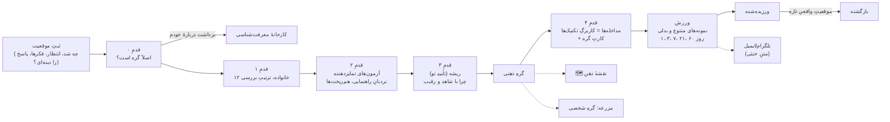
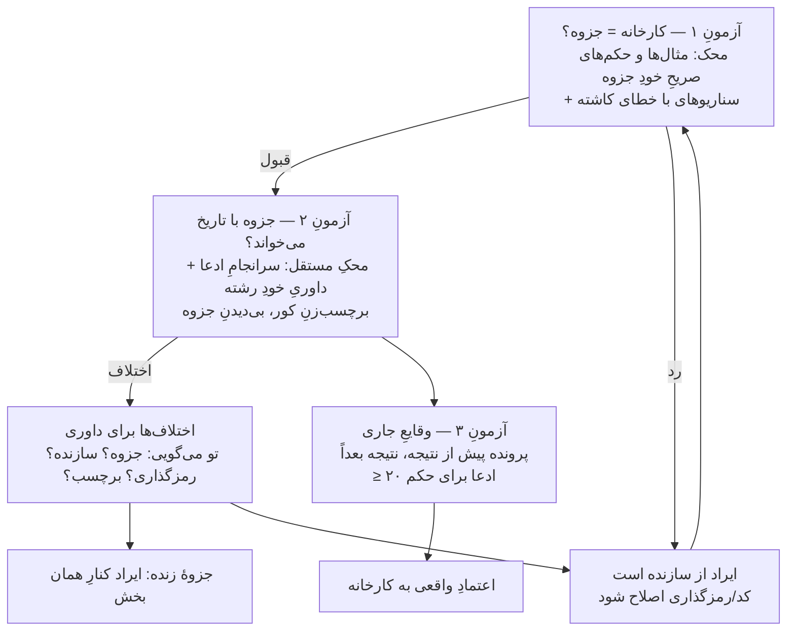
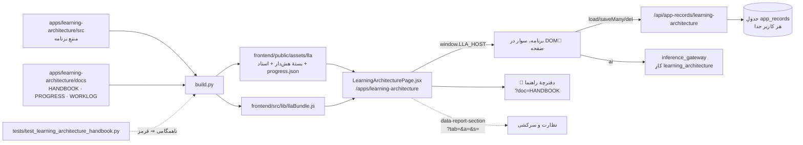
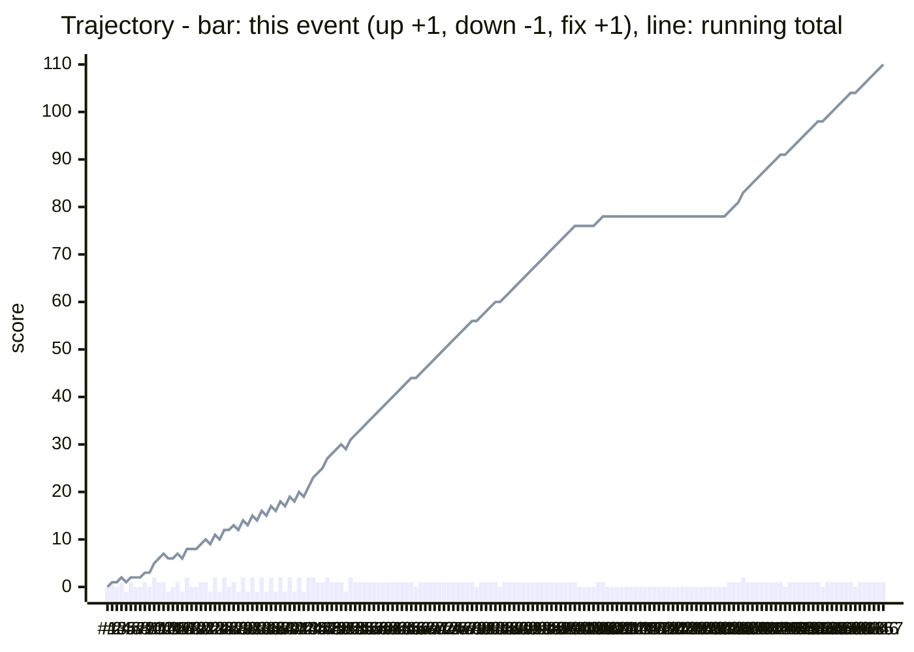
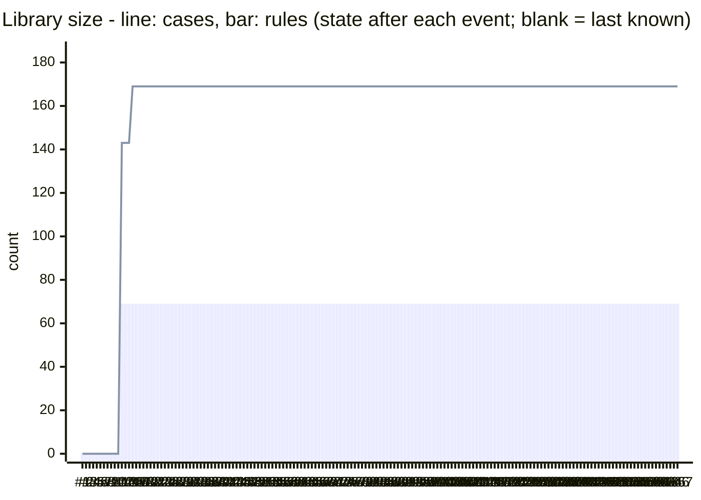

# 📘 دفترچهٔ راهنمای «معماری یادگیری عمیق و کارخانهٔ معرفت‌شناسی»

به‌روزرسانی: 2026-11-18 · با هر تغییر در این صفحه به‌روز می‌شود · همین متن هم در GitHub
(`apps/learning-architecture/docs/HANDBOOK.md`) و هم داخلِ خودِ صفحه (دکمهٔ «📘 دفترچهٔ راهنما») دیده می‌شود.

> **قاعدهٔ نگه‌داری (برای Claude، هر هوش مصنوعیِ دیگر، ناظرِ خودکار و انسان):** پس از هر کار روی این صفحه
> (۱) یک بخش به انتهای [دفترِ کار](WORKLOG.md) با امضا، (۲) اگر صفحه جلو یا عقب رفت یک سطر در [دفترِ پیشرفت](PROGRESS.md)،
> (۳) بخشِ مربوطِ همین دفترچه به‌روز، (۴) `python apps/learning-architecture/build.py`. فهرست و نمودارِ روند **ساخته می‌شوند**؛
> دستی ویرایششان نکن. هیچ سطرِ قدیمی پاک نمی‌شود؛ اصلاح = سطرِ تازه با ↩. روالِ کامل: [§۱۳](#۱۳--روالِ-کار-برای-هر-نشست-ایجنت-و-برگهٔ-نظارت-و-سرکشی).

## فهرست

<!-- TOC:BEGIN (generated by apps/learning-architecture/build.py from the ## headings) -->
- [۰ — واژه‌نامه](#۰--واژهنامه)
- [۱ — این صفحه چیست و چرا ساخته شد](#۱--این-صفحه-چیست-و-چرا-ساخته-شد)
- [۲ — از کجا شروع کنم؛ راهنمای استفادهٔ عملی](#۲--از-کجا-شروع-کنم-راهنمای-استفادهٔ-عملی)
- [۳ — نقشهٔ اجزا و ارتباطشان](#۳--نقشهٔ-اجزا-و-ارتباطشان)
- [۴ — سامانهٔ یادگیری](#۴--سامانهٔ-یادگیری)
- [۵ — کارخانهٔ معرفت‌شناسی](#۵--کارخانهٔ-معرفتشناسی)
- [۶ — اعتبارسنجی؛ سه آزمون](#۶--اعتبارسنجی-سه-آزمون)
- [۷ — شبیه‌سازِ مسئله‌های بزرگ](#۷--شبیهسازِ-مسئلههای-بزرگ)
- [۸ — استفادهٔ علمی؛ چطور با این صفحه پژوهش کنیم](#۸--استفادهٔ-علمی-چطور-با-این-صفحه-پژوهش-کنیم)
- [۹ — جای این صفحه در Lifemanager؛ معماریِ فنی](#۹--جای-این-صفحه-در-lifemanager-معماریِ-فنی)
- [۱۰ — تصمیم‌های کلیدی](#۱۰--تصمیمهای-کلیدی)
- [۱۱ — نمودارِ روند؛ کجاییم، کجا جلو رفتیم، کجا عقب](#۱۱--نمودارِ-روند-کجاییم-کجا-جلو-رفتیم-کجا-عقب)
- [۱۲ — کارهای باز و گامِ بعد](#۱۲--کارهای-باز-و-گامِ-بعد)
- [۱۳ — روالِ کار برای هر نشست، ایجنت و برگهٔ نظارت و سرکشی](#۱۳--روالِ-کار-برای-هر-نشست-ایجنت-و-برگهٔ-نظارت-و-سرکشی)
<!-- TOC:END -->

## ۰ — واژه‌نامه

هر اصطلاح فقط یک‌بار و فقط این‌جا تعریف می‌شود. ستونِ سوم می‌گوید **چرا** وجود دارد.

| اصطلاح | یعنی چه | فلسفه/هدف |
|---|---|---|
| **دورهٔ گام‌به‌گام** | مسیرِ خطیِ ۵۶ درس (۴۵ تکنیک + ۱۱ پروتکل) در ۸ منزل (ترتیبِ برنامهٔ ۸ هفته‌ای)، روی یک «موضوعِ دوره» ِ واقعی؛ نقشه‌اش می‌گوید کجایی | «اقیانوس» را به یک رودخانه با جهت تبدیل می‌کند: هر بار فقط یک قدمِ روشن |
| **درس** | یک تکنیک با پنج قدمِ ثابت: ۰ گرم‌کردن، ۱ ببین و بفهم، ۲ امتحان کن، ۳ انجام بده، ۴ بسنج و ببند | الگوی ثابت یعنی هرگز نمی‌پرسی «حالا چه کنم؟» |
| **ردِ پا / ↩ برگرد** | فهرستِ جاهایی که از آن‌ها آمدی؛ دکمهٔ «برگرد» دقیقاً به همان صفحه و همان اسکرول می‌برد؛ منوی کناری آن را پاک می‌کند | گم‌نشدن: همیشه می‌دانی کجایی و از کجا آمدی |
| **سامانهٔ یادگیری** | نیمهٔ اولِ صفحه: ۴۵ تکنیکِ یادگیری، ۹ فاز، موضوع‌ها، مزرعه، پروتکل‌ها، مرور | چیزی را **عمیق بفهمی** و فراموش نکنی، نه فقط بخوانی |
| **کارخانهٔ معرفت‌شناسی** | نیمهٔ دوم: هر ادعا/خبر/برداشت از ایستگاه‌هایی برگرفته از جزوهٔ مصباح می‌گذرد | بفهمی یک ادعا **چقدر معتبر است** و خطا دقیقاً کجاست |
| **جزوه** | جزوهٔ «معرفت‌شناسی» ِ مجتبی مصباح؛ متنِ کامل و دست‌نخورده در «متن جزوه» | مرجعِ همهٔ ملاک‌های کارخانه؛ کارخانه حق ندارد چیزی به آن ببندد |
| **تصدیق** | جمله‌ای که چیزی را ادعا می‌کند و می‌تواند درست یا نادرست باشد | واحدِ سنجش؛ «دلار» تصدیق نیست، «دلار فردا بالا می‌رود» هست |
| **پرونده** | یک ورودی (خبر، برداشت، استدلال) که از ایستگاه‌ها رد می‌شود و حکم می‌گیرد | هر سنجش ردپا دارد و بعداً با نتیجهٔ واقعی مقایسه می‌شود |
| **ایستگاه / سالن** | یک گامِ سنجش برگرفته از یک بحثِ جزوه / گروهی از ایستگاه‌ها (۳۱ ایستگاه در ۶ سالن) | ترتیبِ ایستگاه‌ها همان ترتیبی است که خطا رخ می‌دهد: اول تفکیک، بعد راه، بعد داوری |
| **راهِ معرفت** | منبعِ یک تصدیق: حس، عقل، نقل، تخصصِ دیگران، استقراء، تجربه، یادآوری، شهود | هر راه شرطِ اعتبار و منشأ خطای خودش را دارد |
| **قاعده** | یک ملاکِ جزوه که به کد درآمده (۶۹ قاعده): «سقف» یا «پرچم» | داوریِ تکرارپذیر و بی‌هوش‌مصنوعی |
| **سقف** | قاعده‌ای که می‌گوید اطمینانِ مجاز به این ادعا حداکثر چقدر است (مثلاً استقراءِ ناقص ⇒ ۸۰) | اطمینانِ بیش از سقف = «اطمینانِ بی‌پشتوانه» |
| **پرچم** | قاعده‌ای که یک خطای روش را علامت می‌زند (مثلاً راوی نامعتبر) | جای دقیقِ خطا را نشان می‌دهد، نه فقط بد بودنِ نتیجه را |
| **داوریِ قطعی** | اجرای همهٔ قاعده‌ها روی پرونده (موتورِ `epi_engine.js`) | همان حکمی که جزوه می‌دهد، بی‌سلیقه و بی‌AI |
| **رمزگذاری** | ثبتِ ویژگی‌های هر ادعا (از چه راهی، با چه اطمینانی…) تا قاعده‌ها اجرا شوند | قاعده روی ویژگی کار می‌کند، نه روی متن |
| **رمزگذاریِ کور** | همان پرونده‌ها را کسی رمزگذاری کرده که حکم و برچسب را ندیده | می‌سنجد عددها از «دانستنِ جواب» باد نکرده باشند |
| **محکِ رشته** | داوریِ خودِ آن رشته (پزشکی، مهندسی، مالی…) دربارهٔ درستیِ روشِ کنشگر، مستقل از جزوه | بدونِ آن، سنجیدنِ جزوه با جزوه دورِ باطل است |
| **سه آزمون** | ۱: کارخانه = جزوه؟ ۲: جزوه با تاریخ می‌خواند؟ ۳: در وقایعِ جاری درست درمی‌آید؟ | به ترتیب: اول ابزار، بعد استاد، بعد خودِ واقعیت |
| **اختلاف** | جایی که کارخانه با محک نخواند | پرسشی که **تو** داوری می‌کنی: ایراد از جزوه است یا از سازنده؟ |
| **جزوهٔ زنده** | فهرستِ ۶۹ قاعده با نتیجهٔ هر کدام در آزمون‌ها و ایرادهای ثبت‌شده | نقدِ جزوه کنارِ متن می‌ماند؛ متن دست نمی‌خورد |
| **دفترِ پیش‌نگر** | پرونده‌هایی که **پیش از** معلوم‌شدنِ نتیجه ثبت شده‌اند | تنها محکی که دانستنِ سرانجام در آن دخالت ندارد |
| **مزرعه** | درختِ هر علم؛ هر مفهومِ فهمیده‌شده از میوه تا ریشه در آن کاشته می‌شود | فهم‌ها پراکنده و گم نشوند |
| **پروتکل** | روال‌های زمان‌دار (پس از هر جلسه، روزانه، هفتگی، ماهانه) | یادگیری عادت شود، نه رویداد |
| **صفِ تأیید** | پرونده/مسئله‌ای که هوش مصنوعی پیشنهاد داده تا تو تأیید نکنی وارد نمی‌شود | AI فقط سازنده است؛ برچسبِ غلطش داوری را آلوده نکند |
| **نمونهٔ آمادهٔ سازنده** | هر مسئله، شبیه‌ساز یا سازندهٔ تمرینی که سازنده از پیش نوشته (۱۳ مسئلهٔ بزرگ، ۶ شبیه‌سازِ نمایشیِ گره، ۶ سازندهٔ کد)؛ پیش‌فرض پنهان، با «تنظیمات › نمونه‌های آمادهٔ سازنده» | مسئله‌ها را مالک می‌دهد؛ سیستم نباید فرض کند مسئله‌های او چیست (WORKLOG (21)) |
| **وارسیِ پاسخ‌ها / سه حلِ مستقل** | هر پاسخی که هوش مصنوعی می‌سازد (گزینهٔ درستِ گام‌ها و تمرین‌ها، مسئله‌های هم‌ساختار، نمونه‌های ورزشِ گره) سه بار جداگانه و بی دیدنِ پاسخ حل می‌شود؛ ناهمخوانی ⇒ پرچم یا «وارسی‌نشده» | با جوابِ غلط تمرین نکنی |
| **دفترِ کار / دفترِ پیشرفت** | [WORKLOG.md](WORKLOG.md) / [PROGRESS.md](PROGRESS.md) | هر تغییر ردپا دارد؛ هر نقطهٔ نمودار سند دارد |

## ۱ — این صفحه چیست و چرا ساخته شد

**یک جمله:** این صفحه دو ابزار است با یک حافظهٔ مشترک — یکی برای **عمیق فهمیدن** (سامانهٔ یادگیری) و یکی برای **سنجیدنِ اعتبارِ
هر ادعا** (کارخانهٔ معرفت‌شناسی) — و یک آزمایشگاه که خودِ کارخانه و جزوه را با واقعیت محک می‌زند.

**چرا دو ابزار در یک جا؟** فهمیدن و سنجیدن «عموم و خصوصِ من وجه»اند: هر فهمی سنجش لازم دارد (آیا درست فهمیدم؟) و هر سنجشی
فهم (اصلاً ادعا چه می‌گوید؟)، ولی هیچ‌کدام زیرمجموعهٔ دیگری نیست. پس دو کارخانه در یک شهرکِ صنعتی ساخته شد: حافظه، مزرعه و
ابزارها مشترک‌اند؛ منو و منطقِ هر کدام جدا (WORKLOG (5)).

**سه اصلِ ثابت** (هر تغییری که یکی از این‌ها را بشکند، اشتباه است):
1. **متنِ جزوه مقدس است، نه مصون.** کارخانه حق ندارد چیزی به جزوه ببندد یا حکمش را بی‌صدا ضعیف کند؛ ولی هر جا جزوه با
   واقعیت نخواند، ایراد ثبت و کنارِ متن نگه داشته می‌شود («جزوهٔ زنده»).
2. **هوش مصنوعی فقط سازنده است.** پیشنهادِ پرونده و تجزیهٔ مسئله؛ در داوری هیچ نقشی ندارد (خواستهٔ صریحِ مالک، WORKLOG (7)).
3. **هر عدد، محکِ مستقل.** برچسبی که از خودِ جزوه آمده نمی‌تواند جزوه را تأیید کند (درسِ تلخِ WORKLOG (8)).

## ۲ — از کجا شروع کنم؛ راهنمای استفادهٔ عملی

**ساده‌ترین راه: «💬 دستیار»** (دکمهٔ شناورِ پایینِ صفحه؛ با کشیدن جابه‌جا می‌شود). بنویس چه می‌خواهی — و اگر عکس یا فایلی هست بچسبان یا با 📎
بگذار. دستیار به بخشِ درست می‌بردت، فرم را از حرف‌هایت پر می‌کند (سبز)، باقیِ جاهای لازم را زرد نشان می‌دهد و می‌گوید چه بنویسی — یا اگر
بخواهی یکی‌یکی می‌پرسد و خودش پر می‌کند. خواستهٔ اصلی بالای گفت‌وگو سنجاق می‌شود و «مراحل» (کشویی) نشان می‌دهد کجای کاری. هر گفت‌وگو یک
«سشن» با نامِ خودش است (☰ فهرست، ＋ تازه) و فایل‌ها و متنش در فولدرِ خودش در درایو می‌ماند. حرفِ نامربوط را می‌گوید نامربوط است؛ اگر چیزی
در قلمروِ این صفحه است ولی صفحه بلدش نیست، خودش یک **برگهٔ فوری** در «نظارت و سرکشی» ثبت می‌کند. بی دستیار هم همه‌چیز مثلِ قبل کار می‌کند.

**موضوعِ چندوجهی ⇒ «🧭 تور».** اگر حرفت به چند بخش مربوط است (مثلاً یک گیرِ ذهنی + ادعایی برای سنجیدن + مسئلهٔ بزرگ + چیزی برای یادگرفتن + حوزه‌ای که هنوز در قلمرو نیست)، دستیار آن را به «وجه»ها می‌شکند، **به ترتیب و با دلیل** می‌چیند (ورودیِ بقیه اول؛ مفهومِ مشترک پیش از تمرینِ تخصصی؛ حوزهٔ نبوده جلوی بقیه را نمی‌گیرد) و یکی‌یکی می‌بردت. پیشرفتِ هر وجه از **خودِ داده‌ها** سنجیده می‌شود (موقعیت ثبت شد؟ ریشه را خودت تأیید کردی؟ گره و ورزش‌هایش ساخته شد؟ …)، نه از حرفِ مدل؛ تمرین‌های روزها و ماه‌های بعد را **خودِ بخش‌ها** می‌سازند (ورزشِ گره، آزمایشِ واقعی، مسئلهٔ هم‌ساختار، کارتِ مرور، چرخهٔ ۱-۳-۷، تاریخِ بازبینیِ پرونده) و همه در «امروز» می‌آیند؛ تور تا **تسلطِ کامل** (سفر تا آخر، آزمایشِ واقعی، شبیه‌ساز) در «امروز» و با یادآورِ کانال‌های گره‌ها پیگیری می‌کند. برای حوزهٔ نبوده برگهٔ فوری می‌گذارد و **دنبالش می‌کند**: وقتی روتین جواب داد، با نقشهٔ تازهٔ سامانه می‌سنجد؛ ناقص ⇒ زیرِ همان برگه با دلیل یادداشت می‌گذارد (برگه دوباره باز می‌شود)؛ درست ⇒ همان وجه باز می‌شود و تو را در حوزهٔ تازه می‌گرداند تا یک موضوع/پرونده با تمرینِ فاصله‌دار در آن داشته باشی. تصمیم‌ها (ریشه، تأییدِ مسئله، بپذیر/رد کن) و جوابِ تمرین‌ها همیشه با خودت است. **پنجره:** سرتیتر را بکش تا جابه‌جا شود، دو گوشهٔ پایین را بکش تا بزرگ/کوچک شود، ⤢ (یا دو بار زدنِ سرتیتر) بیشینه/برگشت؛ اندازه و جا به خاطر می‌ماند؛ در موبایل برگهٔ پایینِ صفحه است. **موعدها (⏰):** اگر در گفت‌وگو تاریخی بگویی («فردا امتحان دارم»، «تا جمعه»)، دستیار آن را موعد ثبت می‌کند: در «امروز» تا ۷ روز مانده دیده می‌شود، یک روز پیش از آن یادآور می‌آید، و برنامهٔ تمرین پیش از موعد تمام می‌شود؛ اگر گفتی کی کار می‌کنی («بعد از ۲۲»)، ساعتِ یادآورها همان می‌شود. تاریخِ گذشته ثبت نمی‌شود. **تأییدِ برگه:** وقتی تور برگه‌ای را با نقشهٔ تازه درست دید، دکمهٔ «✅ تأییدِ برگهٔ #N» در کشوی تور فقط برای خودت می‌آید (دستیار هرگز آن را نمی‌زند). پنجره با کیبورد هم باز می‌شود و Escape می‌بنددش.

**«حل شد» با آزمون، نه با حرف.** وجه وقتی «انجام شد» می‌شود که پایه و تمرینش برپاست؛ اما **حل‌شدن** فقط با نشانه‌های عینی: گره «ورزیده» با معیارِ خودِ گره‌گشا، و **ماندگاری** — ۳۰ و ۹۰ روز پس از ورزیدگی یک پاسخِ درستِ سرد و بی‌بازگشت (در «امروز» با «🔁 سنجشِ ماندگاری» می‌آید)؛ هم‌ساختارها ۳ درستِ پیاپی در ۲ نوبت با ≥ ۳ روز فاصله و همان ماندگاری؛ پرونده با ثبتِ نتیجهٔ واقعی؛ چرخهٔ ۱-۳-۷ تا آخر. دستیار تا آن وقت فقط می‌گوید «در راهِ حل‌شدن». اگر از پریشانیِ جدی بگویی، اول خطِ کمکِ انسانی را می‌بینی؛ و بخشی از خواسته که بیرون از این صفحه است (کاریابی، پول، درمان) صادقانه «↗ بیرون از این صفحه» گفته می‌شود.

**«🔍 غربالِ لایه‌ها» — ریشه، نه سطح.** هر حرفی را، حتی اگر به‌ظاهر بی‌ربط باشد (خرید، رابطه، فوتبال، آشپزی)، دستیار نه رد می‌کند و نه به چند وجهِ سطحی پخش می‌کند. آن را لایه‌به‌لایه می‌شکافد:
- ایمنی
- خواستهٔ واقعی
- تکرار و ریشهٔ مشترک با گره‌های پیشینت
- هر ۱۲ خانوادهٔ گره
- ادعای پنهان و راهِ دانستن
- مسئلهٔ سخت
- **دانشِ پیش‌نیاز**
- یادگیری
- آنچه باید از تو پرسید
- حوزهٔ نبوده
- آنچه واقعاً بیرون از این صفحه است

برای هر لایه با شاهد از حرفِ خودت حکم می‌دهد: «پیدا شد»، «رد شد»، «باید پرسید» یا «بیرون». تور فقط از یافته‌ها و به‌سوی **ریشه** ساخته می‌شود. غربال در کشوی تور و ایمیل دیده می‌شود.

**«🧩 نقشهٔ پیش‌نیازها».** وقتی مسئله‌ای علمی را نفهمیدی، نقشه دقیقاً نشان می‌دهد کدام مفهوم، از کدام علم و شاخه، در کدام گامِ حل لازم بود. هر مفهوم یک پرسشِ تشخیصی دارد و سنجشش با خودت است. هر پیش‌نیازِ نبوده یک موضوعِ یادگیری با سفرِ ۱۱ گامی می‌شود و در پایان دوباره سراغِ خودِ مسئله می‌روی.

**«🗺 قلمروِ سامانه‌ها»** (نقشه‌ها ⇐): مثلِ قلمروِ معرفت‌شناسی، برای **هر** سامانهٔ این صفحه — یادگیری و حافظه، ذهن و هیجان و گره‌ها، حلِ مسئله و استدلال، تصمیم و خودتنظیمی، ارتباط و گفت‌وگو، خودشناسی و ارزش‌ها — ۱۳۵ حوزه از منابعِ وارسی‌شده؛ هر حوزه با گزاره‌هایش بر پایهٔ همان اصولِ بدیهی (قضیه / تجربی / بیرون)، ابزارهای همین صفحه، و **کمبودِ** آن. گام‌ها با شاهد جلو می‌روند و گامِ آخر را فقط کارِ خودت می‌سازد. دستیار و «🧠 کارنامهٔ ذهن» همین را می‌خوانند.

**«🧠 کارنامهٔ ذهن»** (نقشه‌ها ⇐): ذهنت در یک نگاه و در جزئیات. **هر عدد یک احتمال است** که از دادهٔ خودت و اصل‌های عقلیِ کارخانه (A3، A4) درمی‌آید، بی‌برش و بی‌میانگینِ قراردادی:
- «احتمالِ درستیِ پاسخِ بعدی» = (درست+۱)/(کل+۲)؛
- «احتمالِ پیشرفت» از ماهِ نخست تا ماهِ آخر؛
- «احتمالِ بیش‌اطمینانی».

**«📐 سنجشِ استاندارد»** سازه‌ها را از مدل‌های جهانی می‌گیرد: CHC برای هوش (استدلالِ سیال، دانشِ انباشته، یادگیری و بازیابی)، مدلِ عقلانیتِ استانوویچ، فراشناخت، پیش‌بینیِ هیجانی. آنچه صفحه نمی‌تواند معتبر بسنجد (حافظهٔ کاری، سرعت، هوشِ هیجانیِ توانشی) صریحاً «سنجیده نمی‌شود».

**مقایسه با مردم** فقط با «🧩 معمای امروز» است، روزی یکی و فقط با دستِ خودت. این معماها دشواری‌شان در نمونهٔ بزرگی از مردم و از منبعِ معتبر آمده (`norms/norms.json`). مقایسه با مدلِ راش و با هم‌سن‌های همان منبع است؛ سنت از تاریخِ تولدی می‌آید که خودت ثبت می‌کنی.

**«ضریبِ هوشیِ کل» ساخته نمی‌شود**، چون فقط آزمونِ هنجاریابی‌شده و کنترل‌شده آن را معتبر می‌دهد.

بقیهٔ کارنامه:
- نقطه‌های سیاه؛
- روندِ ماهانه؛
- **نقشهٔ کاملِ ذهن**؛
- **شبکهٔ ذهن**؛
- مسیرهای پیشِ رو؛
- «از کجا دوری و چرا».

طراحی: `docs/decisions/2026-10-15-mind-card-psychometric.md`.

**«💡 جایگاهِ ایده»** (نقشه‌ها ⇐، زیرِ کارنامه): ایده‌ات را به دستیار بگو. دستیار نه ردش می‌کند، نه کورکورانه تأییدش. ایده خودش یک رکورد می‌شود با این بخش‌ها:
- **قوت‌ها**، هر کدام با شاهد از حرفِ خودت؛
- **فرض‌های لازم**، که هر کدام در کارخانه یک پروندهٔ سنجش می‌گیرد؛
- **مسئله‌های طراحی**، یعنی «چطور کار می‌کند / چطور سنجیده می‌شود»، که به بخشِ مسئله و نقشهٔ پیش‌نیاز می‌روند؛
- **بیرون از صفحه**: بازار، قانون، سرمایه.

جایگاهِ ایده نمره نیست: **سقفِ اعتبار = ضعیف‌ترین فرضِ لازم**، چون کل از جزء بیشتر نیست (A1). فرضِ سنجیده‌نشده «شک» (½) است (A4). قوت‌ها سقف را بالا نمی‌برند؛ فقط می‌گویند چه چیزی ارزشِ آزمودن دارد.

**«📚 منبع‌ها و پوشش»** (نقشه‌ها ⇐، زیرِ کارنامه): هر کتاب یا منطقِ بیرونی که می‌فرستی، مورد‌به‌مورد با سامانه سنجیده می‌شود. هر مورد این‌ها را دارد:
- کجای سامانه است (حرکت، تکنیک، گره‌گشا، ایستگاه، سفر)؛
- چقدر عمیق است (عمیق، سطحی، ندارد، نامربوط)؛
- چه کم دارد؛
- دکمه‌ای که به همان جا می‌رود.

روندِ دورها و «آنچه سامانه بیش از این منبع دارد» هم آمده است. نخستین منبع: «چگونه آن را حل کنیم» ِ پولیا. عددِ «عمیق» در دورهای ۲ تا ۴ به ۷۵۸ رسیده بود، اما بازبینِ بدبین نشان داد بسیاری فقط به اعتبارِ یک تونلِ عام «عمیق» شمرده شده بودند. در دورِ ۵ هر مورد با معیارِ سخت‌گیرانهٔ «خودِ همین مورد، در لحظهٔ درست، با تمرین یا وارسیِ کدیِ ویژهٔ خودش» و با نقلِ عینی از صفحهٔ اجراشده دوباره سنجیده شد: **۵۶۷ عمیق، ۱۰۸ سطحی، ۱۰۴ ندارد، ۳۳ نامربوط** از ۸۱۲. پس از ساختِ «🔭 مسئلهٔ حل‌نشدهٔ خودم»، دورِ ۶ (همان معیار، بازبینِ مستقلِ تازه): **۵۸۵ عمیق، ۱۱۵ سطحی، ۷۹ ندارد، ۳۳ نامربوط** (`docs/decisions/2026-10-15-polya-round6.md`). فهرستِ کمبودها در ۱۲ گروهِ نیاز در همان زبانه و در `docs/decisions/2026-10-15-polya-strict-regrade.md` آمده است. آن بزرگ‌ترین کمبود (تونلِ حل فقط روی مسئلهٔ حل‌شده) با «🔭 مسئلهٔ حل‌نشدهٔ خودم» بسته شد.

**حلِ مسئله گام‌به‌گام** (شبیه‌ساز و مسئلهٔ خودت):
- پیش از قدمِ اول **کارتِ فهمِ مسئله**: مجهول، داده، شرط، و اینکه شرط کافی است یا زائد یا متناقض؛
- **حدس** با درصدِ اطمینان، و آزمودنش؛
- وسطِ کار، **نشانهٔ پیشرفت** یا «کنار بگذار تا فردا»؛
- **وارسیِ گام‌به‌گامِ راه‌حلِ خودت**؛
- در پایان **کارتِ بازنگری**: نتیجه را بیازما، از راهِ دیگر به دست آور، در یک نگاه ببین، جای دیگری به کار ببر. از آن درسی به قلمِ خودت، کارتِ مرور و مسئلهٔ هم‌ساختار ساخته می‌شود.

همه با تمرینِ فاصله‌دار در «امروز» برمی‌گردند. ۲۷ حرکتِ حل هر کدام یک «پرسشِ خودت از خودت» دارند و تمرینِ فاصله‌دار می‌گیرند. «سرنخِ پله‌ای» و نردبانِ راهنمایی به ترتیبِ فهم، طرح، اجرا و بازنگری پیش می‌روند. دستیار هنگامِ حل هر بار یک پرسش می‌پرسد، از کلی به جزئی، بی لو دادن، و پس از «حل شد» یک پرسشِ بازنگری. مسئله‌های کوتاهِ تمرینی از ۲۰۲۶-۱۰-۱۵ به تصمیمِ مالک پیش‌فرض روشن‌اند (خاموش‌کردن: «تنظیمات»)؛ نمونه‌های تاریخیِ سازنده همچنان پنهان‌اند.

- **«🌱 کوچک‌ترین گامِ بعد»** (اراده و خواستن): پس از گامِ غلط با حالِ دلسرد/نگران/خسته، در «پیشرفتی نبود»، پس از ثبتِ نقد روی «💡 جایگاهِ ایده» و در گره‌های خانوادهٔ F7. می‌پرسد چقدر می‌خواهی، امید، کنجکاوی، کوچک‌ترین گامِ مشخص، کی و چند دقیقه بی‌وقفه، و ارزشِ کار. گامِ مبهم («بیشتر تلاش کنم»)، خودِ هدف، گامِ بی‌زمان و تکرارِ گامِ انجام‌نشده را کد رد می‌کند. وارسی روی همان نردبانِ فاصله‌دار در «امروز» برمی‌گردد. کنار گذاشتنِ آگاهانه با دلیل جایز است؛ اگر دلیل از حسِ پس از نقد آمده باشد، سه روز بعد دوباره پرسیده می‌شود. همه داده است، نه نمره.
- **قابِ «مسئلهٔ عملی»** هشت جزء دارد؛ دو جزءِ تازه «دانستهٔ پیشین/نادقیق» و «ریاضی‌کردن» (یک کمیت و یک رابطه) است. قابی که سنجیدنی نیست کارتِ مرور نمی‌سازد.
- **جعبهٔ حدس:** حدس با تمثیل، جدولِ حالت‌هایی که خودت می‌سازی (کد تفاضل‌های پیاپی و حالتِ بعد را حساب می‌کند)، فرمولِ دقیق در n (بی eval، روی همهٔ حالت‌ها وارسی می‌شود)، حدس‌های رقیب و حالتی که جدایشان می‌کند، و «کدام حدس را اول بیازمایم و چرا». سه مولدِ تمرینیِ تازه (`diffs`، `rivals`، `analogy`) از صفحهٔ حرکت‌ها می‌آیند و پاسخِ غلط فردا برمی‌گردد.
- **استدلالِ محتمل در کارخانه** (قضیهٔ T_plausible، به تصمیمِ مالک): در کاربرگِ «راه عقل و برهان»، اگر صورتِ استدلال استقرائی یا تمثیلی باشد، شمارِ پیامدهای تازهٔ تأییدشده یا مواردِ همانند (k از n و همانندی در رابطهٔ مربوط) پرسیده می‌شود. «داوری قطعی» صورتِ استدلال و این شمارها را خودش از کاربرگ پر می‌کند و سقف را می‌دهد: n پیامدِ تازه ⇒ (n+1)÷(n+2)؛ تمثیل ⇒ (k+1)÷(n+2)؛ شباهتِ ظاهری یا نامعلوم ⇒ ½. هیچ‌وقت ۱۰۰.

**«🔭 مسئلهٔ حل‌نشدهٔ خودم»** (مسئله‌های بزرگ ⇐ زبانهٔ همین نام): تصمیمی که باید بگیری، پروژه‌ای که گیر کرده یا پرسشی فکری که جوابش را نمی‌دانی — بی پاسخ. همان تونلِ حل، این بار روی واقعیت:
- **فهم:** اول کلِ مسئله در یک جمله و چرا می‌خواهی حلش کنی؛ بعد مجهول، **هر داده جدا**، شرط و کفایتش؛ و حدسی با اطمینان و آزمونش.
- **طرح:** یک پرسش در هر نوبت، از کلی به خاص، با «چرا این پرسش»:
  - مسئلهٔ مرتبط از کارهای خودت (با کد، واژه‌های مشترک)؛
  - «فرض کن حل شده — از آخر به عقب»؛
  - مسئلهٔ کمکی با پلِ برگشت؛
  - حرکت‌ها با دلیل؛
  - طرح ثبت نمی‌شود تا دربارهٔ هر داده‌ای که به کار نرفته، با نامش، بگویی چرا.
- **اجرا:** هر گامِ واقعی پیش از انجام یک پیش‌بینی با احتمال و روز دارد. همان روز در «امروز» می‌پرسد «انجامش دادی؟ چه شد؟» و هم‌خوانی را خودت داوری می‌کنی. پیش‌بینی‌ها در «🎯 دفترِ پیش‌بینی» و کالیبراسیونِ «🧠 کارنامهٔ ذهن» می‌نشینند.
- **پس از نتیجه:**
  - غافلگیری ⇐ گره‌گشا یا «دوباره فهمِ مسئله»؛
  - بی‌پیشرفت ⇐ «🌱»؛
  - گیر ⇐ گره‌گشا با همین مسئله.
- **ادعاها:** هر ادعای درونِ مسئله با یک کلیک پروندهٔ کارخانه می‌گیرد و درجهٔ موتور کنارش می‌آید.
- **بازنگری (یا کنار گذاشتنِ آگاهانه با دلیل):**
  - درس ⇐ کارتِ مرور؛
  - «کدام پرسش بیشتر کمک کرد» ثبت می‌شود؛
  - مسئلهٔ تازه‌ای که از آن ساختی سه روز بعد برای حل برمی‌گردد.
- **پرسش‌ها از آنِ خودت می‌شوند:** پرسشی که دو بار با فاصله کمکت کرده (پلهٔ ۳ ِ نردبان)، دیگر داده نمی‌شود. اول می‌پرسد «الان از خودت چه می‌پرسی؟» و بعد پرسشِ فهرست را برای مقایسه نشان می‌دهد. شبیه‌ساز هم همین‌طور است.
- **✏️ اصلاحِ پیامِ پیشین (۲۰۲۶-۱۰-۱۷):** «اشتباه گفتم، منظورم … بود» — از هر فاصله. هر رکوردی که از یک پیامِ گفت‌وگو ساخته شد
  (حدس، نتیجهٔ گام، داده/مجهول/شرطِ فرمِ فهم که دستیار در همان نوبت پر کرد، طرح و موعدش، جوابِ گفته‌شده و حکمِ وارسیِ بر پایهٔ آن) شناسهٔ همان پیام را دارد.
  اصلاح همه را دنبالش می‌برد و **هیچ‌چیز پاک نمی‌شود**: مقدارِ پیشین با «اصلاح شد ⇐» در تاریخچه می‌ماند، نتیجهٔ گامِ پس‌گرفته «پس گرفته شد» می‌شود و حکمِ
  وارسیِ کهنه کنار می‌رود. دو راه: «✏️ اصلاح» روی حبابِ خودت در دستیار (تو داوری؛ همان دم، بی مدل) یا گفتنِ اصلاح در گفت‌وگو (مدل گزارش می‌کند و صفحه
  می‌سنجد که تکه در پیامِ پیشینِ خودت است، اصلاح در پیامِ کنونی و با نشانهٔ «اشتباه گفتم/منظورم/درستش…» است). «اشتباه کردم» دربارهٔ کاری در دنیای
  واقعی، نقلِ اشتباهِ دیگری یا اصلاحِ حرفِ دستیار چیزی را برنمی‌گرداند.
- **پیش‌نیاز در حینِ حل و «🧭 نقشهٔ مسیرِ مسئله» (۲۰۲۶-۱۰-۱۸، دورِ ۲۲):** وقتی از حرفت پیداست مفهومِ مشخصی را که همین گام لازم دارد نداری، مربی آن را گره یا کم‌هوشی نمی‌خواند: نامِ دقیقِ مفهوم و گام را می‌گوید، یک پرسشِ تشخیصی می‌پرسد، فقط به اندازهٔ همین گام یاد می‌دهد و با مثالِ تازه تسلط را می‌سنجد، بعد دقیقاً به همان گام برمی‌گردد و جا را بازگو می‌کند — اگر پیش‌نیاز خودش پیش‌نیاز داشت، تو‌در‌تو؛ چند پیش‌نیازِ یک گام پشتِ هم. هر کدام در «🧩 نقشهٔ پیش‌نیازها» ِ همان مسئله (با موضوعِ یادگیری) و کارنامه برای هر گیر علت (پیش‌نیاز/گره/مهارت/هنوز نامعلوم) را با شاهد می‌نویسد؛ گیرِ پیش‌نیازی ضعفِ مرحله نیست و آموختنش پیشرفت است. «🧭 نقشهٔ مسیرِ مسئله» (صفحهٔ مسئله، دستیار، و نوارِ «جغرافیا» در نماهای دیگر) از مبدأ تا مقصد نشان می‌دهد کجایی و چقدر مانده؛ انحراف‌ها نقطه‌چین، اصلاح‌ها پرشِ برگشت، موس روی هر نقطه چه بود و چه شد.
- **حلقهٔ قلمرو و ریزه‌کاری‌های پیش‌نیاز (۲۰۲۶-۱۰-۱۸، دورِ ۲۳):** قراردادِ پیش‌نیاز از همان پیامِ نخست برقرار است؛ هر گیرِ میانهٔ یک پیش‌نیازِ باز، و گیرهای پیشینِ همان گام وقتی تشخیص نشست، به نبودِ آن پیش‌نیاز نسبت داده می‌شوند (نه ضعفِ تو)؛ پیش‌نیازی که خودش پیش‌نیازِ بازی دارد تا آن بسته نشود بسته نمی‌شود و برگشت همیشه به نزدیک‌ترین جای منتظرِ باز است؛ اگر خودت گام را برداشتی، صفحه بازگویی نمی‌خواهد. وقتی ابزاری که گامی از مسئله‌ات لازم دارد در سامانه نیست و دستیار برگهٔ «[دستیار · کمبودِ سامانه]» ثبت می‌کند، همان گام «⏸ منتظرِ برگهٔ #n» روی صفحهٔ 🔭، در «🧭 نقشهٔ مسیر» و در «📜 پرونده» علامت می‌خورد و بقیهٔ کار ادامه دارد؛ گیرِ آن لحظه کمبودِ سامانه ثبت می‌شود، نه ضعفِ تو. وقتی روتینِ مسئول ابزار را ساخت (ثبت‌گاه تازه شد یا برگه با «پاسخ به برگهٔ دستیار #n» جواب گرفت)، صفحه خودش می‌فهمد، می‌سنجد که همان گام را جواب می‌دهد (وگرنه زیرِ برگه می‌نویسد و برگه دوباره باز می‌شود)، در «امروز» می‌گوید «🛎 ابزارِ لازم آمد» و دفعهٔ بعد همان گام را با تو از سر می‌گیرد.
- **«ابزارِ لازم آمد» فقط با شاهد (۲۰۲۶-۱۰-۲۵، دورِ ۲۴):** وقتی روتین زیرِ برگهٔ کمبود جواب می‌دهد، صفحه فقط **جوابِ روتین** را می‌خواند — نه متنِ خودِ برگه، نه «کجا افزوده شود»، نه تشخیصِ افتراقیِ دستیار. حوزه‌ای که خودِ برگه کنار گذاشته بود نامزد نیست؛ واژه‌های بندِ «نه/بی/بدون» و بندی با فعلِ منفی («… جواب نمی‌دهد») و واژه‌های عام («مسئله، تغییر، ابزار، هیچ، واقع، نمودار») شمرده نمی‌شوند؛ همهٔ نامزدها امتیاز می‌گیرند و بهترین برمی‌گزیده می‌شود. «🛎 ابزارِ لازم آمد» فقط وقتی هم‌خوانی روشن است (دست‌کم دو واژهٔ کامل، یکی از خودِ گام یا عنوانِ برگه، بی رقیبِ هم‌امتیاز)؛ نیمه‌روشن ⇒ صفحه پیش از ادامه از تو می‌پرسد «این ابزارِ تازه همان است که برای گامِ … لازم بود؟» و تا جوابت گام منتظر می‌ماند؛ بی‌ربط ⇒ «⚠️ پاسخِ روتین … جواب نداد»، یادداشت زیرِ برگه و برگه دوباره باز. برگه‌ای دربارهٔ خودِ سامانه (اصلاح، خودشناسیِ سامانه، کتابِ همراه، سنجشِ مدل‌ها) هرگز گامی از مسئله‌ات را منتظر نمی‌کند — فقط گامی که دستیار نام برد (`gap.step`، یا «گامِ #k»). اگر گامِ منتظر را خودت از راهِ دیگری برداشتی، صفحه در گفت‌وگو می‌گوید و برای روتین زیرِ برگه می‌نویسد؛ «📜» سرانجامِ هر انتظار (رسید، از راهِ دیگری، بی ساختن) و نامِ درستِ گام را دارد و رویدادها به ترتیبِ زمان‌اند. (WORKLOG 107)
- **وقتی روشن نیست، از تو می‌پرسد — و «نه» ِ تو همیشه شنیده می‌شود (۲۰۲۶-۱۱-۱۱، دورِ ۲۵):** «🛎 ابزارِ لازم آمد» فقط وقتی می‌آید که واژه‌ای از **خودِ گامِ تو** با ساختهٔ تازه مشترک باشد. واژه‌هایی که همه‌جای قلمرو هستند («عدد»، «داده»، «ایده»)، واژهٔ نامِ نمایی که خودِ برگه گفته بود جواب نیست («💡 جایگاهِ ایده») و تکه‌واژه‌ها «رسید» نمی‌سازند — صفحه می‌پرسد «این ابزارِ تازه همان است که برای گامِ … لازم بود؟» و هرگز هم‌زمان هم نمی‌پرسد هم حکم می‌دهد. اگر ابزاری «آمد» و دیدی به کارِ گامت نمی‌آید، همان را بگو («این همون نیست»، «به کارِ گامِ سوم نمیاد»): گام دوباره «⏸ منتظر» می‌شود، زیرِ برگه نوشته و برگه دوباره باز می‌شود، و «امروز» می‌گوید «گامِ … دوباره منتظرِ برگهٔ #n است». اگر اشتباه گفته بودی («اشتباه گفتم، همونه»)، همان ابزار با تأییدِ خودت برمی‌گردد و ردِ قبلی در 📜 می‌ماند. خطِ ⚠️ هر بار می‌گوید چه آمد و چرا جوابِ گامت نبود؛ «⏳ شاید هنوز منتشر نشده» فقط وقتی می‌آید که روتین چیزِ ساخته‌ای را نام برده باشد. تکه‌ای که پس از بستنِ مسئله می‌آوری و ابزارش نیست، مدخلِ «⏸» ِ خودش را در همان مسئلهٔ بسته می‌گیرد.
- **گفت‌وگو ⇄ صفحه یک داستان است (۲۰۲۶-۱۰-۱۸، دورِ ۲۳):** آنچه در گفت‌وگو گفتی و مربی سنجید — کلِ مسئله در یک جمله («کلش اینه: …»)، مجهول، داده، شرط، طرح با گام‌هایش، گزارشِ گام، نتیجه، پاسخِ پرسشِ بازنگری — در فرم‌های همان مسئله می‌نشیند با «از گفت‌وگو: «…» — درست است؟» (✓ درست است / ✏️ ویرایش)؛ فقط خانهٔ خالی پر می‌شود و نوشتهٔ خودت هرگز بی‌صدا عوض نمی‌شود. مرحلهٔ مسئله، «📜»، «🧭» و نوارِ جغرافیا همین داستان را می‌خوانند (پس از گفتنِ طرح دیگر «فهمِ مسئله — طرح هنوز نیست» نه) و «اول کل، بعد جزءها» پس از گفتنِ کل دوباره پرسیده نمی‌شود. مسئلهٔ زنده‌ای که بعدتر از همان گفت‌وگو می‌سازی کارِ گفت‌وگو را می‌آورد. «🧭» ِ مسئلهٔ گفت‌وگو از صورتِ خودت تا مجهول است، فقط رویدادهای همان مسئله، و «نقشهٔ مسیرم رو نشون بده» آن را باز می‌کند.
- **اصلاح به هر نسخهٔ همان واقعیت (۲۰۲۶-۱۰-۱۸، دورِ ۲۱):** رکوردی که دستیار از چند پیامِ تو ساخت یک منبع برای هر پیام دارد؛ نسخه‌ای که خودت در صفحه نوشتی
  (فرمِ فهم، قابِ عملی، طرح، گام و «چه شد؟»، 🌱، بازنگری) با همان واقعیت به معنا پرسیده می‌شود («۲۰۰ مترمربع» = «200 m^2»، «یه» = «یک»، «خونه» = «خانه» — واحدِ دیگر هرگز)؛ حکم، حدس
  و «حل شد» که همان داده را به کار برده بودند با دلیل کنار می‌روند (با اصلاح یا با «بله»)؛ موعد با بندِ خودت و تاریخِ خورشیدی جابه‌جا می‌شود؛ وزن و اندازه‌هایت رکوردند و نمودار
  پیروِ اصلاح است؛ «📜 پروندهٔ این گفت‌وگو» حدس‌ها، برنامه‌ها، همهٔ اصلاح‌ها (بی‌اثر و ردشده هم)، تمرین‌ها و 🎯 را به زبانِ خودت دارد. (WORKLOG 86)
- **اصلاح به معنا، یک بار، از پایهٔ هر حکم (۲۰۲۶-۱۰-۱۸، دورِ ۲۲):** «همان واقعیت» یعنی مقدار با خانوادهٔ واحد (با تبدیل: ۱۵۰ میلی‌متر = ۱۵ سانتی‌متر؛ «پنجاه متر مربع» = «۵۰ مترمربع»؛ «پیمونه» = «پیمانه»)، نه عددِ تنها؛ نسخهٔ تو در واحد و خطِ خودش پرسیده می‌شود، با بخشِ عوض‌شده و متنِ کاملِ تازه. هر اصلاح یک بار و بر کوچک‌ترین بازه می‌نشیند (✏️ را صفحه با متنِ کامل برمی‌گرداند و مربی دوباره اعمالش نمی‌کند)؛ درسی که با جایگزینیِ درجا بی‌معنا می‌شد با متنِ کاملِ پیشنهادی از خودت پرسیده می‌شود. حکم/حدس/«حل شد» فقط اگر بر همان داده بنا شده بود کنار می‌رود (پایه را مدل می‌گوید و صفحه با متنِ شاهدِ همان حکم می‌سنجد)؛ اصلاحِ موعد به حدس و حکم دست نمی‌زند. «بله» ِ تو همان دم در نتیجه‌ای که دستیار می‌خواند می‌نشیند؛ اصلاح به مسئلهٔ پیشینِ حل‌شده (حتی از سشنِ دیگر) می‌رسد و فقط در پروندهٔ همان، یک بار، ثبت می‌شود.
- **اصلاح با نقشِ عدد، نسخه‌های سشن، و نتیجهٔ ردشده دست‌نخورده (۲۰۲۶-۱۰-۱۹، دورِ ۲۳):** «همان واقعیت» یعنی همان مقدار در همان نقش: عددهای یک فهرست («۴، ۹، ۱۳ سانت») واحدِ پایانی را دارند، کرانِ بازه («بینِ ۱۰ تا ۲۰») مقدارِ تنها نیست، نامِ شمرده‌شده («۸۰۰ کارتن») گواه است، رقمِ نقاب‌دار («؟۴۸۷؟») فقط با نقاب‌دار، «۱۰×۱۰» یک مقدار است، و واحدِ مقداری که بی‌واحد گفته بودی از واحدِ تازه حدس زده نمی‌شود (نسخهٔ «۱.۶ متر» ِ خودت آن را می‌گوید). خواستهٔ سنجاق‌شده و حدس‌هایی که همان داده را دارند با «این‌جا هم عوض شود؟» پرسیده می‌شوند و نتیجه‌ای که بر مقدارِ پیشین حساب شده بود («۱۰ × ۹ ÷ ۲ = ۴۵») بازنویسی نمی‌شود — با دلیل کنار می‌رود تا خودت دوباره حساب کنی. «چه شد؟» ِ تایپ‌شدهٔ خودت و صورتی که جایگزینیِ درجا وارونه‌اش می‌کرد فقط با پرسش عوض می‌شوند. «اشتباه گفتم» با «نتیجه‌ام رد شد» فرق دارد: حدس/نتیجه‌ای که خودت آزمودی و رد شد همان «رد شد» می‌ماند. بی گزارشِ پایه، برهانِ کلی («برای هر n»، استقرا) با اصلاحِ یک عدد کنار نمی‌رود. «بله، دادهٔ ۲ رو هم عوض کن» در گفت‌وگو همان دکمه است. (WORKLOG 97)
- **اصلاح با مرزِ عدد و نقشِ آن، و عددهای حساب‌شده (۲۰۲۶-۱۰-۲۵، دورِ ۲۴):** هر جایگزینی عددِ تمام را می‌گیرد («۱» هرگز درونِ «۱.۷۵» نیست — در صفحه و در مربی)؛ نقشِ عدد سنجیده می‌شود: «۱۶ هفته» شمارِ روزهاست و «۱۵ اسفند» روزِ ماه، پس «۱۶ ⇐ ۱۵» هرگز پیشنهاد نمی‌شود و مقدارِ هم‌نقش از حرفِ خودت برداشته می‌شود («۱۸ هفته … نه ۱۶»)؛ «بر ۴» (مقسوم‌علیه) با «رقمِ اول ۴» یکی نیست. وقتی عددی را بی‌واحد گفته بودی و همسایه‌هایش واحدِ دیگری دارند، مقدارِ درست با واحدِ خودش نوشته می‌شود («۱.۸ عرض، ۱۵۰ سانت ارتفاع»). پیش‌نویس‌های «از گفت‌وگو: … درست است؟» که هنوز تأیید نکرده‌ای و مقصدِ «🧭» همراهِ اصلاح می‌آیند (پیشین در تاریخچه). عددهایی که از مقدارِ پیشین **حساب** کرده بودی («۱۰۰ خانه»، «۹۸ خانه»، «۴۹ دومینو» پس از «۸×۸ نه ۱۰×۱۰») در صفحهٔ مسئله «🕰 کهنه پس از اصلاح» می‌گیرند — با پیشنهادِ همان حساب با مقدارِ درست (۶۴، ۶۲، ۳۱) وقتی همهٔ راه‌ها یک عدد می‌دهند؛ هیچ عددی بی‌صدا بازنویسی نمی‌شود. یک ✏️ با چند عدد یک نتیجه دارد که همهٔ جفت‌ها را نام می‌برد، هر تغییر یک بار؛ دلیل نقلِ واقعیِ حرفِ توست (هرگز ««» ⇐ «»»)؛ هر سطرِ تغییر یک سو دارد: «تازه» (اصلاح شد ⇐ «پیشین»)؛ پرسشِ «این‌جا هم عوض شود؟» بی پیکان: «تازه» به‌جای «پیشین». (WORKLOG 105)
- **اصلاح به واقعیت، نه به پیام (۲۰۲۶-۱۰-۱۸، دورِ ۲۰):** هر رکوردی که از گفت‌وگو نوشته می‌شود (مسئلهٔ ساخته یا بسته در گفت‌وگو، فرمی که دستیار پر
  کرد، درس و کارتِ بازنگری، موعد و یادآور، داده‌های فرمِ فهم) منبعِ `{sess, mid, msg, span, key}` دارد — `span` همان جمله‌ای از پیامِ توست که رکورد از آن آمد.
  اصلاحِ یک تکه فقط رکوردهایی را عوض می‌کند که همان جمله را دارند (یا کلیدی که مدل گزارش داد)؛ بقیهٔ رکوردهای همان پیام دست نمی‌خورند و حکمِ وارسی فقط وقتی
  کنار می‌رود که داده‌ای که به کار برد عوض شد. نسخه‌ای را که **خودت** در صفحه نوشتی (یا پس از پرکردنِ دستیار ویرایش کردی) صفحه هرگز بی‌صدا عوض نمی‌کند:
  یک بار در گفت‌وگو می‌پرسد «این‌جا هم عوض شود؟» با هر دو مقدار — «نه» یعنی همان می‌ماند و دیگر پرسیده نمی‌شود. ویرایشگرِ «✏️ اصلاح» در هر دو پوسته
  خواناست و همان موتورِ اصلاحِ گفت‌وگو را می‌راند. پرونده از یک دفترِ رویداد به ترتیبِ زمانِ **کنش** خوانده می‌شود (برنامه‌ها و اصلاح‌های گفت‌وگو، پاسخِ
  «این‌جا هم…»، مکث و بازگشت، میانهٔ راه، جلسه‌های تمرین)؛ گفت‌وگوی بی مسئلهٔ زنده هم «📜 پروندهٔ این گفت‌وگو» دارد؛ یک منبعِ وضع (مرحلهٔ جاری «در جریان»).
- **«📜 پروندهٔ کامل» (۲۰۲۶-۱۰-۱۷):** از سرِ صفحهٔ مسئله، از سشنِ دستیار و از خطِ زمانیِ «🧠 کارنامهٔ ذهن». یک صفحهٔ فقط‌خواندنی به ترتیبِ زمان و روز:
  صورت، فرمِ فهم همان‌طور که پر شد (با نسخه‌های پیشین و اصلاح‌ها)، حدس و سرانجامش، طرح، گام‌ها با پیش‌بینی و نتیجه، حکمِ وارسی، بازنگری، اصلاح‌ها، پیامِ
  گفت‌وگویی که هر رکورد از آن آمد (با پیوند به سشن) و اثرِ هر کنش بر کارنامه (مثلاً «اجرا +»؛ پس‌گرفته‌ها خط‌خورده). مرحله‌ای که هنوز نرسیده «هنوز
  نرسیده» است و بازنگریِ انجام‌نشده نمی‌آید. فرمول‌ها رسم می‌شوند (TeX ِ خام هرگز). «⬇️ Markdown»، «⬇️ HTML» و «🖨 چاپ» همان بخش‌ها را به همان ترتیب
  می‌دهند. بی مسئله: «📚 همهٔ کارها» — مسئله‌ها، ایده‌ها، پرونده‌های کارخانه و سشن‌ها به ترتیبِ آخرین فعالیت (دادهٔ آزمون/تور بیرون). از خودِ رکوردها
  ساخته می‌شود؛ نسخهٔ دومی نیست.

**«🧩 معمای امروز»:** روزی یک معمای ماتریسیِ تصویری از مجموعهٔ MaRs-IB. دشواری‌اش در ۱۵۰۱ بزرگسال سنجیده شده و هر کدام ۳۰ ثانیه وقت دارد. پاسخ و درصدِ اطمینان فقط با خودت است. اگر معما را پیش‌تر دیده‌ای بزن «دیده‌ام» تا در مقایسه شمرده نشود. پرسش‌های کلامی و مشهور (CRT، قیاس‌ها، واسون، عددفهمی) فقط می‌گویند «چند درصدِ آن گروه درست جواب دادند»؛ برآوردِ مقایسه‌ای از آن‌ها ساخته نمی‌شود، چون ترجمه دشواری را جابه‌جا می‌کند. گروهِ مرجع همیشه با نام گفته می‌شود: «۳۸۷ بزرگسالِ ۳۰ تا ۳۹ سالهٔ آمریکایی در Prolific، ۲۰۲۱»، نه «همهٔ مردم». داده را ناظرِ عمومی ماهی یک بار از منابعِ معتبر تازه می‌کند و وارسی‌کنندهٔ مستقل هر عدد را بازبرآورد می‌کند.

**«📧 گزارشِ تور»:** در حینِ هر تور (طرح، کامل‌شدنِ هر وجه، پیگیریِ برگه، طیِ ترتیب، تسلطِ کامل) گزارشِ شکیل به ایمیلت می‌رود: نقشهٔ راه، جزئیاتِ هر وجه، تمرین‌های زمان‌بندی‌شده، برگه‌ها، **از کجا عبور کرد**، گفت‌وگوی فشرده، و کارنامهٔ ذهن با همهٔ نمودارها. خاموش/روشن، «الان بفرست» و «👁 پیش‌نمایش» در کشوی تور.

**اگر گم شدی: «🧭 این برنامه چیست؟»** (تا ۲۰۲۶-۱۰-۱۴ «نقشهٔ کل» نام داشت؛ کنارِ «🗺 نقشه‌ها» گیج‌کننده بود) (بالای منو؛ اولین ورود هم همین‌جا باز می‌شود). سه چیزی که مالک داد — **ایده‌ها و دغدغه‌ها**،
**جزوهٔ معرفت‌شناسیِ مصباح**، **آموزش‌های یادگیری** — این‌جا سه «کار» شده‌اند و هر روز فقط یکی را لازم داری:

| کار | کی؟ | صفحه‌ها | حاصل |
|---|---|---|---|
| 🌱 فهمیدنِ عمیق | چیزی را واقعاً بفهمی و یادت بماند | موضوع‌ها ⇒ سفرِ ۱۱ گامی ⇒ تکنیک‌ها ⇒ مزرعه ⇒ مرور / امروز | کاربرگ، کارتِ مرور، نهال در مزرعه |
| ⚖️ سنجیدنِ ادعا و تصمیم | بدانی خبر/ادعا/تصمیمی چقدر معتبر است | میزِ کار ⇒ پرونده (ایستگاه‌ها) ⇒ حکم و تاریخِ بازبینی ⇒ ثبتِ نتیجه از «امروز» | حکم، نخستین نقطهٔ خطا، راهِ درست |
| 🪢 گره‌گشایی و حلِ مسئله | جایی گیر کرده‌ای | گره‌گشا ⇒ موقعیت (نردبان تا ریشه) ⇒ گرهِ ذهنی ⇒ ورزش ⇒ نقشهٔ ذهن؛ مسئله‌های بزرگ ⇒ حرکت‌ها | ریشه، گره، ورزشِ فاصله‌دار |

بقیه **کارگاهِ سازنده و مرجع**‌اند (اعتبارسنجی/بک‌تست، کتابخانه، اختلاف‌ها، جزوهٔ زنده، متنِ جزوه، دغدغه‌ها، اطلس، مبانی) — برای
ساختن و آزمودنِ خودِ سامانه؛ کارِ روزانه نیستند. بالای **هر** صفحه نوارِ «این‌جا» می‌گوید این صفحه کدام کار است، به چه کار می‌آید و
قدمِ بعد چیست (جمع‌کردنی). هر کار یک «مسیرِ کاری»ِ قدم‌به‌قدم دارد («قدم‌به‌قدم شروع کن» در نقشهٔ کل) که از صفحه‌های واقعی
می‌گذرد و جای تو را نگه می‌دارد. واژه‌نامهٔ «یک نام برای هر معنا» هم در «این برنامه چیست؟» است (گرهِ ذهنی ≠ گرهِ درخت؛ چهار «نقشه»…).

**اگر نمی‌دانی از کجا شروع کنی: «🧭 دورهٔ گام‌به‌گام»** (اولین مورد در منو و اولین «در» در صفحهٔ شروع). یک موضوعِ واقعی انتخاب می‌کنی و
دوره ۵۶ درس (۴۵ تکنیک + ۱۱ پروتکل) را یکی‌یکی جلو می‌برد. زمانِ هر درس از حجمِ خودش برآورد و بالای درس نوشته می‌شود (حدودِ ۱۵ تا ۸۰ دقیقه؛ هر درس را
می‌شود در چند نشست تمام کرد — جای تو نگه داشته می‌شود). هر درس همیشه همان پنج قدم را دارد:

| قدم | چه می‌کنی | چرا |
|---|---|---|
| ۰ گرم‌کردن | ۱–۲ پرسشِ **کاربردی** از درس‌های قبل («کجا به کارش می‌بری؟»، «چرا کار می‌کند؟»، «اشتباهِ رایجش چیست؟» — نه «تعریفش چیست»)، از حافظه؛ پاسخت با تاریخ ذخیره می‌شود، بعد پاسخِ مرجع را می‌بینی و می‌گویی چقدر یادت بود. دکمهٔ «ادامه» اول همین را می‌آورد؛ ردکردن فقط با دکمهٔ صریحِ «فعلاً رد کن» | خودِ دوره بازیابیِ فعال (۴۱) و فاصلهٔ فزاینده (۴۲) را روی تو اجرا می‌کند؛ فاصله‌ها ۱، ۳، ۷، ۲۱، ۶۰ روز |
| ۱ ببین و بفهم | تعریف در یک جمله، تصویر (برای بعضی تکنیک‌ها ویژه)، جای تکنیک در چرخهٔ ۹ فازی، گام‌ها به‌شکلِ مسیر | فهمِ پیش از اجرا |
| ۲ امتحان کن | شبیه‌ساز (برای ۱۴ تکنیک: ۳۷، ۳۲، ۴۱، ۴۲، ۴۰، ۱۲، ۳۶، ۲۸، ۴۵، ۲، ۴، ۱، ۳، ۵) + «ترتیب را بساز» + «درست یا اشتباهِ رایج؟» که از گام‌ها و اشتباه‌های خودِ تکنیک ساخته می‌شوند | تمرینِ تعاملی به‌جای خواندن |
| ۳ انجام بده | کاربرگِ همان تکنیک روی موضوعِ دوره؛ بی‌پرکردنِ فیلدهای لازم جلو نمی‌روی | اجرای واقعی |
| ۴ بسنج و ببند | روبریک، نوشتن از حافظه (ذخیره می‌شود) و یک کارتِ مرورِ کاربردی، «از فردا» | تثبیت و ادامه |

«🗺️ نقشهٔ دوره» همیشه نشان می‌دهد در کدام منزل و کدام درسی (📍)، چند درس تمام شده و قدمِ بعدی چیست. ارجاع به تکنیکِ دیگر در دوره
در یک کشوی کوچک باز می‌شود؛ تو از درس بیرون پرت نمی‌شوی. تکنیکی که **بیرون از دوره** (در صفحهٔ خودِ تکنیک) کامل کرده‌ای، در دوره
«انجام‌شده» حساب می‌شود و مجبور به تکرارش نیستی (مرورش آزاد است). اگر موضوعِ دوره را جای دیگری پاک کنی، دوره پیشرفتت را نگه می‌دارد و
فقط می‌خواهد موضوعِ تازه‌ای انتخاب کنی. فقط **دیدنِ** یک قدم چیزی ذخیره نمی‌کند؛ ذخیره با اولین نوشتهٔ تو شروع می‌شود.

**کارخانهٔ معرفت‌شناسی هم دوره دارد:** «🧭 دورهٔ گام‌به‌گام» بالای منوی کارخانه (و درِ اصلیِ کارخانه در صفحهٔ شروع):
یک درسِ مقدمه (مفاهیمِ پایه از خودِ داده‌های جزوه) و ۳۰ ایستگاه به ترتیبِ مسیرِ کارخانه، «حکمِ نهایی» آخر — ۳۲ درس در ۸ منزل، با همان
پنج قدم. در شروع یک ادعا/خبر/باورِ واقعیِ خودت را می‌نویسی و هر درس همان ایستگاهِ **همان پرونده** را پر می‌کند؛ تمرین‌ها با کلیدِ پاسخِ
خودِ کارخانه بازخورد می‌دهند؛ سه تصویرِ آموزشی (سقفِ اعتبار و «ضعیف‌ترین حلقه»، «راهِ معرفت ⇐ کدام ایستگاه»، «ساختِ مسیرِ پرونده») همان
موتورِ داوریِ واقعی را صدا می‌زنند و هیچ قاعده‌ای را عوض نمی‌کنند.

**دورهٔ سامانهٔ یادگیری** حالا ۵۶ درس است: ۴۵ تکنیک + ۱۱ درسِ پروتکل (آخرِ هر منزل، برای پروتکل‌های همان هفته؛ همان پنج قدم،
اجرای واقعیِ پروتکل روی موضوعِ دوره و زمان‌بندیِ دفعهٔ بعد). ۱۴ تکنیک شبیه‌سازِ ویژه دارند.

**سفرِ گام‌به‌گام روی یک موضوع:** در صفحهٔ هر موضوع دکمهٔ «🧭 سفرِ گام‌به‌گام روی این موضوع» مسیرِ ۱۱ گامی را یکی‌یکی می‌برد
(📍 کجایی، یک کارِ مشخص، کاربرگِ همان گام، بی‌کاملِ فیلدهای لازم جلو نمی‌روی، از همان‌جا ادامه). صفحهٔ کاملِ موضوع دست‌نخورده می‌ماند.

**📎 پیوست‌ها:** پایینِ صفحهٔ هر پرونده، هر موضوع، هر موقعیتِ گره‌گشا و هر **مسئلهٔ خودت** (مسئله‌های بزرگ)؛ و در فرمِ «افزودنِ مسئلهٔ تو» پیش از تجزیه — عکس/PDF ِ صورت یا حل را پیوست کن تا هوش مصنوعی از خودِ تصویر بخواند (تا ۴ فایل، هر کدام ≤ ۸ مگابایت، با تیکِ «فرستاده شود»؛ تایپِ صورت و پاسخ آن‌گاه لازم نیست). فایل مستقیم به فولدرِ همان مورد در درایو می‌رود (حداکثر ۲۵ مگابایت) و سرور فقط پیوندش را نگه می‌دارد. **عمداً بی‌پیوست:** گره (الگوی انتزاعی؛ شواهدش در موقعیت‌هاست)، درس‌های دوره (محتوای سامانه؛ کارِ تو در «موضوع» است)، حرکت‌ها، ورزش‌ها و مسئله‌های هم‌ساختار (ساختهٔ سامانه)، و نمونه‌های آمادهٔ سازنده (WORKLOG (29)).

**گم‌نشدن در بقیهٔ صفحه:** بالای هر صفحه نوارِ «📍» می‌گوید کجایی (سامانه › گروه › صفحه). اگر از جای دیگری با پیوند آمده باشی،
دکمهٔ «↩ برگرد به …» (و یک دکمهٔ شناور پایینِ صفحه) دقیقاً به همان صفحه و همان نقطهٔ اسکرول برت می‌گرداند و می‌گوید از کدام بخش آمدی.
زدنِ منوی کناری یعنی «شروعِ تازه». داخلِ Lifemanager «↩ برگرد» و دکمهٔ Back ِ مرورگر یک کار می‌کنند (هر قدمِ ردِ پا یک خانهٔ
تاریخچه است؛ عوض‌کردنِ زبانه‌های داخلِ یک صفحه تاریخچه را پر نمی‌کند).

صفحهٔ «**از اینجا شروع کن**» (همیشه بالای منو) چند «در» دارد — اولی همین دوره است؛ بقیه (جدولِ زیر، به‌اضافهٔ درهای کارخانه، گره‌گشا و حلِ مسئله) برای وقتی است که راه را بلدی:

| می‌خواهم… | برو به | چه می‌کنی | چه می‌گیری |
|---|---|---|---|
| یک موضوع را عمیق بفهمم | سامانهٔ یادگیری › **موضوع‌ها** | عنوان را بنویس؛ مسیرِ ۱۱ گامی را گام‌به‌گام جلو برو | فهمی که در «مزرعه» کاشته شده و کارت‌های مرور |
| روش‌های یادگیری را تمرین کنم | **نقشه و گراف** › برنامهٔ ۸ هفته‌ای | هر هفته چند تکنیک؛ هر تکنیک: چرا، چطور، کارگاه، ارتباطات | عادتِ یادگیریِ عمیق |
| هر روز بدانم چه کنم | **امروز** و **مرور** | کارهای سررسیده و کارت‌های امروز | پیوستگی |
| اعتبارِ یک خبر/ادعا/برداشت را بسنجم | کارخانه › **میز کار** | ورودی را همان‌طور که هست بنویس، «مسیر سریع»، ایستگاه‌ها را پر کن | درجهٔ اعتبار، نخستین نقطهٔ خطا، تصمیم و تاریخِ بازبینی |
| خودِ جزوه را یاد بگیرم | **ایستگاه‌ها**، **مفاهیم**، **متن جزوه** | هر ایستگاه: چرایی، روش، متنِ جزوه، مثال، تمرین با پاسخ‌نامه | تسلط بر ملاک‌ها |
| حل‌کنندهٔ یک مسئلهٔ سختِ حل‌شده و مشابه‌هایش بشوم | **مسئله‌های بزرگ** ⇒ «افزودنِ مسئلهٔ تو» | صورت و پاسخِ نهایی را بنویس؛ پس از وارسی و تأیید، از سخت به آسان تمرین کن و «مسئله‌های هم‌ساختار» بساز | شمِ حلِ همان مسئله و انتقال به مشابه‌ها |

**یک روالِ عملیِ پیشنهادی** (پیشنهاد است، نه قاعده):
- **هر روز (۱۰–۲۰ دقیقه):** «امروز» ⇒ کارت‌های «مرور» ⇒ اگر خبری ذهنت را مشغول کرد، یک پرونده در «میز کار» با «مسیر سریع».
- **هر هفته:** یک جلسهٔ «برگهٔ سفید» برای موضوعِ هفته (پروتکل‌ها) + سرزدن به «اعتبارسنجی» ⇒ زبانهٔ «اختلاف‌ها برای داوری».
- **وقتی نتیجهٔ یک پرونده معلوم شد:** همان پرونده ⇒ ایستگاهِ «حکم نهایی» ⇒ «نتیجه واقعی» را ثبت کن («میز کار» پرونده‌های سررسیده را یادآوری می‌کند). این همان چیزی است که آزمونِ ۳ را تغذیه می‌کند.

## ۳ — نقشهٔ اجزا و ارتباطشان

```mermaid
flowchart TB
  subgraph LEARN["سامانهٔ یادگیری"]
    T["۴۵ تکنیک · ۹ فاز"] --> W["کارگاه و کاربرگ"]
    TOP["موضوع‌ها"] --> PIPE["مسیرِ ۱۱ گامی\nاز میوه تا ریشه"]
    PIPE --> FARM["مزرعه\nدرختِ هر علم"]
    PROTO["پروتکل‌ها"] --> REV["مرور و کارت‌ها"]
    W --> REV
  end
  subgraph EPI["کارخانهٔ معرفت‌شناسی"]
    BOOK["متنِ جزوه\nدست‌نخورده"] --> ST["۳۱ ایستگاه در ۶ سالن"]
    BOOK --> RULES["۶۹ قاعدهٔ قطعی"]
    IN["ورودی: خبر/ادعا"] --> ST --> VERD["حکم: درجهٔ اعتبار\nنخستین نقطهٔ خطا"]
    RULES --> ENG["داوریِ قطعی\nبی‌AI"] --> VERD
    VERD --> OUT["نتیجهٔ واقعی\nبعداً ثبت می‌شود"]
  end
  subgraph VAL["اعتبارسنجی و تکامل"]
    LIB["کتابخانهٔ وقایع\n۱۶۹ پرونده"] --> TESTS["سه آزمون"]
    FIELD["محکِ رشته\nمستقل از جزوه"] --> TESTS
    OUT --> TESTS
    TESTS --> DIS["اختلاف‌ها\nداوریِ تو"]
    DIS --> LIVING["جزوهٔ زنده\nایرادها کنارِ متن"]
    PROB["مسئله‌های بزرگ\nشبیه‌ساز ۴ سطحی"]
  end
  ENG --> TESTS
  LIVING -. "نقد، نه تغییرِ متن" .-> BOOK
  FARM <-. "پل: مفهومِ سنجیده‌شده کاشته می‌شود" .-> VERD
  AI["هوش مصنوعیِ Lifemanager\nفقط سازنده"] -. "پیشنهاد ⇒ صفِ تأیید" .-> LIB
  AI -. "تجزیهٔ مسئله ⇒ صفِ تأیید" .-> PROB
```

**چه چیزی به چه چیزی وصل است، به زبانِ ساده:**
- **جزوه ⇒ ایستگاه‌ها و قاعده‌ها:** هر ایستگاه یک بحثِ جزوه است و زیرِ هر ایستگاه متنِ خودِ جزوه آمده. هر قاعده به بندِ جزوه‌اش ارجاع دارد.
- **پرونده ⇒ داوریِ قطعی ⇒ حکم:** کاربرگِ ایستگاه‌ها را تو پر می‌کنی؛ موتور سقف‌ها و پرچم‌ها را حساب می‌کند و می‌گوید اطمینانت بیش از
  مجاز است یا نه و خطا اولین بار کجا رخ داده.
- **حکم ⇒ نتیجه ⇒ آزمونِ ۳:** هر پرونده‌ای که نتیجه‌اش بعداً ثبت شود، محکِ واقعیِ کارخانه است.
- **کتابخانه + محکِ رشته ⇒ آزمون‌های ۱ و ۲ ⇒ اختلاف‌ها ⇒ جزوهٔ زنده:** این همان چرخهٔ «کارخانه را معتبر کن، جزوه را نقد کن» است (§۶).
- **حکم ⇄ مزرعه:** مفهومی که در کارخانه سنجیدی، می‌تواند در درختِ علمِ خودش در مزرعه کاشته شود.

## ۴ — سامانهٔ یادگیری

| بخش در منو | چیست | منبع در کد |
|---|---|---|
| 🧭 دورهٔ گام‌به‌گام | نقشهٔ سفر (۸ منزل، ۵۶ درس: ۴۵ تکنیک + ۱۱ پروتکل) و درس‌های پنج‌قدمی؛ شبیه‌سازها و تمرین‌های تعاملی | `src/app/a11_course.js`، `a14_sims.js` |
| 🪢 گره‌گشا | جایی گیر کردم / کاری کردم که نمی‌فهمم چرا ⇒ گرهِ ذهنی را پیدا کن، باز کن، ورزیده شو؛ نقشهٔ ذهن (بخشِ پایین) | `src/app/a16_knots.js`، `a17_kpractice.js`، `a18_kmap.js`، طرح: `docs/specs/KNOTS.md` |
| امروز | کارتِ «ادامهٔ دوره»، کارهای موعدار، پیشرفت | `src/app/a3_views.js` |
| نقشه و گراف | ۹ فاز (پیش‌تنظیمِ ذهنی ⇒ … ⇒ تثبیت و بازیابیِ فعال)، گرافِ روابطِ تکنیک‌ها، برنامهٔ ۸ هفته‌ای | `src/app/core*.js`، `a3_views.js` |
| ۴۵ تکنیک | هر تکنیک: چرا کار می‌کند، دقیقاً چطور، کارگاهِ تمرین، ارتباطات، متنِ عینیِ منبع و «اصلاحیه» | `src/tech/t_*.js`، `src_*.js` |
| موضوع‌ها | مسیرِ ۱۱ گامی برای یک موضوع: گرفتنِ میوه ⇒ … ⇒ جاری کردن در زندگی | `src/app/core2.js`، `a5_farm.js` |
| مزرعه | درختِ هر علم (اصلی و پیوندی)، ریشه تا میوه، گره، جوانه، کمپوست، نهالستان | `src/app/a5_farm.js` |
| پروتکل‌ها | ۱۱ روال (از «قانونِ ۵ خطِ دلتا» تا «ممیزیِ دوحلقه‌ایِ ماهانه» و «بیانِ دیگر») و صفِ منابع | `src/app/core*.js` |
| نوارِ «📍» و «↩ برگرد» (همهٔ صفحه‌ها) | جای تو، ردِ پا، برگشت به همان نقطه | `src/app/a10_nav.js` |
| مرور | مرورِ فاصله‌دار و سنجشِ اطمینان (آیا به اندازه‌ای که مطمئنی، درست می‌گویی؟) | `src/app/a4_views2.js` |
| دغدغه‌ها، اطلس، مبانی و اصلاحیه‌ها | ۲۴ دغدغهٔ مالک و راهِ حلِ هر کدام؛ الگوهای مشترکِ علوم؛ پشتوانهٔ علمی و اصلاحیه‌های اسناد | `src/app/core*.js` |

### 🧪 پروندهٔ تمرینِ باز — تکنیک‌هایی که با برگشتن کار می‌کنند (دورِ ۱۹c، ۲۰۲۶-۱۰-۱۷)
بسیاری از ۴۵ تکنیک فقط وقتی کار می‌کنند که در روزها و هفته‌ها به آن‌ها برگردی (فاینمن ۱ روز و ۱ هفته بعد، بازیابیِ ۱/۳/۷، کالیبراسیون، آزمونِ فرضیه تا نتیجه…).
پیش‌تر هر کاربرگ رکوردی تازه و بی‌پیوند بود و «تسلط» تلاش‌های همان روز را می‌شمرد. حالا (`src/app/a41_practice.js`، نمای `practice`، زبانهٔ «🧪 پرونده‌ها» در صفحهٔ هر تکنیک):
- **یک پرونده برای هر (تکنیک × موضوع)** — موضوع: مسئلهٔ زنده، پروندهٔ معرفتی، گره، موضوع یا «آزاد». هر ذخیرهٔ کاربرگ (کتابخانه، دوره، سفر، گره) پرونده را می‌سازد یا ادامه می‌دهد؛ تکرارِ همان روز یک جلسه است؛ پیش‌نویس جلسه نیست.
  هر جلسه تاریخ، کار، نتیجهٔ سنجیده (درصدِ بازیابی، شمارِ اصطلاح و گیرِ فاینمن، پاسخ‌های درست و شکل‌ها، آزمایشِ کامل، حکم) و نقشش را دارد (به‌موقع، زودتر، دیرتر با شمارِ روز، شکست، وارسی).
  وضع: باز / در حالِ تثبیت / تثبیت شد / مکث / بسته، با تاریخچه. شروع از صفحهٔ مسئله، پرونده، گره (هر ۴۵ تکنیک — ۱۵ تکنیکی که پیش‌تر از گره نمی‌آمدند هم)، دوره، و دستیار (`start_practice`، فقط پس از «آری» یا خواستهٔ صریحِ خودت).
- **آهنگ از متنِ خودِ تکنیک** (`PR.POLICY`، هر سطر نقلِ عینیِ dose/کاربرگ و آزمون می‌سنجد که در متن هست) — نه عددِ قراردادی. موعدها از `A.SCHED` می‌گذرند؛ اگر نبود، «امروز» سطرِ «🧪» را خودش می‌دهد.
- **«تثبیت شد» فقط با شاهدِ تاریخ‌دار:** زنجیرهٔ گام‌های به‌موقع با نتیجهٔ سنجیدهٔ موفق (سنجیده بر خودارزیابی مقدم است)؛ قاعدهٔ فاصله‌گذاریِ گره‌گشا (≥۲ نوبت با فاصلهٔ ≥۳ روز، ≥۳ شکل، بدلی؛
  آزمایش: ≥۳ آزمایشِ کامل در ≥۱۴ روز)؛ کالیبراسیون: اطمینانِ اعلام‌شده درونِ بازهٔ نرخِ درستی ((k+1)/(n+2) ± انحرافِ پسین) در ≥۳ روزِ جدا؛ راهبردِ T31 روی دو مسئلهٔ جدا با ≥۳ روز فاصله؛ کارت: موفقیت در فاصلهٔ بلندتر.
  پس از آن وارسیِ ماندگاری در پلهٔ بعد؛ شکست ⇒ «تثبیت شد» با تاریخ و دلیل پس گرفته می‌شود و نوبتِ «امروز» برمی‌گردد. «به نظرم تثبیت شد» ِ بی‌شاهد فقط ادعای خودت است. تسلطِ تکنیک دیگر تکرارِ یک روز را نمی‌شمرد («تثبیت‌شده» فقط با پرونده‌ی تثبیت‌شده)؛ راهِ شمارشیِ قدیم قرنطینه است (`A.masteryCountOnly`).
- **یک رکورد برای هر کار:** ردیفِ T24 همان پیش‌بینیِ «🎯» است (نتیجه از هر سو؛ ثبتِ تکراری در 🎯 همان را پیشنهاد می‌کند)؛ T21 ِ گره همان «آزمایشِ واقعی» ِ گره است و گامِ پیش‌بینی‌دارِ مسئلهٔ زنده خودش رکورد است؛
  T22 به پروندهٔ معرفتی (با تاریخِ بازبینی و نتیجه) وصل است؛ T9 یک پیش‌بینیِ تاریخ‌دار با امتیازِ «برآوردِ درونی در برابرِ نرخِ پایه»؛ T41 همان چرخهٔ ۱-۳-۷ ِ موضوع (یکی). صفحهٔ تکنیک خودِ رکورد را باز می‌کند؛ دفترِ کالیبراسیون هر کار را یک بار می‌شمرد.
- **پیوند به عقب:** پرونده در صفحهٔ مسئله و «📜 پروندهٔ کامل» می‌آید؛ آزمونِ حدس از پرونده روی خودِ حدسِ مسئله می‌نشیند («حدس رد شد» / «تأیید در n آزمون — تأیید، اثبات نیست»؛ مسئله باز می‌ماند). بستنِ پرونده گره را نمی‌بندد.
- **فهرست‌های جاری** (پرونده با `kind: list`): فرض‌ها (T15؛ ماهانه یا با رویدادِ مهم)، قفسهٔ مدل‌ها (T16؛ شمارِ کاربست به روز، «پذیرفته» با سه کاربستِ واقعی در سه روز)، «اشتباهاتِ فکری من» (T31/T34، یکی؛ ماهانه)،
  باورها (T34؛ هفتگی)، ابهام‌های باز (T35؛ هفتگی، تاریخچهٔ احتمال)، پارتو (T3؛ ماهانه، روندِ سهم‌ها)، سیگنال/نویز (T10؛ فقط تاریخی که خودت نوشتی). رکوردِ نمونه/تور هرگز در فهرست یا پرونده‌های تو نمی‌آید.
- **یک کار، یک رکورد، یک سطر (دورِ ۲۰، ۲۰۲۶-۱۰-۱۸ — RO7):** پرونده صاحبِ زمان‌بندیِ هر رکوردِ پیوسته است. چرخهٔ ۱-۳-۷ ِ T41: همیشه دقیقاً یک برگهٔ بازِ P3 برای گامِ جاری
  (همان سطرِ «امروز» با موعدِ خودِ پرونده)، پله‌های بعدی نگه‌داشته (`hold`) و بی سطر، پله‌های گذشته بسته با دلیل؛ جلسهٔ فرمِ سریع یا گفت‌وگو همان برگه را می‌بندد و جلو می‌برد.
  بازیابیِ دیرِ ناموفق چرخه را از همان روز از نو می‌چیند؛ **بازیابیِ دیرِ موفق فاصلهٔ بلندتر می‌گیرد** (پله‌های کوتاه‌تر گذشته‌اند، پلهٔ بعد ≥ پلهٔ بعدیِ نردبان پس از فاصلهٔ
  ازسرگذشته — در «🔭 مرورِ حلِ مسئله» ِ a36 هم). پروندهٔ بازیابی روی یک مسئلهٔ زنده مرورهای 🔭 و کارتِ بازسازیِ همان مسئله را با همان نتیجه جلو می‌برد و تا باز است
  سطرِ جدا به آن‌ها نمی‌دهد. پرونده هرگز «موعدی ندارد» نمی‌گوید تا معیارش باز است. **T24 دو مرحله‌ای:** هر ردیف با گزاره، اطمینان و موعد همان لحظه 🎯 ِ تاریخ‌دار
  می‌شود (پیش‌نویس هم؛ ردیفِ بی‌موعد 🎯 نمی‌سازد و صفحه تاریخ را می‌خواهد)؛ تأمل‌ها (حدسِ منحنی، الگو، قاعده) پس از نخستین نتیجه پیدا می‌شوند؛ نوبتِ بعدِ پرونده روزِ پس از آخرین
  موعدِ باز/آخرین کار. وضعِ حدس از رکوردهای حدسِ خودِ مسئله (داوریِ بازنگری، رد/اثبات، نتیجهٔ گام‌ها، حدس‌های پیشین، آزمون‌های پرونده). برنامهٔ گفت‌وگو ⇄ گامِ زنده ⇄ 🌱: گامِ تازهٔ
  هم‌محتوا «📌 همان برنامه؟» ِ یک‌کلیکی می‌گیرد (متنِ عیناً همان ⇒ خودکار؛ ناهم‌محتوا هرگز)، سپس یک وضع و یک سطر. روال‌های آماده (کارتِ نمونه، قرائتِ روزانه، برگهٔ سفیدِ هفتگی…) فقط
  پس از نخستین اجرای خودش در «امروز». دستیار: `start_practice` با `consent {quote, kind: yes|request}` ِ سنجیده با پیامِ خودش (نه کلیدواژه)، `practice_log` (ثبتِ جلسه با نقلِ عینی)،
  بلوکِ پرونده‌ها فقط وقتی پرونده‌ای باز برای همان موضوع/سشن هست یا موعدش رسیده (`APP.PR.promptBlock(subject)`)؛ رویدادهای پرونده با زمانِ خودِ رویداد (`APP.PR.events(subject)`).
- **شروع از گفت‌وگو و قاعده‌های زمان (دورِ ۲۱، ۲۰۲۶-۱۰-۱۸ — R2 R5):** هر وقت سشن «موضوع» دارد (مسئلهٔ زندهٔ سشن، مسئلهٔ گفت‌وگو، تکنیک یا حرکتی که نامش
  از ثبت‌گاهِ خودش در حرفِ او آمده، یا صفحهٔ تکنیکِ باز) `start_practice` حتی بی پروندهٔ باز در پرامپت است، با فهرستِ کاملِ ۴۵ تکنیک؛ در بازنگری یک بار پیشنهاد
  (رضایتِ دورِ ۲۰ همان). نمای «🧪» دکمهٔ «شروعِ تمرین» دارد (بی تکنیک پرونده نمی‌سازد). **«تثبیت شد» فقط از دنبالهٔ خودِ تکنیک پس از آخرین شکست**
  (T41: سه بازیابیِ موفق «روز ۱، ۳ و ۷»)؛ شکستِ زودتر از موعد هم شکست است و دنباله را از نو می‌چیند؛ بازیابیِ دیرِ موفق فاصلهٔ بلندتر می‌گیرد ولی یک موفقیت شمرده می‌شود.
  ردیفِ T24 همان 🎯 است: «ادامه با کاربرگ» همان کاربرگ را باز می‌کند، `practice_log` همان 🎯 را داوری می‌کند (اطمینانِ خودش)، موعدِ پرونده جلو می‌رود؛ همهٔ موعدهای کاربرگ با
  یک خواننده (`A.willWhen`: «۱۵ آبان»، «سه‌شنبه»…). روزِ جلسه از حرفِ خودش («دیروز»، «پریروز»)؛ «فردا می‌کنم» جلسه نیست؛ آهنگِ خودش («هر دو هفته») موعدِ همان پرونده
  (`practice_rhythm`). پرونده صاحبِ کارتِ درسِ بازنگری و کارتِ قابِ همان مسئله هم هست؛ 🌱 ِ یک‌شبه پس از روزِ وارسی بسته می‌شود (با دلیل)؛ برنامه ⇄ 🎯 هم پیوند می‌خورد
  (یک سطر). کالیبراسیون تا داده نیامده عددی نشان نمی‌دهد؛ نمودارِ روندِ بازیابی جلسه‌های پرونده را هم می‌خواند.
- **هر داوری جلسه است؛ فهرست‌ها جزیره نیستند (دورِ ۲۲، ۲۰۲۶-۱۰-۱۸ — P6 P7):** هر 🎯 ِ داوری‌شدهٔ پروندهٔ کالیبراسیون (از صفحهٔ 🎯 و «امروز»، ردیفِ کاربرگ، گفت‌وگو یا برنامه)
  جلسهٔ همان روزِ پرونده است (یک جلسه برای هر روزِ داوری؛ برداشتنِ داوری ⇒ جلسهٔ فقط-داوری هم برداشته می‌شود)؛ گزارشِ گفت‌وگو 🎯 را با عددهای خودش می‌گیرد (درصدی که گفت =
  اطمینانِ همان پیش‌بینی، «۲۴ ساعت» در متنش)، وگرنه «کدام؟» با متنِ هر کدام. برنامه‌ای که خودِ کارِ پرونده است («… مرورِ T41») به پرونده می‌پیوندد و یک سطرِ «امروز» می‌ماند. آهنگِ
  خودش («یه ماه دیگه»، «دو هفته یه بار»؛ «هر روز نه» آهنگ نیست) دیرکرد را هم می‌سنجد؛ معیاری که با موضوع جور نیست (T23 روی پروژه) گفته می‌شود؛ متنِ معیار به متنِ خودِ تکنیک استناد می‌کند.
- **حرفِ خودش می‌بندد (دورِ ۲۴، ۲۰۲۶-۱۰-۲۵ — R7):** موعدِ امتحان با گزارشِ خودش («میان‌ترم رو ۱۴ گرفتم، … قفل نکردم») بسته می‌شود، جمله‌به‌جمله؛ حدسِ گفت‌وگو سرانجامش را از جملهٔ خودش می‌گیرد (ردِ همان پیام، آزمونِ پیامِ بعد، دلیلِ «چون … پس»، «چهار تا بسه» ⇒ «… پنج تا»)؛ یک پیش‌بینی یک 🎯 (فرمِ 🎯 همان پیش‌بینیِ گفت‌وگو را کامل می‌کند)؛ خواسته‌ای که همان نوبت انجام شد قول نمی‌شود و متنِ قول حرفِ خودش است؛ «… خوبه؟» برنامه نیست.
  **فهرست‌های جاری:** هر مورد مسئله و سشنش را دارد و در صفحهٔ 🔭 ِ همان مسئله («📋 فهرست‌های جاریِ همین مسئله»)، «📜 پرونده» (مسئله و گفت‌وگو) و «🏋 کارِ تکنیک‌ها» می‌آید؛ بستن با
  نوع (حل/روشن شد · رد شد · بسته) و بازگشایی، ابهام با چند فرضیه و احتمالِ هر کدام (تاریخچه)، فرضِ «باربر»، سهمِ پارتو (بیش از ۱۰۰٪ ⇒ هشدار)، حکمِ سیگنال/نویز با تاریخِ بررسیِ دوباره.
  دستیار: `list_add` (با رضایتِ خودش؛ متن، عدد و تاریخ فقط از حرفش) و `list_update`؛ بلوکِ «# فهرست‌های جاری» جای هر نیاز را می‌گوید. جلسهٔ پروندهٔ فهرست‌شکل (T15…) مرورِ همان فهرست است.
  «امروز»: موعدِ ⏰ ِ گذشته «تحویل دادی؟» می‌پرسد.
- **یک کار، یک سطر؛ حرفِ خودت می‌بندد (دورِ ۲۳، ۲۰۲۶-۱۰-۱۹ — Q7):** «امروز» برای هر کار یک سطر دارد: برنامه‌ات، پیگیریِ ⏰ ِ همان کار، پیش‌بینیِ 🎯 ِ آن و قولی که برای بعد گذاشتی — یا کارتِ «بازسازی»، برگهٔ سفید و مرورِ حلِ همان مسئله — در یک سطر با «همان کار: …» می‌آیند؛ «همان کار» فقط با شاهد (پیوندِ ثبت‌شده، یا همان روزِ موعد و هم‌پوشانیِ محتوا)، و «انجام دادم» ِ برنامه
  پیگیری‌اش را هم می‌بندد. سطرِ برنامه شناسه ندارد و جملهٔ «فردا …» ِ دیروز «(دیروز گفتی)» می‌گیرد. موعدی که خودت گفتی انجام شد («میان‌ترم رو ۱۴ گرفتم») بسته می‌شود (دو موعدِ هم‌تراز ⇒ هیچ‌کدام) و پرسش از نوعِ کار است: امتحان «دادی؟ چطور شد؟»، تحویل «تحویل دادی؟»، بقیه «انجام شد؟». حدسِ گفت‌وگو سرانجامش را از آزمودنِ خودت در پیام‌های بعد می‌گیرد؛ پیش‌بینی
  (پاسخِ «چه می‌گوید و چقدر مطمئنی؟» یا «پیش‌بینی می‌کنم …») حدس نیست و با موعد 🎯 ِ تاریخ‌دار می‌شود. «… ولی بعداً» و «فردا یادم بنداز …» قول می‌شوند و در «امروز» و سشن‌های بعد برمی‌گردند. مسئله‌های تازه‌ای که در بازنگری ساختی، حتی پیش از ثبتِ خودِ مسئله، روی نردبان به «امروز» برمی‌گردند. پرونده مقدارِ خامِ رکورد («refuted») نشان نمی‌دهد و هر تغییرِ یک اصلاح یک بار می‌آید.
  `list_add` نقلی از دو پیامِ پیاپیِ تو را می‌پذیرد؛ مدلِ ثبت‌شده با نامِ دیگر کاربستِ همان مدل است («کاربستِ مدل» ِ صفحه می‌پرسد «همان مدل؟»)؛ پنجرهٔ تمرین در «امروز» و پرونده یکی است.

### گره‌گشا — کشف، بازکردن و ورزیدگیِ گره‌های ذهنی، رفتاری و روانی

**چرا (مالک، ۲۰۲۶-۱۰-۱۲):** «اگر در یک آزمونِ هوش یا مسئله گیر کردم، یا کاری کردم که نمی‌فهمم چرا (کفِ دست/ناخن)، یا نتیجه‌ای اجتماعی گرفتم
(از فلانی بیشتر می‌فهمم ولی مدیرها حرفِ او را قبول دارند)، با در نظر گرفتنِ **همهٔ سناریوها** ریشهٔ گره را پیدا کنم، بازش کنم، و با نمونه‌های
متنوع و انتزاعی ورزیده شوم — نه حفظِ راه‌حل.» طرحِ کامل و منابع: [`docs/specs/KNOTS.md`](specs/KNOTS.md) (بازبینی‌شده توسطِ یک بازبینِ مستقل، پیش از ساخت).

- **۱۲ خانواده** (همه همیشه دیده می‌شوند): دانش و مفهوم · بازنماییِ مسئله · راهبرد و گیرکردن · پایش و فراشناخت · ظرفیت و حالتِ ذهنی ·
  عادت و خودکاری · هیجان و انگیزه · اجتماعی و ارتباطی · باور دربارهٔ خود · موقعیت و ساختار (بیرون از ذهن) · برداشت و نتیجه‌گیری · تصمیم و خودتنظیمی.
  رتبه از قواعدِ ثابت روی ورودی و شاهدها (مقایسهٔ عملکرد ±۳، واقعیت ±۱، پیش‌بینیِ خلافِ واقع ±۰٫۵) — «ترتیبِ بررسی، نه احتمال».
- **ریشه را تو تأیید می‌کنی؛** هوش مصنوعی فقط پیشنهاد می‌دهد (فرضیهٔ فرعی، پله‌های نردبان، هم‌ریخت، نمونهٔ ورزش)، هر بار پس از اعلامِ
  «این متن به ارائه‌دهندهٔ بیرونی می‌رود» با پیش‌نمایش و حذفِ نام‌ها؛ هیچ فرضیه‌ای دربارهٔ حالِ درونیِ شخصِ سوم پذیرفته نمی‌شود.
- **ورزش — از مسئلهٔ خودت (۲۰۲۶-۱۰-۱۳):** هوش مصنوعی نمونه‌های تازه را از روی **موقعیت‌های خودت** که به گره پیوند خورده‌اند می‌سازد (صورت، پاسخِ درست، کجا گیر کردی، فکرهایت؛
  برای گره‌های هیجانی/باورِ خود فقط صورت و پاسخ) — همان ساختار و تله، ظاهرِ تازه؛ نمونه‌ای که تقریباً خودِ مسئلهٔ اصلی است کنار می‌رود. هر نمونه فقط با **سه حلِ مستقلِ هم‌نظر** و
  بی‌نشتِ پاسخ پذیرفته می‌شود؛ یا خودت نمونه می‌سازی. شش سازندهٔ برنامه‌وار (کوزه‌های آب، ۲-۴-۶، واسون، نرخِ پایه، حافظهٔ کاری، قیدِ پنهان) مسئله‌های
  کتابی‌اند، نه مسئلهٔ تو ⇒ «نمونهٔ آمادهٔ سازنده»، پیش‌فرض پنهان (تنظیمات).
- **🧪 شبیه‌سازِ همین مسئله:** در موقعیتِ «مسئله» (پس از دیدنِ پاسخ یا پایانِ نردبان) راهِ حلِ مسئلهٔ خودت به گام‌های تصمیم با گزینه شکسته می‌شود (گزینه‌های غلط =
  اشتباه‌های رایج، به‌ویژه همان‌جا که گیر کردی)، سه حل‌کنندهٔ مستقل گزینه‌ها را وارسی می‌کنند و پس از تأییدت در «مسئله‌های بزرگ» با همان شبیه‌سازِ چهارسطحی و «مسئله‌های هم‌ساختار» تمرین می‌شود.
- **شش شبیه‌سازِ نمایشی** (کوزه‌های آب، ۲-۴-۶، نفرینِ دانش، حافظهٔ کاری، وضعیتِ پایانی، نردبان) نمایشِ پدیده‌های کتاب‌اند، نه مسئلهٔ تو ⇒ از منو بیرون و پیش‌فرض پنهان (WORKLOG (21)). «ورزیده‌شده» = دست‌کم ۳ درستِ پیاپی روی ۳ شکل در ۲
  نوبت با فاصلهٔ ≥۳ روز + ۲ بدلیِ درست با اطمینانِ ≥۷۰٪؛ گره‌های اجتماعی/رفتاری فقط با **۳ آزمایشِ واقعیِ کامل در ≥۲ هفته**.
- **صداقت:** هیچ‌جا نمی‌گوید «این گره دیگر برنمی‌گردد» یا «ضریبِ هوشت بالا می‌رود»؛ تمرینِ سؤال‌های شبیهِ هوش آشنایی با همان نوع را بالا می‌برد.
- **ایمنی:** بررسیِ کلیدواژه‌های آسیب به خود پیش از ثبت و پیش از هر درخواستِ هوش مصنوعی (با شماره‌های کمک)؛ بی‌تشخیصِ بالینی؛ ارجاع به متخصص با سه موقعیتِ پیاپیِ شدید.
- **درایو:** برای هر موقعیت و هر گره یک فولدر و شیت **به‌طورِ پیش‌فرض** (خاموش‌کردنی)؛ عکسِ سؤال در «پیوست‌ها»ی همان فولدر؛ احساس‌ها و یادداشت‌های هیجانی/باورِ خود فقط با انتخابِ جدا.
- **عکسِ سؤال:** در ثبتِ «مسئلهٔ حل‌نشده» عکس را بگذار؛ با تأییدِ تو همراهِ متن به هوش مصنوعی می‌رود (پیشنهادِ فرضیه، پله‌های راهنما، هم‌ریخت، ساختِ نمونهٔ ورزش).
- **یادآورها:** در «تنظیمات › اعلان‌ها» ردیفِ «ورزشِ گره‌گشا» دارند (روشن/خاموش، کانال‌های تلگرام و ایمیلِ همان‌جا) و یک نسخه در زنگوله؛ متنِ پیش‌فرض خنثی.
- **پیوندها (هر کدام با «چرا»):** کارخانه — سنجشِ برداشت‌های دربارهٔ خود، و ایستگاه‌های مرتبطِ هر خانواده (برداشت از یک اتفاق ⇐ «استقراء»، «تجربه»، «درجهٔ اعتبار»؛ مدیرها و همکار ⇐ «استناد به تخصصِ دیگران»، «فهمِ متن و گوینده»؛ بدخوانیِ صورت ⇐ «واقع، فهم، زبان»؛ باور دربارهٔ خود ⇐ «پیش‌زمینه‌ها»، «مسئولیتِ معرفتی»؛ مفهوم ⇐ «تصور یا تصدیق»)؛ کاربرگِ ۴۵ تکنیک و درسِ دورهٔ همان تکنیک؛ «مسئله‌های بزرگ» برای گیرکردن روی راه؛ مزرعه («گرهِ شخصی»)؛ کارت‌های مرور؛ «امروز»؛ P9؛ دغدغه‌های ۱۰ و ۷ ِ خودت.

**فلسفه:** اسنادِ اولیه چند ادعای نادرست داشتند (مثلاً «۸۰/۲۰ قانون است»). سامانه آن‌ها را **پنهان نکرد**؛ کنارِ هر تکنیک «اصلاحیه» گذاشت.
مثال‌هایی که سامانه خودش ساخته برچسبِ «تولیدی» دارند و می‌شود پنهانشان کرد (WORKLOG (2)). همین قاعده برای **مسئله‌ها**: مسئله‌ها را مالک می‌دهد؛
هر مسئله، شبیه‌ساز یا سازنده‌ای که سازنده از پیش نوشته «نمونهٔ آمادهٔ سازنده» است و پیش‌فرض پنهان (تنظیمات › نمونه‌های آمادهٔ سازنده؛ WORKLOG (21)).

### ⏱ زمان‌بندِ واحد (۲۰۲۶-۱۰-۱۷، تورِ پولیا دورِ ۱۹c) — یک زمان‌بند، یک ساعت
ممیزیِ طولی نشان داد حدودِ دوازده زمان‌بندِ جدا (کارت، چرخهٔ ۱-۳-۷، گرم‌کردنِ دوره، حرکت‌ها، ورزش و آزمایشِ گره، مسئلهٔ هم‌ساختار،
بازبینیِ پروندهٔ معرفتی، گامِ مسئلهٔ زنده، 🌱، پیش‌بینی و زنجیره، موعدها، تور) هر کدام نسخهٔ خودشان از [۱، ۳، ۷، ۲۱، ۶۰] را داشتند و
هیچ تکنیکی نمی‌توانست یکی‌شان را قرض بگیرد؛ T42 در کد «۱ و ۳ روز» بود در حالی که متنش «۱ روز، ۶ روز» می‌گوید.
- **`A.SCHED` (`src/app/a42_sched.js`، درست پس از `a1_base` بار می‌شود):** تنها جای «چه چیزی، کی، چرا».
  `register(منبع | قلم)` / `unregister(کلید)` / `all(day)` / `due(day)` / `next(record)` / `plan(سیاست، پرونده، day)` / `todayLines(day)` /
  `remind(قلم)` / `syncReminders()` / `openFor(tid)` / `planSource({...})` / `captureRemind()`. منبع = `{kind, label, list(day), today, remind, types, line?}`؛
  قلم = `{kind, id, track?, due, until?, txt, sub?, go?, remindKey?, dupOf?}`؛ کلید = `kind:id[:track]` — هر کلید یک قلم (یک کارت، یک سطر).
- **سیاست از متنِ خودِ تکنیک (`A.SCHED.POLICY`):** هر سیاست نقلِ عینیِ `dose` ِ همان تکنیک را در `src` دارد و آزمون وجودِ نقل را در متن می‌سنجد:
  T42 `[1, 6]` سپس ×ضریب؛ T41 چرخهٔ ۱/۳/۷ + هفتگی؛ T31 پنجرهٔ ۲ تا ۷ روز؛ T3، T9 و T14 ماهانه؛ T22 و T37 هفتگی؛ T23 بازآزمایی یک روز پس از آزمونک و
  مرورِ روند هر ۳ چرخه؛ T28 ۱ و ۷ روز؛ T26 ۱ روز؛ T4 ۳ و ۷ روز؛ T21 موعدِ خودِ کاربر با سقفِ «دو آزمونِ باز»؛ T24 با رسیدن به ۵۰ موردِ داوری‌شده (نه تقویم).
  تکنیکی که متنش فاصله نمی‌گوید سیاست ندارد — نردبانِ عمومی (`A.SCHED.LADDER`) هرگز جایش نمی‌نشیند.
- **زمان‌بندهای پیشین پیچیده شدند، نه حذف:** هر کدام منبعِ `legacy` در A.SCHED دارد (یک فهرست، یک «بعدی»، یک کلیدِ یادآور — مثلاً آزمایشِ گره ⇐ `knot:<id>`)
  و سطرِ «امروز» ِ خودش را هنوز خودش می‌سازد (رفتار همان). کپی‌های آرایهٔ نردبان جای‌شان را به `A.SCHED.ladder(…)` دادند و در `APP.SCHED_QUARANTINE`
  و `docs/overhaul/REMOVAL_CANDIDATES.md` ثبت‌اند. 🎯 پیش‌بینی و ⛓ زنجیره سطر و یادآورشان را از A.SCHED می‌گیرند («عقب‌افتاده از …»، لغوِ یادآور با ثبتِ نتیجه)؛
  پیش‌بینیِ گامِ مسئلهٔ زنده سطرِ جدا نمی‌گیرد.
- **کارت:** یادآورِ «cards:review» پس از هر نمره و بازنشسته/بازگرداندن تازه می‌شود؛ کارتِ عقب‌افتاده موعدِ خودش را نگه می‌دارد (یک یادآور برای همان موعد، نه یکی
  برای هر روزِ بازکردنِ صفحه). «بازنشسته کن» در «مرور › همه کارت‌ها» (`A.cardSuspend`) کارت را از صف، «امروز» و یادآور بیرون می‌برد، بی حذف.
- **ساعتِ واحد (`A.now()`):** `A.today`، `S.put` و ساعت‌های خصوصیِ ماژول‌ها (`now`/`nowISO`/`nowIso`) و دریچه‌های `Date.now` همه از `A.now()` / `A.nowMs()` /
  `A.nowISO()` می‌گذرند؛ بی جابه‌جایی همان `new Date()` است. **برای تورگردانِ بی Playwright (فقط در حالتِ توسعه):** `?dev=1&clock=YYYY-MM-DD` یا
  `APP.clock.advance(n)` / `set(day)` / `reset()` + بارگذاریِ دوباره؛ نشانِ «⏱ ساعتِ آزمایشی» دیده می‌شود؛ رکوردِ ساختهٔ آن ساعت `simClock` می‌گیرد و بی آن ساعت
  از «امروز» و کارنامه بیرون است. `?remind=capture` (یا `APP.SCHED.captureRemind()`) بارِ یادآورها را در `APP.SCHED.captured` ضبط می‌کند و هیچ پیامی نمی‌فرستد.
  `APP.clock.check()` شبیه‌سازیِ نادرست را نشان می‌دهد: `mixed` (فقط `APP.today` وصله شده) و `stale` (پرشِ رو به عقب بی بارگذاری).
- **آزمونِ چندروزه با ساعتِ Playwright (روشِ اصلی):** `ctx = newContext({timezoneId:'Asia/Tehran'})` ⇒ `page.clock.install({time})` ⇒ کار ⇒
  `APP.S.flushNow()` ⇒ `page.clock.setSystemTime(روزِ بعد)` ⇒ `reload()` ⇒ سنجشِ «امروز» و `APP.SCHED.captured`. پس از هر پرش بارگذاری کن (حالتِ درون‌حافظه)؛
  مرزِ نیمه‌شبِ تهران را با `timezoneId` بسنج. نمونه: `tests/test_tour1_r19c_sched.js`. تحویلِ یادآور در سرور با `deliver_due(now=…)` در `tests/test_app_reminders.py`.

## ۵ — کارخانهٔ معرفت‌شناسی

**شش سالن، به ترتیبِ وقوعِ خطا:**

| سالن | کار | چرا این‌جا |
|---|---|---|
| ۰ پذیرش | ورودی دقیق ثبت می‌شود: چه هست، از کجا آمده، چه تصمیمی به آن بسته است، خطا چقدر گران است | سنجشِ چیزِ مبهم بی‌معناست |
| ۱ تفکیک | ساحتِ واقع/فهم/زبان، تصور از تصدیق، حضوری از حصولی، کلی از جزئی، صدقِ معرفتی از اخلاقی | بیشترِ خطاها پیش از استدلال، در خلطِ مفاهیم رخ می‌دهند |
| ۲ راه‌ها | هر تصدیق بدیهی است یا نظری؛ اگر نظری، از کدام راه؛ ایستگاهِ همان راه با ملاکِ خودش می‌سنجد | هر راه منشأ خطای خودش را دارد |
| ۳ داوری | درجهٔ اعتبار تا پایه، حلِ تعارض، ممیزیِ پیش‌زمینه‌ها، وظیفهٔ تحقیق؛ «حکمِ نهایی» **همیشه آخر** | اعتبار مراتب دارد و عمل باید بر احتمالِ برتر تکیه کند |
| ۴ آزمایشگاهِ شبهه | اگر استدلال به شک‌گرایی، نسبی‌گرایی، کل‌گرایی یا هرمنوتیکِ فلسفی رسید | این شبهات اگر بی‌پاسخ بمانند کلِ سنجش را بی‌معنا می‌کنند |
| ۵ دین | قواعدِ ویژهٔ معرفتِ دینی (ساختار، منابع، تعارض، قرائت‌ها، کثرت‌گرایی) | شاخه‌ای از معرفت‌شناسیِ خاص که بر عام متوقف است |

**مسیرِ سریع و کامل:** سریع فقط ایستگاه‌ها و پرسش‌های اصلی؛ کامل همه را. مسیر بر اساسِ پاسخ‌هایت باز و بسته می‌شود
(مثلاً سالنِ دین فقط برای پروندهٔ دینی).

**پوشش:** هر ۷۲ بخشِ جزوه در جایی از کارخانه به کار رفته («پوشش و ملاحظاتِ متن» دقیقاً می‌گوید کجا)؛ ۲۳ «ملاحظهٔ متن» دربارهٔ
خودِ جزوه ثبت شده؛ بخش‌های روایی/تاریخی که ایستگاه نشده‌اند در «پرونده‌های پشتوانه» آمده‌اند.

**دیدگاهِ رقیب:** جایی که موضعِ جزوه محلِ نزاع است، دیدگاهِ رقیب با برچسب و جدا از متن آمده و قابلِ پنهان‌کردن است (WORKLOG (5)).

## ۶ — اعتبارسنجی؛ سه آزمون

این بخش همان خواستهٔ اصلیِ مالک است: «بر حسبِ وقایعِ قطعیِ خودِ جزوه، ایراداتِ کارخانه را بگیریم؛ وقتی کارخانه درست شد روی
وقایعِ گذشته بک‌تست بگیریم و وقایعِ فعلی را هم بسنجیم؛ کارخانه کم‌کم معتبر شود، جزوه نقد شود، و وقایعِ گذشته و حال داوری شوند.»

| آزمون | می‌پرسد | محک | اگر نخواند یعنی | وضعِ فعلی (2026-10-11) |
|---|---|---|---|---|
| ۱ | آیا کارخانه همان جزوه است؟ | فقط خودِ جزوه: ۵۱ مثال/حکمِ صریح + ۲۰۰ سناریوی ساختگی با خطای کاشته | سازنده بد فهمیده یا بد پیاده کرده — **نه** جزوه | **قبول:** ۱٫۰۰ روی مثال‌ها؛ ۱٫۰۰ روی خطاهای کاشته |
| ۲ | آیا جزوه با تاریخ می‌خواند؟ | **مستقل از جزوه:** آیا ادعا واقعاً درست درآمد + داوریِ خودِ رشته دربارهٔ روش (برچسب‌زنِ کور) | یا ملاکی از جزوه با واقعیت نمی‌خواند، یا رمزگذاری غلط است، یا برچسبِ رشته محلِ بحث است — داوری با تو | **قبول:** ۱۱۰ واقعه؛ توافق ۰٫۹۸ (کرانِ پایینِ ۹۵٪: ۰٫۹۱)؛ از ۷۹ ادعای پرچم‌خورده ۹۷٪ غلط درآمد، از ۸۳ ادعای بی‌پرچم ۱۴٪؛ Brier ۰٫۲۰ در برابرِ ۰٫۲۵ ِ پایه؛ ۴ اختلاف |
| ۳ | در وقایعِ جاری درست درمی‌آید؟ | نتیجهٔ واقعیِ پرونده‌های خودت که **پیش از** نتیجه ثبت شده‌اند | همان «۲» ولی بی‌آلودگیِ دانستنِ سرانجام | **هنوز دادهٔ کافی نیست** (۰ ادعای پیش‌نگرِ نتیجه‌دار؛ ≥ ۲۰ لازم) |

**چرا ترتیب مهم است:** تا آزمونِ ۱ قبول نشود، ردشدنِ آزمونِ ۲ چیزی دربارهٔ جزوه نمی‌گوید (شاید فقط کارخانه بد ساخته شده).
و آزمونِ ۲ هر قدر خوب باشد، سقفِ خوش‌بینانه است: وقایعِ کتابخانه مشهورند (و مشهورند چون روشن‌اند) و رمزگذاری‌شان با دانستنِ
سرانجام انجام شده؛ رمزگذاریِ کور این را کم می‌کند (۰٫۹۷؛ ۹۴٫۵٪ در برابرِ ۴٪ — در صفحه گرد‌شده ۹۵٪) ولی صفر نمی‌کند. **آزمونِ ۳ محکِ واقعی است.**

**هیچ وزنی خودکار تنظیم نمی‌شود.** زبانهٔ «حساسیتِ قاعده‌ها» فقط **گزارش** می‌دهد که خاموش‌کردنِ هر قاعده نتیجه را چقدر عوض
می‌کند. قاعده‌ای که با تاریخ نخواند، بی‌صدا ضعیف نمی‌شود؛ به‌عنوانِ پرسش از جزوه پیشِ تو می‌آید (WORKLOG (8)).

**سه حالتِ رمزگذاری** در زبانهٔ «سه آزمون» قابلِ انتخاب‌اند: رمزگذاریِ نخست، رمزگذاریِ کورِ مستقل، فقط‌واقعیت‌ها (بدونِ ویژگی‌های
تشخیصی). آزمونِ ۱ همیشه با رمزگذاریِ نخست اجرا می‌شود (چون محکش خودِ جزوه است).

**تکرارِ دوره‌ای (هفتگی، بی‌تنظیمِ وزن):** هر دوره دسته‌ای تازه و بی‌تکرار از سناریوهای با خطای کاشته می‌سازد (آزمونِ ۱ هر بار با دادهٔ
تازه)، سه آزمون را روی همهٔ پرونده‌های تأییدشده دوباره اجرا می‌کند و اگر آزمونِ ۱ رد شد هشدار می‌دهد. در Lifemanager اگر هفت روز از
دورهٔ قبل گذشته باشد با باز کردنِ «میز کار» اجرا می‌شود؛ دستی: زبانهٔ «تکرار دوره‌ای» ⇒ «اجرای یک دوره اکنون». گزارشِ هر دوره در
همان زبانه و «تاریخچه» می‌ماند.

**کنترل‌ها:** کنترلِ مثبت (خطاهای کاشته باید گرفته شوند) و کنترلِ منفی (برچسب‌های به‌هم‌ریخته نباید توافقِ بالا بدهند).

### ♾ بک‌تستِ پیوسته (۲۰۲۶-۱۰-۱۳) — همیشه، دوره‌ای، بی‌تکرار

مالک: «بک‌تست باید همیشه ادامه داشته باشد، مثلِ ترید کوانتومی؛ هم سامانه خودش را بسنجد و اصلاح کند، هم وقایع را معرفت‌شناسی کند؛
هوش مصنوعی فقط سازنده است.» «تکرارِ دوره‌ای» ِ بالا فقط با بازکردنِ صفحه و فقط روی سناریوهای ساخته از خودِ قاعده‌ها اجرا می‌شد،
پس فضایش ته می‌کشید (۱۳۱ ⇒ … ⇒ ~۶ سناریوی تازه) و هرگز واقعهٔ واقعیِ تازه‌ای نمی‌آورد — «تمام‌شده» به نظر می‌رسید. حالا:

| ترید کوانتومی (مفهوم) | این‌جا |
|---|---|
| تونل/باکس: ساختارِ ثابت و نسخه‌دار؛ فقط ضریب‌ها برازش می‌شوند | سالن/ایستگاه و ۶۹ قاعده ثابت؛ سقف = «وزن»؛ تغییر فقط با تصمیمِ مالک |
| داده‌ای که دائم بزرگ می‌شود | **پیکره**: بذر (۱۶۹) + هر دور وقایعِ واقعیِ تازه و سناریوهای انتزاعیِ هم‌ساختارِ آن‌ها (`backtest/corpus/`) |
| داوریِ قطعی، بی هوش مصنوعی | `tools/epi_backtest.js` — همان موتورِ صفحه، در Node |
| تأیید فقط روی دادهٔ برون‌نمونه | یافته فقط وقتی «تأییدشده» است که روی ≥۳ واقعهٔ **افزوده پس از اصلاح** درست درآید |
| کنترلِ منفی/مثبت | هر دور خودکار: برچسبِ جابه‌جا (توافق باید فرو بریزد) و خطای کاشته (باید دیده شود) |
| دفتر و حکمِ هر آزمایش | `backtest/ledger.json` (هر دور یک ردیف)، `findings.json` (هر نقص و سرانجامش)، `results.json` |
| هوش مصنوعی فقط سازنده | روتینِ ناظر گردآوری و **رمزگذاریِ کور** (رمزگذار برچسب را نمی‌بیند) و تشخیصِ علت می‌کند؛ حکم را فقط موتور می‌دهد |

**هر دور** (`docs/supervisor/BACKTEST_PROMPT.md`، روتینِ «بک‌تستِ پیوسته»): وضع و شکاف‌ها ⇒ گردآوریِ ۸–۱۲ مورد (شکست‌های واقعی برای
قاعده‌های نیازموده، **وقایعِ سالمِ کامل** به‌عنوانِ آزمونِ سلامت، و سناریوی انتزاعی از روی یک واقعهٔ واقعی) ⇒ رمزگذاریِ کور ⇒
`add` (ردِ تکراری، منبع‌دار بودن، کلیدهای مجاز) ⇒ `run` ⇒ تشخیصِ هر یافته با یکی از هفت علت و نقل از جزوه ⇒ اصلاحِ خطای سازنده
(رمزگذاری/برچسب) یا **پیشنهادِ تغییرِ قاعده برای مالک** ⇒ `run` ⇒ «جزوهٔ متقن» ⇒ کامیت.

**آزمونِ سلامت:** واقعه‌ای که واقعاً (نه از شانس) سالم به نتیجه رسیده باید بی‌پرچم بگذرد؛ پرچم ⇒ «هشدارِ کاذب» ⇒ نقصِ سامانه تا
خلافش ثابت شود. **آزمونِ تشخیص:** شکست باید دیده شود، در ایستگاهِ درست («کاملاً» = همهٔ ایستگاه‌های موردانتظار)، با راهِ درست.

**در صفحه:** «اعتبارسنجی» ⇒ زبانهٔ پیش‌فرضِ «♾ بک‌تستِ پیوسته»: آخرین دور، روند، هر یافته و سرانجامش، **پیشنهادهای منتظرِ
تصمیمِ تو** (بپذیر/رد کن ⇒ رکوردِ `ebtp_<id>`؛ ناظر با `GET /api/inspection/audit/epi-decisions` ِ فقط‌خواندنی آن را می‌خواند)،
قاعده‌های هنوز نیازموده، و حکمِ هر واقعه — وقایعِ افزوده تحلیلِ معرفتیِ خودشان را درجا دارند (چرا شکست/سالم، راهِ درست، حکمِ
کارخانه، منبع). **«📜 جزوهٔ متقن»** (`docs/VERIFIED_BOOKLET.md`، هر دور خودکار): هر بخشِ جزوه با ✅ آزموده‌ودرست / ⚠ یافتهٔ باز /
🔧 اصلاح‌شده در انتظارِ آزمونِ تازه / ⬜ نیازموده، و علتِ هر یافته زیرِ همان بخش.

**مرزها:** متنِ جزوه هرگز عوض نمی‌شود؛ قاعده/سقف/ایستگاه/معیارِ قبولی فقط با تصمیمِ مالک؛ هر واقعه یک بار؛ سناریوی انتزاعی از روی
یک واقعهٔ واقعی (نه از روی قاعده‌ها). **جزوه‌های دیگر** (مثلاً آئودی): ساختار آماده است (`books` روی قاعده و واقعه؛ هر جزوه اول جدا، بعد
یکپارچه)، ولی متنی جز جزوهٔ مصباح به سامانه داده نشده.

### 🧱 مبنای درجه‌ها (۲۰۲۶-۱۰-۱۳) — هیچ عددی بی مبنا

پرسشِ مالک: «این درصد بر چه مبنایی است؟ … به بدیهیات منتقل کن، طبقِ جزوه». پاسخ (`src/app/epi_found.js`، زبانهٔ «🧱 مبنای درجه‌ها»):
- **بدیهی طبقِ جزوه (s39):** اولیات و وجدانیات، «خطاناپذیر». **تکمیلِ s40:** باقیِ تصدیق‌ها «بر اساسِ حسابِ احتمالات» در بازهٔ ۰..۱. پس هر عدد باید
  **قضیه‌ای از حسابِ احتمالات** باشد که اصولش (امتناعِ تناقض، «کل از جزء بزرگ‌تر»، بازهٔ ۰..۱، ضربِ مستقل‌ها، امتناعِ ترجیحِ بلامرجح) اولی‌اند.
- **چهار گونهٔ سقف:** B (عدد خودش قضیه است — ۲۱)، S (ساختار قضیه، مقدارِ پایه نه — ۱۴)، O (فقط «< یقین» — ۴)، X (ناسازگار با قضیه — ۳).
- **پایه‌ها** (مثلِ وثاقتِ ناقلِ ثقه) را جزوه با «سنجشِ تطابق با واقعیات و اسناد» (s52) احراز می‌کند؛ چون این سنجش استقرایی است، سه مرز دارد:
  فقط نمونهٔ **بی‌گزینش** (`sample: "unselected"`)، دست‌کم ۳۰ گروهِ مستقل با نیم‌پهنای ۹۵٪ ≤ ۱۰ واحد، و هرگز بالاتر از کرانِ قضیه. تا آن وقت «ناکافی».
- **اعمال‌شده با پذیرشِ مالک (WORKLOG 33):** ۱۵ سقف به کرانِ قضیه («حداکثر شک = ۵۰»)؛ هر سقفِ گذشته‌شده ایستگاهش را پرچم می‌زند؛ ویژگیِ
  **«گسترهٔ ادعا»** (`scope`: کلی نامحدود / کلی محدود / مورد بعدی، + `dom_n`) با سه سقفِ **فرمولی** — صفرِ حدی، ۱۰۰(n+1)/(M+1)، ۱۰۰(n+1)/(n+2) —
  که عددشان را قضیه از ویژگی‌های همان تصدیق می‌سازد. دو قاعدهٔ قدیمِ استقراء «گذرا» ماندند (فقط برای تصدیقِ بی‌گستره).
- **از ۲۰۲۶-۱۰-۱۴ هیچ عددِ قراردادی (WORKLOG 36):** هر سقف = قضیه، یا قضیه × مقدارِ پایهٔ سنجیده، یا «کمتر از یقین»؛ تحملِ مقایسه ۰.
  مقدارهای پایه را **بک‌تست خودش** از «قاب»های بی‌گزینش (مجموعه‌ای از پیش معین، همه‌اش، هر مورد با سند/تواتر احرازشده) با قضیهٔ (k+1)/(n+2)
  می‌سازد — بی‌داده ½. `epi_backtest.js audit` نگهبانِ مبناست (عددِ قراردادی، قضیهٔ بی‌برهان، سقفِ بی‌اشتقاق ⇒ تخلف)؛ دفتر سلامتِ کارِ ناظر را
  هر دور می‌سنجد. ارتقای فراتر از جزوه فقط با قضیه‌ای از اصولِ موجود و تصمیمِ مالک؛ اصلِ تازه فقط مالک، فقط اگر به تعریفِ s39 اولی باشد.
- **حالت‌های آزمایشی** (پیش‌فرض خاموش): `deg` (فقط درجه‌ها) و `derived` (کرانِ قضیه). بک‌تست هر دور اثرشان را روی کلِ پیکره می‌سنجد؛
  پیشنهادهای برآمده (`p_found_*`) در «♾ بک‌تستِ پیوسته» منتظرِ «بپذیر/رد کن» ِ مالک‌اند. هیچ سقفی خودکار عوض نمی‌شود.

### 🗺 قلمروِ معرفت‌شناسی (۲۰۲۶-۱۰-۱۴) — همهٔ حوزه‌های این علم، و پیشرفتِ هر کدام

- **نقشه** (`src/app/epi_territory.js`): ۱۴ گروه، ۱۰۸ حوزه از SEP، IEP، Routledge Companion، کتاب‌های درسی و سنتِ اسلامی؛ ۳۳ حوزه به بخش‌های جزوه
  وصل‌اند. **پیشرفت** (`backtest/territory.json`، فقط ابزار): ۰ نقشه‌شده ⇒ ۱ منابع ⇒ ۲ گزاره‌ها ⇒ ۳ رده‌بندی بر پایهٔ بدیهیات ⇒ ۴ قاعده یا مرز ⇒ ۵ تثبیت
  (فقط ابزار، با وقایعِ تازه). هر گام با شاهد و یک‌به‌یک؛ حوزه‌های جزوه «فقط بخشِ جزوه» تا از ادبیات «گسترش» یابند. سندِ زنده: `docs/TERRITORY.md`.
- **مرز:** گسترش فقط با قضیه از پنج اصلِ ثابت یا پایهٔ سنجیده؛ آنچه برنمی‌گردد «بیرون از قلمروِ قطعی» علامت می‌خورد، نه ساخته.
- **ناظرِ ناظر:** زیرعاملِ جدا در پایانِ همان روتینِ شبانه با بدگمانی وارسی می‌کند؛ `epi_backtest.js review`؛ نبودنش هشدارِ دورِ بعد است.

### 🗺 نقشه‌ها و گرافِ مشترک (۲۰۲۶-۱۰-۱۴)

همهٔ نقشه‌ها ذیلِ «🗺 نقشه‌ها» (بالای هر دو منو؛ در هر سامانه گروهِ «🗺 نقشه‌ها»): 🧭 این برنامه چیست؟ (نقشهٔ کل)، 🧠 کارنامهٔ ذهن،
نقشهٔ مسیرِ یادگیری، نقشهٔ ذهنِ تو، مزرعه، نقشهٔ کارخانه، قلمروِ معرفت‌شناسی، مبنای درجه‌ها، 🗺 قلمروِ سامانه‌ها، 🧩 نقشهٔ پیش‌نیازها — و **گرافِ مشترک** (`a25_graph.js`) که از خودِ ثبت‌گاه‌ها ساخته می‌شود: یادگیری + دادهٔ تو + کارخانه/جزوه/قلمرو،
پل‌ها (فقط پیوندهای ثبت‌شده با دلیل) و **شکاف‌ها** (جایی که پل نیست). هر داده‌ای که هر نشست یا روتین بیفزاید همان لحظه در گراف است؛
قرارداد در `AGENTS.md` («نقشه‌ها و گرافِ مشترک»)، آزمون `tests/test_graph.js`. نقشهٔ ذهن در کشوی هر گره ایستگاه‌های معرفتیِ خانواده‌اش را نشان می‌دهد.
**خوداصلاحی (WORKLOG 40):** هر ارجاعِ شکسته یا شناسهٔ دوگانه در «🗺 نقشه‌ها» گزارش می‌شود؛ برای ثبت‌گاه‌های کارخانه/جزوه/قلمرو/تکنیک/مسئله،
`epi_backtest.js audit` + `tests/test_learning_architecture_integrity.py` (pytest ِ اجباری) ادغامِ پیوندِ شکسته را می‌بندد. هر سامانه گرافِ کاملِ
خودش را هم دارد: زبانهٔ «🕸 گرافِ کاملِ یادگیری» در نقشهٔ مسیرِ یادگیری و «🕸 گرافِ کاملِ معرفت‌شناسی» در نقشهٔ کارخانه.

## ۷ — شبیه‌سازِ مسئله‌های بزرگ

**مسئله را خودت می‌آوری** (مالک، ۲۰۲۶-۱۰-۱۳: «قرار شد مسئله‌ها را من بدهم»): مسئلهٔ سختی از هر علمی که سال‌ها حل‌نشده ماند — یا مسئله‌ای که خودت در آن گیر کردی (از
«گره‌گشا» ⇒ «🧪 شبیه‌سازِ همین مسئله») — همراهِ پاسخی که سرانجام به دست آمد. هوش مصنوعی مسیرِ حل را به گام‌ها می‌شکند؛ هر گام «لحظه‌ای» است: وضعِ دانش تا آن‌جا، و تو حرکتِ
بعدی را از میانِ گزینه‌ها انتخاب می‌کنی (گزینهٔ درست و گزینه‌های بن‌بست با توضیح). فهرست با مسئله‌های خودت باز می‌شود. ۱۳ مسئلهٔ آماده‌ای که سازنده نوشته (فرما، چهار رنگ، پوانکاره،
درجهٔ پنج، ساخت‌های یونانی، اصلِ توازی، عطارد، جسمِ سیاه، زنون، هانسِ زیرک، زملوایس، هلیکوباکتر، طولِ جغرافیایی) «نمونهٔ آمادهٔ سازنده»اند و پیش‌فرض پنهان؛ پرونده‌های بک‌تستِ کارخانه از آن‌ها همیشه سر جایشان‌اند.

- **چهار سطح:** سطحِ بعد وقتی باز می‌شود که سطحِ فعلی را با دست‌کم ۸۰٪ درست تمام کنی؛ در سطحِ آخر گزینه‌ای نیست و حرکت را خودت می‌نویسی. نمرهٔ بارِ اول هرگز بازنویسی نمی‌شود.
- **ترتیب:** تاریخی، آسان به سخت، یا سخت به آسان.
- **زبانه‌ها:** مسئله و پاسخ (پاسخِ نهایی پنهان)، **دوره و زمانه** (ابزارها و باورهای آن روزگار و چرا حل این‌قدر طول کشید)، مسیرِ حل، شبیه‌ساز، بن‌بست‌ها، تمرین‌های هم‌خانواده، درس‌ها و ایستگاه‌ها، پرونده‌های بک‌تست.
- **حرکت‌ها (🧗):** فقط از گام‌های **مسئله‌های خودت** (تجزیهٔ هوش مصنوعی برای هر گام برچسبِ حرکت می‌دهد؛ نمونه‌های آماده فقط با گزینهٔ تنظیمات). ۱۶ «حرکتِ حل» (ناوردا، بازنمایی، کنارگذاشتنِ فرض، جدی‌گرفتنِ ناهنجاری، تجزیه، محاسبه، سنجشِ دقیق‌تر، …). هر گامِ مسئله با حرکتِ قاطعش برچسب دارد (یا عمداً بی‌برچسب، با دلیل). صفحهٔ هر حرکت همان حرکت را در مسئله‌های رشته‌های مختلف کنارِ هم می‌گذارد، و **تمرینِ درهم‌تنیده** اول می‌پرسد «کدام حرکت این‌جا کار می‌کند؟» و بعد خودِ گام را. انتقال به مسئله‌های «مشابه» همین‌جا ساخته می‌شود: بازشناختنِ حرکت در لباسِ تازه، نه حفظِ پاسخ.
- **پلِ گیرکردن:** «🪢 این‌جا گیر کردم» از هر گام یک موقعیتِ عادیِ «گره‌گشا» می‌سازد؛ فقط زمینهٔ خنثی و پرسش در صورتِ موقعیت می‌آید (جمله‌ای که پاسخ را لو بدهد تا دیدنِ پاسخ نگه داشته می‌شود) و از همان‌جا به همان گام برمی‌گردی.
- **مسئله‌های هم‌ساختار («موارد مشابه»):** زبانهٔ هر مسئله: از صورت، پاسخ و حرکت‌های قاطعش ۴ مسئلهٔ تازه در شکل‌های دیگر + ۱ بدلی (ظاهرِ شبیه، بی‌آن حرکت) ساخته می‌شود؛
  نشتِ پاسخ و «تقریباً همان مسئله» رد؛ هر کدام **سه حلِ مستقل**؛ وارسی‌نشده پنهان؛ تمرینِ یکی‌یکی با اطمینان پیش از پاسخ، فاصله‌های ۱/۳/۷/۲۱/۶۰ روز، موعدها در «امروز».
- **وارسیِ پاسخ‌ها:** هر گام و هر تمرینِ ساختهٔ هوش مصنوعی پیش از تأیید سه بار جداگانه حل می‌شود (حل‌کننده‌ها برچسبِ «درست» را نمی‌بینند و ترتیبِ گزینه‌ها برای هر کدام فرق دارد)؛
  ناهمخوانی یا «دو پاسخِ قابلِ‌دفاع» ⇒ پرچم و تأییدِ بسته تا اصلاح و وارسیِ دوباره یا پذیرشِ آگاهانه؛ تغییرِ متنِ پرسش/گزینه پس از وارسی ⇒ دوباره.
- **مسئلهٔ تازه:** با هوش مصنوعی (تجزیهٔ مسیر؛ منبع اختیاری — بی‌منبع برچسب می‌خورد) یا JSON ِ دستی ⇒ **بازبینِ تاریخی** (یک فراخوانِ جدا که هر قلمِ تجزیه را با منبع و دوره می‌سنجد و پرچم می‌زند؛ قلمی که پس از بازبینی تغییر کند باید دوباره بازبینی یا آگاهانه پذیرفته شود) ⇒ **صفِ تأیید** ⇒ پس از تأییدِ تو وارد می‌شود. ساختار سخت‌گیرانه سنجیده می‌شود (همهٔ ایرادها یک‌جا، به فارسی) و رکوردِ خراب جدا نشان داده می‌شود، نه وارد شبیه‌ساز.
- **تضمین نیست:** این بخش شمِ حل را ورزیده می‌کند؛ «حل‌کنندهٔ مسئله‌های باز» شدن را وعده نمی‌دهد.

## ۸ — استفادهٔ علمی؛ چطور با این صفحه پژوهش کنیم

سه کارِ علمی که این صفحه برایش ساخته شده، و دقیقاً چطور:

**الف) معتبر کردنِ کارخانه (کارِ سازنده، با داوریِ تو)**
1. «اعتبارسنجی کارخانه و جزوه» ⇒ زبانهٔ «سه آزمون». آزمونِ ۱ باید «قبول» باشد. اگر نیست، هر ردیفِ ردشده خطای سازنده است ⇒ برگهٔ
   «نظارت و سرکشی» بزن یا در نشستِ بعد بخواه اصلاح شود.
2. در همان زبانه، «رمزگذاری پرونده‌ها» را روی «رمزگذاری کور مستقل» بگذار: اگر عددها خیلی افت کرد، کارخانه به «دانستنِ جواب» تکیه دارد، نه به ملاک. زبانهٔ «پایداری رمزگذاری» نشان می‌دهد سر کدام ویژگی‌ها دو رمزگذار توافق ندارند.

**ب) نقدِ جزوه (کارِ تو)**
1. «اختلاف‌ها برای داوری»: برای هر اختلاف علت را انتخاب کن — اشتباهِ جزوه، بدفهمیِ سازنده، خطای رمزگذاری، برچسبِ نادرست،
   خلأِ جزوه (ملاکی ندارد)، خلأِ پیاده‌سازی، یا نامعلوم — و یک خط دلیل بنویس.
2. علتِ «اشتباه/خلأِ جزوه» زیرِ همان بخش در «متن جزوه» و در «جزوهٔ زنده» می‌ماند. این **نقدِ مستند** است: هر ایراد با واقعه‌اش.
3. «حساسیتِ قاعده‌ها» نشان می‌دهد کدام قاعده بیشترین بار را می‌کشد؛ قاعده‌ای که خاموش‌کردنش نتیجه را **بهتر** کند، نامزدِ نقد است
   (و فقط نامزد — تصمیم با توست).

**ج) داوریِ وقایعِ گذشته و حال**
- **گذشته:** «کتابخانهٔ وقایع» ⇒ «افزودن پرونده» (یا «گردآوری با هوش مصنوعی» ⇒ «صف تأیید»). برای هر واقعه «داوریِ رشته» را از منبعِ مستقل بنویس، نه از جزوه.
- **حال (مهم‌ترین):** خبر یا تصمیمی که نتیجه‌اش هنوز معلوم نیست ⇒ «میز کار» ⇒ ایستگاه‌ها ⇒ حکم و تاریخِ بازبینی. **پیش از** نتیجه
  ثبت کن و بعد دست نزن. وقتی نتیجه آمد ⇒ در ایستگاهِ «حکم نهایی» کادرِ «نتیجه واقعی (پس از بازبینی)». با ۲۰ ادعای نتیجه‌دار، آزمونِ ۳ حکم می‌دهد.

**خطاهای روشیِ رایج که باید ازشان پرهیز کرد:** ثبتِ پرونده بعد از دانستنِ نتیجه (آزمونِ ۳ را باد می‌کند)؛ نوشتنِ «داوریِ رشته» از
روی جزوه (دورِ باطل)؛ تغییرِ قاعده برای سبز شدنِ یک واقعه (همان «بهینه‌سازیِ» ردشده).

## ۹ — جای این صفحه در Lifemanager؛ معماریِ فنی

| موضوع | چطور | کجا |
|---|---|---|
| منبع | کدِ خامِ برنامه (JS ِ بی‌چارچوب) + متن‌های خامِ اسناد | `apps/learning-architecture/src/`، `sources/` |
| ساخت | یک فرمان: `python apps/learning-architecture/build.py` — بسته، اسناد، فهرست و نمودار؛ خروجی‌های مستقل (artifact، Apps Script) در `dist/` | `build.py`، `tools/handbook.py` |
| بسته در برنامه | `lla.<hash>.js` و `lla.<hash>.css` (CSS محدود به `.lla`) | `frontend/public/assets/lla/` |
| صفحه | بسته را بارگذاری و در `
` سوار می‌کند؛ نشانی `?tab=&a=&s=` جای فعلی را نگه می‌دارد؛ `?doc=` دفترچه را باز می‌کند | `frontend/src/pages/LearningArchitecturePage.jsx` |
| داده | هر رکوردِ برنامه یک سطر در `app_records` (کاربر، برنامه، شناسه، نوع، JSON). **فقط با ورود:** بی‌توکن ⇒ ۴۰۱ و حسابِ گوگلِ تأییدنشده ⇒ ۴۰۳، حتی وقتی `REQUIRE_AUTH` خاموش است (پیش‌تر هر کسی بی‌ورود دادهٔ مالک را می‌خواند). ذخیره رکورد‌به‌رکورد جواب می‌دهد: رکوردِ نامعتبر (شناسهٔ بد، بیش از ۲ میلیون نویسه) با دلیل رد می‌شود و بقیه ذخیره می‌شوند؛ سقف‌ها: ۸ MB برای هر درخواست، ۲۰٬۰۰۰ رکورد برای هر کاربر | `app/models/app_record.py`، `app/routes/app_records.py` |
| ذخیره در صفحه | تا داده‌ها از سرور نیامده‌اند هیچ نمایی ساخته و هیچ چیزی ذخیره نمی‌شود (بارگذاریِ ناموفق ⇒ پیام + «تلاشِ دوباره»، نه برنامهٔ خالی که پیش‌فرض‌ها را روی داده‌های تو بنویسد)؛ ذخیره در دسته‌های کوچک، یکی‌یکی، با تلاشِ دوبارهٔ فزاینده؛ حذف در صف و هرگز با یک ذخیرهٔ جامانده زنده نمی‌شود؛ هنگامِ بستنِ صفحه هرچه مانده فرستاده می‌شود | `src/app/a1_base.js` |
| پیوست‌ها | بایت‌ها **فقط** در درایو: `…/<گروه>/<عنوان · شناسه>/پیوست‌ها/`؛ جدولِ `app_files` فقط نام، نوع، حجم، شناسه و پیوندِ درایو (+ migration ِ `0067`)؛ درایوِ قطع ⇒ ۵۰۳ با پیام، نه ذخیره در سرور؛ حذف ⇒ پنهان + تغییرِ نام در درایو | `app/services/app_mirror_service.py` (`upload_attachment`)، `app/models/app_file.py`، `src/app/a12_mirror.js` |
| گره‌گشا | سه ماژول + طرح؛ رکوردها: `kcase`، `knot`، `kitem`، `kexp`؛ یادآورها نزدِ سرور (`app_reminders` + لاگِ ارسال `app_reminder_sends`، migration `0068`؛ کارِ `app_reminders` هر ۱۵ دقیقه): فقط در بازهٔ [ساعتِ انتخابی، +۱۲ ساعت] به وقتِ محلی، حداکثر ۳ پیام در روز، هر کانال یک بار با نتیجهٔ صادقانه (`sent`/`failed`/`skipped_unconfigured`)، تلاشِ دوباره فقط برای کانالِ شکست‌خورده | `src/app/a16_knots.js`، `a17_kpractice.js`، `a18_kmap.js`، `app/services/app_reminder_service.py`، `app/routes/app_records.py` |
| حجم و هزینه | «تنظیمات › 📁 گوگل درایو › 📦 حجم و هزینه»: رکوردها و رونوشتِ آینه در پایگاه‌داده، پیوست‌ها در درایو، و هوش مصنوعیِ این صفحه در ۳۰ روز (درخواست، توکنِ تقریبی = نویسه÷۴، هزینهٔ تخمینی اگر قیمتِ مدل وارد شده باشد) | `GET /api/app-records/learning-architecture/usage` |
| آینهٔ درایو | هر پرونده، هر موضوع و دوره یک **فولدر** با یک **شیتِ تب‌دار** (راست‌به‌چپ) در `LifeManagerData › learning-architecture › پرونده‌ها | موضوع‌ها | دوره › «عنوان · شناسه»`؛ هر چند دقیقه خودکار (کارِ `app_mirror`) و دکمهٔ «همگام‌سازیِ الان» در تنظیمات؛ پیوندِ «📁 فولدر» و «📊 شیت» در نوارِ بالای همان صفحه. اصلِ داده در پایگاه‌داده؛ حذف در برنامه ⇒ فولدر فقط تغییرِ نام می‌دهد. نوشتن: اول مقدارها، بعد پاک‌کردنِ فقط دُمِ کهنه (شیت هیچ‌وقت نیمه‌خالی نمی‌ماند)؛ تبی که سند دیگر ندارد «(قدیمی)» و آخر می‌رود، پاک نمی‌شود؛ تغییرِ گروه (مثلاً موضوع ⇐ دوره) همان فولدر را جابه‌جا می‌کند؛ خطای گذرای درایو هرگز «پاک‌شده» حساب نمی‌شود (فولدرِ تکراری ساخته نمی‌شود)؛ سقفِ سهمیهٔ گوگل ⇒ توقف تا نوبتِ بعد؛ دو همگام‌سازیِ هم‌زمان ممکن نیست؛ موردهای خطادار ته صف می‌روند تا بقیه گیر نکنند. نوعِ تازه = یک سازنده در `a12_mirror.js` (سرور عوض نمی‌شود) | `src/app/a12_mirror.js`، `app/services/app_mirror_service.py`، `app/models/app_mirror.py` |
| هوش مصنوعی | فقط از مسیرِ مرکزیِ برنامه. **انتخابِ مدل کاملاً خودکار** (WORKLOG 44): فهرستِ زندهٔ ارائه‌دهنده هر ۲۴ ساعت، مدلِ منقضی خاموش و سنجاقش آزاد، برای هر کار تازه‌ترین مدلِ دارای قابلیت‌های لازم (`requires`) و ترجیحی (`preferred`)، و اگر فراخوانی شکست، مدلِ بعدی؛ سنجاقِ دستی فقط اگر خودت بخواهی. بی‌مدل ⇒ فقط پیشنهادِ AI غیرفعال است؛ داوری‌ها همه کار می‌کنند | `app/services/ai/catalog.py`، `manager.py`، `model_discovery.py`، `inference_gateway.py` |
| خواندنِ کاملِ پیوست‌ها (۲۰۲۶-۱۰-۱۴) | هر پیوستی که به هوش داده شود — در گره‌گشا، «مسئلهٔ تو»، سازندهٔ تمرین، دستیار — **کامل** خوانده می‌شود: هر قالب (PDF و صفحه‌های اسکن با مدلِ بینا، Word، Excel، PowerPoint، RTF، OpenDocument، EPUB، ایمیل، HTML، CSV، متن/کد، ZIP، صوت/ویدیو با رونویسیِ کامل)، تا ۴۰ فایل و هر کدام ۱۰۰ مگابایت؛ همه جا شد ⇒ یک بار با متنِ کامل، نشد ⇒ تکه‌خوانیِ کامل؛ تکهٔ ناخوانده ⇒ پاسخ نمی‌دهد و می‌گوید کدام؛ گزارشِ خواندن برای هر فایل. بایت‌ها فقط در درایو | `app/services/app_reading.py`، `app/services/inspection_files.py`، `inspection_media.py` |
| AI در عمل (به‌روز ۲۰۲۶-۱۰-۱۳) | فقط با دکمه: منتقدِ کارگاه، جای‌گذاری در مزرعه، «بیان دیگر»، منتقدِ ایستگاه، گردآوریِ وقایع (⇒ صفِ تأیید)، تجزیهٔ مسئله (⇒ بازبینِ تاریخی + وارسیِ پاسخ ⇒ صفِ تأیید)، «شبیه‌سازِ همین مسئله»، مسئله‌های هم‌ساختار؛ در گره‌گشا: فرضیهٔ فرعی، پله‌های نردبان (+ حل‌کنندهٔ نشت)، هم‌ریخت (+ سه حل)، نمونه‌های ورزش (+ سه حل). هر پاسخِ «پاسخ‌دار» با سه حلِ مستقل وارسی می‌شود. هر دکمه فقط متنِ خودش را می‌بیند و پیش از ارسال (در گره‌گشا) دقیقاً همان متن نشان داده می‌شود؛ بودجهٔ پاسخ ≥ ۶۰۰۰ توکن (۸۱۹۲ برای JSON ِ بزرگ). **فقط مالک** (ADMIN_EMAILS) به هوش مصنوعی، درایو، پیوست و یادآورِ این صفحه دسترسی دارد (WORKLOG (23)). دوره و داوری‌ها بی‌AI. **مدل دیگر دستی نوشته نمی‌شود:** کارِ روزانهٔ `ai_model_refresh` فهرستِ زندهٔ ارائه‌دهنده را می‌گیرد، تازه‌ترین مدلِ پایدار را روشن و مدلِ حذف‌شده را خاموش (نگه‌داشته) می‌کند؛ انتخابِ دستیِ مالک (`[owner]`) محترم است. پاسخِ خالی یا مسدود دیگر «موفق» حساب نمی‌شود؛ کلید در سرآیند می‌رود نه در نشانی، و در پیامِ خطا نمی‌آید (WORKLOG (15)) | `app/services/ai/model_discovery.py`، `app/services/ai/inference_gateway.py` |
| نظارت و سرکشی | برنامه در خودِ صفحه سوار است (نه قاب)، هر نما `data-report-section` دارد، هر بخشِ دفترچه هم؛ کادرِ برگه دقیقاً همان‌جا را نشان می‌دهد | `src/app/a3_views.js`، صفحه |
| 💬 دستیار (۲۰۲۶-۱۰-۱۴) | گفت‌وگوی شناور روی همهٔ نماها؛ **لایهٔ جلو** — صفحه پشتِ صحنه است و بی‌چت هم کامل کار می‌کند. هوش: کارِ جدای `lla_assistant` (ترجیح «سریع»؛ برای عکس/PDF اگر مدلِ سنجاق‌شده بینا نباشد، سریع‌ترین مدلِ بینا). **اشراف خودکار** از ثبت‌گاه‌ها: همهٔ `A.V` + `VIEW_META` + منوها + مسیرهای کاری + واژه‌نامه + تکنیک‌ها/ایستگاه‌ها/خانواده‌ها/حرکت‌ها/روال‌ها + دادهٔ خودِ کاربر + پویشِ فیلدهای همین لحظه (`data-ai-k`). کارها: `go`، `fill` (مقدار + رویدادِ input/change ⇒ همان ذخیرهٔ دستی)، `highlight`، `click` (هرگز دکمهٔ حذف/پاک)، `attach` (فایلِ سشن در ورودیِ فایلِ فرم). سشن = رکوردِ `achat` (نام، خواستهٔ سنجاق‌شده، حافظهٔ انباشته، مراحل، پیوست‌ها، برگه‌ها)؛ پیوست‌ها ⇒ `دستیار — گفت‌وگوها/<نام · شناسه>/پیوست‌ها/` و آینه (`BUILD.achat`) متنِ کامل را در شیتِ همان فولدر. کمبود ⇒ `HOST.report` ⇒ `POST /api/inspection` + `/urgent` (بخشِ `assistant`، همان نشانیِ نما)، با انتزاع، جای افزودن، پیوندها، هماهنگی با روال‌ها و مستندات؛ تکراری ثبت نمی‌شود | `src/app/a26_assist.js`، `LearningArchitecturePage.jsx` (`ai.task`، `report`)، `app/routes/app_records.py` (`_AI_TASKS`)، `app/services/ai/catalog.py`، آزمون‌ها `tests/test_assist.js`، `tests/host/e2e_assist.js` |
| 🧭 تورِ دستیار (۲۰۲۶-۱۰-۱۴) | `s.tour` ِ ماندگار در رکوردِ `achat`: وجه‌ها (`knot/claim/problem/learn/territory/other`، وضع `todo/now/done/blocked/skipped`، `refs`، `blocked`)؛ عملیاتِ مدل `tour_plan/add/focus/step/link/done/skip` (پیش از هر چیزِ دیگرِ نوبت اجرا می‌شود؛ طرحِ تازه وجهِ انجام‌شده را عوض نمی‌کند)؛ نشانه‌ها و تمرین از خودِ رکوردها (`kcase→knot→kitem/kexp`، `case.st.st_final`، `eprob→pbitem/eprog_`، `topic→card/sched/journey`)؛ پیوندِ خودکارِ رکوردِ ریشه‌ای که از آغازِ وجه ساخته شد؛ هم‌گامی پیش و پس از هر نوبت؛ «پیگیری تا تسلط» (نشانه‌های غیرِ اصلی) در `A.dueList` و `HOST.remind`؛ پیگیریِ برگه: `HOST.sheet(id)` ⇒ وارسی با `VERIFY_SYS` (کارِ `learning_architecture`) ⇒ ناقص: `HOST.note` (`POST /api/inspection/{id}/notes`، برگه را باز می‌کند)، «شاید منتشر نشده»: صبر تا تازه‌کردن، درست: وجه باز؛ جارو هر ۲۰ دقیقه. پنجره: `pgeom` {x,y,w,h,max} | `src/app/a27_tour.js`، `a26_assist.js` (`AS.DO`، پنجره)، `LearningArchitecturePage.jsx` (`sheet`، `note`)، آزمون `tests/test_tour.js` |
| 🗺 قلمروِ سامانه‌ها (۲۰۲۶-۱۰-۱۴) | نقشه‌ها `territory/maps/*.json` (۶ سامانه، ۱۳۵ حوزه؛ منابعِ وارسی‌شده با Crossref؛ گزاره‌ها با ردهٔ قضیه/تجربی/بیرون بر پایهٔ A0–A4؛ ابزارها `tech:`/`proto:`/`kfam:`/`move:`/`station:`/`view:`؛ `gap_fa`) ⇒ `window.SYS_TERR`؛ دفتر `territory/ledger.json` ⇒ `window.SYS_TERR_LEDGER`؛ فقط `tools/sys_territory.py` (`check` در pytest: گام هرگز بیش از شاهد؛ ۴ = ابزارِ کامل بی کمبود؛ ۵ از دادهٔ کاربر در صفحه). نما `sterr`، دستیار (`SYST.manifest`)، گراف (`ssys`/`sarea`)، قلمروِ مالکیت `sys-territory` (ناظرِ عمومی، PROMPT v8) | `src/app/a28_systerr.js`، `territory/`، `tools/sys_territory.py`، `tests/test_mind_report.js`، `tests/test_app_report_mail.py` |
| 🧠 کارنامهٔ ذهن (۲۰۲۶-۱۰-۱۴) | `A.MIND.model()`: هفت بُعد از نقشه‌های قلمرو (+ `s_epi`)؛ پاسخ‌های پاسخ‌دقیق (`kitem` شمردنی، `pbitem`، حرکت‌ها)، جفت‌های اطمینان↔درستی (Brier)، ماندگاری (≥ ۳۰ روز پس از نخستین درست)، وضعِ گره‌ها، نتیجهٔ واقعیِ پرونده‌ها؛ `MIN_N=5`؛ نمره فقط با شاخصِ عملکرد؛ مرزهای مرحله ۴۰/۶۵/۸۵. نمودارها SVG ِ بی‌کتابخانه (راداری، روند، کالیبراسیون، نقشهٔ کاملِ ذهن، شبکه) و `A.MIND.png` برای ایمیل. نما `mind` | `src/app/a29_mind.js`، `docs/decisions/2026-10-14-mind-report-card.md` |
| 📧 گزارشِ تور (۲۰۲۶-۱۰-۱۴) | رویدادها از تغییرِ وضعِ تور (طرح، وجه، برگه، ترتیب، تسلط) ⇒ صفِ `s.tour.mailq`؛ مهم‌ها فوری، ریزها با فاصلهٔ ≥ ۵ دقیقه جمع؛ HTML ِ ایمیل‌پسند (RTL، سبکِ درون‌خطی) + متنِ ساده + PNG ِ درون‌خطی (cid) ⇒ `HOST.mail` ⇒ `POST /api/app-records/{app}/report-email` (`app_report_mail.py`: گیرنده = `NOTIFICATION_EMAIL_TO` یا حسابِ گوگلِ متصل؛ Gmail با `multipart/related` یا SMTP؛ وضعِ صادقانه؛ سقفِ ۳۰ در روز). مسیرِ عبور `s.trail` از رسمِ صفحه. «امروز» از آخرین پیامِ کاربر، نه `s.updated` | `src/app/a30_report.js`، `app/services/app_report_mail.py`، `app/routes/app_records.py`، `gmail_service.send_email_gmail(images=)` |
| هماهنگیِ روتین‌ها (۲۰۲۶-۱۰-۱۴) | قلمرو ⇐ مالک در `ownership.json`؛ دست‌به‌دست در `handoffs/` (یک فایل برای هر مورد)؛ `handoff.py` و نگهبانِ `ship.sh`؛ دستیار برگه را با قلمرو، مالک و روالِ رسیدگی ثبت می‌کند، پس از تشخیصِ افتراقی و نظرِ دومِ مدلِ استدلالی (§۱۳) | `docs/supervisor/`، `scripts/supervisor/handoff.py`، `src/app/a26_assist.js` |
| دفترچه در صفحه | دکمهٔ «📘 دفترچهٔ راهنما» (و «📈 نمودارِ پیشرفت»، «🗒️ دفترِ کار»): همین سه سند، همان فایل‌های GitHub؛ فهرست از عنوان‌ها، نمودارهای mermaid، نمودارِ روندِ بومی از `progress.json`؛ برنامه زیرش سوار می‌ماند | `frontend/src/components/learning-architecture/`، `frontend/src/lib/llaHandbook.js` |
| دروازهٔ همگامی | `build.py --check` + قواعدِ دفترها؛ در pytest اجرا می‌شود، پس ادغامِ ناهمگام ممکن نیست | `tests/test_learning_architecture_handbook.py` |
| نسخهٔ قدیمی | قرنطینه، نه حذف: `?legacy=1` | `docs/overhaul/REMOVAL_CANDIDATES.md` |
| نسخه‌های مستقل | artifact ِ claude.ai و پروژهٔ Google Apps Script از همان منبع | `dist/` (پس از ساخت) |

**امنیت:** بسته هم‌مبدأ با برنامه اجرا می‌شود (به توکن دسترسی دارد). پذیرفتنی است چون فقط از همین ریپو ساخته می‌شود و رندرِ متنش
ورودی را escape می‌کند. **هرگز** بسته‌ای از بیرون (آپلود، پیوستِ برگه) جای آن نگذار؛ تغییر فقط از مسیرِ منبع ⇒ ساخت.

## ۱۰ — تصمیم‌های کلیدی

| تاریخ | تصمیم | دلیل (و گزینه‌های ردشده) | سند |
|---|---|---|---|
| 2026-10-09 | docx سندِ مرجعِ ۴۵ تکنیک؛ AI فقط «منتقد» در کارگاه | تناقضِ اسناد باید یک‌جا حل شود. **ردشده:** هر سه سند هم‌وزن | WORKLOG (1) |
| 2026-10-11 | مثال‌های تولیدی برچسب‌دار و قابلِ پنهان | شفافیت بدونِ ازدست‌دادنِ کاربرد. **ردشده:** حذفِ کامل | WORKLOG (2) |
| 2026-10-11 | دو کارخانه، هستهٔ مشترک؛ متنِ جزوه دست‌نخورده؛ دیدگاهِ رقیب جدا؛ دین داخلِ کارخانه | نسبتِ «عموم و خصوصِ من وجه». **ردشده:** ادغامِ کامل؛ اصلاحِ متن؛ ماژولِ دینِ جدا | WORKLOG (5) |
| 2026-10-11 | «حکمِ نهایی» همیشه آخرین ایستگاه | ممیزی: پیش از سالن‌های ۴ و ۵ حکم صادر می‌شد | WORKLOG (6) |
| 2026-10-11 | شبیه‌ساز همین حالا؛ پیشنهادهای AI ⇒ صفِ تأیید | مالک. **ردشده:** «بعداً»؛ ورودِ خودکار | WORKLOG (7) |
| 2026-10-11 | AI فقط سازنده، هیچ نقشی در داوری | خواستهٔ صریحِ مالک | WORKLOG (7) |
| 2026-10-11 | سه آزمونِ پشت‌سرهم با محکِ مستقل به‌جای «دادگاه» و بهینه‌ساز | دورِ باطل و کپیِ کورکورانه. **ردشده:** بهینه‌سازِ وزن، تقسیمِ دوره، «پاکت» (کد نگه داشته شد، نمایش داده نمی‌شود) | WORKLOG (8) |
| 2026-10-11 | هیچ وزنی خودکار تنظیم نمی‌شود؛ حساسیت فقط گزارش | تنظیمِ خودکار یعنی بی‌صدا ضعیف‌کردنِ حکمِ استاد. **ردشده:** ایدهٔ اولیهٔ «وزن‌دهی و تثبیت با بک‌تست» | WORKLOG (8) |
| 2026-10-11 | صفحهٔ «از اینجا شروع کن» و زبانِ ساده | «گنگ است». **ردشده:** راهنمای بیرونیِ جدا (کسی نمی‌خواند) | WORKLOG (9) |
| 2026-10-11 | سوار شدنِ بومی در Lifemanager، دادهٔ پایگاه‌داده، AI ِ برنامه، قدیمی قرنطینه | «نظارت و سرکشی» باید ببیند. **ردشده:** قابِ ایزوله؛ کلیدِ AI در مرورگر | WORKLOG (10) |
| 2026-10-11 | همه‌چیزِ صفحه در `apps/learning-architecture/`؛ فهرست و نمودار **تولیدی**؛ دروازهٔ همگامی در pytest؛ اسناد در بستهٔ فرانت | منبع فقط روی دیسکِ یک نشست بود؛ نمودارِ دستیِ Detective-1 رانش کرده بود. **ردشده:** نمودارِ دستی؛ فقط گیت‌هاب؛ خواندنِ فایل از ریپو در زمانِ اجرا (`docs/` از Docker بیرون است) | WORKLOG (11) |
| 2026-10-12 | «دورهٔ گام‌به‌گام» ِ خطی (۴۵ درس، ترتیبِ برنامهٔ ۸ هفته‌ای) با پنج قدمِ ثابت، روی یک موضوعِ واقعی؛ اول سامانهٔ یادگیری | مالک: «وارد اقیانوس شدم، از وسطش… سیستم فراری‌دهنده است». مالک انتخاب کرد: یک دوره از صفر تا آخر، اول سامانهٔ یادگیری. **ردشده:** مسیرِ هدف‌محور (فعلاً)؛ هر دو سامانه هم‌زمان؛ حذف یا خلاصه‌کردنِ محتوای مرجع (مالک: «نمی‌گم حذف کنی») | WORKLOG (12) |
| 2026-10-12 | ردِ پا + «↩ برگرد» در همهٔ صفحه‌ها؛ منوی کناری = شروعِ تازه؛ در دوره ارجاع‌ها در کشو | گم‌شدن با هر پیوند. **ردشده:** فقط دکمهٔ Back ِ مرورگر (در نسخهٔ مستقل کار نمی‌کرد و جای اسکرول را نگه نمی‌داشت) | WORKLOG (12) |
| 2026-10-12 | شبیه‌سازها «مدلِ ساده‌شده برای شهود» با برچسبِ صریح؛ تمرین‌های عمومی فقط از دادهٔ خودِ تکنیک (گام‌ها و اشتباه‌ها) | عددِ علمی جعل نشود. **ردشده:** ساختنِ ۴۵ شبیه‌سازِ ویژه در یک نوبت (کیفیت و درستی پایین می‌آمد) | WORKLOG (12) |
| 2026-10-12 | فهرستِ مدل‌های AI خودکار از ارائه‌دهنده (روزانه + همان دکمه)، نه هارد‌کد؛ مدلِ ناپدید خاموش ولی نگه‌داشته؛ پیش‌نمایش‌ها و خانواده‌های ناشناخته خاموش | مالک: «به‌روزرسانیِ مدل‌ها نباید هارد‌کد باشد… خودکار، بدونِ زدنِ دکمه». **ردشده:** روشن‌کردنِ خودکارِ هر مدلِ تازه (پیش‌نمایش‌ها ناپایدارند)؛ حذفِ مدلِ ناپدید (قرنطینه، نه حذف)؛ خاموش‌کردن وقتی فهرست خالی یا خطا برمی‌گردد | WORKLOG (15) |
| 2026-10-12 | `/api/app-records` فقط با ورودِ معتبر و حسابِ تأییدشده، مستقل از `REQUIRE_AUTH` | صفحه همیشه پشتِ ورود است، پس برای مالک تغییری ندارد؛ ولی بی‌آن هر کسی دادهٔ مالک را می‌خواند. **ردشده:** فقط مدیر (ممکن بود مالک را بیرون بگذارد اگر نقشِ مدیر نداشت)؛ منتظرِ روشن‌شدنِ `REQUIRE_AUTH` ماندن | WORKLOG (15) |
| 2026-10-12 | «گره‌گشا»: تشخیص فرضیه است و ریشه را کاربر تأیید می‌کند؛ ۱۲ خانواده همیشه دیده می‌شوند؛ قدمِ ۰ («اصلاً گره است؟») پیش از همه | مالک: «همهٔ سناریوها را در نظر بگیر». **ردشده:** تشخیصِ خودکار با هوش مصنوعی (داوری نمی‌کند)؛ فقط مسئله‌های ریاضی؛ پنهان‌کردنِ خانواده‌های کم‌امتیاز | WORKLOG (18) |
| 2026-10-12 | نمونه‌های ورزش: برنامه‌وار هر جا ممکن است؛ نمونهٔ هوش مصنوعی فقط با سه حلِ مستقلِ هم‌نظر؛ «ورزیده‌شده» نه «حل‌شده» | بازبینیِ مستقل: یک مدل خودش را تأیید نمی‌کند؛ انتقالِ دور تضمین‌پذیر نیست. **ردشده:** یک وارسیِ دوم با همان مدل؛ ادعای «گره دیگر برنمی‌گردد» | WORKLOG (18) |
| 2026-10-12 | قاعدهٔ تکنیک‌های ترکیبی (ممیزی B28): وقتی خودِ ترکیب آزمون نشده و شواهد فقط برای اجزاست، سطح = B فقط اگر سازوکارِ اصلی شواهدِ مستقیم و فراتحلیلی دارد، وگرنه C؛ همیشه با برچسبِ «بر پایهٔ اجزا» | ۲۸ را B و ۳۵/۳۹ را C گذاشته بودیم بی‌قاعدهٔ صریح. نتیجه: ۲۸، ۳۰، ۳۶ = B؛ ۳۵، ۳۹ = C. **ردشده:** پایین‌آوردنِ فقط ۲۸ (ناهماهنگیِ تازه با ۳۰ و ۳۶) | WORKLOG (16) |
| 2026-10-12 | پیوست‌ها فقط در درایو، نه در سرور | مالک: «پایگاه را شلوغ و پرحجم نکند». **ردشده:** ذخیرهٔ موقت در سرور وقتی درایو قطع است (همان پرشدن را برمی‌گرداند) | WORKLOG (16) |
| 2026-10-12 | دورهٔ کارخانه روی **یک پروندهٔ واقعی**؛ تمرین‌ها فقط با کلیدِ پاسخِ موجود؛ بی‌بازیِ ترتیب | جعلِ کلیدِ پاسخ ممنوع؛ ایستگاه‌ها ترتیبِ روشی ندارند | WORKLOG (16) |
| 2026-10-12 | درایو = آینهٔ همیشه‌به‌روز (نه جای اصلی): برای هر پرونده/موضوع/دوره یک فولدر + یک شیت، زیرِ همان `LifeManagerData` که «نظارت و سرکشی» استفاده می‌کند؛ صفحه سند را می‌سازد، سرور فقط می‌نویسد | مالک انتخاب کرد. **ردشده:** درایو به‌عنوانِ منبعِ اصلی (کند، تعارضِ ویرایش)؛ فقط با دکمه؛ فولدرِ قدیمیِ خالیِ «LifeManager» (برنامه از آن استفاده نمی‌کند) | WORKLOG (14) |
| 2026-10-13 | مسئله‌ها را مالک می‌دهد: ۶ شبیه‌سازِ نمایشی، ۶ سازندهٔ کد و ۱۳ مسئلهٔ آماده «نمونهٔ آمادهٔ سازنده» و پیش‌فرض پنهان؛ نمونه‌ها و شبیه‌سازها از مسئلهٔ خودِ مالک؛ حرکت‌ها فقط از مسئله‌های او؛ هر پاسخِ ساختهٔ هوش مصنوعی با سه حلِ مستقل | مالک: «تو نباید مسئله طرح کنی … از کجا می‌دانی مسئله‌های من این است» و «وارسیِ جواب باید بماند، وگرنه با جوابِ غلط تمرین می‌کنم». **ردشده:** حذف (قرنطینه، نه حذف؛ ۸ مسئله پروندهٔ بک‌تست‌اند)؛ نمایانِ برچسب‌دار؛ پنهان‌کردنِ کلِ «حرکت‌ها» (از مسئله‌های مالک زنده است)؛ وارسیِ فقط پاسخِ نهایی | WORKLOG (21) |
| 2026-10-13 | «مسئله‌های بزرگ» جدا ولی وصل می‌ماند؛ واحدِ انتقال = «حرکت» (۱۶ حرکتِ حل) و تمرینِ درهم‌تنیده؛ تجزیهٔ هوش مصنوعی فقط با بازبینِ تاریخیِ جدا و تأییدِ مالک | مالک: «مسائلِ سختِ علوم را با جوابشان تزریق کنم … تا حل‌کنندهٔ آن و موارد مشابهش بشوم … متخصص تویی». این بخش از قبل بود؛ ادغام در «گره‌گشا» دو کار با منطقِ متفاوت (بازسازیِ مسیرِ تاریخی ↔ کشفِ گرهِ شخصی) را قاطی می‌کرد، پس جدا با پلِ دوطرفه. **ردشده:** بخشِ کاملاً تازه کنارِ بخشِ موجود (دوباره‌کاری)؛ ورودِ مستقیمِ خروجیِ هوش مصنوعی؛ «تمرینِ مشابه» با تولیدِ آزادِ مسئله (پاسخِ وارسی‌نشده) | WORKLOG (20) |
| 2026-10-13 | لایهٔ راه‌یابیِ کل (نقشهٔ کل، نوارِ «این‌جا»، سه مسیرِ کاری، واژه‌نامه) — **فقط افزودنی** | مالک: «وسطِ اقیانوسم … چیزی حذف نکن». ممیزیِ اجرایی: ۴۲ نما، دو منوی موازی، پنج «از اینجا شروع کن»، واژه‌های چندمعنایی. **ردشده:** ادغام یا حذفِ منوها (خلافِ خواستِ مالک) | WORKLOG (30) |
| 2026-10-13 | بک‌تستِ پیوسته در git و با روتین؛ اصلاح فقط با آزمونِ تازه؛ قاعده فقط با تصمیمِ مالک | الگوی ترید کوانتومی انتزاع شد: ساختار ثابت، ماده همیشه تازه، داوری قطعی، تأییدِ برون‌نمونه، کنترل‌ها، دفتر. **ردشده:** تنظیمِ خودکارِ سقف‌ها (بی‌تصمیمِ مالک دوری می‌شد)؛ ادامهٔ سناریوی ساخته از خودِ قاعده‌ها به‌عنوانِ تنها ماده (دوری و ته‌کشنده) | WORKLOG (31) |
| 2026-10-13 | عددِ هر درجه یا قضیه از حسابِ احتمالات (اصولِ اولی، طبقِ s39/s40) یا پایهٔ اندازه‌گیری‌شده با نمونهٔ بی‌گزینش و کافی؛ وگرنه صادقانه «ترتیبی/اندازه‌گیری‌نشده»؛ تغییرِ سقف فقط با تصمیمِ مالک | مالک: «هیچ چیز نباید قراردادی باشد … به بدیهیات منتقل کن». **ردشده:** برازشِ عددها روی پیکره (استقرایی و پیکرهٔ گزینش‌شده)؛ رفتن فقط با درجه‌های کیفی (۱۰ شکستِ دیده‌شده از دست می‌رفت)؛ تعویضِ خودکار | WORKLOG (32) |
| 2026-10-13 | سقف‌های B به کرانِ قضیه؛ «گسترهٔ ادعا» و سقفِ فرمولی برای استقراء؛ هر سقفِ گذشته‌شده مقصر | پذیرشِ مالک (p_found_half/vazraf/scope). **ردشده:** تنظیمِ جوجه و فرما برای «قبول‌شدن» — ناسازگاری‌شان با قضیه به‌صورتِ یافته و پیشنهاد ماند | WORKLOG (33) |
| 2026-10-14 | هیچ عددِ قراردادی؛ پایه‌ها از قاب‌های بی‌گزینش با (k+1)/(n+2)، خودکار و ثبت‌شده؛ قاعده/قضیهٔ تازه فقط با تصمیمِ مالک | مالک: «اصیل، از بدیهیات دور نشود، خودش ارتقا یابد». **ردشده:** آستانهٔ «کافی» (قراردادی)؛ برازش روی پیکرهٔ دست‌چین؛ اصلِ تازه به دستِ ناظر | WORKLOG (36) |
| 2026-10-14 | نقشهٔ کاملِ قلمرو از چند فهرستِ مستقل؛ پیشرفتِ گام‌به‌گام فقط با شاهد و ابزار؛ ناظرِ ناظر داخلِ همان روتین | مالک: «به همهٔ حوزه‌ها رسوخ کند … نقشه ناقص نباشد … بی روتینِ تازه». **ردشده:** روتینِ جدا برای بازبینی (وقت/هزینه، و بازبینی باید پیش از پوش باشد)؛ گامِ ۴ ِ کامل برای حوزه‌های جزوه (جزوه همهٔ حوزه نیست) | WORKLOG (38) |
| 2026-10-14 | گرافِ مشترکِ مشتق از داده (نه دستی)؛ همهٔ نقشه‌ها ذیلِ «🗺 نقشه‌ها» با جابه‌جایی و نام‌گذاری، بی حذف؛ پیوند فقط از داده، شکاف‌ها نشان داده می‌شوند | مالک: «نقشهٔ مشترک، دقیق و به‌روزشونده … ذیلِ یک قسمت بی حذف». **ردشده:** کتابخانهٔ گراف (بی‌وابستگی، مثلِ بقیهٔ صفحه)؛ یک SVG با ۵۰۰ گره (ناخوانا) ⇒ نمای کلان + کانونی؛ ساختنِ پیوند برای پرکردنِ شکاف‌ها | WORKLOG (39) |
| 2026-10-14 | هماهنگیِ روتین‌ها با نقشهٔ مالکیت + دفترِ دست‌به‌دست + نگهبان — **بی روتینِ چهارم**؛ کار در قلمروِ دیگری فقط با دستورِ مالکِ آن؛ دستیار مثلِ پزشکِ عمومی: تشخیصِ افتراقی، نظرِ دوم، ارجاع به قلمرو و روتینِ درست | مالک: «کارها جزیره‌ای نشود … مستندات دقیق و همه مجاب به خواندن … بی تسلسل». **ردشده:** روتینِ هماهنگ‌کننده (تسلسل، و همان مشکلِ دانستنِ کارِ دیگران را خودش هم دارد)؛ اینکه هر روتین فقط برگه‌های قلمروِ خودش را بردارد (برگهٔ فوری تا دورِ شبانه می‌ماند)؛ قفل/نوبت‌گیری (روتین‌ها هم‌زمان کم اجرا می‌شوند؛ git و `precheck` کافی است)؛ ارجاعِ بی نظرِ دوم (خطای پزشکِ عمومی متخصص را گمراه می‌کند) | WORKLOG (45) |
| 2026-10-14 | خواندنِ کاملِ هر پیوست با خواننده‌های «نظارت و سرکشی» + برنامهٔ خواندن (یک‌جا یا تکه‌خوانیِ کامل) + شکستِ صریح به‌جای پاسخِ ناقص؛ انتخابِ کاملاً خودکارِ مدل با جایگزینی | مالک: «کامل بخواند و خلاصه‌کاری نکند … مدل خودکار و همیشه به‌روز». **ردشده:** ذخیرهٔ متنِ استخراج‌شده در پایگاه‌داده (خلافِ «پایگاه را شلوغ نکن»)؛ نمونه‌برداری از تکه‌ها (content-engine — ناقص)؛ سقفِ بی‌صدای تکه‌ها (allin1 — ناقص)؛ سنجاقِ دستی به‌عنوانِ راهِ اصلی | WORKLOG (44) |
| 2026-10-14 | «💬 دستیار»: چت لایهٔ جلو روی خودِ فرم‌ها (نه مسیرِ موازی)؛ اشراف از ثبت‌گاه‌ها، نه دستی؛ هوشِ ارزان/سریعِ جدا برای چت، کارِ عمیق با هوشِ خودِ بخش‌ها؛ کمبود ⇒ برگهٔ فوری با انتزاع | مالک: «به‌جای ساده‌کردنِ دوباره، چت‌باتی که می‌برد، پر می‌کند و اگر بلد نیست درخواستِ فوری ثبت می‌کند … این خیلی مهم است». **ردشده:** ساده‌کردنِ دوبارهٔ صفحه (مالک نخواست)؛ API ِ جدا برای نوشتنِ رکوردها از چت (دوگانگی با فرم‌ها و دور زدنِ اعتبارسنجیِ همان فرم)؛ نقشهٔ دستیِ سامانه در پرامپت (از کار عقب می‌ماند)؛ گفت‌وگوی چندنوبتیِ خامِ ارائه‌دهنده (حافظهٔ انباشته + ۱۲ پیامِ اخیر ارزان‌تر و در همهٔ ارائه‌دهنده‌ها یکسان)؛ ثبتِ برگه برای هر سؤالِ بی‌جواب (فقط کمبودِ واقعیِ قلمرو، یک‌بار) | WORKLOG (43) |
| 2026-10-14 | «🧭 تور»: موضوعِ چندوجهی ⇒ وجه‌های مرتب با پیشرفتِ داده‌محور؛ تمرین را خودِ بخش‌ها می‌سازند؛ «انجام شد» برای ترتیب، «پیگیری تا تسلط» جدا؛ برگهٔ حوزهٔ نبوده تا درست‌شدن دنبال و با نقشهٔ تازه وارسی می‌شود؛ جوابِ تمرین هرگز با دستیار | مالک: «اولویت‌بندی و ترتیب‌بندی کند، مرحله‌به‌مرحله و بی‌فراموشی عبور دهد، تمرین برنامه‌ریزی و پیگیری کند، برگه را پیگیری کند و اگر ناقص بود زیرِ همان برگه با دلیل راهنمایی کند». **ردشده:** زمان‌بندِ تمرینِ موازی برای تور (دوگانگی با کارت/ورزش/هم‌ساختار؛ «امروز» دو منبع می‌داشت)؛ پیشرفت از روی «مراحلِ» نوشتهٔ مدل (مدل فراموش یا خیال می‌کند؛ فقط برای وجهِ `other`)؛ بستنِ وجه فقط با تسلطِ کامل (سفرِ ۱۱گامه جلوی بقیهٔ تور را چند هفته می‌گرفت)؛ برگهٔ تازه برای هر جوابِ ناقص (یادداشت زیرِ همان برگه تاریخچه را یک‌جا نگه می‌دارد)؛ وارسی بی‌درنگ پس از جواب (صفحهٔ کهنه ⇒ «ساخته نشده»ِ دروغ؛ پس تازه‌کردن و «شاید منتشر نشده») | WORKLOG (47) |
| 2026-10-14 | «حل شد» فقط با آزمون: ورزیدگی با معیارِ خودِ بخش + ماندگاریِ ۳۰ و ۹۰ روز (پاسخِ درستِ سرد، بی‌بازگشت)؛ ایمنی، «نیمی‌مربوط» و ترتیبِ اولویت‌دار در قاعده‌های دستیار | مالک: «عمیقاً مطمئن شود مشکلم حل شده، نه فقط خودم بگویم — آزمایشم کند». **پیش‌فرض‌هایی که تصمیمِ توست:** ۳۰/۹۰ روز و «۳ درست در ۲ نوبت با ≥ ۳ روز» برای هم‌ساختارها. **ردشده:** پرسشِ «حل شد؟» از کاربر (خودگزارشی)؛ آزمونِ نهاییِ یک‌باره (بی ماندگاری) | WORKLOG (48) |
| 2026-10-14 | «🗺 قلمروِ سامانه‌ها»: همان الگوی قلمروِ معرفت‌شناسی برای همهٔ سامانه‌ها؛ گام هرگز بیش از شاهد؛ «ابزارِ کامل» = ابزار بی کمبود؛ گامِ ۵ فقط از دادهٔ کاربر؛ مالک: ناظرِ عمومی | مالک: «در هر قسمت قلمروهای جدید و منطقی بر پایهٔ بدیهیاتِ قطعی بسازد — همه چیز». **ردشده:** گامِ ۴ برای هر حوزه‌ای که «ابزاری» دارد (۱۲۶ حوزه کمبودِ ثبت‌شده داشتند — گزافه)؛ روتینِ تازه برای قلمروها (تسلسل؛ ناظرِ عمومی کافی است)؛ گزاره‌های روان‌شناختی با ردهٔ «قضیه» (فقط آنچه از A0–A4 یا تعریف برمی‌آید) | WORKLOG (48) |
| 2026-10-14 | «🧠 کارنامهٔ ذهن»: چهار شاخصِ شفاف با اندازهٔ نمونه، بی ضریبِ هوشی و بی مقایسه با «مردم»؛ «📧 گزارشِ تور» با همهٔ نمودارها | مالک: «کارنامه، نمره، ضریبِ هوشیِ کلی و هر قسمت، جایگاه در جغرافیای انسان‌ها». **ردشده:** IQ ِ کلی/بخشی (بی آزمونِ هنجاری ساختگی است)؛ «انواعِ هوش» ِ گاردنر (پشتوانهٔ سنجشیِ ضعیف)؛ داوریِ هوش مصنوعی دربارهٔ خِرَد؛ SVG در ایمیل (Gmail نشان نمی‌دهد ⇒ PNG ِ درون‌خطی) | WORKLOG (48)، `docs/decisions/2026-10-14-mind-report-card.md` |
| 2026-10-15 | کاربرگ‌های عمومی بی اصطلاحِ بازار و بانک؛ مثال‌های کارشدهٔ بازار و بانک پیش‌فرض پنهان (تنظیم «مثال‌های بازارِ مالی و بانک را هم نشان بده»)؛ مقدارِ ذخیره‌شدهٔ گزینهٔ بازنویسی‌شده با «(گزینهٔ پیشین)» حفظ می‌شود | مالک: «اون مثال‌ها اگر شلوغ می‌کنه و گمراه‌کننده‌ست برش دار و مراقب باش آسیب نبینه چیز دیگه‌ای». **ردشده:** حذفِ مثال‌ها (قرنطینه، نه حذف) | WORKLOG (53) |
| 2026-10-15 | گره‌گشا بی عددِ قراردادی: هر خانواده «شاهد دارد / هنوز معلوم نیست / کنار رفت»؛ پاسخ فقط تبیینی را رد می‌کند که با آن تناقض دارد (A0)؛ خانواده با ردِ همهٔ تبیین‌های فرعی کنار می‌رود (A1)؛ نشانهٔ مشترک زمینه است نه شاهد (A4)؛ یافتهٔ غربال شاهد است | مالک: «باید همه چیز به بدیهیات برگرده، بدیهیاتِ یقینی». **ردشده:** وزن‌های تازه به جای وزن‌های پیشین (باز هم قراردادی) | WORKLOG (54) |
| 2026-10-15 | کارنامهٔ ذهن بی عددِ قراردادی: هر عدد احتمالی از A3+A4؛ سازه‌ها از CHC و عقلانیت (استانوویچ)؛ مقایسه با مردم فقط با معماهای لنگردارِ MaRs-IB (راش با کفِ حدس ¼، گروهِ سنیِ همان منبع) و ضریبِ هوشیِ کل ساخته نمی‌شود؛ «💡 جایگاهِ ایده» با سقفِ ضعیف‌ترین فرض؛ گامِ ۲ برای هر جمعیت جدا (۶۰ / ۳۶٫۴ / ۶۰٫۹، نامعلوم ½) | مالک: «بدونِ اعدادِ قراردادی … بر اساسِ بدیهیات و استانداردهای جهانیِ روان‌شناسی … مقایسه با سایرِ انسان‌ها با سن و شرایط … همیشه به‌روز»؛ «اگر بر اساسِ بدیهیاتِ قطعی است پذیرش را اعمال کن». **ردشده:** میانگینِ هم‌وزن و برش‌های ۴۰/۶۵/۸۵؛ «هوش‌های چندگانه»؛ IQ ِ کل؛ ریختنِ مقیاس‌های دو منبع روی هم؛ گویه‌های کلامیِ ترجمه‌شده به‌عنوانِ لنگر؛ ICAR (مجوزِ نمایش ندارد)؛ «۶۰ برای همهٔ پژوهش‌های کارشناس» (قضیه نیست)؛ ۵۲٫۴ برای نامعلوم (فقط برای «یکی از سه» قضیه است) | WORKLOG (57)، `docs/decisions/2026-10-15-mind-card-psychometric.md` |
| 2026-10-15 | منبع‌های بیرونی (کتاب‌ها) مورد‌به‌مورد سنجیده می‌شوند و کمبودها فقط در تونل‌های موجود ساخته می‌شوند؛ «عمیق» فقط با اجرا و به داوریِ بازبینِ مستقل؛ تقدمِ مقدارِ سنجیده بر سقفِ «بی‌دلیلی» برای یافتهٔ مستقیم‌خوانده (B″) | مالک: «نمی‌خوام سیستمِ موازی به اسمِ پولیا … مطمئن بشم که مواردی که تو پولیا هست تو سیستمِ ما هم هست و عمیق هم هست»؛ «اگر بر اساسِ بدیهیات است اعمال کن». **ردشده:** صفحه یا سامانهٔ «پولیا»؛ پذیرشِ ادعای سازنده بی بازبینِ مستقل؛ «۶۰ برای همه»؛ محدود کردنِ فقط `r_naql_ahad` (بی‌اثر بود) | WORKLOG (58) |
| 2026-10-15 | استدلالِ محتمل با قضیهٔ T_plausible (پیامدِ تازهٔ تأییدشده، تمثیل با همانندیِ رابطه‌ای)؛ مسئله‌های تمرینی پیش‌فرض روشن؛ اراده، مسئلهٔ عملی و فنونِ حدس در تونل‌های موجود | مالک: «موافقم» به سه پیشنهاد. **ردشده:** «پیامدِ ردشده ⇒ ۰» (قضیه نیست؛ همان قاعدهٔ تعارضِ یقینی کافی است)؛ اجباری کردنِ حدسِ رقیب در نخستین برخورد (تصمیمِ مالک)؛ زیرسامانهٔ جدا به نامِ پولیا | WORKLOG (60) |
| 2026-10-15 | «عمیق» فقط با معیارِ سخت‌گیرانهٔ مورد‌به‌مورد و نقلِ عینی از صفحهٔ اجراشده؛ بازبینِ بدبینِ اجرایی پیش از هر ادغامِ بزرگ؛ آزمونِ هر قاعده از مسیرِ واقعیِ کاربر (نه با ویژگیِ دست‌ساز) | بازبین‌های بدبین: ۷۵۸ ِ دورِ ۴ با ۹۳ متنِ تکراری ساخته شده بود؛ قاعده‌های تازه روی پروندهٔ خودِ کاربر نمی‌تابیدند؛ مدل به‌تنهایی بندِ ایمنی را خاموش می‌کرد. **ردشده:** نگه‌داشتنِ عددِ بزرگ‌تر | WORKLOG (61) |
| 2026-10-15 | مقدمهٔ ظنی در قیاسِ معتبر ⇒ «کمتر از یقین» (`r_aql_matter_zanni`، فقط `T_below1`)؛ رمزگذاریِ پیکره و قاب فقط با دو رمزگذارِ کورِ جدا + بازبینِ مستقل، فقط خانهٔ خالی، و هر رمزی که حکمِ درستی را خراب کند برمی‌گردد؛ پرکردنِ رمزی که پایهٔ سنجیده‌ای را بی شرطِ جمعیت جابه‌جا کند برمی‌گردد | قاعدهٔ ثابتِ مالک: «اگر بر اساسِ بدیهیاتِ قطعی است … اعمال کن» و «انجامش بده» (۲۰۲۶-۱۰-۱۵). **ردشده:** «سقف = ضعیف‌ترین مقدمه» (در قیاس A1 کرانِ پایین می‌دهد) و «½ برای درجهٔ ناگفته» (ظنی یعنی بیش از ½) — بازبینِ مستقلِ برهان؛ ناسازگاریِ «ضعیف‌ترین حلقه / آمیزه» ⇒ پیشنهادِ `p_found_mixture` برای مالک |
| 2026-10-15 | **سقف = بیشینهٔ اعتباری که خودِ راه توجیه می‌کند** (زبرینِ سازگار با A0–A4). شرطِ «راه» (مقدمه، صدور، وثاقتِ ناقل، درستیِ یادآوری، همانندی، تازگی، بازگویی) با «آمیزه» سنجیده می‌شود: ½ + q(r − ½) (قضیهٔ `T_support`)؛ «ضعیف‌ترین حلقه» فقط وقتی تصدیق خودِ راه را می‌گوید (`x_about_route`). پایه‌ای که تعریفش دلیلِ صدق است (ناقلِ ثقه، ظاهر، قرینهٔ همسو) بی‌داده فقط «کمتر از یقین»؛ پایهٔ خنثی ½ | دستورِ ثابتِ مالک: «بر اساسِ دغدغه‌های من موارد باز را انجام بده و نپرس». **ردشده:** «ضعیف‌ترین حلقه برای همه» (مادهٔ کاذب را ۰ می‌کرد، خلافِ s40)؛ عددِ ¾ برای پایهٔ مساعدِ سنجیده‌نشده (به پارامتربندی بسته است). بازبینِ برهانِ PC2؛ ۰ حکمِ درستِ خراب؛ Brier ِ سقف‌ها بدتر شد (۰٫۲۶۲ ⇒ ۰٫۲۹۷) چون سقف حالا زبرینِ اثبات‌پذیر است نه پیش‌بینی — WORKLOG (64) |
| 2026-10-15 | «🔭 مسئلهٔ حل‌نشدهٔ خودم»: حالتِ زنده در همان تونلِ حل، با واقعیت به جای پاسخِ آماده؛ پیش‌بینیِ هر گام فقط در کالیبراسیونِ پیش‌بینی (نه درستیِ پاسخ)؛ درونی‌شدنِ پرسش با پلهٔ نردبان؛ مواردِ باز بی پرسش از مالک، با معیارهای خودش | بزرگ‌ترین کمبودِ پولیا و دستورِ مالک «هی نپرس». **ردشده:** نوعِ رکورد یا نمای جدا؛ داوریِ گام با هوش مصنوعی؛ آستانهٔ شمارشیِ قراردادی برای درونی‌شدن | WORKLOG (65) |
| 2026-10-16 | مربیِ حل: مدل حالِ کاربر را گزارش می‌دهد (`coach_state`) و صفحه با متنِ خودِ کاربر می‌سنجد؛ پشتیبانِ متنی هرگز پرسشی را «جواب‌گرفته» نمی‌زند؛ یک پرسش در هر نوبت از یک منبع؛ دروازه‌های حدسی فقط هشدار | الگوهای متنی در هر دو جهت خطا می‌کردند (تور ۱، دورهای ۲–۴). **ردشده:** افزودنِ الگوی بیشتر (پایان ندارد)؛ اعتمادِ بی‌سنجش به مدل | WORKLOG (67) |
| 2026-10-17 | «🔭 مسئلهٔ حل‌نشدهٔ خودم» دیگر به‌جای کاربر حدس نمی‌زند: «✅ حل شد» نتیجهٔ گامِ باز را می‌پرسد (یا از گزارشِ سنجیدهٔ گفت‌وگو، `APP.liveStepReport`، می‌گیرد)؛ «(حدسِ تو: …)» فقط با هویتِ حدس (q ِ مدل در همان پیام، حدسی که در پیامِ کاربر آمد) روی همان گزینه؛ سرِ مرجع‌دار می‌ماند؛ پرسشِ هم‌ارزی فقط برای تبدیلِ عبارتی با مجهول؛ «پیامِ کامل» کنارِ فهرستِ بازنگری | «انجام نشد» ِ خودکار، یادداشتِ حدس از نزدیکیِ نقل/اشاره و ارزیابیِ عددیِ «تبدیل‌شده» کارنامهٔ ذهن و بازنگری را دروغ می‌کردند (تور ۱، دورِ ۱۸). **ردشده:** افزودنِ واژه به فهرستِ برچسب‌ها/مَثَل‌ها (همان نزدیکی با استثنای بیشتر) | WORKLOG (68) |
| 2026-10-17 | فرمول یک ورودی (هر چه مردم تایپ می‌کنند: TeX، ASCII، رقمِ فارسی، ×÷²، حرفِ فارسی درونِ رشتهٔ عملگردار) و دو خروجی دارد: MathML در حباب و پیش‌نمایش، و `APP.MATH.toPlain` (یونیکدِ خوانا) در هر چاهِ متنِ ساده (<option>، title، toast، ایمیل). خطِ «# فرمول» ِ دستیار از محتوا می‌آید، نه از نما. نمودارِ کوچک و صفحهٔ شطرنج زیرِ پیام از همان داده‌ها | گزینه‌های بازنگری TeX ِ خام نشان می‌دادند؛ نشانه‌گذاریِ خودِ کاربر (s36 «ع+۶ = ع²»، رقمِ فارسی) شناخته نمی‌شد؛ خطِ فرمول در ۳۹ از ۵۹ پرامپت بی‌ربط بود (تورِ پولیا دورِ ۱۸) | WORKLOG (68) |
| 2026-10-17 | یک کنش، یک رکورد: نتیجهٔ گامی که در گفت‌وگو گفت (گزارشِ سنجیدهٔ مدل) همان دم روی گام است — فرمِ اجرا از پیش پر با «از گفت‌وگو»، تأیید یا اصلاحِ خودش همان رکورد را جایگزین می‌کند؛ موردهای «پیش از حل شد» هر کدام واژهٔ نوعِ خودشان را دارند و گامِ واقعیِ باز فقط هنگامِ بستن یا گزارش؛ حدسِ گفت‌وگو جعبهٔ حدس را از پیش پر می‌کند تا اطمینان و آزمون گم نشوند | تورِ پولیا دورِ ۱۹ (RN2، WORKLOG 73). **ردشده:** بستنِ خودکارِ گام با گزارشِ گفت‌وگو (پیشرفت و خواستن را فقط خودش می‌گوید)؛ هشدارِ قطعیِ «کمکی حل شد» (صفحه رکوردی از حلِ کمکی ندارد) |
| 2026-10-17 | مرزِ فرمول از **نقشِ** هر تکه در جمله تعیین می‌شود، نه از یک نویسه: عددِ تنهای چسبیده به واژهٔ فارسی پیش از رابطه از آنِ جمله است؛ کد (حرف-رقم/رقم) متن است؛ «…» پس از عملگر درونِ فرمول؛ رابطهٔ تنها با متغیرِ لاتین («x=۲») فقط در پیامی که شاهدِ ریاضیِ دیگری دارد. نمودار از آنِ پیامی است که داده نخستین بار در آن آمد، با رقم و نامِ محورِ خودِ همان پیام، و «افزودنِ نقطه» روی همان نمودار (ماندگار روی رکوردِ پیام). فیلدِ فرمول‌دار `unicode-bidi:plaintext` (جهتِ هر سطر از محتوایش) | «بر ۸ ⇒ y=۲» در حبابِ خودش «بر ۲ = x ⇒ ۳» خوانده می‌شد؛ «TR-2026/10» کسر شد؛ «+ …» نیم شد؛ «n≈3.7» دیده نشد؛ نمودار تکراری و با رقمِ لاتین (تورِ پولیا دورِ ۱۹). ردشده: «·» ِ فاصله‌دار به‌عنوانِ ضرب (جداکنندهٔ «۲ از ۵ · ۳» فرمول می‌شد)؛ ذخیرهٔ نقطهٔ افزوده در localStorage (به دستگاه‌های دیگر نمی‌رسید) | WORKLOG (74) |
| 2026-10-17 | اصلاحِ پیامِ پیشین (INF15، سمتِ مدل): مدل `coach_state.retract {msg, what, fix}` می‌دهد و صفحه می‌سنجد — تکه در پیامِ **پیشینِ خودِ کاربر** در همین سشن، پیامِ کنونی نشانهٔ اصلاحِ حرفِ خودش («اشتباه گفتم/نوشتم»، «منظورم … بود»، «نه، … درسته»، «اصلاح کن») و مقدارِ درست را دارد، درست ≠ نادرست؛ آن‌گاه هر رکوردِ لایهٔ مربی که از آن پیام آمده (حدس، برنامه + موعد + یادآور، قول، شاهدِ پاسخ، فرمی که کنشِ دستیار در آن نوبت پر کرد، رویدادهای کارنامه) برمی‌گردد و درست می‌نشیند — پیشین با «اصلاح شد ⇐» در تاریخچه، هیچ چیز پاک نمی‌شود؛ رکوردهای مسئلهٔ زنده از راهِ `APP.liveRetract`. خود-اصلاح بازنگری (+) است، هرگز شکست؛ زمینهٔ نوبتِ بعد دقیقاً می‌گوید چه عوض شد. بی گزارش، الگو فقط «کدام را اصلاح کنم؟» می‌پرسد. کارنامه: هر سطرِ مرحله و بُعد «از کجا؟» دارد (کار، تاریخ، +/−، «📜») و کارِ پس‌گرفته بیرون است (INF17) | مالک: «اصلاحِ پیامِ قبلی باید در تور آزموده شود» و «کارنامه کلی بماند ولی ردیابی‌پذیر». **ردشده:** برگرداندن با الگوی متن بی گزارشِ مدل (اصلاحِ دروغ گران است)؛ پاک‌کردنِ رکوردِ نادرست؛ جایگزینیِ کلِ متن با «درست» (فقط بخشِ نادرست عوض می‌شود: «قسط ۸» ِ همان پیام می‌ماند)؛ «اشتباه کردم» ِ تنها به‌عنوانِ شکستِ مرحله | WORKLOG (75) |
| 2026-10-17 | «📜 پروندهٔ کامل» از خودِ رکوردها ساخته می‌شود (فقط‌خواندنی، بی نسخهٔ دوم) و اصلاحِ یک پیام از راهِ شناسهٔ پیامِ منبعِ هر رکورد همه‌چیزِ ساخته از آن را برمی‌گرداند — مقدارِ پیشین در تاریخچه «اصلاح شد ⇐»، هرگز پاک‌شدن؛ ✏️ ِ کاربر بی مدل اعمال می‌شود، گزارشِ مدل فقط پس از سنجش (تکه در پیامِ پیشینِ خودِ او، اصلاح در پیامِ کنونی، نشانهٔ اصلاحِ اول‌شخص، اصلاح ≠ همان مقدار) | مالک: «یک جا همهٔ مسیر» و «اصلاح باید دنبالش برود». **ردشده:** کپیِ جدای پرونده (دو منبع از هم جدا می‌شوند)؛ پاک کردن یا بازنویسیِ بی‌تاریخچه (ردِ «هرگز حذف»)؛ برگرداندن با الگوی «اشتباه» بی گزارشِ مدل (اشتباهِ دنیای واقعی و نقلِ دیگری را هم برمی‌گرداند) | WORKLOG (76) |
| 2026-10-17 | یک زمان‌بند (`A.SCHED`) و یک ساعت (`A.now`): هر چیزِ تاریخ‌دار با کلیدِ یکتا ثبت می‌شود؛ فاصله‌ها از متنِ خودِ تکنیک (T42 «۱ روز، ۶ روز» — کدِ «۳» اصلاح شد)؛ زمان‌بندهای پیشین پیچیده و ثبت شدند، نه حذف؛ جابه‌جاییِ ساعت فقط در حالتِ توسعه و رکوردهایش برچسب‌دار | ممیزیِ طولی: دوازده زمان‌بند با کپیِ نردبان و هیچ‌کدام قرض‌گرفتنی نبود؛ تور باید روزها را شبیه‌سازی کند. **ردشده:** بازنویسیِ یک‌بارهٔ همهٔ زمان‌بندها (رفتارِ موجود را به خطر می‌انداخت)؛ نردبانِ عمومی برای همهٔ تکنیک‌ها (خلافِ متنِ هر تکنیک)؛ وصلهٔ `APP.today` به‌تنهایی (created ساعتِ واقعی می‌ماند ⇒ حالتِ آمیخته)؛ ساعتِ آزمایشی در کارِ عادی | WORKLOG (77) |
| 2026-10-17 | **تکنیکِ طولی = پرونده‌ی باز تا تثبیت** (`a41_practice.js`): یک پرونده برای هر تکنیک × موضوع؛ آهنگ فقط از متنِ خودِ تکنیک؛ «تثبیت شد» فقط از شاهدِ تاریخ‌دار و سنجیده (قاعدهٔ فاصلهٔ گره‌گشا دوباره به کار رفته) با وارسیِ ماندگاری و پس‌گرفتن؛ هر کار یک رکورد (T24⇄🎯، T21⇄آزمایشِ گره/گامِ زنده، T22⇄پروندهٔ معرفتی، T9⇄🎯، T41⇄P3)؛ فهرست‌های جاری برای T3/T10/T15/T16/T31/T34/T35 | مالک ۲۰۲۶-۱۰-۱۷ (نقشهٔ راه §۱۳)؛ ممیزیِ طولی: از ۱۶ تکنیکِ چندهفته‌ای فقط T42 آماده بود. **ردشده:** زمان‌بندِ جدا برای هر تکنیک (همه از A.SCHED)؛ رونوشتِ رکوردِ پیوسته در صفحهٔ تکنیک (کهنه می‌شود)؛ «روان» با شمارِ تلاش؛ آستانهٔ ۵۰ پیش‌بینیِ T24 برای «تثبیت» (متنِ T24 آن را برای بازبینیِ ماهانه می‌گوید، نه برای تثبیت)؛ ساختنِ تاریخِ پیش‌فرض برای ادعای T10 | WORKLOG (78) |
| 2026-10-17 | کارِ تکنیک‌ها به «🧠 کارنامهٔ ذهن» می‌رسد (LT4): بخشِ «🏋 کارِ تکنیک‌ها» نشست‌های پروندهٔ تمرین، روبریکِ برگه‌ها (خودسنجی، نه اندازه)، ردیف‌های داوری‌شدهٔ جدول‌های کالیبراسیون (T24/T32/T33)، درصدِ بازیابیِ ۱-۳-۷ و برگهٔ سفیدِ هفتگی را می‌خواند؛ هر نشست یک بار، تکرارِ همان روز یک سطر، پیش‌نویس/پس‌گرفته/داوری‌نشده/نمونه/آزمون/تور بیرون؛ هر سطر زیرِ «از کجا؟» با تاریخ و منبع و پیوند به رکورد؛ افت پس از «تثبیت شد» با دلیلش. نگاشت به بُعد فقط از راهِ منبعی که کارنامه از پیش می‌نگارد (پروندهٔ سنجش، دفترِ پیش‌بینی)، وگرنه «بی‌نگاشت» و بیرون از عددهای بُعدها | ردشده: نگاشتِ تکنیک ⇒ بُعد از شمارِ حوزه‌های قلمرو (هر تکنیک در ۳ تا ۶ سامانه آمده؛ نگاشت نیست، ساختگی است)؛ ریختنِ روبریک یا نمرهٔ منتقدِ هوش مصنوعی در «دقت»؛ شمردنِ پیش‌بینیِ T24 هم در برگه و هم در دفترِ پیش‌بینی؛ نمرهٔ کسی که به او یاد دادی به نامِ تو | WORKLOG (79) |
| 2026-10-18 | **اصلاح واقعیت را برمی‌گرداند، نه پیام را** (تورِ پولیا دورِ ۲۰، سهمِ «coach»: RO1 RO3 RO4 RO5 RO8 MT1): هر رکوردِ مربی منبع دارد (`src20 {sess, msg, span, key}`)؛ اصلاح فقط رکوردی را عوض می‌کند که عبارتِ منبعش با تکهٔ اصلاح‌شده هم‌پوشان است یا کلیدش همان است که مدل گفت (`retract.key`)؛ محتوای درست‌شده از پیامِ کنونی دوباره ثبت می‌شود؛ حکمِ وارسی فقط وقتی داده‌اش عوض شد. هم‌سنجی واژه‌به‌واژه پس از یکسان‌سازی (نه زیررشته: «شنبه» ⊄ «پنجشنبه»، «۱۰» ⊄ «۱۰۰») و جایگزینیِ کوچک‌ترین بخشِ متفاوت. مدل فقط از «# اصلاحی که صفحه انجام داد/نپذیرفت» می‌فهمد چه شد؛ ردشده یک سطر برای خودش. نوبتِ ✏️ سامانه‌ای است (یک موتور با گفت‌وگو). پاسخ پیش از نمایش یک بار وارسی می‌شود (دو پرسشِ چسبیده، «حل شد» ِ مدل، ادعای پیش از نتیجه، ضمیر) و یک بار بازنویسی. ریشهٔ گم‌شدنِ «اول کل را ببین»: پرامپتِ چندباره در صفحهٔ بلند، مرحله را دوباره می‌سنجید. ردشده: فهرستِ بستهٔ عبارت‌های اصلاح؛ برگرداندنِ همهٔ رویدادهای پیام؛ بازنویسیِ کنش‌ها؛ بریدنِ هر دو پرسشِ جدا (قراردادِ O1 ِ دورِ ۱۵ می‌ماند). | WORKLOG (80) |
| 2026-10-18 | اصلاح به واقعیت (RO1/RO2/RO5/RO6، دورِ ۲۰): منبعِ هر رکوردِ گفت‌وگو `{sess, mid, msg, span, key}`؛ اصلاح فقط رکوردی را عوض می‌کند که span اش تکهٔ اصلاح‌شده را دارد یا key اش گزارشِ مدل است؛ حکمِ وارسی فقط با تغییرِ داده‌ای که به کار برد؛ نسخهٔ دست‌نوشتِ او ⇒ یک بار «این‌جا هم عوض شود؟»؛ پرونده از یک دفترِ رویداد (`A.EVLOG`) به ترتیبِ زمانِ کنش و یک منبعِ وضع. ردشده: برگرداندنِ هر چه از همان پیام آمد (رفتارِ دورِ ۱۹b — درست‌ها را هم پس می‌گرفت)؛ بازنویسیِ بی‌صدای نسخهٔ صفحه؛ ترتیب با زمانِ ذخیره؛ «پیامِ پایانی» به‌جای منبعِ نامعلوم | WORKLOG (81) |
| 2026-10-18 | **یک کار، یک رکورد، یک سطرِ «امروز» (RO7):** پرونده صاحبِ زمان‌بندیِ رکوردهای پیوسته است (P3، 🔭 مرورِ همان مسئله، کارتِ بازسازی، 🎯 ِ T24)؛ برنامهٔ گفت‌وگو ⇄ گام ⇄ 🌱 با «همان برنامه؟» ِ یک‌کلیکی یکی می‌شوند؛ بازیابیِ دیرِ موفق فاصلهٔ بلندتر می‌گیرد؛ رضایتِ شروعِ پرونده از گزارشِ سنجیدهٔ مدل؛ روالِ آماده فقط پس از شروعِ خودش. | یک کار هم‌زمان در دو صف (P3 و 🔭، پرونده و 🎯، 📌 و 🌱) دو وضعِ ناسازگار و سطرهای ماندگار ساخت (A8 B·D10 C20-13 D·7 D·11 D·12). ردشده: حذفِ برگه‌های P3 یا مرورِ 🔭 (قرنطینه نه حذف — پرونده آن‌ها را می‌بندد/نگه می‌دارد)؛ پیوندِ خودکارِ هر برنامه به هر گامِ تازه (محتوای ناهم‌پوشان هرگز)؛ فهرستِ کلیدواژهٔ «آری»؛ تاریخِ پیش‌فرض برای ردیفِ بی‌موعدِ T24 | WORKLOG (82) |
| 2026-10-18 | نوبتِ مربی‌گریِ «💬 دستیار» ⇒ کارِ «lla_coach» (ردهٔ میانهٔ استدلالی: `preferred: reasoning` + `tier: balanced`، بینا و PDF‌خوان)؛ نوبتِ فقط-عمل و پیگیریِ خودکار ⇒ «lla_assistant» ِ سریع؛ تصمیم در صفحه از خودِ پرامپتِ ساخته‌شده (`AS.chatTask`) | شاهدِ models20 (همان پرامپت‌ها، ۸ سناریو): haiku PASS/PARTIAL/FAIL ۲/۲/۴، sonnet ۴/۴/۰ — فرق در داوریِ نوبتِ سرنوشت‌ساز (۴ از ۸ ⇒ ۱½) و دیدنِ پاسخِ او؛ ردهٔ میانه از تعریفِ خودِ کاتالوگ (`_TIER_PRIORITY`: Pro/Opus فقط با سنجاق). **ردشده:** ردهٔ بالا (بی شاهد، گران‌ترین)؛ ردهٔ سریع برای همه (همان ۴ شکست)؛ نامِ مدل در کد؛ هر نوبت به ردهٔ میانه (نوبت‌های فقط-عمل از ردهٔ سریع چیزی کم ندارند) | WORKLOG (83) |
| 2026-10-18 | **مسیریابی از ردبندیِ خودِ صفحه و یک ساختارِ نتیجهٔ اصلاح** (تورِ پولیا دورِ ۲۱، سهمِ «route+coach»: R1 R3a/f/g/h R6 R7 R8 + افزوده‌های گروهِ A): ردهٔ نوبت از همان چیزی خوانده می‌شود که صفحه خودش می‌نویسد — «مسئلهٔ گفت‌وگو» در «# وضعِ کنونی» (فقط وقتی صورتِ نگه‌داشته به آشکارسازِ خودِ صفحه `AS.statesProblem` مسئله است)، مسئلهٔ زنده، سرتیترهای مربی، پروندهٔ تمرینِ در کار — و «فقط-عمل» فقط برای پیامی که جز فرمان نیست. نتیجهٔ اصلاح یک ساختار است `{changed, ask, note}` که عیناً به مدل و در یک سطرِ ساده به خودش می‌رسد (بی‌اثر و رد هم)؛ درس فقط در همان بند، نتیجه و درسِ درست‌شده دوباره ثبت و خود-اصلاح هرگز گم نمی‌شود؛ سطرِ تغییر تکه‌های متفاوت را نشان می‌دهد؛ جای‌گزینی همان diff ِ بخشِ مسئله. جبرانِ ردهٔ کف: «حل شد؟» ِ دکمه‌دار پس از درسِ وارسی‌شده، «نتیجهٔ گامِ N؟»، نقلِ فرمول‌وار با ارزیابِ امن، مرحلهٔ خطا از حرفِ خودش. **ردشده:** فهرستِ واژهٔ بزرگ‌تر برای sig (همان بیماری)؛ فرستادنِ همه به lla_coach (هزینه بی شاهد)؛ بستنِ خودکار با درس (بی «بله» ِ خودش)؛ eval برای فرمول (CSP/امنیت). | 
| 2026-10-18 | یک ساختارِ نتیجهٔ اصلاح `{changed, ask, note}`؛ «همان واقعیت» به معنا (واحد، محاوره، نامِ فیلد) و وابستگیِ ثبت‌شده (حکم/حدس/«حل شد» با `uses`)، نه برابریِ واژه یا کنار گذاشتنِ کور (دورِ ۲۱) | دورِ ۲۱: ۰/۳۸ — اصلاح به نسخه‌های دیگرِ همان واقعیت نمی‌رسید و وابسته‌ها می‌ماندند. **ردشده:** فهرستِ دستیِ هم‌معناها برای هر سناریو؛ کنار گذاشتنِ هر حکم با هر تغییرِ داده (حکمی که آن داده را به کار نبرد درست می‌ماند)؛ عوض کردنِ بی‌پرسشِ نسخهٔ دست‌نوشتِ او | WORKLOG (86) |
| 2026-10-18 | **اصلاح به معنا، یک بار، با پایهٔ حکم** (تورِ پولیا دورِ ۲۲، سهمِ «correction»: P3): «همان واقعیت» = مقدار + خانوادهٔ واحد با تبدیل و عددِ واژه‌ای، عددِ تنها هرگز؛ جایگزینیِ کمینه (عدد + همان واحد ⇒ فقط عدد؛ واژهٔ همسایهٔ تکراری در بازه)؛ ✏️ یک بار (مربی دوباره اعمال نمی‌کند)؛ `retract.rests` = پایهٔ حکم به گزارشِ مدل و سنجشِ صفحه؛ موعد با key=datum و شناسه در پرامپت؛ «بله» ⇒ ساختارِ نتیجه | دورِ ۲۲: ۱۸ نقلِ دونده و ۲۱ از ۳۹ ورودیِ P3 ِ بانک روی ساختِ پایه قرمز؛ پس از اصلاح همه سبز (۱ ورودی با دلیل به a29). **ردشده:** فهرستِ دستیِ هم‌معناها؛ بازنویسیِ خودکارِ درس با جملهٔ کامل (جمله ساخته می‌شد)؛ کنار نگذاشتنِ هیچ حکمی بی گزارشِ مدل |
| 2026-10-19 | **نقشِ عدد، نسخه‌های سطحِ سشن، نتیجهٔ ردشده و نتیجهٔ کهنه** (تورِ پولیا دورِ ۲۳، سهمِ «correction»: Q4): `occX`/`numCopy23` (فهرست، بازه، نقاب، نامِ شمرده‌شده، پنجره تا عددِ دیگر، «۱۰×۱۰»، واحدِ پیشین هرگز از واحدِ تازه)؛ خواستهٔ سنجاق‌شده و حدس‌ها نامزدِ نسخه (`A.liveSessCopies`)؛ نتیجهٔ بنا‌شده بر مقدارِ پیشین کهنه با دلیل، هرگز بازنویسی؛ صورتِ وارونه و «چه شد؟» ِ خودش فقط با پرسش؛ ✏️ شناسهٔ پیام را به مربی می‌دهد؛ اصلاحِ حدسِ ردشده رد می‌شود؛ شاهدِ کلی بی fallback | دورِ ۲۳: ۱۸ نقلِ دونده و ۱۸ از ۳۸ ورودیِ Q4 ِ بانک روی ساختِ پایه قرمز؛ پس از اصلاح همه سبز. **ردشده:** محاسبهٔ دوبارهٔ نتیجه به‌جای او؛ واحد گرفتن از مقدارِ تازه؛ «بله» ِ تنها در گفت‌وگو به‌عنوانِ پاسخِ پرسشِ نسخه |
| 2026-10-25 | **مرزِ عدد در هر جایگزینی؛ نقشِ عدد با واحدهای زمان و روزِ ماه؛ عددهای حساب‌شده با حسابِ وارسی‌پذیر** (تورِ پولیا دورِ ۲۴، سهمِ «correction»: R3): `fragReN` در `subst19b` ِ مربی؛ «هفته/روز»، نامِ ماه، واحدِ لاتینِ چسبیده؛ `rolePair`/`growOld24`/`impliedUnit`؛ نقشِ مقسوم‌علیه و بزرگی در `occX`/`nbrOK`؛ `chatDraftsFollow`؛ `staleScan`/`A.liveStale` (یک عملِ حساب از مقدارِ پیشین و عددی که پیش‌تر آمده؛ پیشنهاد فقط با توافقِ همهٔ راه‌ها)؛ ✏️ یک اجرا؛ دلیلِ واقعی؛ سطرها یک‌سو | دورِ ۲۴: ۱۰ نقلِ دونده و ۱۶ از ۲۸ ورودیِ R3 ِ بانک روی ساختِ پایه قرمز؛ پس از اصلاح همه سبز. **ردشده:** گزارشِ مدل برای وابستگیِ عددها (وارسی‌ناپذیر — پیشنهادِ §۱۲ ردیفِ ۵۷ الف)؛ بازنویسیِ خودکارِ عددِ حساب‌شده؛ تبدیلِ واحد در صورت؛ «بر» ِ کور | WORKLOG (105) |
| 2026-10-18 | **پایداری فقط از دنبالهٔ خودِ تکنیک پس از آخرین شکست** (تورِ پولیا دورِ ۲۱، سهمِ «practice»: R2 R5): شمارِ بازیابی‌های موفقِ پس از آخرین شکست باید به شمارِ پله‌های خودِ تکنیک برسد؛ بازیابیِ دیرِ موفق یک موفقیت است (فاصلهٔ بلندتر هنوز داده می‌شود)؛ شکستِ زودتر از موعد شکست است | «تثبیت شد» با یک جلسه پس از پسرفت اعلام می‌شد (C21-11، D·10). **ردشده:** «۳ موفقیت با فاصله‌های ۲→۷→۱۴» ِ بانک (فرضِ نویسندهٔ بانک، نه متنِ T41 «چرخه روز ۱، ۳ و ۷»)؛ نگه‌داشتنِ «دیرِ موفق همهٔ پله‌های کوتاه‌تر را گذرانده» برای شاهد | WORKLOG (87) |
| 2026-10-18 | **هر داوری جلسهٔ پرونده؛ فهرست‌ها با چرخهٔ عمر و پیوند** (تورِ پولیا دورِ ۲۲، سهمِ «practice + lists»: P6 P7) | جلسهٔ کالیبراسیون از خودِ 🎯 ِ داوری‌شده (هر مسیر)، نه از راهی که داوری آمد؛ 🎯 با عددهای خودش؛ موردِ فهرست با مسئله/سشن و در 🔭/📜/کارنامه؛ کنشِ دستیار با رضایت و عدد/تاریخ فقط از حرفش. **ردشده:** جلسه فقط از گفت‌وگو (داوریِ صفحه پنهان می‌ماند)؛ نوشتنِ a29/a33 ِ مالکانِ دیگر (پیچیدنِ خروجی از a41)؛ معیارِ «۲۰ پیش‌بینی» ِ T24 (قاعدهٔ دورِ ۱۹c را عوض می‌کرد) | WORKLOG (93) |
| 2026-10-18 | **سن از یک تاریخِ تولد و گروه‌های رشدیِ مستند** (`a43_age.js`): پیش‌دبستانی ۰–۵، دبستانی ۶–۱۱، نوجوان ۱۲–۱۷، بزرگسال ۱۸–۵۹، سالمند ۶۰+؛ بلوکِ «# مخاطب» فقط شیوهٔ گفتن را عوض می‌کند؛ کارنامه فقط با گروهِ هم‌سنِ همان منبع (بی تاریخ ⇒ پرسیدن؛ بیرون از بازه یا خانهٔ کم‌جمعیت ⇒ «برای این سن هنجارِ معتبر در دست نیست») | منبعِ مرزها: نظامِ ۶-۳-۳ ِ آموزش‌وپرورشِ ایران (دبستان از ۶ سالگی، متوسطه ۱۲–۱۷)، مرحله‌های پیاژه (پیش‌عملیاتی ۲–۷، عملیاتِ عینی ۷–۱۱، صوری از ۱۱–۱۲)، پیمان‌نامهٔ حقوقِ کودکِ سازمانِ ملل مادهٔ ۱ (کودک = زیرِ ۱۸؛ پایهٔ قاعده‌های ایمنی)، WHO/UN (سالمند = ۶۰+). خانهٔ ۵۰–۷۴ ِ MaRs-IB: ۵۱ از ۶۹ نفر ۵۰–۵۹، میانهٔ ۵۴ (وارسی از دادهٔ باز). **ردشده:** پرسیدنِ سن به دستِ مدل؛ N(0,1) بی سن؛ مقایسهٔ کم‌سال با بزرگسال؛ هنجارِ Chierchia 2019 (روشِ دیگر: ترتیبِ ثابت، سقفِ ۸ دقیقه، بی SD، بی مقیاسِ راش) | WORKLOG (88) |
| 2026-10-18 | **کمبودِ پیش‌نیاز ≠ گره ≠ کم‌هوشی؛ مسیرِ مسئله از دفترِ رویدادها** (تورِ پولیا دورِ ۲۲، سهمِ «prereq»: P1 P2؛ `a44_route.js`): مدل `coach_state.prereq/prereq_res/learned/cause` را با نقلِ حرفِ او گزارش می‌دهد و صفحه می‌سنجد (نقل، مفهومِ دقیق نه نامِ رشته، مسئلهٔ باز، گامِ باز)؛ پشتهٔ جاهای منتظر روی خودِ مسئله؛ پرسشِ نوبت از بالای پشته (یک منبع: `A.prereqTurnQ` در `coachCore`)؛ علتِ گیر در کارنامه و «هنوز نامعلوم» بی شاهد؛ نقشهٔ مسیر فقط از `A.dossier`/`A.EVLOG`. | **ردشده:** پشته در رکوردِ جدا، بیرون بردنِ گیرهای نامعلوم از مرحله، نقشهٔ افقی (اسکرول در ۳۶۰px). | WORKLOG (90) |
| 2026-10-18 | **گیر در میانهٔ پشته پیش‌نیاز است؛ پدر پس از فرزند؛ حلقهٔ قلمرو قطعی و بی مدل** (تورِ پولیا دورِ ۲۳، سهمِ «prereq»: Q2 Q6؛ `a44_route.js`): علتِ گیر با مرزِ گام (گامِ زندهٔ بسته، نتیجه/طرحِ انجام‌شده، بسته شدنِ پیش‌نیازِ دیگر)؛ شاهدِ گره/مهارتِ همان پیام مقدم؛ تسلطِ پدرِ دارای فرزندِ باز نگه داشته می‌شود؛ مدخلِ «منتظرِ برگه» در همان ظرفِ پشته و رویدادهایش در `A.EVLOG`؛ «ساخته شد» = تغییرِ ثبت‌گاه نسبت به عکسِ لحظهٔ برگه یا جوابِ «پاسخ به برگهٔ دستیار #n»؛ «جواب می‌دهد» = دو واژهٔ کاملِ مشترکِ غیرِ فراگیر (قاعدهٔ R6 + `distinctFor`)؛ «نقشهٔ سامانه» به ترتیبِ کم‌زیان‌ترین کوتاه می‌شود و قلمروها هرگز. | **ردشده:** کپیِ پشته برای مسئلهٔ زنده (دو منبع)، داوریِ مدل برای «همان گام را جواب می‌دهد»، مدخلِ منتظر بی مسئلهٔ در کانون، بالا بردنِ سقفِ پرامپت. | WORKLOG (95) |
| 2026-10-18 | **پرسشِ نوبت از یک منبع، کارِ همین نوبتِ او اول** (تورِ پولیا دورِ ۲۲، سهمِ «turnq+class»: P4 P5): پس از نتیجهٔ گام، کارِ خودش در همین پیام (بازگفت، گامی که گفت + پیش‌بینی، «به نظرت درسته؟»، برهانِ زیرِ بازنگری) بر پرسش‌های پس از نتیجه و جانشینِ «گامِ بعدیِ تو چیست» مقدم است و جانشین برای هر نتیجه یک نوبت؛ «پرسیده» با کلیدِ نوبت؛ بازوارسی فقط وقتی اصلاح نتیجه/حکمی را کنار گذاشت؛ یک سطرِ پرسشِ نوبت در کلِ پرامپت (`AS.oneTurnQ22`)، عیناً متنِ صفحه؛ پرسشِ صفحه در پس‌سنجی با اکثریتِ واژه؛ ردبندِ پیامِ فرعی (`metaMsg22`) پیش از آشکارسازِ مسئله و حدس. **ردشده:** بازنویسیِ ثابت‌های پرسشِ کتاب؛ فهرستِ واژهٔ تازه برای مسیریابی | WORKLOG 92 |
| 2026-10-18 | **تاریخ به تقویمِ خودِ شخص؛ سطرِ صفحه به ضمیرِ او؛ پرسشِ نوبت با همین پیام سنجیده** (تورِ پولیا دورِ ۲۳، سهمِ «ageclass»: Q1 Q5): تاریخِ تولد شمسی یا میلادی، با نامِ ماه یا «X سالمه، تولدم روزِ Y»، در کارت، کنشِ `birth` و جملهٔ خودش؛ تبدیل با jalaali-js و هم‌خوان با تقویمِ persian ِ ICU؛ خطا جملهٔ انسانی. هر سطری که صفحه به او می‌نویسد (سامانه، کارت، «امروز») از یک مبدلِ ضمیر می‌گذرد. «سن به چه کار می‌آید/کجا/آفلاین/مدل» از ثبت‌گاهِ `A.SELF_FACTS`، اولِ نقشهٔ سامانه. سلام و معرفی و نامِ کودک نه در عنوان؛ گشایشِ پشتِ سلام ⇒ مربی؛ گزارشِ تمرین/کاربست و نگه‌داشتن مسئلهٔ تازه نیستند؛ پرسشِ نوبتی که همین پیام جوابش را داد یا بی‌جاست زمینه می‌شود. **ردشده:** تاریخِ میلادیِ تنها (کودک و سالمندِ ایرانی نمی‌دانند)؛ تبدیل در ذهنِ مدل (یک روز خطا دید شد)؛ بازنویسیِ همهٔ متن‌ها به «شما» در منبع (ده‌ها پرونده؛ یک مبدل در نمایش)؛ ثبتِ تولدِ دیگری از گفت‌وگو؛ سنِ ساختگی از «X سالمه» | WORKLOG (94) |
| 2026-10-18 | **گفت‌وگو ⇄ صفحه یک داستان** (تورِ پولیا دورِ ۲۳، سهمِ «story»: Q3؛ `a45_story.js`): کارِ سنجیدهٔ گفت‌وگو (`C.saidOk` ِ a27، «کل» فقط با نشانهٔ صریح) رویدادِ `A.EVLOG` و پیش‌پرکردنِ خانهٔ خالیِ فرم با «از گفت‌وگو … درست است؟»؛ مرحلهٔ یک منبع `A.liveStoryPhase` (فرم یا داستان، هر کدام جلوتر)؛ مسئلهٔ زندهٔ بعدی `L.chatImp`؛ مالکِ هر رویداد `A.STORY.owns`؛ 🧭: مبدأ صورت، مقصد مجهول (`A.STORY.dest`)، گام‌های طرحِ گفت‌وگو روی خط، پیش‌نیاز از پشتهٔ دامنهٔ خودش (`entOf`)، برچسبِ بی‌بریدگی، نوارِ هرگز کهنه، `go` ِ route با شناسهٔ همین مسئله. **ردشده:** نوشتنِ مستقیمِ `solve.u[1]`/`L.plan` از گفت‌وگو (بی تأییدِ او)؛ عوض کردنِ `A.livePhase` (خواننده‌های فرم‌محور)؛ کپیِ رویدادهای سشن در دفترِ مسئله (دو نسخه)؛ `destOf` ِ دورِ ۲۲ (جملهٔ پرسشیِ کناری) — قرنطینه. | 
| 2026-10-19 | **یک کار، یک سطر؛ حرفِ خودش می‌بندد** (تورِ پولیا دورِ ۲۳، سهمِ «today»: Q7) | «همان کار» در «امروز» فقط با شاهد (پیوندِ ثبت‌شده یا همان روزِ موعد + هم‌پوشانیِ محتوا)، سطرِ صاحب می‌ماند و بقیه زیرش؛ موعدِ گزارش‌شده با حرفِ خودش بسته (فقط یک موعدِ بی‌رقیب)؛ حدسِ گفت‌وگو از آزمودنِ خودش؛ پیش‌بینی ≠ حدس (🎯 با `f.plan`، نه `q.fc`)؛ قولِ خودش (`by: user`)؛ مسئلهٔ تازهٔ بازنگری پیش از ثبت در `s.backPend` | **ردشده:** ادغامِ همهٔ سطرهای یک مسئله بی شاهد (گام، مکث و قول کارهای جدایند)؛ «انجام شد» ِ برنامه به‌جای سرانجامِ پیش‌بینی؛ حذفِ JSON ِ نتیجهٔ اصلاح به‌جای نثر |
| 2026-10-25 | **یک داستان تا پرسشِ نوبت؛ کارِ پیشینِ من** (تورِ پولیا دورِ ۲۴، سهمِ «story»: R2 + R8؛ `a45_story.js`، `a38` ‏`storyPh`/`A.liveTurnPhase`، `a27` ‏`storyAns24`): مرحلهٔ بلوکِ مسئلهٔ زنده و پرسشِ نوبت از `A.liveStoryPhase` (نه فرمِ تأییدنشده)؛ نتیجهٔ زیرمسئله «اجرا» است و فقط نتیجهٔ کل «بازنگری»؛ گام‌های طرح فقط از فهرستِ خودش یا `coach_state.plan.steps` ِ سنجیده (هرگز بُرش در ویرگول)؛ پیامِ اصلاح، امتحانِ ردشده (تاریخچهٔ «امتحانِ ردشده»)، بندِ منفی/شرطی و پرسشِ متا هرگز داده/مجهول نمی‌شوند؛ chat_solved مجهول/داده/شرط/جواب را با «درست است؟» پیشنهاد می‌دهد (پیش از ✓ چیزی نوشته نمی‌شود)؛ نوارِ 🔭 مرحله‌های گفت‌وگو را تیک می‌زند. **کارِ پیشین (§۲۱):** `coach_state.prior` با نقلِ سنجیده، حساب و تبدیلِ واحدِ صفحه (دقت از نوشتهٔ خودش)، «وابسته به گامِ n»، نقطهٔ ازسرگیری = نخستین گامِ نه‌درست، مرحله از حکم‌ها، «درست است؟» (✓ / ✗) و اصلاح فقط پس از «آری» با «اصلاح شد ⇐»، رویدادِ «کارنامه» برای گامِ درست. **ردشده:** بُرش در «اول … بعد …» ِ یک جمله (بانکِ R24 #31)؛ عوض کردنِ `A.livePhase` (خواننده‌های فرم‌محور)؛ نوشتنِ `solve.u[1]` ِ ثبت‌شده بی ✓؛ داوریِ عددیِ π/پرانتز (سهمِ مدل). |
| 2026-10-25 | **«رسید» فقط با شاهدِ جوابِ روتین** (تورِ پولیا دورِ ۲۴، سهمِ «loop»: R1؛ `a44_route.js`، و `AS.triage` ِ `a26_assist.js`) | هم‌خوانیِ حلقهٔ قلمرو فقط از یادداشت‌های جوابِ روتین (نه متنِ برگه/یادداشت‌های صفحه)؛ حوزه‌های کنارگذاشتهٔ تشخیصِ افتراقی بیرون؛ نفی‌آگاه؛ واژه‌های عامِ DECISIONS_R24 و واژگانِ خودِ حلقه بیرون؛ امتیاز برای همه و بهترین؛ «رسید» = دست‌کم دو واژه (قاعدهٔ R6) + لنگر در گام/عنوان + بی رقیبِ هم‌امتیاز؛ نیمه‌روشن ⇒ پرسش از او (`coach_state.sys_fit` یا «آره/نه» ِ آغازِ پیام)؛ برگهٔ خودِ سامانه (fix و بی‌گام) هرگز گام را منتظر نمی‌کند — افتادن به گامِ «now» برداشته شد و برگهٔ بی‌گام `sysPend` می‌ماند تا «مراحل» شماره‌اش را نام ببرد؛ sys_done ⇒ خطِ صفحه با ضمیرِ او + یادداشت زیرِ برگه؛ رویدادِ «⏸» در 📜 سرانجامِ کنونی و نامِ کنونیِ گام را دارد؛ رویدادهای یک انتظار هرگز پیش از رویدادِ قبلیِ خودش نمی‌نشینند. دلیل: دروغِ «ابزار آمد» (S1، D24-1) ساختِ واقعیِ بعدی را هم از سنجش می‌انداخت. |
| 2026-10-25 | **یک آشکارساز برای گشایش؛ پس‌سنجی با دفترِ سشن** (تورِ پولیا دورِ ۲۴، سهمِ «classify»: R4 R6): پیش‌درآمدی که مسئله را نام می‌برد («مسئله: …»، «معلم این سؤال رو داده: …») نشانهٔ مسئله است حتی وقتی از صورت پیراسته می‌شود؛ صورتِ نگه‌داشته روی پیامِ خامِ خودش هم سنجیده می‌شود (همان آشکارساز برای «# وضعِ کنونی»، مربی، «# پیش‌نیاز» و مسیریابی). گزارشِ تمرین/کاربست مسئلهٔ تازه نیست ولی کارِ مربی است؛ همان پیام اگر گیر می‌گوید، گیر است. اطمینان فقط با واژهٔ اطمینان یا در پاسخِ «چقدر مطمئنی؟»؛ وارسیِ گزارش‌شدهٔ خودش «درسته؟» را حدس نمی‌کند. پس‌سنجی: دو تکهٔ پرسش یکی‌اند اگر **هر** پرسشِ صفحه در دفترِ سشن هر دو را در بر گیرد؛ نقلِ مثالِ دستیار («مثلاً «…»») نقلِ او نیست؛ برگشتی که واژه‌ها و عددهای همان گام را دارد پذیرفته است. **ردشده:** فهرستِ ثابتِ جمله‌های گشایش (هر شکلِ تازهٔ معرفی دوباره می‌شکست)؛ پاک کردنِ دفترِ پرسش‌های سشن (پرسشِ صفحه که مدل نوبتِ بعد بازمی‌گوید دیگر شناخته نمی‌شد)؛ کنار گذاشتنِ پس‌سنجیِ نقل (نقلِ ساختگی برمی‌گشت)؛ پذیرفتنِ هر برگشتی بی سنجش (رفتن به گامِ دیگر پنهان می‌ماند) | WORKLOG (108) |
| 2026-10-25 | **سن و ضمیر در هر سطحِ صفحه** (تورِ پولیا دورِ ۲۴، سهمِ «age»: R5): یک تأییدِ تولد برای هر تاریخ در هر سشن (`A.AGE.confirmOnce`)، فقط شمسی؛ هیچ «YYYY-MM-DD» به آدم (گذرگاهِ یگانهٔ `AS.regSys` + پاسخِ مدل + آینهٔ درایو با `A.faDates`)؛ خواندنِ خودِ صفحه از جملهٔ او بر تاریخِ کنشِ مدل مقدم؛ کارت روزِ نوشته را نگه می‌دارد؛ سنِ به حروف؛ «از تاریخِ ثبت‌شده» فقط با تاریخ؛ سالمند (۶۰+) «شما» مگر خودش «تو» بخواهد؛ نشانهٔ ضمیر فقط از فعل (نه «ببینم»، نه «روتین»، نه «ثبتش کن»)؛ کم‌سال نه معمای بی‌هنجار می‌گیرد نه نامِ مدرسه‌اش در 📜 می‌ماند؛ خانهٔ «نسبت به مردم» با همان داوریِ `peers`. **ردشده:** نمایشِ دوشکلیِ تاریخ (ISO به کودک رسید)؛ برداشتنِ همهٔ امرها از شاهدِ ضمیر؛ پنهان کردنِ معما از هر کسِ بی‌سن؛ پاک کردنِ نامِ مدرسه از خودِ پیام | WORKLOG (109) |
| 2026-11-11 | **یک گذرگاه برای ضمیر، یک پرسش در پرسشِ نوبت، معرفی به‌مثابهٔ بندهای هویتی** (تورِ پولیا دورِ ۲۵، سهمِ «classify»: P6) | ضمیرِ سطرِ صفحه همان `AS.regSys` است، ولی حالا هنگامِ **ذخیرهٔ** سشن هم می‌نشیند (متنِ ذخیره = آنچه دیده می‌شود؛ `text0` متنِ خام برای وقتی ضمیر عوض شود)؛ «…» ِ کوتاهی که حرفِ او نیست برچسبِ صفحه است. نشانهٔ ضمیرِ او فقط صدای خودش با دستیار است — نه «ثابت کنید» ِ صورتِ مسئله، نه «تو» ِ عامِ درسِ خودش؛ زیرِ ۱۸ «تو» مگر خودش «شما» بگوید. معرفی زنجیره‌ای از بندهای هویتی در آغازِ پیام است (قوی: سن/تولد/پایه/نام؛ ضعیف: گزارهٔ اسمیِ کوتاه)، نه فهرستی از شکلِ جمله‌ها. هر پرسشِ نوبتی که صفحه می‌سازد در گذرگاهِ پایانی یک «؟» می‌گیرد؛ پرسشی که پیش‌فرض دارد («این گام جواب نداد؟») فقط با همان پیش‌فرض و یک بار. خواسته به معنا خوانده می‌شود («مثلِ یه مسئلهٔ واقعی پیگیری کنم»). **ردشده:** تبدیلِ همهٔ متن‌های DOM به «شما» (حرفِ خودِ او در فرم‌ها هم عوض می‌شد)؛ نگه‌داشتنِ فقط نخستین پرسش از پرسشِ چندتاییِ کتاب (محتوای پرسش گم می‌شد — یک جملهٔ پرسشی شد)؛ فهرستِ شغل‌ها برای شناختنِ معرفی (هر شغلِ تازه دوباره می‌شکست)؛ پذیرفتنِ هر نقلِ فرمولی (فرمولِ عوض‌شده پنهان می‌ماند) | WORKLOG (121) |
| 2026-10-25 | **حرفِ خودش می‌بندد، شاهد می‌سازد** (تورِ پولیا دورِ ۲۴، سهمِ «today»: R7) | موعد از گزارشِ خودش جمله‌به‌جمله (نفیِ جملهٔ دیگر نه)؛ حکمِ حدس فقط با نقلِ جملهٔ خودش (همان پیام، پیامِ بلافاصله بعد، دلیلِ «چون … پس»، نتیجه‌گیریِ «پس … عددِ دیگر»)؛ گیرِ همان پیش‌نیاز با همان شاهد یک سطر «در n نوبت» (شمارِ گیرها همان)؛ پرسشِ «خوبه؟» برنامه نیست و `when` ِ مدل بی زمانِ او «جلسهٔ بعد»؛ قول فقط وقتی همان نوبت کنشِ نوشتنی نداشت؛ پیش‌بینیِ گفت‌وگو صاحبِ 🎯 و فرم کاملش می‌کند؛ پنجرهٔ مسئلهٔ زنده از پیامِ صورتِ خودش؛ «نگه داشتم» یک تصمیم در دروازه؛ حدسی که در بازنگری می‌آزماید مسئلهٔ زنده (فرزندِ همان بازنگری اگر هست بیدار می‌شود، رکوردِ دوم نه) | **ردشده:** ادغامِ هر 🎯 ِ هم‌روز بی شاهدِ متن؛ قول برای هر «فردا» در خواسته؛ مسئلهٔ زنده از حدسِ گذرا («ولش کن») |
| 2026-11-11 | **«کهنه پس از اصلاح» فقط با نشانِ حاصل و رابطهٔ شناخته؛ پیشنهاد فقط حسابِ خودِ صفحه** (تورِ پولیا دورِ ۲۵، سهمِ «correction»: P4 + C11؛ `a38_live.js` ‏`staleCore25`، `A.liveRestsOn`) | عددی کهنه است که متنِ خودش آن را حاصل نشان بدهد (پس از «=/یعنی/پس/سهم/محیط…»، «… رسید/شد»، پرانتزِ توضیح، رکوردِ تک‌عددیِ نتیجه) و رابطه‌اش با مقدارِ اصلاح‌شده شناخته شود (عبارتِ نوشته ← واژهٔ جمله ← یک عملِ هم‌بُعد)؛ دادهٔ بی‌نشان (هدف، اندازهٔ سنجیده، درصدِ داده، کران)، شمارهٔ فهرست، برچسب و سال هرگز؛ «مقدارِ تازه» فقط وقتی همهٔ رابطه‌ها یک عدد بدهند، وگرنه کارت می‌پرسد. حدس/حکم/نتیجه با اصلاحی که پایه‌شان نیست کنار نمی‌روند (ساعت و تاریخ، حسابِ نوشتهٔ بی آن عدد، جنسِ دیگر) | **ردشده:** (۱) هر عددِ قابل‌ساختن با یک عمل از مقدارِ پیشین و هر عددِ پیش‌تر (دورِ ۲۴ — هم‌زمانیِ حسابی را «حساب‌شده» می‌خواند و عددِ ساختگی پیشنهاد می‌داد)؛ (۲) آستانهٔ عددی برای «کوچک/نزدیک» (عددِ قراردادی)؛ (۳) گزارشِ مدل به‌جای سنجشِ صفحه (سنجش‌ناپذیر؛ ✏️ بی مدل هم باید درست باشد)؛ (۴) فهرستِ دستیِ «واژه‌های هدف/اندازه» (شکننده؛ نقشِ داده از جای عدد در نوشتهٔ خودش خوانده می‌شود) |
| 2026-11-11 | **یک مرحله، یک مسئله** (تورِ پولیا دورِ ۲۵، سهمِ «story»: P5) | نتیجهٔ کل یا میانی یک داوری دارد (حرفِ خودش دربارهٔ مانده، دفترِ کارِ پیشین، گام‌های ماندهٔ طرح؛ جواب با فعل/کمیتِ خودِ مجهول) و فقط نتیجهٔ کل «بازنگری» می‌آورد؛ «اجرا» فقط با طرح یا گامِ سنجیده، ایده «طرح» است؛ پیامی که خودش می‌گوید مسئلهٔ دیگری دارد سشن را از مسئلهٔ زندهٔ باز جدا می‌کند و مسئلهٔ تازه pk، مرحله، 🧭 و 📜 ِ خودش را دارد، برگشت فقط با نام‌بردنِ او؛ پیامِ مرزی جمله‌به‌جمله تقسیم می‌شود؛ «# وضعِ کنونی»، بلوکِ مسئلهٔ زنده و سرواژهٔ مربی یک منبعِ مرحله؛ مسئلهٔ خودساختهٔ بیدارشده نردبانِ فهم نمی‌گیرد؛ تعهدِ زمانیِ بی «چه» طرح نیست | **ردشده:** آستانهٔ هم‌واژگی برای «نتیجهٔ کل»؛ ثبتِ خودکارِ مسئلهٔ دوم در 🔭 بی «ثبتش کن»؛ جداکردن با «یه چیزِ دیگه / یه سؤالِ دیگه» (پرسشِ همان مسئله یا خودِ سامانه)؛ «اجرا» برای هر نتیجهٔ میانی (قاعدهٔ دورِ ۲۴) |
| 2026-11-11 | **دفترِ «کارِ پیشینِ من» یک دفتر است و فقط رشد می‌کند** (تورِ پولیا دورِ ۲۵، سهمِ «prior»: P1 + C5–C8؛ `a45_story.js`، لحظهٔ `prior` در `a27`، `a29` ‏`M.phases`، `a44` ‏`planLeft`) | گزارشِ تازه با شمارهٔ گام یا نقل **ادغام** می‌شود؛ درخواستِ گزارش فقط برای آغازِ مسئله با گامِ کارشدهٔ خودش (حتی یکی) یا پیامی که خودش کارِ پیشین می‌خواند؛ پرسشِ نوبتِ آغاز نقطهٔ ازسرگیری است، نه «اول کل» و نه آزمونِ حدس؛ پاسخِ او با معنا و هر گام جدا خوانده می‌شود و «نه» ِ اشتباهی با تاریخچه برمی‌گردد؛ اصلاحِ خودِ او فقط وقتی می‌نشیند که حسابِ صفحه — هر جا حساب‌پذیر است — بخواند؛ ردِ حکم دوباره‌سنجی با شاهد می‌آورد، نتیجه روی صفحه می‌نشیند و پرسشش یک بار است؛ اصلاحِ داده گامِ درست و وابسته‌هایش را «کهنه» می‌کند؛ وابستگی فقط با عددِ نادرستِ همان گام و واژهٔ شمرده‌شدهٔ یکسان؛ سطرِ مربی فقط در پرامپت؛ کارنامه گامِ درست را به حسابِ او و نادرست را با علت می‌نویسد؛ مسئلهٔ حل‌شده در گفت‌وگو با دکمهٔ خودش بسته می‌شود و فقط بازنگری پرسیده می‌شود | **ردشده:** جایگزینیِ دفتر با هر گزارش؛ درست شمردنِ اصلاح فقط به گفتهٔ مدل؛ بازنویسیِ گامِ وابسته با تکهٔ گامِ دیگر؛ ردِ حکم از «نه» ِ آغازِ پیام؛ درخواستِ گزارش برای هر پیامِ حساب‌دار |
| 2026-11-11 | **حسابِ صفحه: هر دو سمت، عددِ گویا، و «نادرست» فقط بی هیچ خوانشِ درست** (تورِ پولیا دورِ ۲۵، سهمِ «arith»: P2؛ `a46_arith.js`) | تجزیه‌گرِ واقعی به‌جای یک عبارتِ منظم: هر دو سمتِ هر «=» کامل حساب می‌شود، زنجیره حلقه‌به‌حلقه، جمعِ پیاپی با عددِ درست‌پیشین؛ حساب با BigInt ِ گویا و رواداری فقط از رقم‌های نوشتهٔ خودش (C9)؛ عددِ گردشدهٔ خودش در حسابِ بعدی بازه است؛ واحد با بُعد (تبدیل، جمع، ضریبِ گفته، ضربِ دو کمیت) و واحدِ ناخوانا «نسنجیده» (C10)؛ کنارِ ✗ هرگز «درست»؛ بلوکِ «# حسابِ صفحه روی همین پیام» برای پیام‌های بعدی | **ردشده:** رواداریِ ثابتِ شناور (`1e-9`، نیم‌واحدِ قراردادی برای سمتِ عبارتی)؛ «درست» از خوانشِ دوم («/» ِ ممیز دقیقاً خطای رایجِ جمعِ کسر را درست نشان می‌دهد — ابهام ⇒ سکوت)؛ خواندنِ «و» به‌جای جمع و جمعِ پیاپی با واژه میانِ عددها (حدسِ واحد)؛ افزودن به `AS.SYS` |
| 2026-11-11 | **«رسید» با واژهٔ خودِ گام؛ «نه» ِ او برگشت می‌دهد** (تورِ پولیا دورِ ۲۵، سهمِ «loop»: P3 + C2–C5؛ `a44_route.js`) | وزنِ واژه در هم‌خوانیِ حلقهٔ قلمرو: صفر (واژگانِ عامِ R24، `dfWide`، تکه‌واژه)، کم‌وزن (واژهٔ پخش میانِ سامانه‌ها — معیارِ «متمایز» ِ A4 — و واژهٔ نامِ نما/حوزهٔ موجودی که متنِ برگه برده، جز نامِ خودِ نامزد و جز وقتی در گامِ اوست و جوابِ روتین هم به کارش برده)، کامل (بقیه). «رسید» فقط با واژهٔ کامل از خودِ گامِ او + قاعدهٔ «دو واژه» ِ R6 + بی‌رقیبِ هم‌امتیاز + بیش از امتیازِ ردشدهٔ او؛ کمتر ⇒ پرسش؛ صفر ⇒ ناهم‌خوانی. پرسشِ بی‌جواب هر سرانجامِ دیگری را نگه می‌دارد. `sys_fit false` (یا خواندنِ خودِ صفحه) پس از «رسید»/«از سر گرفته شد» ⇒ دوباره «منتظر»، یادداشت زیرِ برگه، خطِ «امروز»؛ `sys_fit true` پس از «نه» ⇒ برگشت با تاریخچه. خطِ ⚠️ با دلیلِ همان بار؛ خطِ ⏳ فقط برای ساختهٔ نام‌برده و نادیده. رویدادهای انتظار با مدخل جابه‌جا می‌شوند (یک سطر). تکهٔ پس از بستن ⇒ مدخلِ `late` در همان مسئلهٔ بسته. دلیل: S1 ِ دورِ ۲۵ — ابزارِ نامربوط «رسید» اعلام شد و «نه» ِ او نادیده ماند؛ دروغِ «آمد» بدتر از پرسیدن است و گامِ منتظر نباید گم شود. |
| 2026-11-11 | **یک پیش‌بینی یک 🎯؛ تاریخ فقط از حرفِ خودش** (تورِ پولیا دورِ ۲۵، سهمِ «today»: P7، C1، C12) | داوریِ پیش‌بینی (با پروندهٔ تمرین یا به حرفِ خودش) همان رکورد را می‌بندد؛ جملهٔ داوری پیش‌بینیِ تازه نیست؛ موعد از جملهٔ خودش («جمعهٔ هفتهٔ بعد» = جمعهٔ هفتهٔ بعد؛ نامِ همین روز در خودِ همان روز پرسیده می‌شود)؛ تعهدِ تاریخ‌دارِ بی‌رکورد ⇒ «… درست است؟» و ثبت با «آره»؛ برنامهٔ بی‌زمان «جلسهٔ بعد»؛ سرانجامِ حدس فقط با نقلِ جملهٔ خودش (نفیِ همان گزاره، آزمونِ همان پیام، «حدسم درسته»)، و حدسِ فقط‌مستدل «آزموده نشده — دلیلِ خودت» می‌ماند. **ردشده:** ثبتِ موقتِ «هفت روز بعد» و پرسیدنِ بعدی (حدس است)؛ «تأیید شد» برای حدسی که فقط دلیل دارد (حکمِ بی‌آزمون)؛ ساختنِ 🎯 برای پیش‌بینیِ بی اطمینان (دادهٔ کالیبراسیون نیست)؛ افزودن به `AS.SYS` (سقفِ ۲۰ هزار) — بلوکِ صفحه‌ساخته | WORKLOG (127) |
| 2026-11-12 | **حسابِ صفحه سه حالت دارد: ✓، ✗، و «نه این نه آن»؛ واژهٔ مقیاس و واحد واحد است** (تورِ پولیا دورِ ۲۶، سهمِ «arith»: Q1 + C15–C18؛ `a46_arith.js`) | واژهٔ مقیاس/واحد کنارِ نتیجه عاملِ نتیجه نیست: عددها در خوانشِ عینی و در خوانشِ «یک مقیاس» سنجیده می‌شوند و ✗ فقط از خودِ عددهاست؛ «=» میانِ عددهای گویای دقیق دقیق است و رواداریِ C9 فقط با رقمِ اعشار یا واژهٔ تقریب؛ عددِ صحیح برای مقدارِ ناصحیح و مقیاسِ ناخوانا «؟» می‌گیرند (صفحه مقدار را می‌گوید و می‌پرسد)؛ «میشه» تساوی نمی‌سازد مگر میانِ حساب و عددِ پس از آن؛ سطرِ عملگردارِ ناخوانا «نسنجیده» است؛ «✗» ِ صفحه با اعتراضِ او یک بار بازسنجی می‌شود و اگر بخواند همه‌جا برداشته می‌شود. **ردشده:** ✓ کردنِ هر «= N میلیون» (لغزشِ واقعی پنهان می‌شد)؛ حدس زدنِ تصاعد برای سه‌نقطه؛ پذیرفتنِ اعتراض بی بازسنجی | WORKLOG (130) |
| 2026-11-15 | **روشن‌سازی‌های C23–C29 در خوانندهٔ حساب** (تورِ پولیا دورِ ۲۶، سهمِ arith، پس از وقفه): مقیاسِ عملوند جزوِ حساب است (C23)؛ خوانشِ «همه در یک مقیاس» میانِ واژه‌های مقیاسِ گوناگون پرسیده می‌شود، نه ✓ (C24)؛ «؟» فقط برای گردشده یا بریده (C25/C27)؛ «۱۳/۱۲ = ۱» ✗ و «÷» پرسش (C26) با ثبتِ جوابِ او؛ «و … میشه» جمع و «N تا M … میشه» ضرب (C28)؛ اعتراضِ نابه‌جا: «یک بار سنجیده شد»، تکهٔ ناخوانا، بی عددِ درست (C29). ردشده: ✓ برای خوانشِ «یک مقیاس» میانِ دو واژهٔ مقیاسِ گوناگون (پنهان کردنِ خوانشی که او شاید نخواسته)، و نشان دادنِ عددِ صفحه پس از اعتراض (لو دادنِ جواب). WORKLOG (130). |
| 2026-11-12 | **پاسخِ او به حکم نسبت به همان حکم خوانده می‌شود؛ داورِ اصلاح موتورِ حسابِ صفحه است** (تورِ پولیا دورِ ۲۶، سهمِ «prior»: Q4؛ `a45_story.js`) | «گامِ ۴ به نظرم غلطه» روی حکمِ ✓ ردِ حکم است و روی حکمِ ✗ پذیرفتنش — یک جمله، دو معنا، بسته به وضعی که به آن جواب می‌دهد؛ هر گامِ نام‌برده حالتِ خودش را دارد (حتی در یک بند)؛ واژهٔ درونِ گیومه ذکر است؛ پس‌گرفتنِ رد حالتِ پیش از رد را با تاریخچه برمی‌گرداند و پس‌گرفتنِ «پذیرفتن» ردِ تازه است؛ جایی که قاعده نمی‌تواند تصمیم بگیرد صفحه می‌پرسد («حکمِ کدام گام؟»). اصلاحِ خودِ او را فقط **یک** داور می‌سنجد (موتورِ a46)؛ خوانندهٔ سبک فقط برای جور کردنِ «همان حساب، عددِ تازه» است. متنِ تازه‌ای که مربی هنوز درست ندانست «بازنویسیِ خودش» است (یا «حرفِ تازه‌ات»)، و «نمی‌خواند» فقط وقتی حسابِ خودِ صفحه نخواند. گامی که خودش کنار گذاشت در دفتر می‌ماند ولی نقطهٔ ازسرگیری نیست. | دو داور برای یک چیز یعنی درستِ یکی با نادرستِ دیگری رد می‌شود (S1-a در لباسِ «اصلاح ننشست»)؛ و جمله‌ای که بی وضعِ مخاطبش خوانده شود نیمی از وقت‌ها وارونه خوانده می‌شود. |
| 2026-11-12 | **یکی روشن ⇒ می‌رسد؛ چند تا ⇒ با نام می‌پرسد و نام‌بردن همان جواب است** (تورِ پولیا دورِ ۲۶، سهمِ «loop»: Q7 + C20/C36؛ `a44_route.js`) | (۱) واژه، نه ریخت: فعلِ صرف‌شدهٔ «می/ب…+شناسه» و «ـن/ـند» ِ گفتاری به بنی برمی‌گردند که در واژگانِ خودِ ثبت‌گاه هست («حاضرن» = «حاضر»، «بفهمم» = «بفهمیم»). (۲) نامزدی که شرطِ «رسید» را به‌تنهایی دارد اگر یکی است می‌رسد؛ اگر چند تاست صفحه می‌پرسد و همه را نام می‌برد — مگر گام یا عنوانِ برگه نامِ کاملِ دقیقاً یکی را برده باشد. (۳) جوابِ گره با نام، «اولی/دومی» یا «آن یکی» همان جواب است؛ «آره» ِ بی‌نام پرسشِ «کدام» می‌شود؛ «هیچ‌کدام» ردِ همه. (۴) هر رسیدن، پرسش و از سرگیری شناسهٔ خودش را در 📜 دارد و رویدادِ پیشین سرانجامِ بعدی‌اش را می‌گیرد. (۵) برگه‌ای که صفحه با یادداشتش باز کرد با تأییدِ او بسته می‌شود (`approved`)؛ فهرستِ برگه‌های پرامپت همان لحظه به‌روز است. (۶) کارتِ 🔭 دکمهٔ جواب دارد؛ برگهٔ بی‌گام یک خبرِ 📬 می‌دهد؛ تکهٔ پس از بستن و ابزارِ پس از بستن سطرِ «امروز» دارند؛ برگهٔ خودِ صفحه تکهٔ مسئلهٔ بسته نیست؛ `sys_done` روی برگهٔ بی‌ساختن‌بسته و بستنِ بی‌جوابِ برگه بی‌صدا نیستند. | شمارِ واژه‌های خودِ برگه (و «سه در برابرِ دو») عددی قراردادی است و میانِ دو چیزِ درست برنمی‌گزیند — پرسیدن یک پرسش می‌ارزد، «رسید» ِ نادرست یک گامِ گم‌شده؛ و پرسیدنِ چیزی که روشن است هم کارِ او نیست. هر چه منتظر است یا جواب گرفته باید جایی در «امروز» داشته باشد، و هر چه در 📜 رخ داده همان‌جا بماند. |
| 2026-11-12 | **هر تاریخ با «آره» ِ او — روی هر مسیر؛ داوری پیش‌بینیِ خودش را پیدا می‌کند** (تورِ پولیا دورِ ۲۶، سهمِ «today»: Q5 + Q8، C12 «بر هر دو مسیر»، C19؛ `a41_practice.js`، `plan18` در `a27`) | یک دروازه روی خودِ رکورد، نه روی یک نویسنده: حرفِ خودش، `plan.when` ِ مدل، کنشِ `deadline` و موعدِ 🎯 همه «… درست است؟» می‌گیرند و با «آره/باشه» ِ او می‌نشینند (روزِ خودِ امروز و اصلاحِ رکوردِ ثبت‌شده استثنا) — دورِ ۲۵ فقط تاریخِ بی‌رکورد را می‌پرسید و دو مسیرِ دیگر دورش می‌زدند (U20). حرفِ خودش بر تاریخِ مدل مقدم است؛ پرسش فقط برای بندی که کارِ آیندهٔ خودِ اوست (C19)؛ پرسشِ بی‌جواب می‌ماند (یک سطر + ردیفِ 📅 ِ پاسخ‌دادنی در «امروز»)؛ یک تعهد، یک پرسش، و پیگیری به برنامه بسته است. 🎯: اطمینانِ گفته‌شده پیش‌بینی می‌سازد و همان را نام می‌برد؛ ارجاعِ بی داوری ⇒ «شد یا نشد؟»؛ چند پیش‌بینیِ بازِ بی‌نشانه ⇒ «کدام؟»؛ داوری با تاریخچه برمی‌گردد (`PR.reverdict26`، کنشِ `fcast_verdict`). **ردشده:** ثبتِ فوریِ تاریخی که صفحه «مطمئن» خوانده (همان حدس است — خوانندهٔ پیشین «جلسه شنبه» را هم مطمئن سه‌شنبه می‌خواند)؛ پرسیدنِ تاریخِ مدل که در حرفِ او نیست (تاریخِ ساختگی را به او پیشنهاد می‌کند)؛ پرچمِ دورزدنِ دروازه برای آزمون‌های پیشین (آن‌ها با همان «آره، همین» ِ «امروز» تأیید می‌کنند)؛ نشاندنِ داوری روی تنها پیش‌بینیِ باز وقتی اطمینانِ گفته‌شده مالِ دیگری است | WORKLOG (133) |
| 2026-11-12 | **آنچه صفحه می‌نویسد، نامِ شخصِ سوم ندارد؛ و ضمیر از واژگانِ خودِ صفحه** (تورِ پولیا دورِ ۲۶، سهمِ «classify»: Q9 + C22/C38؛ `a43_age.js` ‏`privLabel`/`titleOf`، `a27_tour.js` ‏`privStore26`/`regDom26`/`POSS26`) | عنوان‌ها و برچسب‌ها (صورتِ نگه‌داشته، عنوانِ سشن و مسئلهٔ زنده، فهرستِ پرونده) هنگامِ **نوشتن** پالوده می‌شوند: نامِ مدرسهٔ کودک یا شخصِ سوم، نامِ معلم، نامِ پس از عنوانِ احترام و شخصی که خودش «نام» خوانده ⇒ «[نامِ مدرسه]/[نامِ معلم]/[نامِ شخص]»؛ پیامِ خودش و محلِ کارِ خودِ بزرگسال دست نمی‌خورد. پرسش دربارهٔ بخشی از صفحه (نامِ نما از ثبت‌گاه + اشاره به صفحه) مسئله نیست. «ـت» ِ ملکی: هر صورتِ «ستاک + ت» ِ متن‌های صفحه یا در `POSS26` است یا در `NOTPOSS26` و آزمون صورتِ رده‌بندی‌نشده را خطا می‌گیرد؛ متن‌های ثابتِ نماها پس از هر نقش از همان گذرگاهِ ضمیر می‌گذرند (حرفِ خودش هرگز). پس‌سنجی فقط وقتی داوری می‌کند که بتواند: ستاکِ فعل پس از «بـ/نـ»، ضمیرِ پیوستهٔ شناخته، جمعِ واقعی با واژهٔ گروه یا اول‌شخصِ جمعِ خودش. **ردشده:** پالایش فقط هنگامِ نقش (هر نما یک جا)؛ فهرستِ دستیِ واژه‌های «ـت»؛ ماسک کردنِ هر نامِ خاص («علی ۳ سیب دارد»، «فیثاغورس») | WORKLOG (134) |
| 2026-11-12 | **یک مسئله، یک رکورد؛ «حل شد» فقط از بستنِ صفحه** (تورِ پولیا دورِ ۲۶، سهمِ «story»: Q3 + Q6 + C21؛ `a45_story.js`، `a27`، `a40`، `a44`، یک سطر در `a41`) | هر گفت‌وگو فهرستِ مسئله‌های خودش را دارد (زندهٔ باز و بسته، گفت‌وگویی) و کانونِ هر نوبت یکی از آن‌هاست؛ نام‌بردن فقط با قابِ صریحِ خودِ او + واژهٔ عنوان/صورت شناخته می‌شود: یک نامزد ⇒ همان نوبت بسته می‌شود (مسئلهٔ بسته هم)، دو نامزد یا نامِ بی‌رکورد ⇒ صفحه می‌پرسد و تا جواب چیزی ثبت نمی‌شود. مالکِ هر رکوردِ گفت‌وگو یکی است (مرزِ درون‌پیام، بسته بودنِ سشن، پنجرهٔ مسئلهٔ گفت‌وگویی). «بازنگری» فقط با جوابِ کل (شاهدِ صفحه یا گزارشِ مدل که صفحه ردش نکند) و «حل شد» روی 🧭، 📜 و دفتر فقط از `A.liveClosure`. سرانجامِ پیش‌بینی با اطمینانِ گفتهٔ خودش نام می‌برد. **ردشده:** بستنِ نوبت با هر واژهٔ مشترک (واژهٔ «بیداری» وسطِ مسئلهٔ شام مسئله را عوض می‌کرد)؛ «آخرین مسئله برندهٔ هم‌ترازی» (حدس به‌جای پرسش)؛ «نتیجه‌ای که میانی‌بودنش ثابت نشد جوابِ کل است» (ریشهٔ U11)؛ پاک‌کردنِ برنامهٔ بی‌مالک از همهٔ پرونده‌ها (در پروندهٔ تنها مسئلهٔ سشن می‌ماند). **پس از توقف (2026-11-15):** تشبیه («مثلِ همون مسئلهٔ X») نوبت را جابه‌جا نمی‌کند و با دادهٔ بی‌مالک در همان پیام صفحه می‌پرسد (C31)؛ پس از برگشت با نام، پیام‌های بی‌نامِ بعدی با همان مسئله می‌مانند (C30). | WORKLOG (135) |
| 2026-11-15 | **اصلاح به هر چه بر آن بنا شده می‌رسد و به هیچ چیزِ دیگر** (تورِ پولیا دورِ ۲۶، سهمِ «correction»: Q2 + C11؛ `a38_live.js`، چند نقطه در `a27`/`a45`/`a44`/`a39`) | یک موتورِ کهنگی (`staleCore25`) برای دفترِ کارِ پیشین، نتیجه‌های گفت‌وگو، نسخه‌ها، نوار و «نتیجهٔ صفحه» ِ مدل — به او و به مدل یک حرف. نشان فقط با وابستگیِ نوشتهٔ خودش (عبارت، تبدیلِ یکا، گردکردن، تفاضلِ نام‌برده، زنجیرهٔ حاصل‌های همان پیام)؛ هم‌رقمیِ اتفاقی، عددِ سنجیده و نرخِ زمانیِ دیگر هرگز؛ نامعلوم ⇒ پرسش. **ردشده:** نشان زدن با «عددِ تکه در متن هست» (U4/U5)؛ نشان زدنِ نیمی از یک زنجیرهٔ نانوشته (عددِ «دقیق» ِ نادرست، C11) | WORKLOG (136) |
| 2026-11-15 | **«و» دو خوانش دارد؛ جواب فقط به «؟» ِ منتظرِ خودش** (تورِ پولیا دورِ ۲۷، سهمِ «arith»: R1 + C40–C45 + C59–C65؛ فقط `a46_arith.js`) | «A و B میشه C» اول جمع است و اگر نخواند ولی ضرب بخواند صفحه می‌پرسد «ضرب کردی؟» (C40) — کارِ درست هرگز ✗. «؟» ِ باز تا جواب منتظر می‌ماند و جواب با عددِ نام‌برده، یا «آره» ِ تنها با پیامِ درست پیشین، بسته می‌شود؛ سطرِ کسِ دیگر (C57) و اتحادِ کسری هرگز (C43/C65). شکل‌های C41/C42 حسابِ دقیق‌اند، نه قرارداد؛ مقدار در مقیاسِ خودش (C45/C62). **ردشده:** «و» همیشه جمع (S1 ِ D27-18)؛ پاک‌کردنِ «؟» ِ کهنه با هر «؟» ِ تازه (S1 ِ D27-1)؛ پنهان‌کردنِ حسابِ نقل‌شده از دیگری؛ حدسِ تصاعدِ هندسی در سه‌نقطه | WORKLOG (138) |
| 2026-11-15 | **پرسشِ فرضی نه اعتراض است نه اصلاح؛ بازسنجی بازحساب است؛ یک گامِ کارشده C7 است و هر گزارش ادغام می‌شود** (تورِ پولیا دورِ ۲۷، سهمِ «prior»: R4 + C46/C56/C74؛ `a45_story.js`، `ST.arithContest` در `a46_arith.js`) | «اگه یه روز صفحه حسابِ درستم رو غلط بخونه …» بازسنجیِ «۱۷۰۰ ثانیه = ۱۷» را «درست» اعلام کرده بود (S1)؛ ریشه: شرط اعتراض خوانده شد و بازسنجی روی متنِ بریده نیافتن را درستی گرفت. حالا بندِ فرضی هم‌طول کنار می‌رود و «درست» فقط با بازخوانیِ ✓ ِ همان حساب؛ وگرنه «نسنجیده». گامِ کارشدهٔ تنها (حتی با واحد میانِ عدد و عملگر) C7 است؛ پس از «✅ حل شد» دفترِ همان مسئله ادغام می‌گیرد و رد شنیده می‌شود | WORKLOG (139) |
| 2026-11-15 | **کهنگی از ترتیبِ نوشتن و وابستگیِ نوشته؛ پیشنهاد فقط بازحسابِ دقیق** (تورِ پولیا دورِ ۲۷، سهمِ «correction»: R2 + C47، C48، C66، C67؛ `a38_live.js`، `a27_tour.js`): عددی که پیش از نخستین پیامِ داده یا در پیامِ اصلاح‌کننده نوشته شد، یا هم‌رقمی که او در ✏️ دست نزد، کهنه نیست؛ ردهٔ (ج) فقط در جملهٔ خودِ داده؛ گنگ دقیق و تقریبی («√۲۰۸ ≈ ۱۴٫۴۲»)؛ «X نه Y» حتی وقتی نقلِ پیشین هر دو را دارد؛ بازحسابِ خودش نشان را برمی‌دارد. **ردشده:** «همهٔ رابطه‌های حدسی ⇒ فقط پرسش» (بانک‌های R25/R26 نشان دادند رابطهٔ همان جمله — «۱۲ نفر … هر نفر ۳ تا، یعنی ۳۶» — نوشتهٔ خودِ اوست و بازحسابش دقیق است)؛ «یکای عملوند از حاصلِ ضرب» (ضرب بُعد را عوض می‌کند: ۵۰ × ۰٫۱۵ = ۷٫۵ مترمکعب)؛ «ردهٔ (د) هرگز» (زنجیره‌های نوشتهٔ او میانِ جمله‌ها را می‌بُرد — نُه ورودیِ R24–R26). WORKLOG (140) |
| 2026-11-15 | **«آره» فقط پاسخِ تازه‌ترین پرسش؛ پرسش سر می‌آید و هرگز جابه‌جا برنمی‌گردد؛ روزِ نفی‌شده و ✏️ جایگزین می‌کنند، نه ثبت** (تورِ پولیا دورِ ۲۷، سهمِ «dates»: R3، C49–C52، C58، C69–C73؛ `a41_practice.js`، `plan18` در `a27`) | پذیرش (در هر جملهٔ پیام، تنها یا با متنِ بیشتر) فقط پرسشِ زیرِ پاسخِ پیشین را جواب می‌دهد؛ پرسشِ مانده با «تاریخ درسته»، دکمهٔ «امروز» یا بازگفتنِ همان کار. روزِ نسبی به روزِ گفتن لنگر است و متنِ کهنه هرگز با امروزِ تازه بازخوانی نمی‌شود؛ پرسش با پایانِ روزش یا گزارشِ انجام بسته می‌شود (تاریخچه در `P.lapsed`). روزِ نفی‌شده هیچ‌جا ثبت، پیشنهاد یا پاسخ نمی‌شود و روزِ جایگزین یک بار پرسیده می‌شود (بی جایگزین «کدام روز؟»)؛ ✏️ ِ روز پرسش یا ثبتِ پیشین را «جایگزین» می‌کند و روزِ تازه فقط با «آره» می‌نشیند. «سرِ برج/آخرِ سال/عید» واقعیتِ تقویم‌اند، «بعد از عید/وسطِ ماه» پرسشِ «کدام روز؟». پیگیری و یادآورِ همان کار به همان 📌 می‌پیوندد (یک رکورد، یک یا دو تاریخ). |
| 2026-11-15 | **اطمینانِ عددی همان لحظه 🎯 می‌سازد، زیرِ مسئلهٔ خودش؛ سرانجامِ روشن یکی را می‌بندد؛ نامِ کوتاه همان پیام را می‌بندد؛ حسابِ دیگری «کارِ دیگری» است** (تورِ پولیا دورِ ۲۷، سهمِ «story»: R5 + R6؛ C53، C30، C57، C75–C79؛ `a41_practice.js`، `a45_story.js`، `a40_dossier.js`، یک بند در `a27_tour.js`، یک سطر در `a31_tools.js`) | (۱) `PR.bookPred`: پیش‌بینیِ با اطمینان بی موعد هم 🎯 ِ بی‌موعد می‌گیرد (`x.fc0`، `fc27`) و موعدِ بعدی روی همان رکورد می‌نشیند؛ `x.prob` = مسئلهٔ همان پیش‌بینی (واژهٔ یکتای مسئلهٔ دیگرِ گفت‌وگو، وگرنه کانونِ نوبت). (۲) `multi27`: چند اطمینان در یک پیام ⇒ چند 🎯، بی سرِ پیام و شمارندهٔ چسبیده؛ اطمینان دربارهٔ گذشته (`past27`) و اطمینانِ نقل‌شده از دیگری (C75) پیش‌بینی نیست؛ همان پیش‌بینی با عددِ تازه ⇒ همان 🎯 با تاریخچه (C77). (۳) `outcome27`: گزارشِ گذشتهٔ روشن (فعلِ همان کار، مقایسهٔ «بیشتر از/زیرِ N»، همان عددها، «درست درومد») که با یک 🎯 ِ باز جور است آن را می‌بندد؛ دو نامزد ⇒ «کدام؟»؛ عددِ دیگرِ «حدودِ N» ⇒ «شد یا نشد؟»؛ «حل شد/تموم شد» فقط سرانجامِ 🎯 ِ همان کار. (۴) a40: 🎯 ِ گفت‌وگو در 📜 ِ مسئلهٔ خودش (`predEv27`، `own27`). (۵) `frames26` + `run26`: نامِ کوتاه در سرِ پیام («مهره‌ها رو …»، «نتیجه‌ی آزمونِ شام: …»، «حالا مهره‌ها») فقط با واژهٔ یکتای عنوان؛ «برگردیم به X» وقتی X به مسئلهٔ کنونی بیشتر می‌خورد جابه‌جایی نیست (B27·D15). (۶) `ST.otherWork27`: «برادرم نوشته بود/داداشم حساب کرد/خاله‌م می‌گه …» ⇒ «کارِ دیگری» در 📜، نه نتیجه، نه «اجرا +» (a27 همان بند `said`). |
| 2026-11-15 | **❓ ِ نشان‌داده‌شده پرسش است؛ بهترین با شمول، نه با شمردن** (تورِ پولیا دورِ ۲۷، سهمِ «loop»: R7 + C54، C20، C80، C81، C36؛ `a44_route.js`) | (۱) جوابِ ❓ ِ گره یا «همان است؟» از نخستین پیامِ پس از نشان‌داده‌شدنش خوانده می‌شود — با نام، بخشِ متمایزِ نام (بی‌فاصله/با پسوندِ گفتاری)، یا شمارهٔ ترتیبِ فهرستِ صفحه؛ «آره/نه» ِ بی‌نام فقط وقتی ❓ تازه‌ترین بود؛ نفیِ یکی از دو، پرسشِ دوباره دربارهٔ دیگری. (۲) نامزدی که واژه‌های گامِ او را دست‌کم مثلِ هر رقیب و واژه‌های نیازِ شرحش را اکیداً بیش از شرحِ هر رقیب دارد روشن است؛ شرحِ یکسان گره است. (۳) حوزهٔ نام‌برده با هم‌پوشانیِ فقط-قاب پرسیده می‌شود. (۴) هر نامزدِ سنجیده سرانجامِ دیدنی دارد؛ «نه» با نامِ نامزدِ دیگر ردِ همان است. (۵) برچسبِ زمینه نامِ پرسشِ واقعیِ نوبت. (۶) تکهٔ پس از بستن در گفت‌وگوی همان مسئله (با بازگشتِ خودش به آن)، و بازکردن فقط با «بازش کن» ِ او | WORKLOG (143) |
| 2026-11-15 | **حرفِ او بایت‌به‌بایت؛ فقط متنِ صفحه ضمیر می‌گیرد؛ نامِ کوچکِ بی‌نشان در برچسب نیست** (تورِ پولیا دورِ ۲۷، سهمِ «classify»: R8 + C55/C22/C38/C82/C83؛ `a27_tour.js` ‏`ownSpans27`/`outMap25`/`pageQuote27`/`forHer27`/`gregWrong27`/`bareAns27`، `a43_age.js` ‏`privBare27`، `a29_mind.js` ‏`priorStep27`، `a26_assist.js` پیگیریِ دوم) | گذرگاهِ ضمیر پیش از تبدیل هر تکهٔ سطر را که عینِ نوشتهٔ اوست (≥ ۳ واژهٔ پیاپی، با نیم‌فاصله) کنار می‌گذارد و پس از تبدیل همان بایت‌ها را برمی‌گرداند؛ «…» ِ درونِ حرفِ او دیگر ژرفای نقل را به هم نمی‌زند (برچسبِ نوار پس از عنوانِ بریده هم «شما» می‌شود)؛ «…» ای که حرفِ او نیست و صفحه آن را حرفِ او نخوانده («حرفِ خودت: «…»») متنِ صفحه است و ضمیر می‌گیرد (C83)؛ برچسب‌های نقشهٔ مسیرِ 🧭 (svg) هم. نامِ پس از نسبتِ ملکی («داداشم علی میگه»، «بابام (علی)») و پیش از عنوانِ پسین («حسن آقا») در برچسب‌ها «[نامِ شخص]» می‌شود — با فعلِ گفتن، پرانتز یا فهرستِ بستهٔ نام‌های رایج، نه حدس؛ نامِ شخصیتِ مسئله، نامِ خودش، نامِ قضیه و کتاب می‌ماند (C82). سطرِ «سامانه» در حبابِ او بی شناسهٔ خام و بی دستورِ لاتینِ مدل («(prc)»)؛ پیگیریِ دوم روی رکوردِ باز «باز است»؛ کارنامه «ناقص» ِ دفترِ زیرِ کلیدِ دیگر را «درست نبود» نمی‌کند؛ تاریخِ میلادیِ پاسخ با تبدیلِ خودِ صفحه سنجیده می‌شود. **ردشده:** پرچمِ دستیِ «حرفِ او» در هر نما (هر نما یک وصله)؛ واژه‌نامهٔ باز از نام‌ها برای هر واژه؛ پاک کردنِ متنِ مدل از نتیجهٔ کنش (مدل هنوز شناسه لازم دارد) | WORKLOG (144) |
| 2026-11-16 | **📜 یک صدا با رکورد و کارنامه؛ سطرِ بدجا جابه‌جا می‌شود، پاک نه** (تورِ پولیا دورِ ۲۷b، سهمِ «history»: R6 + C52، C53/C37، C78؛ `a40_dossier.js` ‏`dedup27`/`attached27`/`A.dossierMove27`، `a45_story.js` ‏`markOf27`/`dimAns27`/`importChat` ‏`other27`/`ST.vagueGoal27`/`ST.prcPlan27`/`ST.moveItem27`) | (۱) کنارِ هر سطرِ او در 📜 همان نشانِ حسابِ صفحه است که مربی دید؛ (۲) یک جمله یک سطر — گامِ دفترِ «کارِ پیشین» نوعِ خودش را دارد و برنامه/طرح/حدسِ همان جمله دوباره نمی‌آید؛ (۳) یک ✏️ یک رویداد، سرش تغییرِ اعمال‌شده؛ (۴) آنچه کارنامه نشمرد در 📜 «+» نمی‌گیرد؛ (۵) سطرِ بدجا با رکوردش به مسئلهٔ درست می‌رود و برمی‌گردد — اصل در تاریخچه می‌ماند. ردشده: پاک کردنِ سطرِ بدجا (قرنطینه نه حذف)؛ «هر فکر کنم + فعلِ آینده = پیش‌بینی» (فقط واژهٔ خواستهٔ صورت). | WORKLOG (146) |
| 2026-11-16 | **اصلاحِ روزِ ثبت‌شده از یک راه؛ پذیرفتنِ پیشنهاد خودش اصلاح است؛ حساب در متنِ خودِ او** (تورِ پولیا دورِ ۲۷ب، سهمِ «leftovers»: C58، C68، C63، C67، D27-24، C27-23، B27·D18، بانکِ R27 #71/#84/#317؛ `a41` ‏`rebook27`، `a27` ‏`retractApply`/`coach_state`/`narr27`، `a38` ‏`runs25`/`accept27`/`retractSess`/`staleCore25`، `a45` ‏`priorMerge`، `a46` ‏`normM`/√/`m2`) | (۱) هر اصلاحِ روزِ برنامه/موعدِ ثبت‌شده از `PR.rebook27` می‌گذرد: ✏️ ⇒ «جایگزین شد» و یک پرسش؛ اصلاحِ گفت‌وگو ⇒ یک جابه‌جایی؛ همیشه یک سطرِ تاریخچه. (۲) «آره، همون ۴٫۲ درسته» گام را با تاریخچه تازه می‌کند (فقط اگر حسابِ صفحه بخواند) و وابسته‌ها پیشنهادِ دقیقِ خود را نگه می‌دارند. (۳) «N میلیون و M (هزار)» در موتورِ کهنگی یک عدد است؛ دو خوانش فقط وقتی پرسیده می‌شود که حکم به آن بسته است؛ √ دقیق یا «√N ≈ x». (۴) `pos/pe` ِ حسابِ صفحه در متنِ خودِ اوست (نقشهٔ جای‌ها، نه هم‌طول‌سازی). | قرنطینه‌ها در REMOVAL_CANDIDATES (2026-11-16)؛ WORKLOG (147) |
| 2026-11-16 | **پرسش دربارهٔ سامانه مقصد نیست؛ صفحه دو خواننده دارد** (تورِ پولیا دورِ ۲۸، سهمِ «surface»: R7 + C99، C100، C127، C129، C130؛ `a27_tour.js` ‏`sysQ28`/`onlySysQ28`/`PLAN28`/`noCal28`، `a45_story.js` ‏`ST.metaQ27`/`goalSentence26`، `a44_route.js` ‏`tieLabels28`/`dupTie28`، `a26_assist.js` ‏`AS.run` (`quiet`)، `a33` ‏`deadline_done`، `a38` ‏`chkVerdFa28`، `a31`، `a21`/`a25`) | (۱) پرسشی که از صفحه کاری روی ثبت‌ها و خبرهای خودِ او می‌خواهد خواستهٔ هیچ مسئله‌ای نیست و مسئله نمی‌سازد — از دستورِ جمله (دوم‌شخصِ درخواست، مجهولِ «ثبت شد» با ارجاع به سامانه)، نه از واژهٔ موضوع؛ امریِ «خبرم کن» درخواستِ یادآور است. (۲) چیدنِ برنامهٔ یک کارِ زندگی خودش مسئله است ⇒ مربی. (۳) نامِ ماه اسم است؛ برچسب‌ها جمله‌ای دارند که گذرگاهِ ضمیر بتواند بگرداند. (۴) نامزدِ هم‌نام با آنچه جدایش می‌کند (واژهٔ شرح یا شماره)؛ هم‌شرح ⇒ «گویا تکراری‌اند» و پرسشِ یکی‌کردن. (۵) نتیجهٔ کنش دو خواننده دارد: ناکامیِ قراردادی فقط برای مدل، حکم با واژهٔ پرونده، هیچ شمارهٔ دور یا C در متنِ صفحه. هر کدام با بازپخشِ اجرای خودِ دونده (C101) |
| 2026-11-16 | **پرسشِ خالی کارِ پیشین نیست؛ مسئلهٔ تازه دفترِ خودش؛ اصلاحِ گامِ دفتر می‌نشیند؛ دلیلِ کهنه از سطر می‌رود** (تورِ پولیا دورِ ۲۸، سهمِ «prior»: R6 — C98، پسرفتِ D28-6، B28·D9، C27-21، C97 سمتِ دفتر، C126، C28-4؛ `a45` ‏`bareQ28`/`bareMsg28`/`newProb28`/`closedNew28`/`splitNow28`/`NEWSTEP28`/`prop28`/`whyLine28`، `priorAsk`/`priorTurn25`/`priorPid27`/`onState`/`stepLine`/`importChat`/`ST.otherWork27`، `a46` ‏`ST.arithContest`) | (۱) «۷ × ۸ = ۵۶ بود دیگه؟» — جمله‌ای که فقط حساب و واژهٔ پرسشِ وارسی دارد — نه دفتری می‌سازد نه گامی می‌افزاید؛ «خودم حساب کردم … درسته؟» هنوز کارِ پیشین است. (۲) مسئلهٔ تازه (مجهولِ خودش، قابِ «معلم یه سؤال داد»، «یه مسئلهٔ دیگه»، جدا شدنِ همین پیام) هرگز گامِ دفترِ مسئلهٔ دیگری — باز یا بسته — نمی‌شود؛ «اگه … چی؟» فرضی است (C126)؛ «گزارشِ سوم»، «حساب کرده بودم» و «یه گامِ تازه» به همان دفتر. (۳) اصلاحِ خودش پس از «X گفت» با «پس …» مالِ خودش است؛ هر مسئلهٔ زنده دفترِ مسئلهٔ گفت‌وگوییِ هم‌صورتش را می‌گیرد. (۴) پس از اصلاحِ خودش وابسته‌ها پیشنهادِ دقیقِ موتورِ اصلاح را می‌گیرند. (۵) بندِ دلیلی که بر گامِ اصلاح‌شده تکیه داشت از سطر می‌رود و در تاریخچه می‌ماند. **ردشده:** دفترِ تازه برای هر پیامِ پرسشی (D28-6 را با «گزارشِ سوم» می‌شکست)؛ تکیه بر سنجشِ هم‌واژگیِ واحدها (ماشین و طوفان هر دو «کیلومتر بر ساعت» دارند). | WORKLOG (149) |
| 2026-11-16 | **هر اطمینانِ عددیِ خودش یک 🎯؛ سرانجام فقط از گزارشِ همان پیامد، عدد با عدد** (تورِ پولیا دورِ ۲۸، سهمِ «forecast»: R4 + C90، C91، C118–C122؛ `a41_practice.js` ‏`read28`/`apply28`/`same28`/`outcome28`/`verdict28`، `a31_tools.js` ‏`A.V.fcast`) | (۱) خوانندهٔ بند: هر جمله/تکه، هر اطمینانِ خودش در هر جای بند، متنِ 🎯 خودِ پیامد؛ گذشته/دیگری هیچ؛ «(تقریباً) مطمئنم» ⇒ یک پرسشِ عدد. (۲) همان پیامد با عددِ تازه ⇒ همان 🎯 با تاریخچه. (۳) سرانجام: فقط واژه/عددِ خودِ ادعا، هر بند جدا؛ اصلاح، اطمینانِ پارسال و گلایه هرگز؛ «حدودِ N» بی تلورانسِ ساختگی (C120: برابر ⇒ شد، دیگر ⇒ می‌پرسد). (۴) دفترِ پیش‌بینی: «باز» و «داوری‌شده» جدا. **ردشده:** آستانهٔ «نزدیک» برای «حدود» (عددِ قراردادی)؛ داوریِ کلِ پیام با یک بهترین؛ پاک کردنِ select ِ داوری‌شده (کنش حذف نمی‌شود — «تغییرِ داوری») | WORKLOG (150) |
| 2026-11-16 | **نشانِ 📜 از متنِ کنونی؛ هر سطر «↪» دارد؛ «کارِ دیگری» فقط برای کنندهٔ حساب** (تورِ پولیا دورِ ۲۸، سهمِ «story»: R5 + C86، C95، C96، C97، C123–C126؛ `a45_story.js` `ST.relines28`/`ST.otherWork27`/`ST.dataSrc28`/`ST.ownCalc28`، `a40_dossier.js` `mvApply28`، `a38_live.js` `inventGate`) | (۱) نشان هرگز با جایگزینیِ رشته‌ای تازه نمی‌شود: از متنِ کنونی دوباره سنجیده و پیشینش در تاریخچه؛ (۲) جابه‌جایی یک لایه روی پروندهٔ ساخته‌شده برای هر سطر، 🎯 و گام — رکورد پاک نمی‌شود، جابه‌جایی در مبدأ ذخیره می‌شود؛ (۳) «X گفت» + حساب ⇒ کارِ دیگری، + مقدار ⇒ دادهٔ او با منبع؛ (۴) آنچه صفحه در متنِ او می‌خواند گزارشِ مدل لازم ندارد | ردشده: دکمه فقط برای رویدادهای `L.evlog` (oA1: ۰ دکمه)؛ «کارِ دیگری» برای هر «گفت» (منبعِ داده کارِ فروشنده می‌شد)؛ ساختنِ 📜 فقط از said ِ مدل (حساب‌های p13/p15 گم می‌شدند) |
| 2026-11-16 | **«N میلیون و M» نخست «M هزار» است؛ «… N تا می‌مونه» جملهٔ خودش است** (تورِ پولیا دورِ ۲۸، سهمِ «arith»: R1، S1 B28·D1 = C28-13 و A28-40؛ C84 با جایگزینیِ C102، C85، C103–C109) | `a46_arith.js` هر عددِ مرکبِ عملوند و نتیجه را به هر دو خوانش (M هزار / M واحد) می‌خواند و همهٔ ترکیب‌ها را می‌سنجد: خوانشِ «همه هزار» می‌خواند ⇒ ✓ بی پرسش؛ فقط خوانشِ دیگری ⇒ ✓ و همان خوانش گفته می‌شود؛ هیچ‌کدام ⇒ ✗ با مقدارِ «هزار» و «واحد» به زبانِ خودش («۲ میلیون و ۷۰۰ هزار»، نه «۲٫۷» یا «۱۰۰۰۴۰۰»)؛ «گرد کردنِ» خوانشِ واحد پرسشِ گرد کردن نیست (همان M ِ گم‌شده است). «تومن» پس از M خوانشِ واحد را می‌بندد. «N تا می‌مونه / باقی‌مانده / اضافه میاد» پس از جمع/ضرب جملهٔ خودش است (فقط پس از تقسیم باقی‌مانده)، و اگر کلّ را خودش گفته جدا سنجیده می‌شود. جوابِ «کدام خوانش؟» خوانده می‌شود (`m2`: «۸۰۰ هزار»، «هزار»، «تومن»، «خودِ ۸۰۰»، «اولی/دومی»). «sqrt(…)» = «√»؛ «a√b ≈ c» نسنجیده، نه سکوت؛ «A و N دهم» عددِ اعشاری؛ «≈» با رقمِ اعشار = گرد، بریده یا گردِ دومرحله‌ای (نه ±۱ رقم). | DECISIONS_R28 R1، C84، C85، C102–C109؛ C101 (آزمونِ قرمز-اول + بانک + بازپخشِ صفحه‌ای) | WORKLOG (152) |
| 2026-11-16 | **پرسشِ تاریخ برای هر کار جدا؛ اصطلاحِ بی‌روز «کدام روز؟» از هر راه؛ ✏️ از روزِ گفتن؛ گذشتهٔ فعلِ همان کار می‌بندد** (تورِ پولیا دورِ ۲۸، سهمِ «dates»: R3 + C92–C94، C113–C117، C127؛ `a41_practice.js` تابع‌های پرسشِ تاریخ، `a27` `planDone18`): شکلِ پرسش (`free/fq/opts`) با برنامهٔ گزارش‌شدهٔ مدل می‌رود (`askO28`) و «امروز خودش X است» فقط وقتی امروز X است (`free28`)؛ نفی/پاسخ/هم‌روزی/بازگفت فقط کارِ جملهٔ خودش را می‌گیرد (`negBound28`، `sameAct28`)؛ «X درسته» بازگفتنِ روزِ پرسیده است؛ «یک کار، دو تاریخ» فقط برای یادآور (`REM28`)؛ ✏️: روزِ نسبی از روزِ گفتن، روزِ گذشته ⇒ «این روز گذشته — کدام روز؟» با ثبتِ برجا (`pastDay28`)؛ گزارشِ انجام = گذشتهٔ همان فعل با همان چیز (`did28`)، فعلِ تنها با دو کار ⇒ «کدام؟»؛ برنامهٔ همین نوبت «انجام شد» نمی‌گیرد. | ده خانوادهٔ دورِ ۲۸ تکرارِ «انجام‌شده» با گواهِ واحد بودند: F5 فقط در راهِ برنامهٔ مدل رخ می‌داد که آزمون‌های دورِ ۲۷ نمی‌رفتند؛ پس گواه سه‌لایه شد (جملهٔ دونده، بانک، بازپخشِ صفحه‌ای با ساعتِ گروه — C101). **ردشده:** وصلهٔ قالبِ «امروز خودش …» به‌تنهایی (ریشه — گم‌شدنِ `free` در برنامه — می‌ماند)؛ هم‌پوشانیِ یک‌واژه‌ای برای «همان کار» («خونه»، «حصار»، «می‌دم» دو کار را یکی می‌کرد)؛ بستنِ ✏️ ِ گذشته بی پرسش یا بردنش به سالِ بعد (C93)؛ «بود» و هر فعلِ گذشته به‌عنوانِ گزارشِ انجام (C94). | `tests/test_tour1_r28_dates.js`، `_bank.js`، `_replay.js`؛ قرنطینهٔ `didIt27` در REMOVAL_CANDIDATES (2026-11-16)؛ WORKLOG (153) |
| 2026-11-16 | **اصلاح همان تکه‌ای است که خودش نام برد؛ پذیرفتنِ پیشنهاد هر جا اصلاح است؛ بازحساب با مقدارِ جاریِ هر داده** (تورِ پولیا دورِ ۲۸، سهمِ «correction»: R2 + C87، C88، C89، C110/C111؛ `a38_live.js` ‏`named28`/`locate28`/`restate28`/`coreDiff`/`accept27`/`accept28`/`acc28`/`redoClear27`/`A.liveStale`/`A.livePriorStale`/`staleCore25 derOf`، `a27_tour.js` ‏`retractCheck`/`retractApply`/`chLine20`، `a45_story.js` ‏`subFrag`/پیوندِ `EN26`) | (۱) «X نیست، Y» و «Y نه X» همان X را عوض می‌کنند و بازگفتِ جمله همان بازه را؛ X ِ ناپیدا یا مبهم ⇒ «کدام عدد؟»؛ اصلاحِ نتیجه داده‌ای را عوض نمی‌کند و نقلِ او بیرون از تکه بایت‌به‌بایت می‌ماند. (۲) «آره، همون X درسته» در دفتر گام را با تاریخچه بازنویسی می‌کند و در مسئلهٔ زنده/گفت‌وگو پیشنهاد را «پذیرفته» ثبت می‌کند؛ پیشنهادِ ساخته از پایهٔ کهنه پذیرفته نمی‌شود و پایهٔ کهنه با مقدارِ جاری‌اش نام برده می‌شود. (۳) پیشنهاد فقط از نوشته‌شدهٔ پیشین و با مقدارِ جاریِ هر دادهٔ اصلاح‌شده؛ اصلاحِ دوم پیشنهادهای اولی را جایگزین می‌کند، کنارشان نمی‌گذارد. |
| 2026-11-17 | **«تومن» نامِ پولِ همهٔ مبلغ است؛ «درصد» ِ نتیجه واحد است؛ جملهٔ باقی/کم/اضافه جملهٔ خودش و با کلِ خودِ او سنجیده می‌شود؛ هر بند حکمِ خودش را دارد** (تورِ پولیا دورِ ۲۹، سهمِ «arith»: R1، S1 C29-1/2/3، D29-1/2؛ C135، C138، C140، C141، C154–C159، C161) | `a46_arith.js`: C105 قرنطینه؛ برچسبِ درصد یا کسرِ درصدنوشته؛ `remains29` (پس از تقسیم باقی‌مانده، پس از تفریق همان حاصل، پس از هر حسابِ دیگر کلِ متن یا صورتِ ثبت‌شده، روایی با لازم/موجود، وگرنه «نسنجیده»)؛ «نصفش میشه» روی حاصلِ پیشین؛ هر تعداد عددِ مرکب؛ نامِ قلم میانِ عددها؛ عددِ تنها نخست «هزار»؛ فقط خوانشِ درهم ⇒ «؟»؛ ✗ در قالبِ خودش؛ صادرهٔ `ST.arithClauses` (حکمِ هر بند برای 📜 و دفترِ کارِ پیشین — یک داور) — ردشده: نگه داشتنِ C105 با استثنا (همان S1 را می‌ساخت)، «کل = واپسین N تا» بی قاعدهٔ تفریق (S1 C29-1)، ✓ برای خوانشِ درهم (C155)، ✓ ِ جمله‌ای وقتی بندی نخوانده است (A29-1) | DECISIONS_R29 R1، C135–C141، C154–C161؛ C101 + C137 (قرمز-اول + بانکِ R29 ۵۹/۵۹ + بازپخش در A، B، C، D) | WORKLOG (156) |
| 2026-11-17 | **دفترِ کارِ پیشین یک داور دارد؛ هیچ «متنِ تازه‌ات» ی که او ننوشته؛ دلیلِ دست‌نخورده دست‌نخورده** (تورِ پولیا دورِ ۲۹، سهمِ «prior»: R3/F17 — C139، D29-7، B29·D25، C25-7′، C163، C164؛ `a45` ‏`tryFix`/`fixK`/`TAG163`، `pageFix`، `priorTurn25` (راهِ retract و راهِ «گام/نتیجه»: `stale29`/`strong29`)، `priorReply` (جفتِ پذیرش)، `stepLine`، `whyNow27`، `stmtHit29`/`priorAsk`، `priorOpenAt`، `BAREW28`) | (۱) حکمِ حسابِ متنِ تازهٔ یک گام فقط از موتور (`ST.arithChk`) است؛ خوانندهٔ سبک فقط «نسنجیده» می‌افزاید. (۲) متنِ ساختهٔ صفحه اگر نخواند ثبت نمی‌شود؛ گامِ کهنه فقط بازحسابِ خودش را با عددِ تازه می‌گیرد. (۳) «و» ِ درونِ عدد مرزِ بند نیست و دلیلِ بی‌تغییر بایت‌به‌بایت می‌ماند. (۴) حسابِ کارشده دربارهٔ صورتِ مسئلهٔ زنده، و نخستین پیامِ مسئلهٔ تازه پس از مسئلهٔ بسته، کارِ پیشین است. **ردشده:** حذفِ کاملِ خوانندهٔ سبک (رد با مقدارِ شاهدِ موتور — «۱۱ جعبه» برای «۱۲ ⇒ ۱۰» — از دست می‌رفت)؛ بستنِ هر retry ِ نخوانده (پاسخِ واقعیِ او به گامِ نام‌برده بی‌بازخورد می‌ماند). | WORKLOG (157) |
| 2026-11-17 | **نشانِ 📜 بند به بند؛ یک سطر برای هر بند؛ وابستگیِ گام از خودِ دفتر** (تورِ پولیا دورِ ۲۹، سهمِ «story»: R6 + C138، C149، C125، C124، C97، C157، C172، C173؛ `a45_story.js` `markOf27`/`unreadClaims29`، `ST.ownCalc28`، `dataKind29`، `ST.otherWorks29`، `ST.stepDeps29`؛ `a40_dossier.js` `deps28`/`mvApply28`) | یک ✓ برای کلِ جمله کارِ غلطِ نخوانده را درست نشان می‌داد (S1 A29-1)؛ «داده» و «حسابِ تو» یک بند را دو بار می‌آوردند؛ وابستگی فقط پس از اصلاح دیده می‌شد. **اکنون:** هر بند نشانِ خودش (خوانده ✓/✗، نخوانده «؟ نسنجیده» — خواننده‌ای که فقط «نسنجیده» می‌افزاید، C139)؛ بند یک بار و با نوعِ خودش؛ پرسشِ وابسته‌ها از دفتر، نه از متنِ سطر | WORKLOG (158) |
| 2026-11-17 | **درصدِ داده اطمینان نیست؛ یک پیامد یک 🎯؛ موعدِ پیش‌بینی با تأییدِ خودش** (تورِ پولیا دورِ ۲۹، سهمِ «forecast»: R5 + C148/C168–C171، C152، C119، C121؛ `a41_practice.js` `CONF28`/`read28`/`apply28`/`PR.bookPred`/`outcome28`/`PR.datePend` (بخشِ پیش‌بینی)/`probOf27`، `a31_tools.js` `A.V.fcast`) | «با N٪ X» داده است و «با N٪» ِ پایانِ بند یا «با N٪ اطمینان» اطمینان (واژهٔ باور همیشه برنده است، C168)؛ نقلِ مدل و بندِ خودش یک 🎯 و روزِ دیگر 🎯 ِ تازه؛ «A N٪ و M درصد که B» دو 🎯 و جملهٔ «A شد، B …» هر دو را جدا می‌بندد؛ روزِ درونِ پیش‌بینی موعدِ 🎯 است با یک تأییدِ «🎯 موعدِ این پیش‌بینی …»، نه برنامهٔ «امروز»، و دفترِ 🎯 آن را «موعدِ پیشنهادی» نشان می‌دهد؛ تبدیلِ واحد، ✏️، «X نیست، Y» و «… پیش‌بینی کردم» سرانجام نیستند. WORKLOG (159). |
| 2026-11-17 | **پرسش دربارهٔ خودِ سامانه مسئله نیست؛ برچسبِ قاعده و شناسهٔ خام هرگز در نمای او؛ نقشهٔ «خودِ سامانه» از ثبت‌گاهِ قاعده‌ها (`A.PAGE_RULES`)** (تورِ پولیا دورِ ۲۹، سهمِ «surface»: R7 + C150/C151/C174/C175؛ `a27` `sysQ29`/`onlySysQ28`/`BACKREF29`/`A.noLabels29`/`AS.seeOnly29`، `a26` `AS.ruleLines`/`AS.manifest`، `a1_base` `A.pageRule`، `a40` `EVL.add`/`clean`، `a44` `PRE.sysSweep`) | قاعده‌ای که اصلاح‌گری می‌افزاید با یک ثبت (و تابعِ اجراکننده‌اش) بی دست‌بردن در پرامپت در نقشه می‌آید و دستیار با شاهد جواب می‌دهد؛ یک پالایه در گذرگاه‌ها به‌جای پاک‌کردنِ هر سازنده. **ردشده:** افزودن به AS.SYS (سقفِ ۲۰ هزار)، فهرستِ دستیِ قاعده‌ها در پرامپت، واژه‌نامهٔ موضوع برای پرسشِ سامانه | WORKLOG (160) |
| 2026-11-17 | **یک تابعِ پیشنهاد با مقدارِ جاریِ همهٔ داده‌ها؛ راهِ نسبت در قرنطینه؛ اصلاحِ دومِ همان داده زنجیره است؛ کمیتِ نام‌برده یا «کدام؟»** (تورِ پولیا دورِ ۲۹، سهمِ «correction»: R2 + C89، C142، C143، C160، C162؛ `a38_live.js` ‏`chain29`/`props29`/`staleMark`/`A.liveSessStale`/`A.livePriorStale`/`staleCore25`/`accept28`/`tryRep`، `a27_tour.js` ‏`retractCheck`/`retractApply`/`subst20`/`subst19b`/`CORR20`) | (۱) پیشنهاد همان موتورِ وابستگیِ نوشته‌شده است با همهٔ داده‌های اصلاح‌شدهٔ جاری؛ حلِ عبارتِ نوشتهٔ خودش برای یکی از عامل‌ها («۱۸ = ۲۷۰۰ ÷ ۱۵۰»)، بندِ باقی‌مانده، تقسیم بر داده در نتیجهٔ تنها و هم‌رقمی در مقیاسِ دیگر ضربِ عدد در نسبتِ اصلاح‌اند و قرنطینه شدند — رابطه‌ای که خودش با واژه گفت («صدی ۸ … پس ۳۳٫۶») می‌ماند؛ (۲) X ِ اصلاح که مقدارِ جاریِ داده‌ای اصلاح‌شده است اصلاحِ دومِ همان داده است (پایه: مقدارِ نخست، تاریخچه: هر دو)؛ (۳) دادهٔ شمرده/ساعت/یکای دیگر ریشهٔ کمیتِ دیگر نیست و رقمِ بی‌کمیتِ چندمعنا «کدام؟» می‌پرسد. **ردشده:** نگه‌داشتنِ راهِ نسبت به‌عنوانِ پس‌افتاده (C89 صریحاً رد کرد) و قرنطینهٔ کاملِ رده‌های (ج)/(د) (نُه حکمِ R24–R26 را می‌شکست)؛ پرسیدنِ «کدام؟» برای هر اصلاحِ دوم (شاهدِ ثبت‌شده — پیامِ اصلاح — بس است) | WORKLOG (162) |
| 2026-11-17 | **یک داور برای «زنگ زدم» — ثبت‌شده‌ها و پرسش‌های باز با هم؛ چند روز در یک پاسخ؛ ✏️ فقط رکوردِ خودش؛ کارِ گذشته «انجام شد» نه «کدام روز؟»؛ روز فقط برای کارِ خودش** (تورِ پولیا دورِ ۲۹، سهمِ «dates»: R4/F6 — C117 در شکل‌های B و D (و C که فقط ظاهراً نگه داشت)، C144–C147، C133، C165–C167، پسرفتِ D29-25؛ `a41_practice.js` ‏`PR.doneFromHer28` (`cands29`/`close29`/`which29`/`stay29`)، `herDays27`/`PR.dateAnswer` (`bare29`/`forAct29`/`state29`/`multi29`)، `rebook27`/`editBooked27`/`doneOn29`، `PR.herDates`؛ `a27` ‏`retractApply` و `a38` ‏`retractSess` (حلقهٔ موعد در ✏️)) | (۱) «کدام؟» فقط ثبت‌شده‌ها را می‌شمرد و همان کارها وقتی هنوز در پرسشِ روز بودند از راهِ دیگری (lapse27) بی‌صدا بسته می‌شدند ⇒ هر راه یک نامزد می‌دید؛ حالا یک تابع همه را می‌بیند و یک بار داوری می‌کند، و پاسخِ «کدام؟» خوانده می‌شود. (۲) «روزِ همان کار» یک واژهٔ مشترک بود ⇒ «بیمه» پرسشِ «داروخونه» را جواب داد؛ حالا فعلِ همان کار و **هیچ چیزِ تازه**؛ جملهٔ روزِ تنها (یا با ضمیرِ کار «انجامش میدم») در هر جای پیام پاسخِ تازه‌ترین پرسش است؛ جملهٔ حال («امروز خسته‌ام») روزی نمی‌گذارد. (۳) ✏️ هر رکوردِ همان پیام را دوباره می‌خواند ⇒ فقط رکوردی که متنش عوض شد. (۴) گزارشِ کارِ گذشته با روزِ گذشته = «انجام شد» در همان روز (C93 فقط برای برنامه‌ای که روزش گذشته). (۵) روزِ ماهِ بی‌سال که نزدیک‌ترین رخدادش گذشته است = پرسشِ C93، هرگز سالِ بعد — مرز از خودِ داده (نزدیک‌ترین رخداد)، نه عددی قراردادی |
| 2026-11-18 | **کلِ بندِ باقی/کم/اضافه فقط از متنِ خودِ او یا صورتِ مسئلهٔ کانون؛ هر بندِ باقی حکمِ خودش و سطرِ 📜 ِ خودش؛ کل‌های ممکنِ ناهم‌حکم ⇒ «نسنجیده»** (تورِ پولیا دورِ ۳۰، سهمِ «arith»: S1 C30-7، F2، C180، C189، C191، C192؛ `a46_arith.js` ‏`focusStmt30`/`stmt29`، `remains30` (`remains29` قرنطینه)، `ofPrev29`، `claimU30`، `normM`، `ST.arithClauses`؛ `a45_story.js` ‏`ST.ownCalc28`) | (۱) صورتِ کهنهٔ `coach.stmt` ِ مسئلهٔ دیگری کلِ بندِ باقیِ مسئلهٔ تازه می‌شد (✗ «۱۲۰۰ − ۱۴»، ✓ «۲۰ − ۱۲»)؛ (۲) «کم دارم»، «برام موند»، «هیچی نمی‌مونه»، مبلغ‌ها و «۴ تا برای فردا» بی‌سطر یا زیرِ ✓ ِ جمله می‌ماندند. **ردشده:** کلِ «واپسین عددِ متن» (همان ریشهٔ C30-7)، انتخابِ یکی از چند کلِ ممکن (C191)، داوریِ «می‌مونه حدود N» ِ پیش از عدد با درازای حدسی | WORKLOG (164) |
| 2026-11-18 | **بازحسابِ یک گام همان حسابِ همان گام است؛ حرفِ دیگری هرگز «اصلاحِ خودش» نیست؛ متنِ گام حسابِ گام است؛ مدل گزارش نداد ⇒ صفحه از پیامِ خودش دفتر می‌سازد** (تورِ پولیا دورِ ۳۰، سهمِ «prior»: F17 — D30-1، A30-22/D30-2، A30-21/B30·D14؛ F11 سمتِ prior C30-11؛ دنبالهٔ C27-3؛ `a45` ‏`redo30`/`stale29`، فیلترِ `its` و `own30`/`pageFix`، `calcSpan30`/`applyFix`، `pagePrior30` + `coach.prAsk30`، `otherProb30`؛ `a27` ‏`selfVerdict30`) | (۱) گامِ کهنه فقط نتیجهٔ تازهٔ خودش یا ورودیِ تازه با عملوندِ دیگرِ خودش را می‌گیرد. (۲) تکهٔ کارِ دیگری (مرزِ C125) هرگز گامِ او را بازنویسی نمی‌کند. (۳) گامِ اصلاح‌شده از نخستین جملهٔ حسابی تا آخرین جملهٔ عدددار؛ برچسبِ فراگفتی کنار. (۴) صفحه که «کارِ پیشین» را خواست و مدل نداد، دفتر از «گام N:» یا بندهای حسابِ خواندهٔ خودش؛ حکم فقط آنچه موتور می‌سنجد. (۵) قابِ «یه X ِ دیگه هم دارم» با واژه‌های بیگانه در دفترِ زنده ادغام نمی‌شود. (۶) «فکر کنم درسته» روی نتیجهٔ کارِ خودش حدس نیست. **ردشده:** شرطِ «همهٔ عملوندها» برای بازحساب (بازحسابِ واقعی «۲۲ × ۱٫۱۲» بی «۱۲ درصد» رد می‌شد)؛ ساختنِ رکوردِ مسئلهٔ دوم در سمتِ prior (کارِ story، F11). | WORKLOG (165) |
| 2026-11-18 | **یک خوانندهٔ اصلاح: مبلغِ مرکب یک کمیت است، پیشنهاد به مقیاسِ خودش و با کسرِ دقیق، کمیتِ نام‌برده با شماره، فعلِ منفی/مثبت در هر صرف** (تورِ پولیا دورِ ۳۰، سهمِ «correction»: F8 + C143/C161/C178/C197–C198؛ `a38_live.js` ‏`occs24`/`mag30`/`numPair30`/`pairs25`/`pair29`/`runs25`/`staleCore25` (‏`Q30`/`each30`/`member30`، `mag27`، `push`)/`fmtQ30`/`fmtV30`/`fmtRe25`/`exact30`/`uq30`/`accept28`/`staleMark`/`A.liveSessStale`/`A.livePriorStale`/`selfCorr`، `a27_tour.js` ‏`CORR_PAIR30`/`CORR20`/`numOnly29`/`retractCheck`/`chLine20`/`retractApply` (صورتِ گفت‌وگو)) | ریشهٔ تکرارِ پنج‌دوره‌ایِ F8 خوانندهٔ رقم‌به‌رقم بود، نه جمله‌ای که در برگه نام نیامده بود: «۲ میلیون و ۴۰۰» دو عدد بود، پس هر اصلاحِ مبلغ «۴۰۰ ⇒ ۷۰۰» می‌شد و عبارت‌هایی که آن مبلغ را داشتند عملوند نداشتند. حالا موتورِ کهنگی/اصلاح مبلغِ مرکب را یک رخداد می‌خواند (مقدار به یکای بزرگیِ نخست، خوانشِ دیگر برای C63)، پیشنهاد را به مقیاسِ نوشتهٔ خودش و کسرِ ناپایان را دقیق می‌نویسد (C161)، اصلاحِ «<نام>ِ دوم» را فقط به بندهای همان نام می‌بندد و ضربِ «N × V» ِ «هر <نام> V» را (N − ۱) × V + مقدارِ تازه می‌خواند (C198)، و قالبِ «فعلِ منفی، N فعلِ مثبت» را در هر صرف (C142 تعمیم). **ردشده:** فهرستِ صورت‌های تازه کنارِ صورت‌های دورِ ۲۹ (همان روشی که پنج دور تکرار شد)؛ تبدیلِ همهٔ مقدارها به مطلق در موتور (بازنویسیِ همهٔ قاعده‌های بزرگیِ C66/C89 — پرخطر)؛ خواندنِ خودکارِ اصلاحِ بی گزارشِ مدل (A30-7) بی حکمِ C136 | WORKLOG (166) |

| 2026-11-18 | **مقصد هستهٔ مجهول است؛ «…» ِ درونِ حساب بند را نمی‌شکند؛ تعریف و معادلهٔ متغیردار ادعای حسابی نیست؛ نامِ مسئله با عددهایش؛ کارِ گفت‌وگو فقط از مسئلهٔ خودش؛ وارسیِ او را صفحه خودش می‌یابد** (تورِ پولیا دورِ ۳۰، سهمِ «story»: F15، F10، F11 + دمِ C177؛ C183 «پیدا شد: …»، C184 یک پرسش با «یا»، C186، C188 توصیهٔ دیگری با منبع؛ WORKLOG 167) | ردشده: پیرایشِ «یه جمله:» فقط برای همین شکل (وصلهٔ یک جمله — ریشه خوانشِ مجهول بود)؛ «نسنجیده» برای هر «=» ِ متغیردار (C107 فقط برای اتحادِ عدددار)؛ حدسِ مسئله از عددهای پیامِ بی‌نام (C21: نامِ بی‌عدد هنوز «کدام؟»)؛ «وارسی شد» از هم‌پوشانیِ یک‌واژه‌ای |
| 2026-11-18 | **احتمالِ اکنون/گذشته 🎯 نیست؛ هر درصدِ خودش 🎯 ِ خودش؛ «حدودِ N» همیشه پرسیده؛ موعدِ 🎯 هرگز برنامه** (تورِ پولیا دورِ ۳۰، سهمِ «forecast»: F4 + C170/C120/C152؛ `a41_practice.js` `read28`/`now30`/`mid30`/`verdict28`/`approx28`/`PR.predVerdict`/`PR.fcDueLeft30`، `a29` `fcLedger30`) | تأییدِ بی‌جوابِ موعدِ 🎯 یک سطرِ 🎯 و یک ردیفِ 🎯 در «امروز» دارد؛ «و N درصد (که)» پس از اطمینانِ خودش 🎯 ِ دوم است مگر واژهٔ کمیت/تغییر پس از درصد بیاید؛ عددِ اعشاری در سطرهای 🎯 با «٫» (WORKLOG 168) |
| 2026-11-18 | **روزِ نفی‌شده هرگز ثبت نمی‌شود؛ کارِ گذشته برنامهٔ آینده را نمی‌بندد و یک سطرِ 📜 می‌گیرد؛ 📌 ِ گذشته‌روز در «امروز» می‌ماند؛ روز و تاریخِ ناهم‌خوان یک «کدام یکی؟»؛ هر کار پرسشِ خودش** (تورِ پولیا دورِ ۳۰، سهمِ «dates»: F6 + C181، C182، C187 و دمِ dates؛ `a41_practice.js` ‏`herDays27`، `PR.dateAnswer` (`otherAct30`/`srcAct30`)، `pastActs30`/`notThis30`/`pastLog30` در `cands29` و `PR.dlDoneFromHer`، `PR.herDates` (`dis30`، «فردا بانک.»، «… رو هم …»، `ev30`)، `recheckOf`، `caseOfAction`/`PR.promptBlock`/`ladder30`/`practice_log`؛ `a27_tour.js` ‏`dueList`/`planTap` (`dueExp30`)، `plan18` (`PR.pastHabit30`)، تراشِ «درست» ِ اصلاح) | (۱) «شنبه نه» تکه‌ای «فقط روز» بود و پیش از خواندنِ نفی پاسخ شمرده می‌شد ⇒ روزِ ردشده ثبت شد (پسرفتِ D30-4)؛ حالا نفی‌شده از هر فهرستِ پاسخ بیرون است و بندی که فقط روزِ نفی‌شده را وصف می‌کند «کارِ دیگر» نیست. (۲) «۲۰ آبان رفتم بانک» با همان فعل/چیز یادآورِ آینده را می‌بست؛ کاری که روزِ D انجام شد برنامهٔ پس از D نیست. (۳) «expired» یعنی فقط «گفت‌وگو دیگر نمی‌پرسد»، نه بسته شدنِ کار. (۴) دو خوانش ⇒ صفحه می‌پرسد، حدس نمی‌زند. (۵) دو کار با یک اصطلاح دو کارند. |
| 2026-11-18 | **«نه» ِ او آخرین حکمِ اوست تا جایش را چیزی بگیرد؛ هر جواب یک بار داوری می‌شود؛ یک پیکان در تاریخچه؛ «صفحه» ِ نهادِ کارِ صفحه پرسشِ سامانه است** (تورِ پولیا دورِ ۳۰، سهمِ «surface»؛ WORKLOG 170): وارسیِ دوبارهٔ صفحه پس از «نه» ِ او پس‌گرفتنش را نمی‌بندد و جوابِ پیش از یادداشتِ «نه» دوباره داوری نمی‌شود؛ پس‌گرفتنِ «نه» با نقلِ خودش حتی پس از بستنِ مسئله برگه را می‌بندد؛ برچسبِ کنارگذاشتن از کسی است که کنار گذاشت؛ بریده گیومهٔ بازمانده را می‌بندد تا ضمیرِ «شما» بماند؛ تاریخچه «تازه» (اصلاح شد ⇐ «پیشین»)، جابه‌جایی «از … به …»؛ نامِ مرحلهٔ روش پرسشِ روش است؛ پرسشِ تشخیصیِ جواب‌گرفته (بی گزارشِ مدل) تکرار نمی‌شود (C186)؛ ضعیف‌ترین مرحله فقط از داوری‌های همان مرحله و با پایه‌اش (C185). **ردشده:** خواندنِ دوبارهٔ همهٔ یادداشت‌ها پس از «نه» (برچسب‌های نادرست می‌ساخت)؛ «طرح» ِ تنها به‌عنوانِ نامِ مرحله (واژهٔ مسئلهٔ او هم هست)؛ پاک‌کردنِ «صفحه» ِ بی‌اضافه از گروهِ سامانه (پرسش‌های واقعیِ «خطا از منه یا از صفحه؟» مسئله می‌شدند). |

## ۱۱ — نمودارِ روند؛ کجاییم، کجا جلو رفتیم، کجا عقب

**قاعدهٔ بخش:** تنها جای دیدنِ یکجای مسیرِ این صفحه. هر نقطه = یک سطرِ [دفترِ پیشرفت](PROGRESS.md)؛ نقطهٔ بی‌سند ممنوع. ستونِ اول
(میله) امتیازِ همان رویداد است (▲ و ↩ = +۱، ▼ = −۱)؛ خط، جمعِ جاری. نمودارِ دوم اندازهٔ کتابخانه است؛ خانهٔ خالیِ دفتر یعنی «این‌بار
اندازه‌گیری نشد» و آخرین مقدارِ معلوم ادامه داده می‌شود (نه صفر). داخلِ صفحه همین نمودار بومی رسم می‌شود: نشانگر را روی هر ستون ببر،
یا با Tab به آن برو و Enter/Space بزن تا جزئیات و پیوندِ دفترِ کارش بیاید.

<!-- PROGRESS-CHART:BEGIN (generated by apps/learning-architecture/build.py — do not edit by hand) -->

> نقطه‌ها = سطرهای [دفتر پیشرفت](PROGRESS.md) (#1 تا #167). جمعِ جاری الان **110** است. این بلوک را دستی ویرایش نکن؛ `python apps/learning-architecture/build.py` آن را از روی دفتر می‌سازد.

<!-- PROGRESS-CHART:END -->

**خوانشِ مسیر تا امروز:**
- **پسرفت‌ها** همه از یک جنس بودند: چیزی ساخته شد که **ظاهرش** درست بود — محتوای پر از ایراد (#۵)، کارخانه‌ای که حکمِ نهایی را
  زود می‌داد (#۱۰)، بک‌تستی که با برچسب‌های دوری «تأیید» گرفت (#۱۳ ⇒ #۱۴ ⇒ #۱۷)، صفحه‌ای بی‌راهنما و بی‌تاریخچه (#۲۳)، رابطی که
  درست کار می‌کرد ولی کسی در آن راه را پیدا نمی‌کرد (#۲۵)، و هوش مصنوعی‌ای که به مدلِ مرده وصل بود (#۲۷). همه را **ممیزِ مستقل** یا **پرسشِ مالک** گرفت، نه آزمون‌های سازنده.
- **ممیزیِ چهارنفرهٔ ۲۰۲۶-۱۰-۱۲** (#۲۹–#۳۰) همین را دوباره نشان داد: دسترسیِ بی‌ورود به داده، ذخیره‌ای که با یک رکوردِ بد برای همیشه گیر می‌کرد،
  بارگذاریِ ناموفقی که می‌توانست تنظیماتِ مالک را بازنویسی کند، و تمرین‌هایی که «ترتیبِ درست»شان واقعاً یکتا نبود — هیچ‌کدام را
  آزمون‌های قبلی نگرفته بودند.
- **درس:** هر ادعای «درست است» باید محکی بیرون از خودش داشته باشد. همین درس سه آزمون، رمزگذاریِ کور و این دفترچه را ساخت.
- **کجاییم:** ابزار کامل است (آزمون‌های ۱ و ۲ قبول)، ولی آزمونِ ۳ — تنها محکِ بی‌آلودگی — هنوز دادهٔ کافی ندارد. گامِ بعدیِ واقعی
  **استفاده** است، نه ساختنِ بیشتر.

## ۱۲ — کارهای باز و گامِ بعد

| # | کار | چرا | وضعیت |
|---|---|---|---|
| 1 | جمع‌کردنِ ≥ ۲۰ ادعای پیش‌نگرِ نتیجه‌دار برای آزمونِ ۳ | تنها محکِ بی‌آلودگی | باز — با استفادهٔ روزمرهٔ مالک |
| 2 | داوریِ ۴ اختلافِ فعلیِ آزمونِ ۲ (لاووازیه و اسیدها، پوانکاره ۱۹۰۰، لایحهٔ π ایندیانا، آزمون‌های دریاییِ H4) | علتِ هر اختلاف = نقدِ جزوه یا اصلاحِ سازنده | **تشخیص داده شد** (بک‌تستِ پیوسته، دورِ ۱ — WORKLOG (31)): هر چهار خطای رمزگذاریِ سازنده بود، نه جزوه؛ اصلاح شد و «در انتظارِ آزمون روی وقایعِ تازه» است |
| 3 | پرسش‌های بازِ متنی: قواعدِ تعارض §۸۰ (تقسیمِ سه‌گانهٔ نثر یا چهارگانهٔ نمودار؟)، تعریفِ «مقصر» و «معاند»، منبعِ ۳۷ در §۸۱–۸۳ | پاسخِ مالک لازم است | باز |
| 4 | سقفِ ۹۵ برای «حسِ کنترل‌شده»؛ دقیق‌کردنِ ویژگی‌های ناپایدار (توافقِ دو رمزگذار روی ویژگی‌ها فقط ۰٫۴۵ بود) | پایداریِ رمزگذاری | باز |
| 5 | سه اصلاحِ اجرانشدهٔ ممیزیِ سامانهٔ یادگیری (سقفِ تایمرِ ۱۵ دقیقه، اعتبارسنجیِ «منابعِ متمایز»، B28) | WORKLOG (3) | **انجام شد** — WORKLOG (16): تایمرِ «سقف» (`max`) که در ۱۵ دقیقه می‌ایستد؛ کاربرگِ ۲۵ بی دو منبعِ متفاوت و دست‌کم یک انسان کامل نمی‌شود؛ قاعدهٔ صریحِ تکنیک‌های ترکیبی (§۱۰) با برچسبِ «بر پایهٔ اجزا» روی ۲۸، ۳۰، ۳۵، ۳۶، ۳۹ |
| 6 | اتصالِ این صفحه به بخش‌های دیگرِ Lifemanager | مالک: «بعداً خودم» | منتظرِ مالک — تا آن موقع چیزی از بقیهٔ برنامه این‌جا نمی‌آید |
| 7 | آزمون‌های مرورگرِ سازنده (`tests/*.js`) هنوز روی نسخهٔ مستقل اجرا می‌شوند، نه داخلِ Lifemanager | پوششِ میزبان | **بخشی** — `tests/host/run_host_e2e.py` برنامهٔ واقعی را با پایگاه‌دادهٔ موقت بالا می‌آورد و آزمون‌های میزبان را اجرا می‌کند (WORKLOG (16))؛ در روالِ §۱۳ اجباری است، ولی در pytest نیست چون Chromium و Node می‌خواهد |
| 8 | شبیه‌سازِ ویژه برای ۱۴ تکنیک (۳۷، ۳۲، ۴۱، ۴۲، ۴۰، ۱۲ + منزل‌های ۲ و ۳: ۳۶، ۲۸، ۴۵، ۲، ۴، ۱، ۳، ۵)؛ ۳۱ تکنیکِ دیگر تمرین‌های عمومی دارند | ملموس‌تر شدنِ درس‌ها، منزل‌به‌منزل | **بخشی** — منزل‌های ۴ تا ۸ در نوبت (عمداً منزل‌به‌منزل، §۱۰) |
| 9 | دوره برای کارخانهٔ معرفت‌شناسی (ایستگاه‌به‌ایستگاه، همان الگو) | مالک | **انجام شد** — WORKLOG (16): ۳۲ درس در ۸ منزل روی یک پروندهٔ واقعیِ خودت |
| 10 | پروتکل‌های هر منزل هنوز درسِ جدا ندارند | پیوستگیِ «روال» با «تکنیک» | **انجام شد** — ۱۱ درسِ پروتکل (دوره ۵۶ درس شد)؛ «مزرعه» پروتکل نیست و پیوند ماند |
| 11 | اولین نوشتنِ واقعی در درایو را در production ببین (فولدر و شیتِ یک پرونده)؛ از محیطِ سازنده به گوگل دسترسی نبود — فقط با شبیه‌سازِ API آزموده شد | آینهٔ درایو | باز |
| 12 | پیوست‌ها (فایل/صوت/تصویر) | آینهٔ درایو | **انجام شد** — مستقیم در `…/<عنوان · شناسه>/پیوست‌ها/` ِ درایو؛ سرور فقط اشاره‌گر نگه می‌دارد؛ بی‌درایو رد می‌شود (نه ذخیره در سرور). نوشتنِ واقعی در production دیده نشده (مثلِ ۱۱) |
| 13 | ~~روشن‌کردنِ `REQUIRE_AUTH=true` روی Render~~ | — | **نادرست بود:** از قبل روشن بوده (مالک، ۲۰۲۶-۱۰-۱۲). `/api/ai/overview` عمداً عمومی است (فقط خواندنی، بی‌کلید) |
| 14 | ثبتِ هزینهٔ هر درخواستِ AI | — | **انجام شد (تخمینی)** — دفترِ مصرف از قبل وجود داشت (تعداد و نویسه)؛ حالا «تنظیمات › 📁 گوگل درایو › 📦 حجم و هزینه» درخواست‌ها، توکنِ تقریبی و هزینهٔ تخمینی را نشان می‌دهد، به شرطِ واردکردنِ قیمتِ مدل در «تنظیماتِ AI › 💲 قیمت» (ارائه‌دهنده قیمت را از API نمی‌دهد) |
| 15 | اولین اجرای کارِ `ai_model_refresh` در production | — | **انجام شد و دیده شد** (WORKLOG (17)): ۶۲ مدلِ زندهٔ Gemini خوانده شد، ۱۱ تازه، `gemini-3.8-flash` روشن، دو مدلِ بازنشسته خاموش؛ بذر هم سالم بود (یافتهٔ «شکستِ بذر» در (16) نادرست بود) |
| 16 | دکمهٔ «بیرون از دوره انجام شده» برای پرونده‌های کارخانه؛ بازیِ ترتیب برای ایستگاه‌ها | ایستگاه‌ها کلیدِ ترتیبی ندارند، پس بازیِ ترتیب ساخته نشد (جعلِ کلید ممنوع) | باز — نیازمندِ داده |
| 17 | اولین ارسالِ واقعیِ یادآورِ گره‌گشا با تلگرام/ایمیل در production را ببین (وضعیتِ هر کانال در «تنظیمات › یادآورِ ورزشِ گره‌ها» دیده می‌شود) | از این محیط به تلگرام و جیمیل دسترسی نبود | باز |
| 18 | گرهِ دانشی (F1) سازندهٔ برنامه‌وار ندارد؛ به نمونهٔ هوش مصنوعیِ وارسی‌شده یا ساختهٔ خودت نیاز دارد (صفحه همین را می‌گوید) | محتوای F1 به موضوعِ خودِ کاربر بسته است | **بسته شد** (WORKLOG (21)): برای همهٔ خانواده‌ها نمونه‌ها از مسئلهٔ خودِ مالک ساخته و با سه حل وارسی می‌شوند؛ سازنده‌های کد نمونهٔ آماده‌اند |
| 19 | ~~مسئله‌های بزرگِ بیشتر از رشته‌های دیگر~~ | — | **[CORRECTION] نادرست بود** (WORKLOG (21)): سازنده مسئله نمی‌نویسد؛ مسئله‌ها را مالک می‌آورد («افزودنِ مسئلهٔ تو» یا «شبیه‌سازِ همین مسئله») |
| 20 | اجرای واقعیِ «وارسیِ پاسخ‌ها» و «مسئله‌های هم‌ساختار» با مدلِ production | WORKLOG (21) | **انجام شد** (WORKLOG (22)): سه خرابیِ واقعی پیدا و رفع شد (سقفِ ۲۵۰۰ توکن، پاسخِ بدشکلِ حل‌کننده، JSON ِ گاه‌به‌گاه نامعتبر)؛ پس از آن وارسی ۳ از ۳، هم‌ساختار و نمونه‌های گره وارسی‌شده |
| 21 | آینهٔ درایو برای مسئله‌های من، شبیه‌سازِ همین مسئله و مسئله‌های هم‌ساختار | «برای هر مسئله فولدر» | **انجام شد** (WORKLOG (22)): فولدر + شیتِ ۷ زبانه در گروهِ «مسئله‌های من»؛ نوشتنِ واقعی در درایوِ مالک با اولین مسئلهٔ واقعی دیده شود |
| 22 | جزئیاتِ یادآور برای هر کانال جدا (تلگرام/ایمیل) — §۱۲.۹ ِ طرحِ گره‌گشا؛ امروز یک گزینه برای هر دو | سرور برای هر یادآور یک «جزئیات» دارد؛ جداکردن تغییرِ سرور می‌خواهد | **انجام شد** (WORKLOG (25)): زیرِ «جزئیات در پیام» دو گزینهٔ «تلگرام» و «ایمیل» (پیش‌فرض هر دو)؛ سرور همان ستونِ `detail` را با `detail_channels` می‌خواند — بی تغییرِ جدول؛ یادآورهای قدیمی همان رفتارِ قبلی |
| 23 | دو حسابِ گوگلِ تأییدشده یک دامنهٔ دادهٔ مشترک دارند (همهٔ توکن‌های گوگل به یک کاربرِ ناشناس نگاشت می‌شوند) — طراحیِ احرازِ کلِ Lifemanager است، نه این صفحه | ممیزیِ سرور | **بسته — مالک (۲۰۲۶-۱۰-۱۳): هر دو حساب مال خودش است؛ فعلاً کاری لازم نیست** |
| 24 | ۶ مثالِ جزوه فقط بخشی از ایستگاه‌های موردانتظار را می‌گیرند و ۳۹ قاعده با هیچ مثالِ جزوه آزموده نمی‌شوند (آزمونِ ۱ ← «مکان‌یابیِ کامل» و «پوششِ قاعده‌ها») | ممیزیِ کارخانه | **۶ از ۶ رفع شد** (WORKLOG (26)، (28)): جزوه کامل خوانده شد؛ هر ۶ خطای سازنده بود، نه جزوه — ۳ رمزگذاری و ۱ برچسب؛ مکان‌یابیِ کامل ۰٫۸۸ ⇒ ۰٫۹۶. **بسته** (WORKLOG (28)): به تصمیمِ مالک قاعدهٔ `r_core_mystic_unchecked` به st_shohud رفت ⇒ `bk_hasan_basri` و `bk_reflective_error` هم کامل؛ **مکان‌یابیِ کامل ۵۱ از ۵۱**؛ از ۳۹ قاعدهٔ بی‌مثال فقط ~۷ در جزوه مثالِ واقعی دارند، بقیه فقط اصل‌اند |
| 25 | ~~تصمیمِ مالک دربارهٔ پیشنهادِ `p_tajrobe_none` (سقفِ ۴۵)~~ | بک‌تستِ پیوسته، دورِ ۱ (درمانِ هورمونی) | جایگزین شد با `p_found_vazraf` (ردیفِ ۲۸) — همان مشکل با قضیه، بی عددِ قراردادی |
| 26 | جزوه‌های دیگر (مثلاً آئودی) برای بک‌تستِ جدا و سپس یکپارچه | خواستِ مالک | باز — متنشان به سامانه داده نشده؛ ساختار (`books`) آماده است |
| 27 | برازشِ سقف‌ها (وزن‌ها) روی پیکرهٔ واقعی با تقسیمِ زمانی و جریمهٔ آزمونِ چندگانه (مثلِ ترید کوانتومی) — فقط به‌صورتِ پیشنهاد | خواستِ مالک (وزن‌دهی با بک‌تست) | باز — پیکرهٔ واقعی هنوز برای برازشِ بی‌دور کوچک است؛ پس از چند دور |
| 28 | ~~سه پیشنهادِ مبنایی~~ | مبنای درجه‌ها (WORKLOG 32) | انجام شد — مالک ۱ و ۲ را پذیرفت و ۳ را خواست؛ WORKLOG (33) |
| 29 | سنجشِ ۸ مقدارِ پایه از قاب‌های بی‌گزینش (مسیرِ ۱ ِ ناظرِ شبانه) | مبنای درجه‌ها (WORKLOG 32، 36) | جاری — خودکار هر دور؛ تا قابی نیست، هر پایه ۵۰ («نمی‌دانیم») |
| 30 | ~~`p_case_chicken`~~ | دورِ ۵ (WORKLOG 33) | انجام شد — مالک پذیرفت؛ قاعدهٔ `r_istiqra_hidden` (WORKLOG 35) |
| 31 | ~~`p_case_flt`~~ | دورِ ۵ (WORKLOG 33) | حل شد بی تصمیم — تناقض نبود؛ برداشتِ سازنده و عددِ ساختگی اصلاح شد (WORKLOG 34) |
| 32 | مسیرِ ۲: خطاهای بیرون از جزوه (نرخِ پایه، گزینش، بازگشت به میانگین، …) ⇒ قضیه از اصولِ موجود ⇒ پیشنهادِ قاعدهٔ «فراتر از جزوه» | خواستِ مالک (WORKLOG 36) | جاری — ناظرِ شبانه؛ هر پیشنهاد منتظرِ «بپذیر/رد کن» |
| 33 | پیشرویِ قلمرو: هر شب دست‌کم یک حوزه یک گام (یا یک «گسترش»)، با بازبینیِ مستقل | WORKLOG 38 | جاری — ناظرِ شبانه؛ سندِ TERRITORY.md |
| 34 | پرکردنِ شکاف‌های گرافِ مشترک (۲۸ تکنیکِ بی‌ایستگاه، ۶ خانوادهٔ گرهِ بی‌پیوند، ۲ ایستگاهِ بی‌پل) فقط با پیوندِ مستند | WORKLOG 39 | باز — نشست‌ها و ناظرِ شبانه، با بازبینیِ مستقل |
| 35 | ~~سه مفهومِ دوتعریفی~~ | خوداصلاحیِ گراف (WORKLOG 40) | انجام شد — ادغام بر پایهٔ s38 و نظرِ علامه مصباح (WORKLOG 42) |
| 36 | ~~سنجاقِ دستیِ مدل برای دستیار~~ | WORKLOG 43 | **لازم نیست** (WORKLOG 44) — انتخاب کاملاً خودکار: تازه‌ترین مدلِ سریعِ بینا و سندخوان، با جایگزینیِ خودکار و به‌روزرسانیِ روزانه |
| 37 | سنجشِ کیفیتِ دستیار در کارِ واقعی: کجا بد برد، کجا بی‌جا پر کرد، کدام برگه‌اش بی‌جا بود — از شیتِ سشن‌ها و برگه‌های «💬 دستیار» | WORKLOG 43 | باز — روالِ عمومی و فوری، با برگه‌های «ثبت‌شده توسط دستیار» |
| 38 | درخواستِ بسیار بزرگ (صدها صفحهٔ اسکن یا ساعت‌ها صوت) یک درخواستِ HTTP ِ طولانی است؛ اگر روزی بریده شد ⇒ کارِ پس‌زمینه با نوارِ پیشرفت و ازسرگیری (الگوی `sourceJob` ِ detective) | WORKLOG 44 | باز — تا وقتی بریده نشده لازم نیست |
| 39 | نخستین دست‌به‌دست‌های واقعی میانِ روتین‌ها را بسنج: `precheck` دوباره‌کاری را گرفت؟ مالک‌ها صندوق را بستند؟ «کهنه» پیش آمد؟ | WORKLOG 45 | باز — ناظرِ عمومی در `handoff.py check` ِ هر دور |
| 40 | تورِ کامل با مدلِ واقعیِ تولید (نه مدلِ شبیه‌سازی): ترتیبِ وجه‌ها، برگه‌های «کمبود»ی که ثبت می‌کند، و آیا پیگیری تا تسلط واقعاً به پایان می‌رسد — از سشن‌های `achat` با `tour` | WORKLOG 47 | باز — روالِ عمومی، پس از دو هفته استفاده |
| 41 | در شبیه‌سازی گاهی صفحه پس از یک کلیک به «امروز» می‌رفت؛ همهٔ موردهای دیده‌شده با راه‌اندازیِ دوبارهٔ مرورگرِ آزمون بود، ولی یک مورد (پیش از رفعِ «پنجرهٔ تأیید») روشن نشد — اگر در کارِ واقعی دیده شد، برگهٔ `fix` | WORKLOG 47 | باز — زیرِ نظر |
| 42 | «🗺 قلمروِ سامانه‌ها»: ۱۲۶ حوزه کمبودِ ثبت‌شده دارند (مهم‌ترین‌ها: ابزارِ زنجیرهٔ فاجعه برای ترس/نگرانی، دفترِ پیش‌بینی با Brier، ابزارِ درختِ تصمیم/ارزشِ انتظاری، کاربرگِ فکر/هیجان، تمرینِ مذاکره و گفت‌وگو، نسبتِ بسامدیِ بیزی) — ناظرِ عمومی هر دور ۲ تا ۴ حوزه | WORKLOG 48 | باز — `tools/sys_territory.py status` |
| 43 | آستانه‌های «کارنامهٔ ذهن» (۵ نمونه، ۴۰/۶۵/۸۵، ماندگاریِ ۳۰ روز) و «حل شد» (۳۰/۹۰ روز) را با دادهٔ واقعی بازبینی کن؛ تغییرشان تصمیمِ مالک است | WORKLOG 48 | باز — مالک |
| 44 | کمبودهای واقعیِ کارزارِ آزمون (نامزدِ ساخت با روتین‌ها): برنامهٔ هفتگیِ پروژه، معیارِ «به‌قدرِ کافی خوب» و قاعدهٔ توقف، الگوی گفت‌وگوی تعارض (sc_conflict)، مسیرِ ترمیمِ گناه/شرم (md_shame_guilt)، ورودِ گروهیِ کارت، قاعدهٔ «گزینش و بقا» در موتورِ سنجش، ابزارِ تمرینِ موقعیتِ اجتماعی؛ مثالِ ثابتِ «میخ» در قدمِ ۰ ِ گره‌گشا | WORKLOG 49 | باز |
| 45 | **تصمیمِ مالک:** در گره‌گشا، کاوشِ «صورت را درست بازگفتی» بازنمایی را −۱ می‌کند؛ ولی خطای «مدلِ مسئله» (فضای نمونهٔ نادرست، شمردنِ جعبه به جای سکه) هم بازنمایی است و با بازگفتنِ درست رد نمی‌شود (کارزارِ دوم، آزمونِ ۵: ریشهٔ درست به تهِ فهرست رفت). پیشنهاد: کاوشِ تازهٔ «مدل/فضای نمونه» برای بازنمایی، یا حذفِ منفیِ بازگفتن وقتی خطا در مدل است. «با نامِ مفهوم هم حل نشد» هم دانش را −۱ می‌کند در حالی که نامِ مفهوم در صفحه نشان داده نمی‌شود. تا تصمیمِ تو، دستیار ناهمخوانیِ رتبه با غربال را صریح می‌گوید | WORKLOG 51 | **انجام شد** (WORKLOG 54): رتبه بی‌وزن شد — رد فقط با تناقض، خانواده فقط با ردِ همهٔ تبیین‌ها، نشانهٔ مشترک زمینه است نه شاهد |
| 46 | قلمروهای نبوده که کارزارِ دوم (مکعب، دوقلوها، زنون، نُه نقطه، سیمپسون، استقرا، شطرنج، رادیکالِ ۲) نشان داد — نامزدِ ساخت با روتین‌ها: تمرینِ زیرِ فشارِ زمان و کارِ عملی برای ترسِ سرِ جلسه؛ نمودارِ فضا‌زمان؛ شبیه‌سازِ نرخ با ترکیبِ دلخواه (استانداردسازی)؛ یاورِ پیام/یادداشتِ تصمیم برای تصمیمی که با دیگری است؛ «اقدامِ تاریخ‌دار» جدا از بازبینی در پروندهٔ کارخانه؛ میان‌برِ «موقعیتِ دیگرِ همان گره»؛ تمرین برای گره‌های استدلالیِ بی پاسخِ عددی و بانکِ اثبات‌های هم‌شکل؛ برچسبِ «یافتن و ردِ فرضِ پنهان» روی گام‌ها؛ بررسیِ «به نکتهٔ کلیدی رسیدی؟» بی لو دادن در نقشهٔ پیش‌نیازها؛ بُعدِ «داوریِ معرفتی» در کارنامهٔ ذهن از یافته‌های غربال و خودسنجی‌ها | WORKLOG 51 | باز |
| 47 | ابزارهایی که نقشه‌های نیازِ دورِ ۱۸ ِ تورِ پولیا خواستند و جایشان قاعدهٔ شبیه‌سازِ تورِ دستهٔ ۲ است (سامانه خودش پیشنهاد و می‌سازد، کیفیتش داوری می‌شود): درختِ حالت‌های احتمال، بومِ هندسه (خط، نیمساز، دایرهٔ مماس)، جدولِ هم‌ریختی که روی حالت‌های کوچک وارسی شود، جدولِ حروفِ جدول‌کلمات، فضای تمرینِ گفت‌وگوی سخت، تمرینِ «کدام فرمول کِی» از برگهٔ خودش، ماشین‌حسابِ یکادار، شبیه‌سازِ «کمیت را تغییر بده» برای نرخ‌های وابسته، نشانه‌گذاریِ ویژهٔ هر مسئله | WORKLOG (71) | باز — تورِ دستهٔ ۲ |
| 48 | زمان‌بندِ واحد: سطرِ «امروز» ِ زمان‌بندهای پیشین هنوز در خودِ ماژول‌هاست (منبعِ legacy)؛ منبع‌های «زنده» (گامِ مسئلهٔ زنده، 🌱) فقط موعدِ امروز را فهرست می‌کنند؛ تور (وجه‌ها و سنجشِ ماندگاری) هنوز منبع ندارد؛ ساعت‌های `a29_mind.js` (سهمِ سازندهٔ «mind») هنوز `new Date()` اند | یک منبع برای «امروز» و یادآور؛ بی خطرِ رفتاری یک‌جا نشد | باز — گام‌به‌گام با آزمون |
| 49 | دورِ ۲۰ (practice): نمایشِ «🏋 کارِ تکنیک‌ها» ِ کارنامه (یک سطر برای هر پرونده با اندازه‌ها) سهمِ a29 است — رکوردِ پرونده دیگر `withdrawn` ِ خالی ندارد (`stableOff`)؛ لاگِ رویدادِ یکتای «📜 پرونده» (RO6) را سازندهٔ live می‌سازد و تا آن‌گاه `APP.PR.events(subject)`؛ زمان‌بندِ پیامد/تأملِ کاربرگ‌های دیگری که مثلِ T24 دو مرحله دارند (T32، T33) هنوز یک مرحله‌اند | مرزِ مالکیتِ فایل‌ها در این دور | باز |
| 50 | دورِ ۲۱ (route+coach): پیشنهاد به سهمِ live — `liveCoach` پس از مصرفِ پرسشِ «فاصله» (`c0Asked`) خودش پرسشِ کارِ بعدی را بدهد (حالا نگهبانِ a27 `PRESTEP21` جایش می‌نشیند)؛ و پروندهٔ تمرینِ «سررسید» ِ سشنِ دیگر هم بلوکِ تمرین را می‌آورد و نوبتِ بی‌ربط را به lla_coach می‌برد — در دورِ ۲۲ با شاهد سنجیده شود. |
| 51 | دورِ ۲۱ (practice): کارنامهٔ «🏋» حالا اندازهٔ کالیبراسیونِ نشست را دارد (`meas {p, ok}` ِ همان 🎯) — نمایشِ همهٔ داوری‌های یک روز در یک سطر سهمِ a29 است؛ نشستِ کاربرگ فقط آخرین داوریِ همان روز را اندازه دارد |
| 52 | بستهٔ سن: (الف) بازبرآوردِ وارسی‌شدهٔ خانهٔ ۵۰–۵۹ ِ MaRs-IB از دادهٔ خام (۵۱ نفر) تا ۵۰–۵۹ دوباره هنجار داشته باشد؛ (ب) بازبرآوردِ دادهٔ گویه‌به‌گویهٔ نوجوانانِ Chierchia 2019 روی همان مقیاسِ راش فقط اگر داده‌اش با همان گویه‌ها هم‌خوان شود؛ (ج) ~~نقطهٔ کوچکِ تاریخِ تولد~~ انجام شد: پلِ میزبان روی `GET/PUT /api/me/date-of-birth` (WORKLOG 89) | WORKLOG 88 | باز (الف، ب) |
| 53 | دورِ ۲۲ (prereq): (الف) یک اجرای مدلِ واقعی روی سناریوهای پیش‌نیازی (`POST /api/inspection/audit/ai`) تا دیده شود مدل `prereq` را با نقلِ درست و ترتیبِ اولویت گزارش می‌دهد؛ (ب) ادغامِ خانوادهٔ «دانش و مفهوم › کمبودِ مفهومِ پیش‌نیاز» ِ گره‌گشا با همین لایه (گره‌گشا روی مسئلهٔ زنده پشته را ببیند)؛ (ج) کاربستِ پیش‌نیازِ آموخته در مسئلهٔ تازه به مرورِ فاصله‌دارِ همان موضوع وصل شود | WORKLOG 90 | باز |
| 54 | دورِ ۲۲ (correction): پایهٔ موفقیت‌های گام در کارنامهٔ ذهن (بانکِ R22 #96) — سهمِ a29: موفقیتی که بر دادهٔ اصلاح‌شده بنا نبود بماند، فقط آن‌که بر آن بود پس گرفته شود؛ همان `retract.rests`/`uses` ِ a38 قرارداد است (یادداشتِ دست‌به‌دست). نیز: درسِ اصلاحی با جملهٔ کامل حالا «متنِ پیشنهادی = درسِ تو + جملهٔ اصلاحِ تو» است — ویرایشِ همان متن پیش از «بله» در کادرِ پرسش هنوز نیست |
| 55 | دورِ ۲۲ (turnq+class): ردیفِ ۵۰ انجام شد (`liveCoach` خودش کارِ بعدی را می‌دهد؛ `PRESTEP21` فقط پشتیبان). باز: پیشنهادِ «می‌خواهی تمرینش کنیم؟» ِ a41 هنوز در متنِ خودش «پیشنهاد بده («…؟»)» است و فقط پالایهٔ پایانی زمینه‌اش می‌کند — سهمِ practice می‌تواند آن را از ریشه زمینه بنویسد؛ «حل شد؟» پس از بازوارسیِ «نتیجه همونه» (A22-11) سهمِ correction | WORKLOG 92 | باز |
| 56 | دورِ ۲۲ (practice + lists): (الف) هشدارِ «معیار با موضوع جور نیست» فقط برای معیارِ گره است — اگر تکنیکِ دیگری سنجهٔ بیرون از موضوع پیدا کرد همان‌جا بیاید؛ (ب) کاربستِ مدل از گفت‌وگو روی مسئلهٔ گفت‌وگو (بی مسئلهٔ زنده) فقط `where` دارد، نه پیوند؛ (ج) «خفته تا»، بازگشتِ مسئلهٔ ساختهٔ بازنگری در «امروز»، حدس‌های گفت‌وگو، C145، عنوان، ZWNJ، «نتیجه سالم ماند»، نمودار پس از بازبارگذاری و ✏️ ِ تکراری مالِ فایل‌های دیگر (a27/a38/a40) است | WORKLOG (93) |
| 57 | دورِ ۲۳ (correction): (الف) نسخه‌هایی که از داده *حساب* شده‌اند و مقدارِ پیشین را نام نمی‌برند («۹۸ خانه»، «(۵۰ و ۴۸)» پس از «۸×۸») — صفحه وابستگی‌شان را نمی‌بیند؛ راهِ درست گزارشِ مدل («این نسخه بر آن داده است») با سنجشِ صفحه است، نه حدسِ عددی؛ (ب) سطرِ هدفِ «امروز» پس از «بله» به خواستهٔ سنجاق‌شده (بانکِ R23 #112) وارسی نشد؛ (ج) پایهٔ موفقیتِ گام در کارنامهٔ ذهن همچنان سهمِ a29 (ردیفِ ۵۴) | WORKLOG 97 · WORKLOG 105 | (الف) **انجام شد** — WORKLOG (105): عددهای حساب‌شده با حسابِ وارسی‌پذیر «🕰 کهنه پس از اصلاح» می‌گیرند (نه با گزارشِ مدل)؛ (ب)، (ج) باز |
| 58 | دورِ ۲۳ (story): (الف) یک اجرای مدلِ واقعی (`POST /api/inspection/audit/ai`) تا دیده شود مدل `said`، `step {quote}` و `unknown` را برای کلِ مسئله، طرح و گزارشِ گام می‌دهد (پیش‌پرشدنِ فرم و مرحله به همان گزارش بسته است)؛ (ب) پروندهٔ گفت‌وگو (`A.dossierSess`) هنوز همهٔ مسئله‌های گفت‌وگوی سشن را با هم دارد — نقشه فقط پنجرهٔ همان مسئله را می‌خواند؛ جدا کردنِ پرونده به pk سهمِ «today» (a40)؛ (ج) پاسخِ پرسش‌های بازنگری فقط برای چهار خانهٔ «راهِ دیگر / در یک نگاه / وارسی / درس» به فرم می‌رسد |
| 59 | دورِ ۲۳ (prereq): (الف) یک اجرای مدلِ واقعی که `gap.step` و `sys_done` را با نقلِ درست می‌دهد (`POST /api/inspection/audit/ai`)؛ (ب) نخستین برگهٔ کمبودِ واقعی که روتینِ مالک ساخت: آیا «پاسخ به برگهٔ دستیار #n» با نامِ حوزه/نما زیرِ برگه آمد تا وارسیِ قطعی آن را پیدا کند (اگر نه، قراردادِ جواب در `AGENTS.md` بندِ ۳ یک سطر بگیرد)؛ (ج) نشانِ «منتظرِ برگه» برای مسئلهٔ گفت‌وگوی بی مسئلهٔ زنده فقط در گفت‌وگو و پروندهٔ سشن است — اگر تورها نیازِ صفحهٔ جدا نشان دادند | WORKLOG 95 | باز |
| 60 | دورِ ۲۳ (ageclass): (الف) پرسشِ «کلِ مسئله در یک جمله» وقتی فرم خالی است ولی در گفت‌وگو گفته شد (A23-35، D23-18 oD1) — سهمِ story (Q3، گفت‌وگو ⇄ فرم)؛ `unfit23` فقط همین نوبت را می‌خواند؛ (ب) پرسشِ تمرین دربارهٔ «دو کارتِ جاافتاده» (بانکِ R23 #130) — فهرستِ پرسشِ تمرینِ a41؛ (ج) نامِ منبعِ بریدهٔ معمای امروز («Zorowitz, S»)؛ (د) سطرهای «امروز» بیرون از `txt/sub/act` باید خودشان `AS.regPage` بخوانند | WORKLOG (94) | باز |
| 61 | دورِ ۲۳ (today): (الف) سطرِ جمعیِ «N کارت مرور» وقتی کارت‌های چند مسئله با هم موعدند با سطرِ همان مسئله ادغام نمی‌شود (فقط وقتی همهٔ کارت‌ها از همان مسئله‌اند)؛ (ب) «همان کار» ِ برنامه و پیش‌بینیِ بی‌هم‌واژه (برنامهٔ «تا پس‌فردا انجامش میدم») فقط از راهِ پیامِ منبع یا `f.plan` پیدا می‌شود — 🎯 ِ صفحه بی پیام و بی پیوند جدا می‌ماند؛ (ج) A23-16: تنها تکرارِ یافته متنِ قاعده با «#» بود — اگر اجرای بعدی باز دو بلوکِ واقعی دید، `retNote` در بازسازیِ پرامپتِ همان نوبت بررسی شود |
| 62 | دورِ ۲۴ (correction): (الف) عددی که با **چند** عمل از مقدارِ پیشین حساب شده و هیچ گامِ میانی‌اش در صفحه نیست («قسطِ ماهانه» از وام با فرمولِ بهره) فقط وقتی نتیجهٔ گفت‌وگوست کهنه نشان می‌خورد (نتیجهٔ عددیِ پس از داده)؛ در رکوردهای تایپ‌شده دیده نمی‌شود؛ (ب) پیشنهادِ دوباره‌حساب برای مقدارِ اعشاری/گرد‌شده («حدودِ ۱۴») فقط با برابریِ دقیق یافته می‌شود | WORKLOG 105 | باز |
| 63 | دورِ ۲۴ (story، R2+R8): (الف) یک اجرای مدلِ واقعی (`POST /api/inspection/audit/ai`) که `coach_state.prior` و `plan.steps` را با نقلِ درست می‌دهد (پیش از دورِ ۲۵)؛ (ب) تورِ چندوجهیِ «کارِ پیشین» (گره/ادعای خبری/ساحتِ نبوده) فقط سطرِ پرامپت دارد — ساختنِ وجه‌ها از `prior` سهمِ دورِ بعد؛ (ج) داوریِ عددیِ نمادین (π، پرانتز، ریشهٔ معادله) و بُعدِ واحدِ برقی (W/V=A) هنوز سهمِ مدل است؛ (د) جوابِ chat_solved فقط از نتیجهٔ کلِ همان مسئله | WORKLOG 106 | باز |
| 64 | دورِ ۲۴ (classify): (الف) پس‌سنجیِ «گامِ کامل را به کودک گفتی» (بانکِ R24 #137) — در R6 نامی ندارد و ساخته نشد؛ داوریِ «لو دادن» با واژه‌شماری شکننده است و جایش قراردادِ مدل یا پرسشِ صفحه است؛ (ب) #۱۳۸ (ضمیرِ «تو» برای سالمند) و #۱۴۰ (ISO به آدم) سهمِ age (R5)؛ (ج) یک اجرای مدلِ واقعی روی گشایش‌های با معرفی (`POST /api/inspection/audit/ai`) تا دیده شود مدل با «# پیش‌نیاز» ِ نوبتِ اول همان قرارداد را می‌دهد | WORKLOG (108) | باز |
| 65 | دورِ ۲۴ (age): (الف) پیرایشِ معرفی با سنِ به حروف («من هشتاد و یک سالمه، …» در عنوانِ مسئله، A24-10 نیمهٔ دوم) — سهمِ classify (`AS.stripIntro23`؛ قرارداد: `A.AGE.numWords`)؛ (ب) خانهٔ «نسبت به مردم» برای سازه‌ای که هیچ معمای لنگرداری ندارد در رونوشتِ a29 هنوز «هنوز … جواب داده نشده» می‌گوید (جدولِ a34 درست است)؛ (ج) نوجوان با «شما» در پرسشِ صفحه (A23-14، pA1 p1) بازسازی نشد؛ (د) یک اجرای مدلِ واقعی برای کنشِ `birth` با تاریخِ «همان‌طور که گفت» | WORKLOG (109) | باز |
| 66 | دورِ ۲۴ (today): (الف) «برآورده شد» ِ قول از فهرستِ کنش‌های همان نوبت است، نه از نتیجهٔ آن‌ها — کنشِ نوشتنی‌ای که صفحه رد کرد (مثلاً `chat_invent` ِ ردشده) هنوز «برآورده» شمرده می‌شود؛ (ب) حدسِ بی‌عدد فقط از پیامِ بلافاصله بعد سرانجام می‌گیرد — آزمونی که دو پیام بعد آمد «آزموده نشده» می‌ماند؛ (ج) نوارِ گفت‌وگوی معلمِ s15 («اکنون: فهمِ مسئله · مقصد: چیکار کنم؟» پس از سه هفته، نیمهٔ دومِ B24·D21) سهمِ story (R2) است؛ (د) `importChat` فقط وقتی پنجره را می‌بُرد که آغازِ pk با صورتِ مسئله هم‌واژه نیست — ریشهٔ دیگرِ A23-32 (pk ِ مسئلهٔ تازه عوض نشد) سهمِ story/classify است |
| 67 | دورِ ۲۵ (correction، P4): (الف) ردیفِ دفترِ «کارِ پیشین» نشانِ `stale25` را نشان بدهد («کهنه پس از اصلاح — دوباره بسنج»، با مقدارِ درست) — داده و کارتِ «🕰» هست، نمایشِ ردیف با `a45` (سهمِ prior)؛ (ب) رابطهٔ چندعملی یا گردشده («پس ۴ تا بخاری» از ۳٫۶) فقط پرسیده می‌شود — صفحه عدد نمی‌سازد؛ (ج) گزارشِ سنجیده‌ای که جنسش با مقدارِ اصلاح‌شده یکی است («۴ کیلو در ۸ هفته» کنارِ «۱۶ ⇐ ۱۸ هفته») هنوز با فرضِ «نتیجهٔ عددیِ پس از داده» کنار می‌رود — تمایزِ «سنجیدم» از «حساب کردم» به گزارشِ مدل (`rests`) بسته است؛ (د) کسر به‌عنوانِ حاصل («= ۳/۴») عملوند شمرده می‌شود و نشان نمی‌خورد | WORKLOG 121 | باز |
| 68 | دورِ ۲۵ (story، P5): (الف) یک اجرای مدلِ واقعی برای بلوکِ «# دو مسئله در این گفت‌وگو» و پیامِ مرزی (نتیجهٔ مسئلهٔ پیشین + مسئلهٔ تازه)؛ (ب) مسئلهٔ دومِ گفت‌وگو تا «ثبتش کن» ِ خودش ردیفِ 🔭 ندارد — پیشنهادِ ثبت در همان نوبت سهمِ مدل است؛ (ج) برگشت میانِ **بیش از دو** مسئلهٔ یک گفت‌وگو فقط به آخرین جداشدن نگاه می‌کند؛ (د) پس از اصلاحِ گامِ نادرستِ کارِ پیشین به دستِ خودش، مرحله یک نوبت دیرتر جلو می‌رود تا دفترِ P1 گام را ✓ کند؛ (ه) مانده‌های A23-6/-8/-10/-19/-25/-26، A22-11، A21-11 (بیرون از P5) |
| 69 | دورِ ۲۵ (prior، P1): (الف) یک اجرای مدلِ واقعی که قراردادِ تازهٔ `prior:[{n,…}]` (ادغام، دوباره‌سنجی) را می‌دهد — آزمون‌ها با مدلِ ساختگی‌اند؛ (ب) اصلاحِ او با «و» به‌جای «+» («۱۲ و ۲۴ میشه ۳۶») و حسابِ با واژه میانِ عملوندها را صفحه خودش نمی‌خواند (سهمِ arith، P2) — آن‌جا اصلاح از گام/نتیجهٔ سنجیدهٔ مدل می‌نشیند؛ (ج) زنجیرهٔ نتیجه‌های گفت‌وگو پس از اصلاحِ داده (نیمهٔ دومِ C25-15) سهمِ correction (P4) است — دفتر کهنه می‌شود، نتیجه‌های گفت‌وگو نه؛ (د) B25·D26 (دفترِ مسئلهٔ نخستِ گفت‌وگو به مسئلهٔ زندهٔ بعدی نمی‌رسد، `cut24` ِ importChat) و نیمهٔ دومِ B25·D24 (نتیجه/استنتاج به‌عنوانِ «داده») سهمِ story؛ (ه) دروازهٔ «جملهٔ کل = رونوشتِ صورت» ِ خودِ فرم (a38) دست نخورد — بستن از کارتِ «در گفت‌وگو به نتیجه رسیدی» است؛ (و) کارتِ ذهن برای «مثالِ نقض زدم» (بانکِ R25 #41) فقط نبودِ رویدادِ منفی سنجیده شد، اعتبارِ مثبتش سهمِ today/classify |
| 70 | دورِ ۲۵ (arith، P2): (الف) جمعِ پیاپی با واژه میانِ عددها («با پنیر که ۱۲۰ تومنه میشه ۱۶۵»، «۸ تا داشتم، با ۵ تا میشه ۱۳ تا») خوانده نمی‌شود — خواندنش حدسِ واحد می‌خواهد (بانکِ R25 #62/#63: فقط «نادرست نگفتن» تضمین است)؛ (ب) «۱/۲ + ۱/۳ = ۲/۵» و هر تساویِ کسری که با «/» ِ ممیز درست درمی‌آید ساکت می‌ماند (داوریِ مربی)؛ (ج) عبارتی که واحد میانِ عددهایش است («۰٫۵۹ کیلووات‌ساعت ÷ ۴٫۵ ساعت = ۱۳۱ وات») و عددِ واژه‌ای («یک‌سوم به‌علاوهٔ یک‌ششم») خوانده نمی‌شود؛ (د) نتیجهٔ «حسابِ صفحه» ِ پیام‌های بعدی فقط در پرامپتِ مربی است — نشاندنش در دفترِ «کارِ پیشین» (ادغام، اصلاحِ خودش با C8) سهمِ prior با `A.STORY.arithChk(text, ctx)`؛ (ه) یک اجرای مدلِ واقعی روی بلوکِ «# حسابِ صفحه روی همین پیام» پیش از دورِ ۲۶ |
| 71 | دورِ ۲۵ (loop): (الف) ردِ «به معنا» ِ ابزاری که آمد، بی هیچ نشانهٔ صریح («این که ابزارِ قیمته، من دنبالِ…»)، فقط با گزارشِ مدل (`sys_fit` با نقل) خوانده می‌شود — اگر مدل گزارش ندهد صفحه نمی‌فهمد؛ یک اجرای مدلِ واقعی لازم است. (ب) C3 «آستانهٔ عددی نه» در برابرِ قاعدهٔ «دو واژه» ِ R6 که نگه داشته شد (با یک واژهٔ گام «سرگذشتِ فناوری‌ها» می‌رسید) — داوریِ نهایی با دورِ ۲۶. (پ) «پخش میانِ سامانه‌ها» فقط حوزه‌های شش سامانه را می‌شمارد، نه قلمروِ معرفت‌شناسی. (ت) تکهٔ پس از بستن وقتی `gap.step` ندارد همچنان بی مدخل می‌ماند (فقط `sysPend`)؛ پرسیدنِ «برای کدام گام؟» ساخته نشد. (ث) شناسه‌های `swN` در دفترِ یک سشن میانِ دو مسئلهٔ گفت‌وگو یکتا نیستند (پیش از این دور هم چنین بود). |
| 72 | دورِ ۲۵ (classify، P6): (الف) A23-6 (پرسشِ e4 روی پیامِ عذرخواهی) و A23-19 (گشایشی که جوابِ خودش را دارد ⇒ «کل» به‌جای آزمودنِ جواب) به انتخابِ پرسشِ نوبت و مرحله بسته‌اند (سهمِ prior/story؛ C7 ِ DECISIONS_R25) — این‌جا دست نخورد؛ (ب) «[n/2] + [n/4] + [n/8]» تکهٔ چپ‌به‌راست است و «[n/2^k]» فرمولِ MathML — یکی‌شدنِ این دو نمایش کارِ a39 است؛ (ج) ضمیرِ متن‌های ثابتِ فرم‌ها و کارت‌های نماها (بیرون از گفت‌وگو و «امروز») هنوز «تو» است: تبدیلِ کلیِ DOM حرفِ خودِ او را هم عوض می‌کرد — نخست باید متنِ خودِ او در DOM نشان‌دار شود؛ (د) پرسشِ چندتاییِ کتاب در گذرگاهِ پایانی یک جملهٔ پرسشی می‌شود («…، زائد، متناقض؟») — بازنویسیِ تک‌تکِ پرسش‌ها در ثبت‌گاه (A.LIVE_QK) با مالک؛ (ه) «5!» با رقمِ فارسی («۵!») فاکتوریل شناخته نمی‌شود (از «شد ۵!» ِ پایانِ جمله جدا نیست) |
| 73 | دورِ ۲۵ (today): (الف) «پیامِ کودک سه بار در پرونده» (U40، بانکِ R25 #224 نیمهٔ دوم) دست نخورد؛ (ب) تعهدِ تاریخ‌داری که مدل برایش برنامه یا موعد ثبت کرد بی «آره» ثبت می‌شود (فقط تعهدِ بی‌رکورد پرسیده می‌شود)؛ (پ) «آخرِ ماه» را خوانندهٔ تاریخ (`A.willWhen`) نمی‌شناسد؛ (ت) نفیِ گزارهٔ حدس فقط شکل‌های «… نبود/نیست» و فعلِ «می…» را می‌خواند، و حدسِ منفی که بعد اثبات شد خوانده نمی‌شود؛ (ث) یک اجرای مدلِ واقعی برای بلوکِ «# پرسشِ صفحه دربارهٔ تاریخِ خودش» |
| 74 | دورِ ۲۶ (arith، Q1): (الف) جمعِ سه‌نقطه‌ای («۱ + ۲ + … + ۲۰ = ۲۱۰») باز نمی‌شود — «نسنجیده» می‌ماند (حسابی/هندسی بودنِ تصاعد حدس می‌خواهد)؛ (ب) حسابِ بی‌عملگر («سه تا ۸۰ میشه ۲۴۰»، «از ۵۲۰ رفت ۶۵۰، یعنی ۲۵٪»، «می‌مونه حدود ۷۹ و ۷ دهم») و عددِ واژه‌ای خوانده نمی‌شود (C17)؛ (پ) ضرب/تقسیمِ دو کمیت با «در» ِ واژه‌ای («۳ متر در ۴ متر = ۱۲ مترمربع») خوانده نمی‌شود؛ (ت) بازسنجیِ اعتراض فقط همان نوشته را با همان خواننده دوباره می‌سنجد — خطای تازهٔ خودِ خواننده را فقط وقتی برمی‌دارد که خواننده اصلاح شده یا او همان حساب را به شکلی بنویسد که خوانده شود؛ (ث) اصلاحِ خودِ او با سنجشِ «؟» (گرد کردن) در دفتر مثلِ ✓ می‌نشیند (متنِ `applyFix` در a45 مالِ prior است)؛ (ج) اجرای مدلِ واقعی روی بلوک‌های تازه («؟»، «—»، «# بازسنجیِ حسابِ صفحه»، «# جوابِ او به «؟» ِ صفحه») پیش از دورِ ۲۷؛ (چ) جوابِ «آره، گرد کردم / نه» (C26) فقط در `s.coach.arithAsk` و بلوکِ مربی ثبت می‌شود — گامِ دفترِ «کارِ پیشین» را خودش عوض نمی‌کند (دفتر مالِ prior است)؛ (ح) «N تا M» ِ چسبیده فقط بی‌واژه یا با صفتِ «…ی» («۴ تومنی») ضرب خوانده می‌شود، بازه‌ها («۲ تا ۳ روز») بیرون می‌مانند. |
| 75 | دورِ ۲۶ (prior، Q4): (الف) D25-15 — مسئلهٔ دومی که از جملهٔ خودِ او زنده شد باز با «کلِ مسئله را در یک جمله …» آغاز می‌شود؛ دروازه‌اش کارتِ «اول کل» ِ `a38_live.js` است (سهمِ story در این دور)؛ (ب) چهار نوبتِ «درخواستِ کارِ پیشین پس از گزارشِ تمرین/آزمون» (s06 p7، s31 p15، s30 p10، s38 p18) در بازپخش بازتولید نشدند — قاعدهٔ «پس از مسئلهٔ دیگر، پیامِ بی‌پرسش آغاز نیست» شکلشان را می‌پوشاند، خودِ آن نوبت‌ها در دورِ ۲۷ دیده شوند؛ (ج) دو سطرِ تازهٔ نوبت (`undo`، `which`) با مدلِ واقعی اجرا نشده؛ (د) گامِ کنارگذاشته را هنوز نمی‌شود از گفت‌وگو «برگرداند» (فقط با اصلاحِ خودِ گام برمی‌گردد). |
| 79 | دورِ ۲۶ (loop، Q7): (الف) هارنسِ تور `HOST.status` ندارد — بستنِ برگه پس از تأییدِ او (تیکِ `approved`) در اجرای تور دیده نمی‌شود تا هارنس آن را شبیه‌سازی کند (RUNNER27)؛ (ب) ریخت‌شناسیِ هم‌خوانی فقط دو ردهٔ بسته را می‌شناسد («بدن/بدهی»، «می‌خرن/خرید» هنوز یکی نیستند) و واژه‌نامهٔ گواهش فقط متنِ حوزه‌هاست، نه متنِ نماها؛ (پ) خبرِ 📬 ِ برگهٔ بی‌گام به حافظهٔ دودقیقه‌ایِ فهرستِ برگه‌ها بسته است و جوابِ دومِ بی‌تغییرِ وضع خبر نمی‌شود؛ (ت) ابزاری که پس از بستنِ مسئله می‌آید فقط وقتی «روشن» است خبر می‌شود (گره یا ناروشن برای مسئلهٔ بسته پرسشی نمی‌سازد)؛ (ث) «تکهٔ پس از بستن» با قلمروِ برگه سنجیده می‌شود، نه با ربطش به همان مسئله — تکهٔ دانشیِ بی‌ربط به مسئلهٔ بسته هنوز زیرِ آن می‌نشیند تا مسئلهٔ تازه رکوردِ خودش را بگیرد (سهمِ story، Q3)؛ (ج) برگهٔ گفت‌وگوییِ بی مسئلهٔ زنده کارتِ 🔭 ندارد و فقط در گفت‌وگو جواب می‌گیرد؛ (چ) «دو نفر در یک مرورگر» (بانکِ مالک ۶) ساخته نشد — برگهٔ باز. |
| 80 | دورِ ۲۶ (today، Q5 + Q8): (الف) اصلاحِ داده‌ای که داوریِ 🎯 و جلسهٔ تمرینِ آن را کهنه می‌کند (B26·D31) — نقطهٔ ورود `PR.reverdict26`، سهمِ correction؛ (ب) پیش‌بینی هنوز به سشن بسته است، نه به رکوردِ مسئله (Q3: «حکمِ پیش‌بینی مالِ مسئلهٔ خودش») — این‌جا فقط «کدام؟» پرسیده می‌شود؛ (پ) «آخرِ سال»، «عید» و «سرِ برج» خوانده نمی‌شوند (روزِ ترتیبیِ بی‌ماه — «تا بیستم» — از ادامهٔ کار پس از وقفه، C34، خوانده می‌شود)؛ (ت) دو بلوکِ تازهٔ ساختهٔ صفحه («# تاریخ در همین پیام»، «# 🎯 داوری‌های این گفت‌وگو») و کنشِ `fcast_verdict` با مدلِ واقعی اجرا نشده‌اند؛ (ث) A26-46 بازتولید نشد (نگهبانش در آزمون هست)؛ (ج) خوانندهٔ `A.willWhen` (a36) هنوز «تا شنبه» را نمی‌خواند و «جلسه شنبه» را سه‌شنبه می‌خواند — `PR.whenInfo` دورش زده، ولی فرمِ «ارادهٔ گام» هنوز از همان می‌خواند؛ (چ) U40 (پیامِ کودک سه بار در پرونده) دست نخورد |
| 81 | دورِ ۲۶ (classify، Q9 + Q10): (الف) نامِ کوچکِ بی‌نشانه («داداشم علی»، «مریم گفت») شناخته نمی‌شود — بی واژه‌نامهٔ نام‌ها از نامِ شخصیتِ مسئله («علی ۳ سیب دارد») جدا نمی‌شود؛ فقط نامِ بسته به نقش، پس از عنوانِ احترام، یا «اسمش/به اسمِ …»؛ (ب) پس از عنوانِ احترام فقط یک واژه و دنبالهٔ اضافه‌اش پالوده می‌شود («خانم مریم احمدی» ⇒ «احمدی» می‌ماند)؛ (ج) فهرست‌های `a40` که خودشان عنوانِ پشتیبانِ سشن می‌سازند (`x.title \|\| clip(نخستین پیام)`) هنوز `A.AGE.titleOf` را صدا نمی‌زنند (سهمِ today؛ عنوانِ پروندهٔ گفت‌وگو و فهرستِ مسئله‌هایش پوشانده شد)؛ (د) واژه‌بندیِ کودک فقط برای پنج پرسشِ «فهم» (`G.CHILD_Q`) — مرحله‌های دیگر به «# مخاطب» سپرده‌اند؛ (ه) گذرگاهِ ضمیرِ نماها متنِ درونِ SVG و مقدارِ فیلدها را نمی‌خواند، و حرفِ بی‌گیومهٔ او را فقط با «زیررشتهٔ نوشته‌های خودش» می‌شناسد؛ (و) «…ی؟» ِ صفت هنوز با واژگان (`NOUNYI25`) کنار می‌رود، نه با قاعده؛ (ز) C26-33 بازتولید نشد — اگر دورِ ۲۷ دوباره دید، ترتیبِ دقیقِ کنش‌ها لازم است؛ (ح) «دو نفر در یک مرورگر» (بانکِ مالک ۶/۵۲) برگهٔ باز می‌ماند؛ (ط) پرسش‌های دوجمله‌ایِ کتاب («… به دست آوری؟ … در یک نگاه ببینی؟») هنوز با «،» یک جمله می‌شوند (بانکِ R26 #231 نیمهٔ دوم برآورده نشد): جدا کردنشان یعنی دو مدخل در ثبت‌گاهِ پرسش‌ها با شناسه و نوبتِ خودشان — کارِ ثبت‌گاه (a38/a27 ‏`TQ`)، نه گذرگاهِ متن | DECISIONS_R26 Q9/Q10 | باز — دورِ ۲۷ |
| 82 | دورِ ۲۶ (story، Q3 + Q6): (الف) C26-18 — پرسشِ تشخیصیِ پیش‌نیاز / کارتِ گیرِ جواب‌گرفته که دوباره پرسشِ نوبت می‌شود (tC1 p6، aC4 p3/p7، pC1 p5) بازتولید نشد و دست نخورد؛ (ب) C25-10 مانده («اجرا» با طرحِ نادرست: s25 p17، pC2 p4، pC3 p4)، B24·D15 (bp1 p11، aB4 p9)، B24·D18، D25-16؛ (ج) جملهٔ سرانجامِ بی واژهٔ «پیش‌بینی» (بانکِ R26 #78، #92) و 🎯 ِ سوم از جملهٔ داوری — سهمِ today (Q8)؛ (د) برگشت با نام فقط در گفت‌وگو شنیده می‌شود (فرم‌های صفحه نه)؛ نام‌بردن با ضمیرِ تنها («اون یکی») پرسیده نمی‌شود؛ (ه) کنشی که پس از coach_state مسئلهٔ تازه را بسازد مرزِ همان پیام را نمی‌گیرد؛ (و) یک اجرای مدلِ واقعی برای بلوکِ «چند مسئله» و پرسشِ «کدام؟»؛ (ز) C26-40 («نردبان تمام شد» در نوبتِ نخستِ مسئلهٔ زندهٔ تازه) بازتولید نشد و دست نخورد |
| 83 | دورِ ۲۶ (correction، Q2): (الف) زنجیرهٔ چندگامیِ درصدِ جمعیت (pwC2 «۲٪ نه ۱٪»: «۱۰ نفر» = ۱٪ × ۱۰۰۰، «۸۹٫۱» = ۹٪ × «۹۹۰» ِ بیرونِ دفتر) — نشان زدنِ نیمه‌کاره عددِ نادرستِ «دقیق» برای «۹۸٫۱» می‌سازد، پس ساخته نشد؛ (ب) «ρgQH» با «(۱۲٫۵/۳۶۰۰)» و «۳ وات‌ساعت» ِ دومرحله‌ایِ گرد خوانده نمی‌شوند؛ (پ) fixture ِ s07 نوبتِ ✏️ ِ قدها را ندارد (دوندهٔ دورِ ۲۷ کنترل را کامل ضبط کند)؛ (ت) بانکِ R26 #48 (ردیفِ 🎯، جلسهٔ تمرین، وارسیِ بازنگری پس از اصلاح) سهمِ «today» — قراردادِ `A.liveRestsOn` / `A.liveCorrStale` در یادداشتِ تحویل | چیزی که صفحه نمی‌تواند دقیق حساب کند باید بپرسد، نه حدس بزند (C11) | باز |
| 84 | دورِ ۲۷ (arith، R1): (الف) حسابِ بی‌عملگر («می‌مونه حدود ۷۹ و ۷ دهم»، aD4) و «سه تا ۸۰ با دو تا برش میشه ۲۴۰ و ۶ دهم» هنوز بیرون از خواننده‌اند (C17)؛ (ب) C63 «N میلیون و M» وقتی هیچ خوانش نمی‌خواند ✗ است و صفحه نمی‌پرسد کدام را می‌خواست؛ (پ) C67 (بازمحاسبهٔ گنگ «√۱۸۱ ≈ ۱۳٫۴۵») در خواننده نیست — √ همچنان «نسنجیده»؛ (ت) نسبتِ C57 فقط با واژهٔ خویشاوندی/نقش («برادرم نوشته») — نامِ کوچکِ بی‌نشانه («علی نوشته») شناخته نمی‌شود؛ (ث) عبارتِ نمایشیِ «۳ متر × ۴» واحدِ عاملِ دوم را نشان نمی‌دهد؛ (ج) پاسخِ «؟» هنوز خودبه‌خود به دفترِ «کارِ پیشین» نمی‌رود (سهمِ prior: `s.coach.arithAsk[].re`)؛ (چ) بازنویسی‌های قدیمیِ `norm` («درصد ⇒ %»، «میشه ⇒ ＝»، «ضرب در»، «تقسیم بر»، «منفی») هنوز طولِ متن را عوض می‌کنند — `pos/pe` ِ این سطرها روی متنِ اصلیِ او جابه‌جاست؛ بازنویسی‌های دورِ ۲۷ (`darProd`، «در صد»، «از … ٪») هم‌طول‌اند | WORKLOG (138) | باز |
| 85 | دورِ ۲۷ (prior، R4): (الف) B27·D2 / بانک #166 — نتیجه و وارسیِ او پس از دفترِ همه‌درست مرحله را از «اجرا» جلو نمی‌برد («عرض و طول» جوابِ «ابعادش چند میشه؟» شناخته نمی‌شود؛ داوریِ `ST.finOf`/`wholeRes` ِ story)؛ (ب) D27-15 / بانک #167 — 📜 کنارِ گام‌های دفتر سطرهای «برنامهٔ خودت» و «حدس» را از همان پیام هم دارد (`a40` ‏`addSessEvents` از `chatPlans` و `coach.guesses` ِ a41)؛ (ج) s28 p4 («نسخهٔ سه‌شنبه رو آوردم …» = مسئلهٔ دوم) — C7 نیامد چون صفحه آن را مسئلهٔ تازه نمی‌شناسد (جداسازیِ مسئله، story)؛ (د) اجرای مدلِ واقعی برای بلوکِ «نسنجیده» ِ بازسنجی | WORKLOG (139) |
| 86 | دورِ ۲۷ (correction، R2): (الف) «۲ میلیون و ۸۰۰ هزار ÷ ۸» (بانکِ R27 #71) — خوانشِ «N میلیون و M هزار» سهمِ خوانندهٔ حساب (arith، R1) است؛ (ب) گامی که فقط با واژه («همون مقدار») به گامِ کهنه اشاره می‌کند (بانک #84) — پیوندِ dep را خوانندهٔ دفتر (prior، a45) می‌سازد؛ (ج) پذیرفتنِ پیشنهاد («آره، همون ۴٫۲ درسته») به‌عنوانِ اصلاح با پیشنهادهای تازه برای وابسته‌ها (C68) ساخته نشد؛ (د) D27-24: پرسش‌های بی‌عددِ «۲، ۷۲، ۶» برای گام‌های فرمی که زمانشان پیش از ✏️ است برداشته شد، ولی فرمِ بی‌زمان همچنان می‌تواند بپرسد؛ (هـ) C27-23 «۱۰ پنل ⇒ ۱۲٫۵» (ردهٔ د: «۱۰ = ۲ × ۵»؛ بازحسابِ دقیق ۱۲ است) و گامِ ۲ («۱۳۶۰ وات» که مربی حساب کرده بود) و «۱۰۰ دقیقه» ِ s23 (۳۵ × ۲٫۸ = ۹۸ ≠ ۱۰۰، و خودش ردش کرد) — وابستگیِ نوشته‌ای ندارند. WORKLOG (140) |
| 87 | دورِ ۲۷ (dates، R3): (الف) بانکِ #107 و C58 بر ثبت‌شده‌ها: اصلاحگر (`retractApply`) روزِ رکوردِ ثبت‌شده را هنوز خودش جابه‌جا می‌کند و این سهم پس از آن ثبت را «جایگزین» و روزِ تازه را پرسیده می‌کند — یکی‌کردنِ این دو مسیر در خودِ اصلاحگر کارِ correction است؛ (ب) گزارشِ انجامِ کوتاه («خریدیم!») فقط تازه‌ترین پرسش را می‌بندد و هم‌ریشه‌یابیِ فعل ساده است (ستاکِ حال/گذشته)؛ (پ) پیگیریِ ⏰ ِ پیوسته در «📜» هنوز سطرِ جدا دارد (سهمِ story)؛ (ت) بلوک‌های پرامپت و پاسخ‌های تازه با مدلِ واقعی اجرا نشده‌اند. |
| 88 | دورِ ۲۷ (story، R5 + R6): ساخته نشد و باز است — (الف) جابه‌جا کردن/برگرداندنِ سطرِ اشتباه‌نشستهٔ 📜 (بانکِ مالک ۴۲، C78؛ بانکِ R27 #234/#235/#250) — قابلیتِ تازه، نه رفعِ نقص؛ (ب) ✓/✗/؟ ِ صفحه کنارِ سطرِ خودش در 📜 (A27-4، #230)؛ (ج) برنامهٔ تمرین ⇒ پروندهٔ تمرین (D27-17، #224/#244) و برنامهٔ وجهِ دیگر («خبرِ خواب»، C27-19، #236) — رکوردِ وجه وجود ندارد؛ (د) پنجرهٔ آغازِ 📜 (aB2، #223)، یک رویداد برای هر ✏️ (A27-14، #231)، «برنامه» + «طرح» ِ تکراری (D26-2، #232)، ترتیبِ سطرِ پرشده با ✏️ (#233)؛ (هـ) پیش‌بینیِ مبهمِ بی واژهٔ «پیش‌بینی» («فکر کنم قبول شم» ⇒ پرسشِ عدد، #200) — C37. |
| 89 | دورِ ۲۷ (loop، R7): (الف) B27·D18 — «گذر از مرحله» برای پرسشِ دربارهٔ صفحه از `chatok` ِ `a27_tour.js` (`ORD[ph] > ORD[ph0]` با `ph` ِ مدل) است، سهمِ a27؛ (ب) C27-6 — مقصدِ 🧭 ِ مسئلهٔ گفت‌وگوی تازه‌ای که a27 از جملهٔ «تکهٔ پس از بستن» ساخت (`A.STORY.dest`)، سهمِ story؛ (ج) نگاشتِ «گفت‌وگو ⇐ مسئلهٔ بسته» (`closedChat`) در نوبت‌های بعدی فقط با `pk` ِ «l:pid» کار می‌کند — اگر a27 مسئلهٔ گفت‌وگوی تازه ساخته باشد، پاسخ‌های بعدیِ او دربارهٔ آن تکه از راهِ «امروز»/🔭 خوانده می‌شود؛ (د) هارنس‌های تور هنوز `HOST.status` ندارند (U59/D26-21 روی میزبانِ واقعی بسته می‌شود). | یک مسئله، یک صدا: هر کمبود سهمِ مالکِ همان پرونده | باز |
| 90 | دورِ ۲۷ (classify، R8): (الف) بانکِ R27 #317 — جملهٔ روایی («خیابونِ ولیعصر خیلی ترافیک بود») هنوز صورتِ مسئلهٔ گفت‌وگو نگه داشته می‌شود: شکایت از مسئله با متن جدا نمی‌شود ⇒ به پرسشِ صفحه («این را به‌عنوانِ مسئله نگه دارم؟») نیاز دارد، کارِ خانوادهٔ پرونده‌سازی (R6)؛ (ب) نیم‌فاصلهٔ برنامه پس از ✏️ (B27·D4 s19) در جانشینیِ متنِ موتورِ اصلاح (a27/a38، correction) — ریشه آن‌جاست، این‌جا فقط نشان داده و سپرده شد؛ (ج) D27-26 پس از «حل شد» ِ صفحه بازتولید نشد (پرسشِ بازنگری می‌آید) — شکلِ s38 همان «مرحله پس از گزارشِ نتیجه جلو نمی‌رود» است (R4، prior)؛ (د) C26-33 در هارنس باز بازتولید نشد؛ (هـ) «[نامِ شخص]» برای نامی بیرون از فهرست و بی فعلِ گفتن/پرانتز («داداشم آرتین ۶ تا تیله داره») هنوز نمی‌آید؛ (و) فهرستِ نشست‌ها در a40 هنوز `AS.sessTitle26` را صدا نمی‌زند (پروندهٔ dates)؛ (ز) آهنگِ پروندهٔ تمرین (D26-30/42/47) در a41 دست نخورد (پروندهٔ dates/story) | WORKLOG (144) |
| 91 | دورِ ۲۷b (history): ساخته نشد و باز است — (الف) جای زمانیِ سطرِ پرشده با ✏️ (B24·D18، بانکِ R27 #233): نوبتِ ✏️ سامانه‌ای است و `onState` ِ a45 آن را نمی‌خواند، پس قلمِ تازه زمانِ پیامِ ویرایش‌شده را نمی‌گیرد؛ (ب) وجهِ «خبرِ خواب» (C27-19، #236) رکوردِ خودش را ندارد؛ (ج) s28 p4 / C25-7′ (جدا کردنِ مسئلهٔ دوم از گزارشِ کارِ پیشین)؛ (د) C27-6 رفع شد (مقصدِ 🧭 پرسشِ دربارهٔ سامانه نیست) ولی خودِ تکهٔ پس از بستن هنوز مسئلهٔ گفت‌وگوی تازه می‌سازد (a27)؛ (هـ) 🎯 و گامِ دفترِ «کارِ پیشین» هنوز با دکمهٔ جابه‌جایی نمی‌روند (فقط سطرهای داستانیِ گفت‌وگو)؛ (و) نقطه‌های 🧭 ِ «کارِ پیشین» هنوز رخدادند (با نامِ جدا)، نه یک نقطه برای هر گام (a44). | باز |
| 92 | دورِ ۲۷ب (leftovers): (الف) C68 فقط برای دفترِ «کارِ پیشین» ساخته شد — پذیرفتنِ پیشنهادِ کهنگیِ نتیجهٔ گفت‌وگو (بی دفتر) و «بله» ِ «این‌جا هم عوض شود؟» وابسته‌های تازه نمی‌سازند (پیشنهادِ همان اصلاح سرِ جایش است)؛ (ب) پیوندِ فقط‌واژه (#84) به dep ِ مدل یا تنها گامِ هم‌واژه تکیه دارد — «همون مقدارِ قبل» بی هیچ‌کدام پیوند نمی‌گیرد؛ (ج) ردهٔ (د) جز برای عددی که متن آن را گردِ حاصلِ نوشته نشان می‌دهد سرِ جایش است (نُه ورودیِ R24–R26)؛ (د) پرسشِ «کدام خوانش؟» (`m2`) هنوز پاسخ‌گیرِ `arithAnswer` ندارد — مربی می‌پرسد؛ (هـ) اصلاحِ روزِ ثبت‌شده به روزِ گذشته در ✏️ چیزی نمی‌پرسد و ثبت را نگه می‌دارد. | WORKLOG (147) |
| 93 | دورِ ۲۸ (surface، R7): (الف) C27-6 در گروهِ C (pC2 p13 «هنوز مسئلهٔ گفت‌وگو ساخته می‌شود») در بازپخشِ همان اجرا بازتولید نشد — تکه زیرِ مسئلهٔ بسته با سطرِ «امروز» نشست و مسئلهٔ تازه‌ای ساخته نشد؛ (ب) A28-36 در بازپخشِ oA1 بازتولید نشد (🎯 ِ بی‌موعد ساخته نشد) ⇒ فقط اثباتِ واحد؛ (ج) بانکِ R28 #261 (C28-22 تاریخِ ISO کنارِ «پیش‌بینی‌ات»)، #262 (C28-21 «««»»»)، #272 (C28-7)، #273/#287 (C28-20)، #269/#284 (U59 — وابسته به `status` ِ میزبان)، #274/#288 (اعتبارِ مرحله برای فراپرسش، وابسته به گزارشِ مدل) در این سهم ساخته نشد؛ (د) #264 با دو حوزهٔ هم‌نام سنجیده شد، نه دو نمای هم‌نام (نماها ثبت‌گاهِ ثابت‌اند). |
| 94 | دورِ ۲۸ (prior، R6): ساخته نشد و باز است — (الف) بانکِ R28 #226: واقعیتِ «اصلاً ۴ لیتر بوده» پس از پرسشِ فرضی را موتورِ اصلاحِ a38 نمی‌پذیرد، پس زنجیرهٔ دقیقِ ۸۰۰۰۰/۱۰/۲۰۰۰ در دفتر ساخته نمی‌شود (correction، C88/C89)؛ (ب) #229: «کلش رو حساب کردم: ۱۲٫۵ بار، یعنی ۲۵۰۰ هزار تومن» — گامِ ۳ می‌نشیند و گامِ ۴ پیشنهادِ دقیقِ ۲۵۰۰ را می‌گیرد ولی یک جمله دو گام را بازنویسی نمی‌کند و مرحله سرِ جایش می‌ماند (story ‏`finOf`)؛ (ج) #235: عنوانِ مسئله از `live_new` ِ مدل است؛ (د) مسئلهٔ تازه پس از بستن وقتی صفحه آن را ثبت نکرده (a27 صورتِ تازه نساخت) فقط دفترِ تازه می‌گیرد، رکوردِ جدا کارِ story است (C97). | WORKLOG (149) |
| 95 | دورِ ۲۸ (forecast، R4): باز — (الف) بانکِ R28 #138 نیمهٔ «روزِ درونِ پیش‌بینی پرسشِ روز نمی‌گیرد» سهمِ dates است (`PR.datePend`؛ این سهم فقط `x.duePend` را مثلِ پیش می‌گذارد)؛ (ب) C121 در گفت‌وگوی چندمسئله‌ای (C28-19): 🎯 هنوز با واژهٔ یکتا به مسئله می‌رود (`probOf27`)، وگرنه به مسئلهٔ زنده — پیش‌بینیِ بی‌ربط به هیچ مسئله («آزمونِ پایانیِ دوره») هنوز زیرِ مسئلهٔ کانون می‌نشیند؛ (ج) «↪» برای 🎯 (C95) سهمِ story؛ (د) B28·D14 (پرسشِ روز از بندِ پیش‌بینی) سهمِ dates؛ (هـ) اجرای واقعی با مدل نشد — بازپخش با پاسخ‌های ضبط‌شده | WORKLOG (150) |
| 96 | دورِ ۲۸ (story، R5): (الف) A28-13 در بازپخشِ s03 دوباره ساخته نشد (مسئلهٔ فرعیِ «اگر ۴ نقطه …» در بازپخشِ امروز جدا نمی‌شود)؛ رفع در کد (`retract` مالِ مسئلهٔ پیامِ اصلاح‌شده) بی اثباتِ صفحه‌ای است؛ (ب) a46 `OTHER` (سهمِ arith) «X یه حسابِ دیگه (هم) کرد: …» را هنوز «کارِ دیگری» نمی‌خواند — 📜 درست است، خطِ صفحهٔ مربی نه؛ (ج) 🎯 ِ جابه‌جاشده فقط در پرونده جابه‌جا می‌شود (رکوردِ `x.prob` ِ پیش‌بینی دست نمی‌خورد — سهمِ forecast)؛ (د) بانکِ R28 #199 و #213 «ساخته نشد» با دلیل؛ (ه) هیچ اجرای مدلِ واقعی |
| 97 | دورِ ۲۸ (arith، R1): (الف) D26-24 aD4 p4 «می‌مونه حدود ۷۹ و ۷ دهم» — حسابِ روایی بی عملگر که مفروقش (۲۴۰، ۳ میلی‌متر) در پیام‌های پیشین است؛ «A و N دهم» حالا عدد است ولی چنین جمله‌ای هنوز سطری نمی‌گیرد (C17). (ب) «a√b ≈ c» محاسبه نمی‌شود، فقط «نسنجیده» (C107 هر دو را روا می‌داند). (ج) جملهٔ «M تا کم میاد» سنجیده نمی‌شود (فقط از جمع جدا می‌شود). (د) پس از جوابِ `m2` نشانِ «؟» ِ همان سطر در 📜 عوض نمی‌شود (C86 سهمِ story)؛ جواب در دفترِ «کارِ پیشین» نوشته نمی‌شود. (ه) شمارِ ترکیب‌ها تا ۵ عددِ مرکب در یک سطر؛ بیش از آن خوانشِ پیشین. |
| 98 | دورِ ۲۸ (dates، R3): (الف) بانکِ R28 #30 — جملهٔ پیش‌بینی با روز («احتمالش ۴۰ درصده که جمعه بارون بیاد») هنوز از `PR.bookPred` (`duePend`، مالِ forecast) پرسشِ «… درست است؟» می‌گیرد؛ DECISIONS_R26 C12 / بانکِ R26 #203 همان را می‌خواهد ⇒ تصمیمِ هماهنگ‌کننده و fixer ِ forecast. (ب) «وسطِ ماه یعنی حدودِ ۱۵ دی» با یک سطرِ «ثبت شد» ثبت می‌شود (بانکِ #7 هر دو را می‌پذیرد)؛ اگر «حدود» باید «… درست است؟» بگیرد، تصمیمِ تازه لازم است. (ج) «وسطِ ماه کارگر میاد» (کارِ دیگری در برنامهٔ او) پرسیده نمی‌شود (C19). (د) جمله‌ای که فعلِ مضارعِ آشنا ندارد («رنگ‌کاری … بعد از عید») گزارشِ انجامش هنوز با قاعدهٔ پیشینِ هم‌پوشانی (بی رابطِ «بود») خوانده می‌شود. | WORKLOG (153) |
| 99 | دورِ ۲۸ (correction): ساخته نشد و باز است — (الف) پذیرفتنِ پیشنهاد در مسئلهٔ گفت‌وگو/زنده سطرِ رکورد را بازنویسی نمی‌کند (فقط «پذیرفته» ثبت می‌شود؛ بانکِ R28 #57 بازنویسیِ سطر را می‌خواهد)؛ (ب) «۱۲ + ۸ = ۲۰ ثانیه» ِ کشش با «۱۲ ثانیه» ِ دور هم‌رقم و هم‌یکاست و هنوز کهنه می‌شود (C66، بانک #78) — جدا کردنِ دو کمیتِ هم‌یکا در دو جملهٔ برچسب‌دار؛ (ج) جملهٔ شرطیِ داده با برابری («√(۳² + ۴²) = ۵ متر» با «ارتفاع ۴ نیست، ۵ متره») پیشنهاد نمی‌گیرد چون حاصل با مقدارِ تازه هم‌رقم است (#64)؛ (د) گامِ داده‌ای که دفترش فقط در گفت‌وگو است (#61) بازنویسی نمی‌شود؛ (هـ) «N میلیون و M» در خوانندهٔ `runs25` (سهمِ arith) — پیشنهادِ D28-14 «۱۸ ⇒ ۲۰»؛ (و) C28-14 (pwC1 «۱۰۰ ⇒ ۱۲۰» از ۲ هکتارِ کهنه) بازپخشِ صفحه‌ای نشد. |
| 100 | دورِ ۲۸ (C134): اصلاحی که هم روزِ هفتهٔ تازه و هم «چه» ِ تازه می‌گوید («نه، چهارشنبه بودجه رو باید تحویل بدم») روز را به هفتهٔ همان تاریخ می‌برد، ولی «چه» ِ موعدی که متنش تکهٔ پیشینِ کامل («سه‌شنبه طرح») را ندارد («تحویلِ طرح») بازنویسی نمی‌شود | سازوکارِ جایگزینیِ تکه (a27 `sub`، a38 `fixVal`) جفتِ چندتکه را روی متنِ کوتاه‌ترِ رکورد نمی‌نشاند؛ مالِ correction است، نه قاعدهٔ روزِ C134 | باز (WORKLOG (155)؛ `tests/test_tour1_r28_c134.js` منفیِ ۲ فقط روز را می‌سنجد) |
| 101 | دورِ ۲۹ (arith، R1): (الف) نشانِ 📜 و دفترِ کارِ پیشین هنوز از `ST.arithClauses` نمی‌خوانند — کارِ story (C138، F15) و prior (C139، F17)، صادره آماده است؛ (ب) «N تا کم دارم / مبلغِ باقی» («پس ۴ میلیون و ۷۰۰ کم دارم») «نسنجیده» یا بی‌سطر می‌ماند؛ (ج) «هیچی نمی‌مونه» و «… هم برای فردا می‌مونه» بی‌سطر؛ (د) پیشنهادهای correction هنوز `ST.arithExactT` را صدا نمی‌زنند (C161)؛ (هـ) بیش از ۸ عددِ مرکب فقط خوانش‌های یکدست را می‌سنجد. |
| 102 | دورِ ۲۹ (prior، R3): باز — (الف) بانکِ R29 #112: پس از بازنویسیِ گامِ ۲ («۳۲ × ۲۵ هزار = ۸۰۰ هزار») وابسته‌ها کهنه می‌شوند ولی پیشنهادِ دقیقِ «۵ میلیون و ۸۰۰ / ۳ میلیون و ۲۰۰» ساخته نمی‌شود — `A.livePriorStale` (موتورِ اصلاحِ a38، C89) مبلغِ آمیختهٔ «N میلیون و M» را بازحساب نمی‌کند (correction + arith)؛ (ب) #114 پرونده و 🧭 ِ هر مسئله (story، B29·D15)؛ (ج) پاسخِ ضبط‌شدهٔ مدل در s28 p4 گزارشِ prior ندارد، پس بازپخش فقط درخواستِ بلوک را می‌آزماید، نه ساختنِ دفترِ مسئلهٔ دوم را (بانک #113 با گزارشِ ساختگیِ مدل سبز است). | WORKLOG (157) |
| 103 | دورِ ۲۹ (story، R6): ساخته نشد و باز است — (الف) برچسبِ مربی (a46 `otherSpans`) هنوز «X یه حسابِ دیگه (هم) کرد: …» را کارِ دیگری نمی‌خواند و «X گفت …، پس <حسابِ او>» را به X می‌دهد (بانکِ R29 #232/#235؛ 📜 درست است) — یک خواننده: a46 باید `A.STORY.otherWorks29` را بخواند (سهمِ arith)؛ (ب) A29-19 / B27·D7 / B28·D9: سطری که نامِ مسئلهٔ دیگری را می‌برد یا دفترِ مسئلهٔ دیگری زیرِ مسئلهٔ در کانون می‌نشیند (F11 با prior)؛ (ج) ✗ ِ بندِ باقی‌مانده («از ۵۰ تا ۷ تا می‌مونه» ⇒ ۸) و «نصفش» به خوانندهٔ arith بسته است (C141/C157) — story تا آن زمان «؟ نسنجیده» می‌گذارد | سهمِ arith (a46) و prior (a45 priorFor/ledger)؛ story فقط کفِ C138 را تضمین می‌کند | بانکِ R29 #225، #226، #227، #232، #244، #245 |
| 104 | دورِ ۲۹ (forecast، R5): باز — (الف) پرسشِ بی‌جواب‌ماندهٔ موعدِ پیش‌بینی هنوز با جملهٔ همگانیِ «… در «امروز» به‌شکلِ پرسش می‌ماند» بسته می‌شود (سهمِ dates، `dateAnswer`)؛ (ب) کارتِ ذهن (T24) پس از سرانجامِ درست در بازپخش جداگانه سنجیده نشد؛ (ج) «۶.۵» در پرسشِ C120 با نقطهٔ لاتین نمایش داده می‌شود. |
| 105 | دورِ ۲۹ (surface): ساخته نشد — بانکِ R29 #294 (یک قراردادِ پیکان در سطرِ تاریخچهٔ 📜؛ سه نماگرِ `a40` و ۲۰ آزمونِ «اصلاح شد ⇐»)، #277 (پس‌گرفتنِ «نه» برگه را نمی‌بندد، U59)، #278/#289 (نگهبانِ ضمیر، A29-7)، #279 (B29·D3 نوارِ «شما»)، #270 (تاریخِ ISO در کارتِ گام، C28-22) | بیرون از خطِ راه‌اندازیِ surface یا با برخوردِ پرخطر در فایلِ مشترک؛ هر یک بازوی نام‌دارِ دونده (C153) | باز (WORKLOG (160)) |
| 106 | دورِ ۲۹ (correction): ساخته نشد و باز است — (الف) «کامیون ۴ میلیون و ۲۰۰ نیست، ۴ میلیون و ۵۰۰» (B29·D14) و «۱۸ × ۱۶۰ = ۲ میلیون و ۸۸۰» (نیمهٔ اولِ D29-10): خوانندهٔ عددِ مرکب (`numOccs`/`runs25`، سهمِ arith) «N میلیون و M» را دو عدد می‌خواند؛ (ب) بانکِ R29 #93: «اتاقِ دوم» با همان رقم و همان یکای اتاقِ اول از هم جدا نمی‌شوند (C110/C143 با واژهٔ نام‌برده)؛ (ج) خطِ پذیرشِ کهنه در دفترِ گفت‌وگو («۳ ⇒ ۲٫۴» به‌جای ۳۰ ÷ ۱۰ = ۳، s23) و ردیفِ پیش‌نویسِ «از گفت‌وگو» که با یک داده بازحساب می‌شود («۲٫۲ ⇒ ۲٫۴»، s04)؛ (د) C161 کسرِ دقیق در کنارِ «≈» | دورِ ۲۹ | باز |
| 107 | دورِ ۲۹ (dates، R4): (الف) «X‌ی هفته‌ی بعد، ⟨روزِ نوشته‌شده⟩» وقتی دو خوانش یک روز نیستند (هفتهٔ شنبه–جمعه) بی‌جواب می‌ماند و صفحه دوباره می‌پرسد — درست است (حدس نمی‌زند) ولی پرسشِ «کدام یکی؟» با هر دو روز هنوز ساخته نشده. (ب) «سرِ برج» در روزِ ۱ ِ ماه دوپهلو می‌ماند (بانکِ R28 #20) و «آره، هر دو» آن را نمی‌گذارد — بانکِ R29 #174 در همان روز «۱ ِ ماهِ بعد» می‌خواهد؛ ناسازگاری به هماهنگ‌کننده گزارش شد. (ج) سطرِ 📜 ِ کارِ گذشتهٔ بی‌برنامه (C166) مالِ story است؛ صفحه فقط برنامه و پرسشی نمی‌سازد. (د) روزِ گذشته‌ای که در «انجام شد» گفت (`doneBy.day`) هنوز در 📜 نشان داده نمی‌شود. |
| 108 | دورِ ۳۰ (arith): (الف) F2-034 «با سالنِ ۲ میلیون و ۷۰۰ میشه ۱۲ میلیون و ۱۵۰، یعنی ۱۵۰ هزار کم دارم» — زنجیرهٔ «با ⟨نامِ اضافه‌دار⟩ N» پس از «.» را نگهبانِ C27-22 («با شعاعِ ۲») نمی‌خواند، پس «۱۵۰ هزار کم دارم» «؟ نسنجیده» است نه ✓ (هرگز ✗)؛ گشودنِ آن نگهبان حکمِ تازه می‌خواهد؛ (ب) پذیرفتنِ اصلاحِ او از نوبتِ پیشین («آره ۸ تا می‌مونه»، «آره ۷ لیتر اضافه میاد»، F2-042/051) کارِ دفتر/اصلاح است (C8/C86)؛ موتور آن را «نسنجیده» می‌دهد چون کل در همین پیام نیست؛ (ج) «یکی موند» ِ گزارشِ 🎯 (F2-078) «نسنجیده» است، سرانجامِ 🎯 کارِ forecast |
| 109 | دورِ ۳۰ (prior): باز — (الف) C30-11: پیامِ مسئلهٔ دیگر حالا در دفترِ زنده نمی‌نشیند، ولی رکوردِ خودش را story باید بسازد (جداکردنِ `split25` برای «یه باغچهٔ دیگه هم دارم …»)؛ تا آن‌گاه حسابش فقط سطرِ «حسابِ تو» ِ 📜 ِ همان مسئلهٔ زنده است. (ب) A30-21 نیمهٔ «رکوردِ مسئلهٔ دوم» (فهرستِ مسئله‌ها) هم مالِ story است؛ دفترش حالا ساخته می‌شود. (ج) s28 در بازپخش بلوکِ «کارِ پیشین» را نمی‌گیرد (C25-7′ در اجرای دونده گرفت) — مسیرِ زمان/پیوندِ بازپخش، نه کد؛ C27-3 جدا آزموده شد. |
| 110 | دورِ ۳۰ (correction): باز — (الف) پس‌گرفتنِ اصلاح وقتی مدل پیامِ اصلاح را نشانه می‌گیرد («همون ۱۰ تیکه / ۴ میلیون و ۲۰۰ / ۱۲۰ درست بود»، C30-16، D30-11، F8-011/020/040) به دادهٔ نخست نمی‌رسد؛ (ب) اصلاحِ بی گزارشِ مدل («بنزین ۴ میلیون و ۲۰۰ نبود …»، A30-7) — خوانشِ خودکارِ صفحه حکمِ C136 می‌خواهد (F8-072 «۵ میلیون و ۹۰۰ نمیشه، ۶ میلیون میشه» نتیجهٔ خودش است)؛ (ج) بازه‌ها (C29-15، D30-9، F8-012/029/044، C199)؛ (د) اصلاح‌های پیاپیِ همان داده در سشنِ بی رکوردِ زنده (s23: ۱۲ ⇒ ۱۵ ⇒ ۱۸ ⇒ ۱۶ بی پیشنهادِ دفتر، C30-2/C30-4)؛ (هـ) C197 تخفیفِ درصدی (۲ میلیون و ۴۳۰) — حالا مبلغِ ثابت (۲ میلیون و ۴۶۰) و بی پرسش؛ (و) U38 و C200 | دورِ ۳۰ | باز |
| 111 | دورِ ۳۰ (story): ساخته نشد و باز است — A29-19 (حسابِ «۱۵ لیتر» ِ بی‌نام زیرِ مسئلهٔ در کانون؛ C21 حدس نمی‌زند)، A23-19، A26-29، B24·D18، B25·D24، B28·D13 (پس از دادهٔ اصلاح‌شده و نتیجهٔ تازه نوار «طرح هنوز نیست»)، C22-11/D25-16 (سرانجامِ حدسِ گفت‌وگو)، C26-30 (درسِ گفته‌شده در گفت‌وگو)، نیمهٔ «پرسشی که کمک کرد/سلیقه» ِ B27·D7، F10 (A29-28/D29-16)، F11 B28·D9/A27-22/C27-19/D29-13/B29·D15/C30-11، C30-8؛ پرسشِ «با مقدارِ اصلاح‌شده دوباره وارسی کن» (C26 Q2) در B oB1 تا جوابِ او هر نوبت می‌ماند — داوریِ هماهنگ‌کننده |
| 112 | دورِ ۳۰ (forecast، F4): باز — (الف) «تقریباً مطمئنم … برمی‌گردونه» (فعلِ پیشونددارِ «برمی‌/درمی‌») در `FUT28` آینده خوانده نمی‌شود و عددش پرسیده نمی‌شود (tD4 p27؛ دیده‌شده، دست‌نخورده)؛ (ب) دو 🎯 ِ یک بند با همان روز دو سطرِ تأییدِ موعد می‌گیرند (درست ولی می‌شد یکی باشد)؛ (ج) ردیف‌های قدیمیِ F4 بیرون از فهرستِ این دور (B28·D15، B29·D4/D7، C28-19، D29-21/22) بازبینی نشد. |
| 113 | دورِ ۳۰ (dates، F6 + دم): باز — (الف) F6-031 «بیمه رو بعداً» (عقب‌انداختنِ کارِ ثبت‌شده بی روز)، F6-050/F6-119 «اولیش ۱ اردیبهشت» (برنامهٔ برگزارکننده یا موعدِ کارِ او؟) و F6-063 (نیتِ بی‌روزِ «یه روز … زنگ بزنم» نامزدِ «کدام؟» است؟) حکم می‌خواهند — به هماهنگ‌کننده؛ (ب) D30-17 نقصِ صفحه نیست: ✏️ پرسشِ آزمایشگاه را برنداشت (بازپخشِ tD4 گامِ ۱۷)، پرسش در ۵ آذر چون روزش گذشته بود بسته شد (C49/C69)؛ (ج) پیوندِ موعدِ گزارش‌شدهٔ مدل به تنها برنامهٔ هم‌روز در `AS.DO.deadline` (`link`) هنوز همان کار را نمی‌سنجد (پیوندِ `bookItem26` اصلاح شد). |
| 114 | دورِ ۳۰ (surface): باز — (الف) C26-33: متنِ تایپ‌شدهٔ «طرحت» پس از ردِ «ثبتِ طرح» و افزودنِ حرکت گم می‌شود؛ در بازپخش دیده شد که زمان‌سنجِ `keepDraft` (a38 `planCard`) هیچ‌وقت روی رکورد نمی‌نویسد — ریشه پیدا نشد و اصلاحِ حدسی برگردانده شد؛ (ب) C186 فقط «جواب داد» را می‌خواند، حکمِ بود/نبود هنوز با مدل است؛ (ج) پس‌گرفتنِ «نه» ِ «هیچ‌کدام» ِ گره پس از بستنِ مسئله (کدام؟) پرسیده نمی‌شود. | از اجرای دونده‌ها (pC1، tC1، tA1) | باز |

## ۱۳ — روالِ کار برای هر نشست، ایجنت و برگهٔ نظارت و سرکشی

**این بخش برای هر کسی است که بعداً روی این صفحه کار می‌کند** (Claude در نشستِ تازه، هوش مصنوعیِ دیگر، ناظرِ خودکار). نسخهٔ کوتاهِ
دستوری‌اش [`apps/learning-architecture/AGENTS.md`](../AGENTS.md) است.

**اول بخوان:** این دفترچه (دست‌کم §۰، §۶، §۱۰، §۱۲) + انتهای [دفترِ کار](WORKLOG.md).

**دامنه:** فقط همین صفحه. چیزی از بقیهٔ Lifemanager (که هنوز قطعی نیست و ممکن است حذف یا عوض شود) به این دفترچه یا این صفحه
اضافه نمی‌شود، مگر مالک صریحاً بخواهد.

**هر تغییر:**
1. فقط در **منبع** (`apps/learning-architecture/src/…`) — هرگز بستهٔ ساخته‌شده در `frontend/public/assets/lla/` را دستی ویرایش نکن.
2. `python apps/learning-architecture/build.py`
3. یک بخش به انتهای [WORKLOG.md](WORKLOG.md) (قالب در سرِ همان فایل، با امضا)؛ اگر صفحه جلو/عقب رفت یک سطر در [PROGRESS.md](PROGRESS.md)؛
   بخشِ مربوطِ این دفترچه (تصمیم ⇒ §۱۰ با گزینه‌های ردشده؛ کارِ باز ⇒ §۱۲)؛ دوباره `build.py`.
4. دروازه: `python -m pytest tests/ -q` (شاملِ `tests/test_learning_architecture_handbook.py`) و `cd frontend && npm run build`.
   اگر رفتارِ برنامه عوض شد، آزمون‌های مرورگرِ `apps/learning-architecture/tests/*.js` را هم روی `dist/learning-architecture.html` اجرا کن؛
   و اگر ذخیره، ورود، تاریخچه، آینه، پیوست یا میزبان عوض شد، آزمون‌های **داخلِ Lifemanager** را هم:
   `python apps/learning-architecture/tests/host/run_host_e2e.py` (پس از `build.py` و `npm run build`؛ پایگاه‌دادهٔ موقت، کاربرِ آزمایشی).
5. ثبتِ عمومیِ ریپو هم مثلِ همیشه: `docs/overhaul/AUDIT_LOG.md` و درسِ قابلِ استفاده در `experiences/`.

**تغییرِ داوری (قاعده، ویژگی، پرونده، محکِ رشته):** این‌ها خودِ ادعای علمیِ کارخانه‌اند. قبل از تغییر، علت را بنویس (کدام آزمون،
کدام واقعه)؛ بعد از تغییر، سه آزمون را دوباره اجرا کن و عددهای تازه را در §۶ و یک سطر در PROGRESS بگذار. **هرگز** برای سبز کردنِ
یک واقعه قاعده را عوض نکن، و «داوریِ رشته» را از روی جزوه ننویس.

**برگهٔ «نظارت و سرکشی» روی این صفحه:** کادرِ برگه `data-report-section` ِ همان نما یا همان بخشِ دفترچه را دارد — برای نماهای
برنامه شناسهٔ نما (مثلاً `e_bt`)، برای دفترچه همان anchor ِ عنوانِ بخش (مثلاً `۶--اعتبارسنجی-سه-آزمون`)، برای نمودار `progress-chart` —
و نشانیِ بازگشت `?tab=…` یا `?doc=HANDBOOK#…` دقیقاً همان‌جا را باز می‌کند. پس برگه‌ای که روی متنِ دفترچه زده شده یعنی «این بخشِ
دفترچه غلط/ناقص/گنگ است»: منبعش `apps/learning-architecture/docs/` است. همین روال اجرا می‌شود و جوابِ زیرِ برگه به سطرِ WORKLOG
ارجاع می‌دهد. اگر برگه چیزی خواست که با «سه اصلِ ثابت» (§۱) نمی‌خواند، انجام نده و در جواب دلیل را بنویس.

**چند روتین روی یک صفحه — بی جزیره و بی روتینِ چهارم (۲۰۲۶-۱۰-۱۴، WORKLOG 45).** سه روتین روی این صفحه کار می‌کنند: صفِ فوری (هر ۳ ساعت)،
ناظرِ عمومی (دو بار در هفته) و بک‌تستِ پیوسته (هر شب). هر سه دستورشان در گیت است (`docs/supervisor/*.md`) و پیامِ هر Routine فقط اشاره‌گر
است — پس هر کدام دستورِ دیگری را می‌خوانَد. سه چیز آن‌ها را هم‌خط نگه می‌دارد:

| چه | کجا | کارش |
|---|---|---|
| نقشهٔ مالکیت | `docs/supervisor/ownership.json` | هر قلمرو (مسیرها) ⇐ روتینِ مالک، تنها ابزارِ تغییر، بخشِ دستورش، دفترش. قاعده/سقف/ایستگاه/وزن/متنِ جزوه = فقط تصمیمِ مالک |
| دفترِ دست‌به‌دست | `docs/supervisor/handoffs/` (یک فایل برای هر مورد) + `HANDOFFS.md` | `did` (کار در قلمروِ دیگری)، `request` (از مالک خواسته شد)، `owner-did` (مالک خودش کرده بود) — با بستنِ مالک: `verified`/`corrected`/`done` |
| ابزار و نگهبان | `scripts/supervisor/handoff.py`، `ship.sh` | `precheck` («قبلاً انجام شده؟») پیش از هر کار، `inbox` در آغازِ هر دورِ مالک، `check` (کهنه‌ها) در دورِ عمومی، `guard` پوشِ بی‌دست‌به‌دست را رد می‌کند |

نمونهٔ مالک: دستیار می‌بیند حوزهٔ «پیش‌بینی» در قلمرو نیست ⇒ برگهٔ فوری با «قلمرو: epi-territory، مالک: بک‌تست» ⇒ صفِ فوری `precheck` می‌زند:
اگر بک‌تست دیشب همان حوزه را افزوده، کاری نمی‌کند، با ارجاع به همان دور جواب می‌دهد و `owner-did` ثبت می‌کند؛ اگر نه، یا **با همان ابزار و
همان بازبینیِ مستقلِ** بک‌تست انجامش می‌دهد و `did` ثبت می‌کند (بک‌تست شبِ بعد می‌سنجد و اگر غلط بود اصلاح و `corrected`)، یا اگر کار خط‌لولهٔ
کاملِ بک‌تست را می‌خواهد `request` می‌گذارد و بک‌تست در اولِ دورِ بعدش انجام و زیرِ همان برگه جواب می‌دهد. دست‌به‌دستی که مالکش دو دور
نبسته، در گزارشِ ناظرِ عمومی «کهنه» می‌آید. دروازه: `tests/test_supervisor_ownership.py`.
